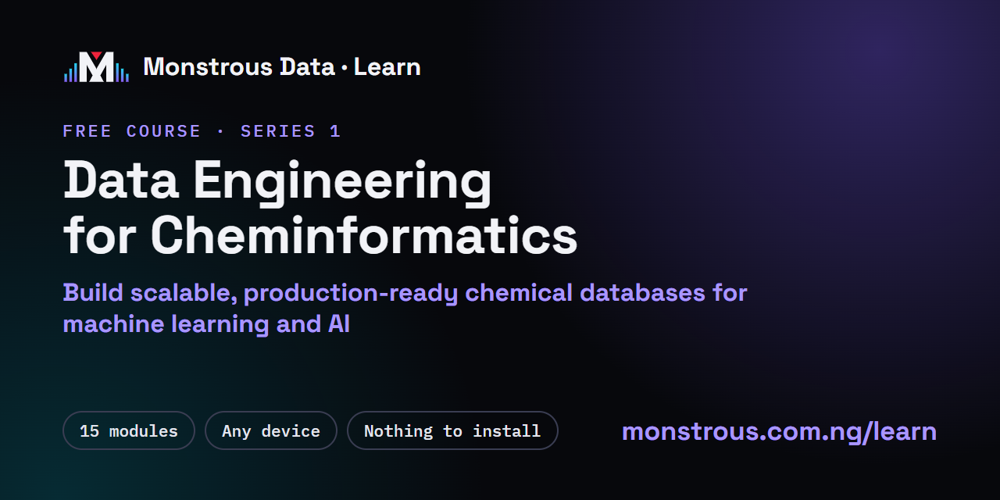

<p align="center">
  <a href="https://monstrous.com.ng/learn/"></a>
</p>

<p align="center">
  <a href="https://monstrous.com.ng/learn/"></a>
  <a href="https://monstrous.com.ng/learn/start/"></a>
  <a href="https://github.com/David-Alobo/monstrous-learn/actions/workflows/ci.yml"></a>
  
  <a href="LICENSE"></a>
  <a href="LICENSE-content"></a>
</p>

Free, practical courses in data engineering for science, from [Monstrous Data](https://monstrous.com.ng).
They are for anyone in pharma, R&D or research who works with chemical data, and for anyone moving
into a data career in science: cheminformatics, bioinformatics, data engineering and more.

Every term is explained as it comes up, and every output shown in a lesson is what its code really
prints: the tests run each example before it is published.

## Start in one minute

Pick whichever suits you. Only the last one needs anything installed.

| | How | You need |
|---|---|---|
| 📖 **Read** | Open the [course pages](https://monstrous.com.ng/learn/) on any phone, tablet or laptop | A browser |
| ▶️ **Run in the browser** | Click **Open in Colab** next to any module below, then run the cells from the top | A free Google account |
| 💻 **Run on your computer** | Follow [Start here](https://monstrous.com.ng/learn/start/): Jupyter, Anaconda or a terminal, on Windows, macOS or Linux | Python 3.11 |

Already at home in a terminal? With [uv](https://docs.astral.sh/uv/) and Git:

```bash
git clone https://github.com/David-Alobo/monstrous-learn.git
cd monstrous-learn/data-engineering/series-1
uv sync
uv run python 01-graphs-and-matrices/code.py
```

The modules that use a database (PostgreSQL or Neo4j) run it in Docker; the
[database guide](https://monstrous.com.ng/learn/databases/) walks through it step by step.

## What you will build

Series 1, **Data Engineering for Cheminformatics**, takes chemical data from loose files to a
pipeline you could run in production:

- **Represent** molecules as graphs, matrices, text and fingerprints, and know what each keeps
- **Read** SMILES, SDF, CSV and Parquet, and give every molecule a stable identity
- **Store** them in relational (PostgreSQL with RDKit) and graph (Neo4j) databases
- **Check and clean** every molecule and every table, with tests
- **Scale** to libraries larger than memory, across cores and machines
- **Make it production-ready:** recovery from failure, incremental ingestion, versioning and
  monitoring

## Modules

<!-- modules:start (written by python -m shared.site.build) -->

**Series 1: Data Engineering for Cheminformatics**

| # | Module | Read or run it |
|---|---|---|
| 1 | [Molecules as graphs and matrices](data-engineering/series-1/01-graphs-and-matrices/) | [Read the lesson](https://monstrous.com.ng/learn/data-engineering/series-1/01-graphs-and-matrices/) · [](https://colab.research.google.com/github/David-Alobo/monstrous-learn/blob/main/data-engineering/series-1/01-graphs-and-matrices/notebook.ipynb) |
| 2 | [Molecules as text, patterns and numbers](data-engineering/series-1/02-text-patterns-and-numbers/) | [Read the lesson](https://monstrous.com.ng/learn/data-engineering/series-1/02-text-patterns-and-numbers/) · [](https://colab.research.google.com/github/David-Alobo/monstrous-learn/blob/main/data-engineering/series-1/02-text-patterns-and-numbers/notebook.ipynb) |
| 3 | [Chemical files and identity](data-engineering/series-1/03-files-and-identity/) | [Read the lesson](https://monstrous.com.ng/learn/data-engineering/series-1/03-files-and-identity/) · [](https://colab.research.google.com/github/David-Alobo/monstrous-learn/blob/main/data-engineering/series-1/03-files-and-identity/notebook.ipynb) |
| 4 | [Databases, schemas and a chemical database](data-engineering/series-1/04-databases-and-schemas/) | [Read the lesson](https://monstrous.com.ng/learn/data-engineering/series-1/04-databases-and-schemas/) · [](https://colab.research.google.com/github/David-Alobo/monstrous-learn/blob/main/data-engineering/series-1/04-databases-and-schemas/notebook.ipynb) |
| 5 | [Molecules as graphs, and graph databases](data-engineering/series-1/05-graphs-and-graph-databases/) | [Read the lesson](https://monstrous.com.ng/learn/data-engineering/series-1/05-graphs-and-graph-databases/) · [](https://colab.research.google.com/github/David-Alobo/monstrous-learn/blob/main/data-engineering/series-1/05-graphs-and-graph-databases/notebook.ipynb) |
| 6 | [Validating molecules](data-engineering/series-1/06-validating-molecules/) | [Read the lesson](https://monstrous.com.ng/learn/data-engineering/series-1/06-validating-molecules/) · [](https://colab.research.google.com/github/David-Alobo/monstrous-learn/blob/main/data-engineering/series-1/06-validating-molecules/notebook.ipynb) |
| 7 | [Standardisation as a tested transformation](data-engineering/series-1/07-standardisation/) | [Read the lesson](https://monstrous.com.ng/learn/data-engineering/series-1/07-standardisation/) · [](https://colab.research.google.com/github/David-Alobo/monstrous-learn/blob/main/data-engineering/series-1/07-standardisation/notebook.ipynb) |
| 8 | [Libraries larger than memory](data-engineering/series-1/08-larger-than-memory/) | [Read the lesson](https://monstrous.com.ng/learn/data-engineering/series-1/08-larger-than-memory/) · [](https://colab.research.google.com/github/David-Alobo/monstrous-learn/blob/main/data-engineering/series-1/08-larger-than-memory/notebook.ipynb) |
| 9 | [Parallel and distributed processing](data-engineering/series-1/09-parallel-and-distributed/) | [Read the lesson](https://monstrous.com.ng/learn/data-engineering/series-1/09-parallel-and-distributed/) · [](https://colab.research.google.com/github/David-Alobo/monstrous-learn/blob/main/data-engineering/series-1/09-parallel-and-distributed/notebook.ipynb) |
| 10 | [Pipelines that survive failure](data-engineering/series-1/10-pipelines-that-survive-failure/) | [Read the lesson](https://monstrous.com.ng/learn/data-engineering/series-1/10-pipelines-that-survive-failure/) · [](https://colab.research.google.com/github/David-Alobo/monstrous-learn/blob/main/data-engineering/series-1/10-pipelines-that-survive-failure/notebook.ipynb) |
| 11 | [Incremental ingestion from ChEMBL and PubChem](data-engineering/series-1/11-incremental-ingestion/) | [Read the lesson](https://monstrous.com.ng/learn/data-engineering/series-1/11-incremental-ingestion/) · [](https://colab.research.google.com/github/David-Alobo/monstrous-learn/blob/main/data-engineering/series-1/11-incremental-ingestion/notebook.ipynb) |
| 12 | [Validating data: records with Pydantic, tables with Pandera](data-engineering/series-1/12-validating-data/) | [Read the lesson](https://monstrous.com.ng/learn/data-engineering/series-1/12-validating-data/) · [](https://colab.research.google.com/github/David-Alobo/monstrous-learn/blob/main/data-engineering/series-1/12-validating-data/notebook.ipynb) |
| 13 | [Versioning everything](data-engineering/series-1/13-versioning-everything/) | [Read the lesson](https://monstrous.com.ng/learn/data-engineering/series-1/13-versioning-everything/) · [](https://colab.research.google.com/github/David-Alobo/monstrous-learn/blob/main/data-engineering/series-1/13-versioning-everything/notebook.ipynb) |
| 14 | [Monitoring pipelines](data-engineering/series-1/14-monitoring-pipelines/) | [Read the lesson](https://monstrous.com.ng/learn/data-engineering/series-1/14-monitoring-pipelines/) · [](https://colab.research.google.com/github/David-Alobo/monstrous-learn/blob/main/data-engineering/series-1/14-monitoring-pipelines/notebook.ipynb) |
| 15 | [Capstone: a resumable, monitored pipeline over a large library](data-engineering/series-1/15-capstone/) | [Read the lesson](https://monstrous.com.ng/learn/data-engineering/series-1/15-capstone/) · [](https://colab.research.google.com/github/David-Alobo/monstrous-learn/blob/main/data-engineering/series-1/15-capstone/notebook.ipynb) |

**Series 2: The Modern Data Stack for Chemistry**

| # | Module | Read or run it |
|---|---|---|
| 1 | [Designing a lab data architecture](data-engineering/series-2/01-lab-data-architecture/) | [Read the lesson](https://monstrous.com.ng/learn/data-engineering/series-2/01-lab-data-architecture/) · [](https://colab.research.google.com/github/David-Alobo/monstrous-learn/blob/main/data-engineering/series-2/01-lab-data-architecture/notebook.ipynb) |
| 2 | [Declarative ingestion](data-engineering/series-2/02-declarative-ingestion/) | [Read the lesson](https://monstrous.com.ng/learn/data-engineering/series-2/02-declarative-ingestion/) · [](https://colab.research.google.com/github/David-Alobo/monstrous-learn/blob/main/data-engineering/series-2/02-declarative-ingestion/notebook.ipynb) |
| 3 | [Modelling the warehouse](data-engineering/series-2/03-modelling-the-warehouse/) | [Read the lesson](https://monstrous.com.ng/learn/data-engineering/series-2/03-modelling-the-warehouse/) · [](https://colab.research.google.com/github/David-Alobo/monstrous-learn/blob/main/data-engineering/series-2/03-modelling-the-warehouse/notebook.ipynb) |
| 4 | [Transformations with lineage](data-engineering/series-2/04-transformations-with-lineage/) | [Read the lesson](https://monstrous.com.ng/learn/data-engineering/series-2/04-transformations-with-lineage/) · [](https://colab.research.google.com/github/David-Alobo/monstrous-learn/blob/main/data-engineering/series-2/04-transformations-with-lineage/notebook.ipynb) |
| 5 | [Tests and contracts in the warehouse](data-engineering/series-2/05-tests-and-contracts/) | [Read the lesson](https://monstrous.com.ng/learn/data-engineering/series-2/05-tests-and-contracts/) · [](https://colab.research.google.com/github/David-Alobo/monstrous-learn/blob/main/data-engineering/series-2/05-tests-and-contracts/notebook.ipynb) |
| 6 | [History and corrections](data-engineering/series-2/06-history-and-corrections/) | [Read the lesson](https://monstrous.com.ng/learn/data-engineering/series-2/06-history-and-corrections/) · [](https://colab.research.google.com/github/David-Alobo/monstrous-learn/blob/main/data-engineering/series-2/06-history-and-corrections/notebook.ipynb) |
| 7 | [Orchestration](data-engineering/series-2/07-orchestration/) | [Read the lesson](https://monstrous.com.ng/learn/data-engineering/series-2/07-orchestration/) · [](https://colab.research.google.com/github/David-Alobo/monstrous-learn/blob/main/data-engineering/series-2/07-orchestration/notebook.ipynb) |
| 8 | [Observability](data-engineering/series-2/08-observability/) | [Read the lesson](https://monstrous.com.ng/learn/data-engineering/series-2/08-observability/) · [](https://colab.research.google.com/github/David-Alobo/monstrous-learn/blob/main/data-engineering/series-2/08-observability/notebook.ipynb) |
| 9 | [Continuous integration for data](data-engineering/series-2/09-continuous-integration/) | [Read the lesson](https://monstrous.com.ng/learn/data-engineering/series-2/09-continuous-integration/) · [](https://colab.research.google.com/github/David-Alobo/monstrous-learn/blob/main/data-engineering/series-2/09-continuous-integration/notebook.ipynb) |
| 10 | [Structure-activity dashboards](data-engineering/series-2/10-structure-activity-dashboards/) | [Read the lesson](https://monstrous.com.ng/learn/data-engineering/series-2/10-structure-activity-dashboards/) · [](https://colab.research.google.com/github/David-Alobo/monstrous-learn/blob/main/data-engineering/series-2/10-structure-activity-dashboards/notebook.ipynb) |
| 11 | [Capstone: a running data stack for a small lab](data-engineering/series-2/11-capstone/) | [Read the lesson](https://monstrous.com.ng/learn/data-engineering/series-2/11-capstone/) · [](https://colab.research.google.com/github/David-Alobo/monstrous-learn/blob/main/data-engineering/series-2/11-capstone/notebook.ipynb) |

<!-- modules:end -->

Each module folder holds the lesson, a notebook, the code on its own and the homework. The full
outline, with the tools each module uses, is in the [Series 1 README](data-engineering/series-1/).

## All the courses

| Track | Courses | Status |
|---|---|---|
| [Data Engineering for Chemistry](data-engineering/) | Series 1: Data Engineering for Cheminformatics · Series 2: The Modern Data Stack for Chemistry · Series 3: Data Pipelines for Digital and Autonomous Chemistry | Series 1 cohort starts January 2027 |
| [MLOps for Chemists](mlops/) | Outline to follow | Coming later |
| [Agentic AI in Chemistry](agentic-ai/) | Outline to follow | Coming later |

We start with the data, because models and agents are only as good as the data behind them.

**How a cohort runs.** A cohort starts on a set date and takes one module a week, with homework, a
community and a peer-reviewed capstone that earns a certificate. Every module stays open to follow at
your own pace. [Join the waitlist](https://monstrous.com.ng/learn/waitlist/) to hear when the next
one starts.

## Questions and help

- **Stuck on a step?** Read [Start here](https://monstrous.com.ng/learn/start/) and the
  [database guide](https://monstrous.com.ng/learn/databases/) first; most problems are covered there.
- **Found an error in a lesson?** [Report it](https://github.com/David-Alobo/monstrous-learn/issues/new/choose)
  with the "Error in a lesson" form.
- **Have an idea?** Use the "Suggestion" form, or write to
  [contact@monstrous.com.ng](mailto:contact@monstrous.com.ng).

If the course helps you, ⭐ **star this repository**: it helps other people find it.

## Contributing

Corrections and improvements are welcome. [CONTRIBUTING.md](CONTRIBUTING.md) explains how the lessons
are built and tested, and [MAINTAINING.md](MAINTAINING.md) covers the course site and releases.
Everyone taking part follows the [code of conduct](CODE_OF_CONDUCT.md).

## Licences

- Code: MIT ([LICENSE](LICENSE)).
- Lesson text and figures: Creative Commons Attribution 4.0 ([LICENSE-content](LICENSE-content)).
- Datasets keep their own licences, named in each module.
