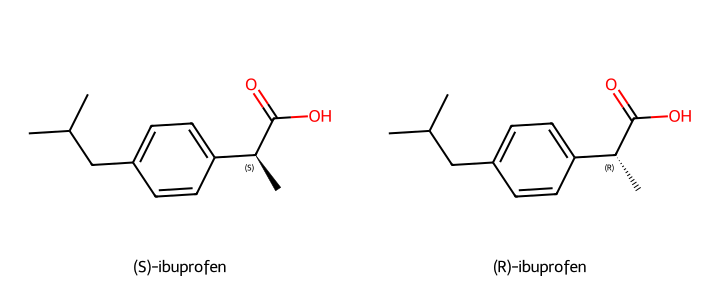
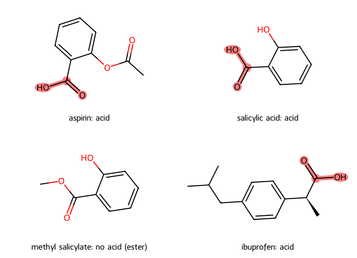
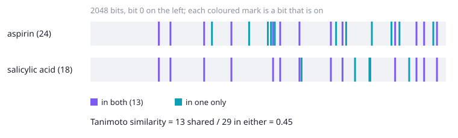

Module 1 treated a molecule as a graph. Most chemical data does not arrive as graphs, though: it
arrives as text (SMILES strings, InChIs, SDF files), is searched with patterns, and is compared and
modelled as numbers. Each of these representations keeps some things and loses others, and a data
engineer has to know which, before choosing what to store.

By the end of this module you will be able to:

- explain why one molecule has many SMILES but one canonical SMILES;
- tell what a representation keeps and what it loses (stereochemistry, aromaticity, tautomers);
- use InChIKey as a molecule's identity, and SMARTS as a search pattern;
- turn molecules into fingerprints and descriptors for comparison and machine learning;
- choose what to store, for which job.

Everything here runs in a browser notebook or on any laptop: you need Python, RDKit and pandas.
We start from aspirin again:

```python
from rdkit import Chem

aspirin = Chem.MolFromSmiles("CC(=O)Oc1ccccc1C(=O)O")
```

## 1. SMILES: one molecule, many strings

SMILES writes the graph as a line of text by walking through it. There are many valid walks, so
one molecule has many SMILES. RDKit's **canonical SMILES** always picks the same one, which makes
it usable for comparing molecules:

```python
for smiles in ["OCC", "CCO", "C(O)C", "[CH3][CH2][OH]"]:
    canonical = Chem.MolToSmiles(Chem.MolFromSmiles(smiles))
    print(f"{smiles:16} -> {canonical}")
```
```output
OCC              -> CCO
CCO              -> CCO
C(O)C            -> CCO
[CH3][CH2][OH]   -> CCO
```

Canonical means canonical *for one toolkit and version*: another program, or another RDKit
release, may choose a different canonical form. That is why a database needs an identity that does
not depend on the toolkit (section 3).

**Aromaticity** is a choice too. Benzene can be written with alternating double bonds (Kekulé) or
with aromatic lower-case atoms; RDKit perceives the aromatic form when it reads the molecule:

```python
benzene = Chem.MolFromSmiles("C1=CC=CC=C1")
print("as read:   ", Chem.MolToSmiles(benzene))
Chem.Kekulize(benzene, clearAromaticFlags=True)
print("kekulised: ", Chem.MolToSmiles(benzene))
```
```output
as read:    c1ccccc1
kekulised:  C1=CC=CC=C1
```

Different toolkits perceive aromaticity by different rules, so the same file can give different
aromatic forms in different programs: one more reason to standardise before storing (Module 7).

## 2. What a representation can lose: stereochemistry

Ibuprofen has one stereocentre. The two mirror images (enantiomers) are different molecules with
different biology, and isomeric SMILES keeps them apart with `@` and `@@`:



```python
s_ibuprofen = Chem.MolFromSmiles("CC(C)Cc1ccc(cc1)[C@H](C)C(=O)O")
r_ibuprofen = Chem.MolFromSmiles("CC(C)Cc1ccc(cc1)[C@@H](C)C(=O)O")
print("S:", Chem.FindMolChiralCenters(s_ibuprofen), Chem.MolToSmiles(s_ibuprofen))
print("R:", Chem.FindMolChiralCenters(r_ibuprofen), Chem.MolToSmiles(r_ibuprofen))
```
```output
S: [(10, 'S')] CC(C)Cc1ccc([C@H](C)C(=O)O)cc1
R: [(10, 'R')] CC(C)Cc1ccc([C@@H](C)C(=O)O)cc1
```

Ask for SMILES without stereochemistry, and the two collapse into one:

```python
def flat(mol):
    return Chem.MolToSmiles(mol, isomericSmiles=False)


print("isomeric SMILES equal:", Chem.MolToSmiles(s_ibuprofen) == Chem.MolToSmiles(r_ibuprofen))
print("flat SMILES equal:    ", flat(s_ibuprofen) == flat(r_ibuprofen))
print("flat:", flat(s_ibuprofen))
```
```output
isomeric SMILES equal: False
flat SMILES equal:     True
flat: CC(C)Cc1ccc(C(C)C(=O)O)cc1
```

Store the flat form and your database silently merges two different drugs. Sometimes that is what
you want (grouping a racemate with its enantiomers), but it must be a decision, never an accident.

## 3. InChI and InChIKey: an identity for every molecule

The **InChI** (IUPAC International Chemical Identifier) is a standard, open, layered description
of a molecule, produced the same way by every program that uses the official software. The
**InChIKey** is a fixed-length, 27-character hash of it: short enough to index, search and join on.

```python
print(Chem.MolToInchi(aspirin))
print(Chem.MolToInchiKey(aspirin))
```
```output
InChI=1S/C9H8O4/c1-6(10)13-8-5-3-2-4-7(8)9(11)12/h2-5H,1H3,(H,11,12)
BSYNRYMUTXBXSQ-UHFFFAOYSA-N
```

The key has three blocks. The first 14 letters encode the connectivity (the skeleton). The next
block has 8 letters for stereochemistry and the other layers, then `S` (a standard InChI) and `A`
(version 1). The last letter records protonation (`N` for neutral). So the two ibuprofen
enantiomers share the first block and differ in the second:

```python
for name, mol in [("S", s_ibuprofen), ("R", r_ibuprofen)]:
    key = Chem.MolToInchiKey(mol)
    print(name, key, "  skeleton:", key[:14])
```
```output
S HEFNNWSXXWATRW-JTQLQIEISA-N   skeleton: HEFNNWSXXWATRW
R HEFNNWSXXWATRW-SNVBAGLBSA-N   skeleton: HEFNNWSXXWATRW
```

Grouping on the first 14 letters finds every stereoisomer of a structure; joining on the whole key
keeps them apart. Standard InChI also treats some mobile hydrogens as one, so certain tautomers
share a key, which is usually what a database wants:

```python
pyridone = Chem.MolFromSmiles("O=c1cccc[nH]1")
hydroxypyridine = Chem.MolFromSmiles("Oc1ccccn1")
print("SMILES equal:  ", Chem.MolToSmiles(pyridone) == Chem.MolToSmiles(hydroxypyridine))
print("InChIKey equal:", Chem.MolToInchiKey(pyridone) == Chem.MolToInchiKey(hydroxypyridine))
```
```output
SMILES equal:   False
InChIKey equal: True
```

InChIKeys are hashes, so two different molecules could in principle share one; in practice
collisions are extremely rare, but a careful pipeline keeps the full InChI or SMILES beside the key.

## 4. Molfiles and SDF: the connection table

Before SMILES there were **connection tables**: a list of atoms (with coordinates) and a list of
bonds between them. The MDL molfile is the classic format, and an SDF file is many molfiles one after
another, each with optional data fields. Most compound libraries and vendor catalogues arrive as SDF.

```python
ethanol = Chem.MolFromSmiles("CCO")
print(Chem.MolToMolBlock(ethanol))
```
```output

     RDKit          2D

  3  2  0  0  0  0  0  0  0  0999 V2000
    0.0000    0.0000    0.0000 C   0  0  0  0  0  0  0  0  0  0  0  0
    1.2990    0.7500    0.0000 C   0  0  0  0  0  0  0  0  0  0  0  0
    2.5981   -0.0000    0.0000 O   0  0  0  0  0  0  0  0  0  0  0  0
  1  2  1  0
  2  3  1  0
M  END

```

Read it as a table: the counts line (3 atoms, 2 bonds), three atom lines (x, y, z, element) and two
bond lines (atom, atom, bond order). Unlike SMILES, a molfile carries coordinates, which also means
it is much larger: Module 3 measures what each format costs.

## 5. Three dimensions: conformers

Real molecules are three-dimensional and flexible. RDKit can generate 3D shapes (conformers), but
one molecule has many, and which you get depends on the method and the random seed:

```python
from rdkit.Chem import AllChem

with_h = Chem.AddHs(aspirin)
ids = AllChem.EmbedMultipleConfs(with_h, numConfs=5, randomSeed=42)
print(len(ids), "conformers of", with_h.GetNumAtoms(), "atoms (hydrogens included)")
print(
    "same atoms, different coordinates:",
    with_h.GetConformer(0).GetAtomPosition(0).x != with_h.GetConformer(1).GetAtomPosition(0).x,
)
```
```output
5 conformers of 21 atoms (hydrogens included)
same atoms, different coordinates: True
```

So 3D coordinates are not an identity: store them, when a job needs them (docking, shape
searches), as data *about* a molecule, never as the molecule's key.

## 6. SMARTS: patterns, not molecules

**SMARTS** describes a pattern to search for, not a molecule. A common mistake is to search with a
molecule written as SMILES. `C(=O)O` read as a molecule matches any carbon double-bonded to one
oxygen and single-bonded to another: carboxylic acids, but also esters. The SMARTS
`[CX3](=O)[OX2H1]` asks for that oxygen to carry a hydrogen, so it finds acids only:



```python
library = {
    "aspirin": aspirin,
    "salicylic acid": Chem.MolFromSmiles("O=C(O)c1ccccc1O"),
    "methyl salicylate": Chem.MolFromSmiles("COC(=O)c1ccccc1O"),
    "ibuprofen": s_ibuprofen,
}
as_molecule = Chem.MolFromSmiles("C(=O)O")
acid = Chem.MolFromSmarts("[CX3](=O)[OX2H1]")
for name, mol in library.items():
    print(
        f"{name:18} C(=O)O as a molecule: {mol.HasSubstructMatch(as_molecule)!s:5}  "
        f"acid SMARTS: {mol.HasSubstructMatch(acid)}"
    )
```
```output
aspirin            C(=O)O as a molecule: True   acid SMARTS: True
salicylic acid     C(=O)O as a molecule: True   acid SMARTS: True
methyl salicylate  C(=O)O as a molecule: True   acid SMARTS: False
ibuprofen          C(=O)O as a molecule: True   acid SMARTS: True
```

Methyl salicylate is an ester, not an acid: only the SMARTS gets it right. Module 4 runs the same
searches inside the database.

## 7. Fingerprints: molecules as bits

To compare thousands of molecules quickly, we turn each into a **fingerprint**, a fixed-length
string of bits. A Morgan (circular, ECFP-like) fingerprint looks at every atom's surroundings out to
a radius, and sets a bit for each environment it finds. Similar molecules share many bits:



```python
from rdkit import DataStructs
from rdkit.Chem import rdFingerprintGenerator

morgan = rdFingerprintGenerator.GetMorganGenerator(radius=2, fpSize=2048)
fingerprints = {name: morgan.GetFingerprint(mol) for name, mol in library.items()}
print("bits set in aspirin:", fingerprints["aspirin"].GetNumOnBits(), "of 2048")
for name in ["salicylic acid", "methyl salicylate", "ibuprofen"]:
    similarity = DataStructs.TanimotoSimilarity(fingerprints["aspirin"], fingerprints[name])
    print(f"Tanimoto similarity, aspirin and {name}: {similarity:.2f}")
```
```output
bits set in aspirin: 24 of 2048
Tanimoto similarity, aspirin and salicylic acid: 0.45
Tanimoto similarity, aspirin and methyl salicylate: 0.35
Tanimoto similarity, aspirin and ibuprofen: 0.20
```

The **Tanimoto similarity** is the number of bits both have divided by the number either has. A
fingerprint cannot be turned back into a molecule, and two different molecules can share one: it is
for comparing and searching, not for identity.

## 8. Descriptors: molecules as numbers

**Descriptors** are numbers calculated from a molecule: molecular weight, logP (a predicted
partition coefficient), polar surface area, hydrogen-bond donors. They are what most machine-learning
models and most filters work with:

```python
from rdkit.Chem import Descriptors

print(f"{'molecule':18}{'MW':>8}{'logP':>7}{'TPSA':>7}{'HBD':>5}")
for name, mol in library.items():
    print(
        f"{name:18}{Descriptors.MolWt(mol):8.1f}{Descriptors.MolLogP(mol):7.2f}"
        f"{Descriptors.TPSA(mol):7.1f}{Descriptors.NumHDonors(mol):5d}"
    )
```
```output
molecule                MW   logP   TPSA  HBD
aspirin              180.2   1.31   63.6    1
salicylic acid       138.1   1.09   57.5    2
methyl salicylate    152.1   1.18   46.5    1
ibuprofen            206.3   3.07   37.3    1
```

Descriptors are calculated, so they depend on the toolkit and its version: store the version beside
them (Module 13 returns to this).

## 9. What to store, for which job

| Representation | Keeps | Loses | Use it for |
|---|---|---|---|
| Canonical isomeric SMILES | Connectivity, stereochemistry, charges | Coordinates; toolkit-specific | Readable storage, exchange, rebuilding the molecule |
| InChI / InChIKey | A standard identity, the same in every program | Readability (the key); some tautomer detail | Keys, joins, finding duplicates |
| Molfile / SDF | Coordinates, data fields | Compactness | Receiving and sending libraries; 3D work |
| Molecular graph | Atoms, bonds, structure | Nothing of the 2D structure; no coordinates | Graph algorithms, graph databases |
| Adjacency, distance and feature matrices | The graph and chosen atom properties, as numbers | Compactness (they grow with atoms squared) | Algorithms, graph neural networks; build them when needed |
| 3D conformers | Shape | Uniqueness | Docking, shape searches (as data, never as a key) |
| SMARTS | A pattern | It is not a molecule | Searching and filtering |
| Fingerprints | Local environments, as bits | Can't be reversed; not unique | Similarity search, clustering, machine learning |
| Descriptors | Chosen properties, as numbers | Structure | Filters, analysis, machine learning |

A sensible first table for a compound library, which the next modules build on:

```python
import pandas as pd

rows = []
for name, mol in library.items():
    rows.append(
        {
            "name": name,
            "inchikey": Chem.MolToInchiKey(mol),
            "smiles": Chem.MolToSmiles(mol),
            "mw": round(Descriptors.MolWt(mol), 2),
        }
    )
compounds = pd.DataFrame(rows)
print(compounds.to_string(index=False))
```
```output
             name                    inchikey                         smiles     mw
          aspirin BSYNRYMUTXBXSQ-UHFFFAOYSA-N          CC(=O)Oc1ccccc1C(=O)O 180.16
   salicylic acid YGSDEFSMJLZEOE-UHFFFAOYSA-N                O=C(O)c1ccccc1O 138.12
methyl salicylate OSWPMRLSEDHDFF-UHFFFAOYSA-N               COC(=O)c1ccccc1O 152.15
        ibuprofen HEFNNWSXXWATRW-JTQLQIEISA-N CC(C)Cc1ccc([C@H](C)C(=O)O)cc1 206.28
```

The InChIKey is the identity, the canonical isomeric SMILES rebuilds the molecule, and everything
else (fingerprints, descriptors, conformers) can be recalculated from it, as long as we record how.

## Try it yourself

The homework for this module is in `homework.md`: a few questions answered by running code like the
code above. Answers are published after the cohort's deadline.

## Further reading

- Weininger, D. (1988). SMILES, a chemical language and information system. 1. Introduction to
  methodology and encoding rules. *Journal of Chemical Information and Computer Sciences*, 28(1),
  31–36. <https://doi.org/10.1021/ci00057a005>
- Heller, S., McNaught, A., Pletnev, I., Stein, S. & Tchekhovskoi, D. (2015). InChI, the IUPAC
  International Chemical Identifier. *Journal of Cheminformatics*, 7, 23.
  <https://doi.org/10.1186/s13321-015-0068-4>
- Dalby, A. et al. (1992). Description of several chemical structure file formats used by computer
  programs developed at Molecular Design Limited. *Journal of Chemical Information and Computer
  Sciences*, 32(3), 244–255. <https://doi.org/10.1021/ci00007a012>
- Rogers, D. & Hahn, M. (2010). Extended-connectivity fingerprints. *Journal of Chemical
  Information and Modeling*, 50(5), 742–754. <https://doi.org/10.1021/ci100050t>
- David, L., Thakkar, A., Mercado, R. & Engkvist, O. (2020). Molecular representations in AI-driven
  drug discovery: a review and practical guide. *Journal of Cheminformatics*, 12, 56.
  <https://doi.org/10.1186/s13321-020-00460-5>
- Daylight Chemical Information Systems. *Daylight Theory Manual*, chapters on SMILES and SMARTS.
  <https://www.daylight.com/dayhtml/doc/theory/>
- The RDKit documentation. *Getting Started with the RDKit in Python*.
  <https://www.rdkit.org/docs/GettingStartedInPython.html>
