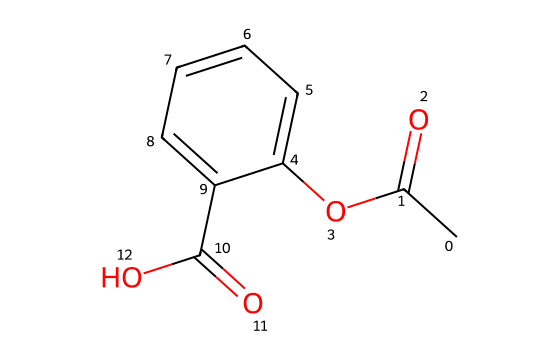
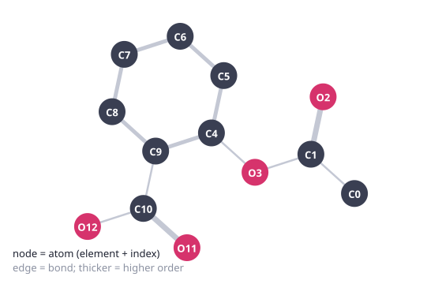
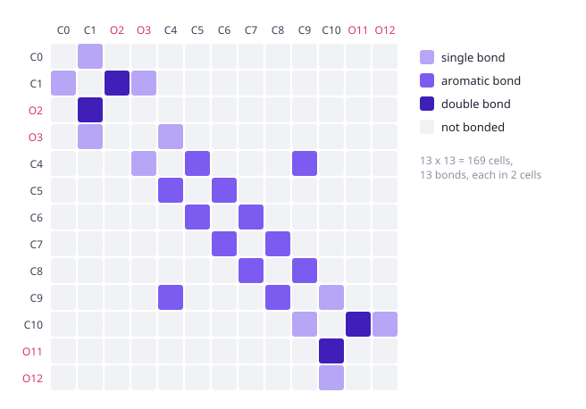

A chemist looks at a drawing and sees aspirin. A computer sees nothing until the molecule is
written down as text, numbers or a graph, and every way of writing it down keeps some things and
loses others. Data engineering for chemistry starts here: before we can store, search, clean or
scale anything, we have to decide what a molecule *is* inside our systems. This module starts with
the most fundamental answer: a molecule is a graph.

By the end of this module you will be able to:

- read a molecule into RDKit and walk through its atoms and bonds;
- build the same molecule as a NetworkX graph, with atom and bond properties;
- write it as matrices: adjacency, bond orders and distances;
- encode atom and bond properties as numbers: weights, one-hot features, bond tensors, edge lists;
- compute on molecules with NumPy: degrees, neighbours, walks, message passing and pieces.

Everything here runs in a browser notebook or on any laptop: you need Python, RDKit, NetworkX,
NumPy and pandas.

## Setup

Everything this lesson needs is imported and set here, so the settings can be changed in one place.
Pipeline steps report with `log`; `print` is kept for showing you results.

```python
import logging

import networkx as nx
import numpy as np
import pandas as pd
from rdkit import Chem

# log lines: level and message only, so the lesson's outputs are the same on every run
# (a real job would add "%(asctime)s" to the format)
logging.basicConfig(level=logging.INFO, format="%(levelname)s %(message)s", force=True)
log = logging.getLogger(__name__)

# elements that get their own one-hot column (section 2); every other element shares "other".
# Add "S", "F", "Cl" and so on for a drug-like library.
ELEMENTS = ["C", "N", "O"]
# RDKit's bond types, one layer of the bond tensor and one edge feature each (section 2)
BOND_TYPES = ["SINGLE", "DOUBLE", "TRIPLE", "AROMATIC"]
```

### Why log and not print

A script that reads a vendor file could report its progress with `print`. Pipeline code uses the
`logging` module instead, for four reasons:

- **Every line has a level.** `DEBUG` for detail while you develop, `INFO` for what a job did,
  `WARNING` for records it skipped, `ERROR` for failures. You choose how much to see by setting a
  level, without editing the code: everything while developing, warnings only in a nightly job.
- **Every line says where it came from.** Each logger has a name (usually the module it is in), and
  a real job adds a timestamp to every line, so you can tell which step wrote what, and when.
- **One line can go to many places.** Add handlers and the same line goes to the screen, a file
  and a monitoring system at once. `print` only reaches the screen, and when a job runs unattended
  overnight nobody is watching the screen.
- **Libraries already log.** RDKit, requests and Dask report through logging (or can be made to:
  Module 6 does it for RDKit, and shows how to turn its messages down or off), so your messages
  sit alongside theirs and are controlled the same way.

`print` stays useful for looking at results while you explore: a matrix, a table, a SMILES. The
rule in this course: if a line would still be wanted when the code runs unattended as a job, it is a
log line; if it is there to show you something, it is a print. Here are three lines at three
levels. The level was set to `INFO` above, so the `DEBUG` line is not shown:

```python
log.debug("atom 4 of aspirin has %d neighbours", 3)
log.info("read %d molecules from %s", 2_000, "vendor.sdf")
log.warning("skipped record %d: %s", 153, "valence error on atom 0")
```
```output
INFO read 2000 molecules from vendor.sdf
WARNING skipped record 153: valence error on atom 0
```

Raise the level to `WARNING`, as a nightly job might, and only the warning is left. The code that
logs has not changed:

```python
log.setLevel(logging.WARNING)
log.info("read %d molecules from %s", 2_000, "vendor.sdf")
log.warning("skipped record %d: %s", 153, "valence error on atom 0")
log.setLevel(logging.INFO)  # back to the lesson's level
```
```output
WARNING skipped record 153: valence error on atom 0
```

Module 14 builds on this to monitor whole pipelines.

## 1. A molecule is a graph

To RDKit, a molecule is a graph: **atoms are nodes and bonds are edges**. Hydrogens are usually
left implicit, so only the heavy atoms appear. Here is aspirin, with every atom numbered in the
order RDKit reads it:



```python
aspirin = Chem.MolFromSmiles("CC(=O)Oc1ccccc1C(=O)O")
print(aspirin.GetNumAtoms(), "heavy atoms,", aspirin.GetNumBonds(), "bonds")
for atom in list(aspirin.GetAtoms())[:5]:
    neighbours = [n.GetIdx() for n in atom.GetNeighbors()]
    print(f"atom {atom.GetIdx()}: {atom.GetSymbol()}, bonded to {neighbours}")
```
```output
13 heavy atoms, 13 bonds
atom 0: C, bonded to [1]
atom 1: C, bonded to [0, 2, 3]
atom 2: O, bonded to [1]
atom 3: O, bonded to [1, 4]
atom 4: C, bonded to [3, 5, 9]
```

The same molecule as a plain graph in NetworkX, the way a graph library or a graph database sees it.
Every node carries the atom's properties and every edge the bond's; the next section turns them
into numbers.



```python
def to_graph(mol: Chem.Mol) -> nx.Graph:
    """A molecule as a NetworkX graph: atoms as nodes, bonds as edges, each with its properties."""
    g = nx.Graph()
    for atom in mol.GetAtoms():
        g.add_node(
            atom.GetIdx(),
            element=atom.GetSymbol(),
            hydrogens=atom.GetTotalNumHs(),
            charge=atom.GetFormalCharge(),
            aromatic=atom.GetIsAromatic(),
        )
    for bond in mol.GetBonds():
        g.add_edge(
            bond.GetBeginAtomIdx(),
            bond.GetEndAtomIdx(),
            bond_type=str(bond.GetBondType()),
            order=bond.GetBondTypeAsDouble(),
        )
    return g


graph = to_graph(aspirin)
print(graph.number_of_nodes(), "nodes,", graph.number_of_edges(), "edges")
print("rings:", [sorted(ring) for ring in nx.cycle_basis(graph)])
print("bonds between the two carbonyl carbons:", nx.shortest_path_length(graph, 1, 10))
```
```output
13 nodes, 13 edges
rings: [[4, 5, 6, 7, 8, 9]]
bonds between the two carbonyl carbons: 4
```

Graph questions (rings, paths, which atoms are connected) are chemistry questions. Module 5 comes
back to this when we store molecules in a graph database.

## 2. Molecules as matrices

Algorithms, and graph neural networks in particular, see a molecule as matrices. NetworkX builds
them straight from the graph. The **adjacency matrix** has one row and one column per atom, with a
1 where two atoms are bonded. Here it is for acetic acid, each atom labelled by element and index,
checked against RDKit's own:

```python
acetic_acid = Chem.MolFromSmiles("CC(=O)O")
g = to_graph(acetic_acid)
atoms = sorted(g)
labels = [f"{g.nodes[i]['element']}{i}" for i in atoms]
adjacency = nx.to_numpy_array(g, nodelist=atoms, weight=None, dtype=int)
print(pd.DataFrame(adjacency, index=labels, columns=labels))
print("symmetric:", bool((adjacency == adjacency.T).all()))
print("bonds per atom (row sums):", adjacency.sum(axis=1).tolist())
print("same as RDKit's:", bool((adjacency == Chem.GetAdjacencyMatrix(acetic_acid)).all()))
```
```output
    C0  C1  O2  O3
C0   0   1   0   0
C1   1   0   1   1
O2   0   1   0   0
O3   0   1   0   0
symmetric: True
bonds per atom (row sums): [1, 3, 1, 1]
same as RDKit's: True
```

Bonds have no direction, so the matrix is symmetric, and each row adds up to the number of bonds
that atom makes (its degree). For aspirin the matrix is 13 by 13 and mostly zeros: each atom is
bonded to only a few others.



### Encoding a molecule's properties

A plain adjacency matrix says only *which* atoms are bonded. Chemistry needs more: what each atom
is, and what kind each bond is. There are four standard ways to put those properties into numbers.

**1. Weights in the matrix.** Put a number in each cell instead of a 1. With the bond order as the
weight, the cells read 1, 1.5 (aromatic), 2 or 3:

```python
orders = nx.to_numpy_array(g, nodelist=atoms, weight="order")
print(pd.DataFrame(orders, index=labels, columns=labels))
```
```output
     C0   C1   O2   O3
C0  0.0  1.0  0.0  0.0
C1  1.0  0.0  2.0  1.0
O2  0.0  2.0  0.0  0.0
O3  0.0  1.0  0.0  0.0
```

One number per cell can carry one property only, so the other properties go beside the matrix.

**2. An atom feature matrix.** One row per atom, one column per property. Numbers (charge,
hydrogens) go in as numbers; categories (the element) are **one-hot encoded**, one column per
category with a 1 in the right one, so that a model never reads "oxygen = 8" as "more than carbon".
The elements that get a column are `ELEMENTS`, set in the Setup block:

```python
def atom_features(data: dict) -> list[int]:
    """One row of the atom feature matrix: one-hot element, then hydrogens, charge, aromatic."""
    element = [int(data["element"] == e) for e in ELEMENTS]
    other = int(data["element"] not in ELEMENTS)
    return [*element, other, data["hydrogens"], data["charge"], int(data["aromatic"])]


columns = [*ELEMENTS, "other", "hydrogens", "charge", "aromatic"]
X = np.array([atom_features(g.nodes[i]) for i in atoms])
print(pd.DataFrame(X, index=labels, columns=columns))
```
```output
    C  N  O  other  hydrogens  charge  aromatic
C0  1  0  0      0          3       0         0
C1  1  0  0      0          0       0         0
O2  0  0  1      0          0       0         0
O3  0  0  1      0          1       0         0
```

**3. A bond tensor: one adjacency matrix per bond type.** Stack one matrix for single bonds, one
for double, one for triple, one for aromatic. Each "layer" is an ordinary adjacency matrix, and
together they say exactly which kind of bond joins which atoms (the layers are `BOND_TYPES`, from
the Setup block):

```python
tensor = np.zeros((len(BOND_TYPES), len(atoms), len(atoms)), dtype=int)
for i, j, data in g.edges(data=True):
    k = BOND_TYPES.index(data["bond_type"])
    tensor[k, i, j] = tensor[k, j, i] = 1
for name, layer in zip(BOND_TYPES[:2], tensor[:2], strict=True):
    print(f"{name} bonds:")
    print(pd.DataFrame(layer, index=labels, columns=labels))
print("shape of the bond tensor (types, atoms, atoms):", tensor.shape)
```
```output
SINGLE bonds:
    C0  C1  O2  O3
C0   0   1   0   0
C1   1   0   0   1
O2   0   0   0   0
O3   0   1   0   0
DOUBLE bonds:
    C0  C1  O2  O3
C0   0   0   0   0
C1   0   0   1   0
O2   0   1   0   0
O3   0   0   0   0
shape of the bond tensor (types, atoms, atoms): (4, 4, 4)
```

**4. An edge list with edge features.** Instead of n-by-n matrices, list each bond once in each
direction, with a row of features per entry. This is what graph neural network libraries take: it
grows with the bonds, not with the square of the atoms:

```python
pairs = [(i, j) for i, j in g.edges()] + [(j, i) for i, j in g.edges()]
edge_index = np.array(pairs).T
edge_features = np.array(
    [[int(g.edges[i, j]["bond_type"] == t) for t in BOND_TYPES] for i, j in pairs]
)
print("edge index (from, to):")
print(edge_index)
print("edge features (one-hot bond type):")
print(pd.DataFrame(edge_features, columns=BOND_TYPES, index=[f"{i}-{j}" for i, j in pairs]))
```
```output
edge index (from, to):
[[0 1 1 1 2 3]
 [1 2 3 0 1 1]]
edge features (one-hot bond type):
     SINGLE  DOUBLE  TRIPLE  AROMATIC
0-1       1       0       0         0
1-2       0       1       0         0
1-3       1       0       0         0
1-0       1       0       0         0
2-1       0       1       0         0
3-1       1       0       0         0
```

Together, the atom feature matrix `X` and either the bond tensor or the edge list with its features
describe the whole molecule as numbers. The MLOps track builds models on exactly these.

### Distances

The **distance matrix** counts the bonds on the shortest path between every pair of atoms.
NetworkX and RDKit give the same answer:

```python
aspirin_graph = to_graph(aspirin)
distances = nx.floyd_warshall_numpy(aspirin_graph, nodelist=sorted(aspirin_graph))
print("bonds between the two carbonyl carbons:", int(distances[1, 10]))
print("the two atoms furthest apart are", int(distances.max()), "bonds apart")
print("same as RDKit's:", bool((distances == Chem.GetDistanceMatrix(aspirin)).all()))
```
```output
bonds between the two carbonyl carbons: 4
the two atoms furthest apart are 6 bonds apart
same as RDKit's: True
```

### Graph operations with NumPy

Once a molecule is a matrix, graph questions become arithmetic. With aspirin's adjacency matrix
`A`, row sums give each atom's degree and the non-zero entries of a row are its neighbours. Squaring
the matrix counts routes: `(A @ A)[i, j]` is the number of two-bond walks from atom `i` to atom `j`,
and its diagonal gives the degrees back:

```python
A = nx.to_numpy_array(aspirin_graph, nodelist=sorted(aspirin_graph), weight=None, dtype=int)
print("degrees:", A.sum(axis=1).tolist())
print("neighbours of atom 4:", np.nonzero(A[4])[0].tolist())
A2 = A @ A
print("two-bond walks from atom 1 to atom 4:", int(A2[1, 4]))
print("diagonal of A @ A equals the degrees:", bool((np.diag(A2) == A.sum(axis=1)).all()))
```
```output
degrees: [1, 3, 1, 2, 3, 2, 2, 2, 2, 3, 3, 1, 1]
neighbours of atom 4: [3, 5, 9]
two-bond walks from atom 1 to atom 4: 1
diagonal of A @ A equals the degrees: True
```

Multiplying the adjacency matrix by the atom feature matrix adds up each atom's neighbours'
features: after one step, every atom "knows" what it is bonded to. This is one round of **message
passing**, the core operation of graph neural networks, and the same idea a Morgan fingerprint uses
when it grows each atom's environment one bond at a time:

```python
aspirin_atoms = sorted(aspirin_graph)
aspirin_labels = [f"{aspirin_graph.nodes[i]['element']}{i}" for i in aspirin_atoms]
X_aspirin = np.array([atom_features(aspirin_graph.nodes[i]) for i in aspirin_atoms])
messages = A @ X_aspirin
print(pd.DataFrame(messages, index=aspirin_labels, columns=columns).head(5))
```
```output
    C  N  O  other  hydrogens  charge  aromatic
C0  1  0  0      0          0       0         0
C1  1  0  2      0          3       0         0
O2  1  0  0      0          0       0         0
O3  2  0  0      0          0       0         1
C4  2  0  1      0          1       0         2
```

Atom 1, the acetyl carbon, receives one carbon and two oxygens from its neighbours; atom 4 receives
two aromatic carbons and an oxygen.

The **graph Laplacian**, `L = D - A` (the degrees on the diagonal minus the adjacency matrix), has
one zero eigenvalue for every separate piece of a graph. A record of sodium acetate holds two pieces,
the acetate and the sodium ion, and the arithmetic finds both, a check Module 6 uses to spot salts
and mixtures:

```python
salt = Chem.MolFromSmiles("CC(=O)[O-].[Na+]")
A_salt = Chem.GetAdjacencyMatrix(salt)
laplacian = np.diag(A_salt.sum(axis=1)) - A_salt
eigenvalues = np.linalg.eigvalsh(laplacian)
print(
    "Laplacian eigenvalues:", (np.round(eigenvalues, 3) + 0.0).tolist()
)  # + 0.0 turns -0.0 into 0.0
print(
    "pieces:", int(np.isclose(eigenvalues, 0).sum()), " RDKit agrees:", len(Chem.GetMolFrags(salt))
)
```
```output
Laplacian eigenvalues: [0.0, 0.0, 1.0, 1.0, 4.0]
pieces: 2  RDKit agrees: 2
```

Matrices are convenient for computation but wasteful for storage: an adjacency matrix grows with
the square of the number of atoms, while a list of bonds grows only with the bonds. Store the
molecule (or its bond list) and build matrices when an algorithm needs them.

## Try it yourself

The homework for this module is in `homework.md`: a few questions answered by running code like the
code above. Answers are published after the cohort's deadline.

## Further reading

- Hagberg, A., Schult, D. & Swart, P. (2008). Exploring network structure, dynamics, and function
  using NetworkX. *Proceedings of the 7th Python in Science Conference (SciPy 2008)*.
  <https://proceedings.scipy.org/articles/TCWV9851>
- Harris, C. R. et al. (2020). Array programming with NumPy. *Nature*, 585(7825), 357–362.
  <https://doi.org/10.1038/s41586-020-2649-2>
- Gilmer, J., Schoenholz, S. S., Riley, P. F., Vinyals, O. & Dahl, G. E. (2017). Neural message
  passing for quantum chemistry. *Proceedings of the 34th International Conference on Machine
  Learning*. <https://arxiv.org/abs/1704.01212>
- David, L., Thakkar, A., Mercado, R. & Engkvist, O. (2020). Molecular representations in AI-driven
  drug discovery: a review and practical guide. *Journal of Cheminformatics*, 12, 56.
  <https://doi.org/10.1186/s13321-020-00460-5>
- The NetworkX documentation. <https://networkx.org/documentation/stable/>
- The Python documentation. *Logging HOWTO*. <https://docs.python.org/3/howto/logging.html>
- The RDKit documentation. *Getting Started with the RDKit in Python*.
  <https://www.rdkit.org/docs/GettingStartedInPython.html>
