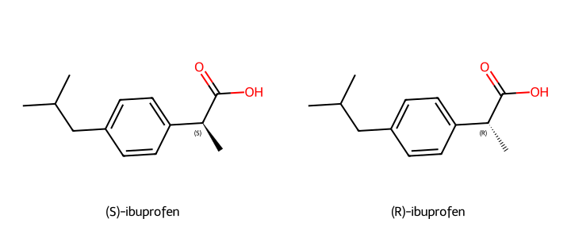
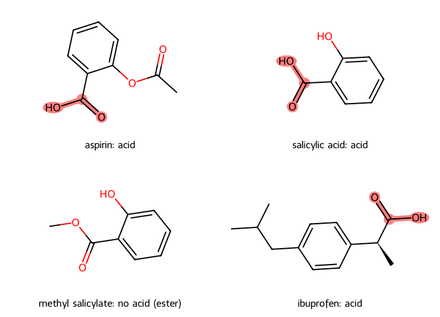
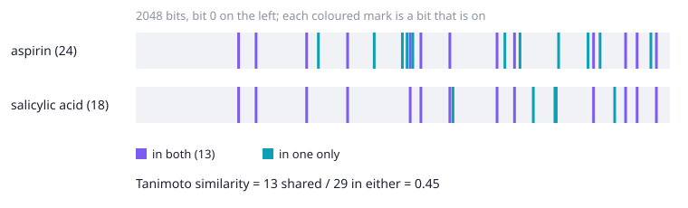

[Module 1](../01-graphs-and-matrices/) treated a molecule as a graph. Most chemical data does not
arrive as graphs, though. It arrives as text: SMILES strings, InChIs, SDF files. It is searched with
patterns, and it is compared and modelled as numbers. Each of these ways of writing a molecule down
(we call them **representations**) keeps some things and loses others. Before we choose what to
store, we have to know which.

By the end of this module you will be able to:

- explain why one molecule can be written as many different SMILES strings, and how RDKit picks one
  standard string for it (the **canonical** SMILES);
- tell what each representation keeps and what it loses, such as stereochemistry (which mirror image
  a molecule is), aromaticity and tautomers (forms that differ only in where a hydrogen sits);
- use an **InChIKey**, a short code calculated from the structure, as a molecule's identity, and a
  **SMARTS** pattern to search for a group such as a carboxylic acid;
- turn molecules into **fingerprints** (long strings of 0s and 1s) and **descriptors** (calculated
  numbers such as molecular weight), to compare them and to use them in models;
- choose which of these to store, for which job.

From Module 1 we use RDKit's `Chem.MolFromSmiles`, which reads a SMILES string into a molecule, and
the habit of reporting with `log` and showing values with `print`.

The lesson uses two Python packages:

- **RDKit**, the chemistry toolkit from Module 1. We load five of its parts: `Chem` (reading and
  writing molecules), `AllChem` (3D shapes), `rdFingerprintGenerator` (making fingerprints),
  `DataStructs` (comparing fingerprints) and `Descriptors` (calculated properties);
- **pandas**, for tables with named columns (used at the end to build a small compound table).

Everything here runs in a browser notebook or on any laptop.

## Setup

Run this block first. It loads the packages and sets the lesson's settings, written in CAPITALS, so
they can be changed in one place. As in Module 1, `log` reports what a job did and `print` shows you
values; [Module 1](../01-graphs-and-matrices/#why-log-and-not-print) explains why.

```python
import logging

import pandas as pd
from rdkit import Chem, DataStructs
from rdkit.Chem import AllChem, Descriptors, rdFingerprintGenerator

# log lines: level and message only, so the lesson's outputs are the same on every run
# (a real job would add "%(asctime)s" to the format)
logging.basicConfig(level=logging.INFO, format="%(levelname)s %(message)s", force=True)
log = logging.getLogger(__name__)

# conformers (section 5): how many to generate, and the random seed that makes them repeatable
N_CONFORMERS = 5
CONFORMER_SEED = 42
# Morgan fingerprints (section 7): radius 2 is ECFP4-like; 2048 bits is a common length
MORGAN_RADIUS = 2
MORGAN_BITS = 2048
```

We start from aspirin again:

```python
aspirin = Chem.MolFromSmiles("CC(=O)Oc1ccccc1C(=O)O")
```

## 1. SMILES: one molecule, many strings

**SMILES** (Simplified Molecular Input Line Entry System) writes the graph of Module 1 as a line of
text, by walking from atom to atom and writing down what it meets. The main rules:

- an atom is its element symbol: `C`, `N`, `O`, `Cl`. Hydrogens are left out and filled in by the
  usual valences, so `CCO` is ethanol, CH3-CH2-OH;
- lower-case letters (`c`, `n`, `o`) are aromatic atoms, so `c1ccccc1` is benzene;
- atoms written next to each other are joined by a single bond; `=` is a double bond and `#` a
  triple bond;
- brackets `( )` hold a branch: in `CC(=O)O` (acetic acid) the `=O` hangs off the second carbon and
  the walk then carries on to the last `O`;
- a matching pair of digits closes a ring: the two atoms marked `1` in `c1ccccc1` are bonded to
  each other;
- square brackets hold an atom written in full, with its hydrogens, charge or stereochemistry:
  `[CH3]`, `[O-]`, `[nH]`, `[C@H]`.

You can start the walk at any atom and take the branches in any order, so one molecule has many
valid SMILES. RDKit's **canonical SMILES** always picks the same one for a given molecule, which
makes it usable for comparing molecules. In the code, `{smiles:16}` inside the f-string pads the
text to 16 characters, so that the arrows line up:

```python
for smiles in ["OCC", "CCO", "C(O)C", "[CH3][CH2][OH]"]:
    canonical = Chem.MolToSmiles(Chem.MolFromSmiles(smiles))
    print(f"{smiles:16} -> {canonical}")
```
```output
OCC              -> CCO
CCO              -> CCO
C(O)C            -> CCO
[CH3][CH2][OH]   -> CCO
```

Canonical means canonical *for one toolkit and version*. (A **toolkit** is a chemistry program or
package such as RDKit.) Another program, or another RDKit release, may choose a different canonical
form. That is why a database needs an identity that does not depend on the toolkit (section 3).

**Aromaticity** is a choice too. Benzene can be written with alternating single and double bonds
(the Kekulé form, `C1=CC=CC=C1`) or with aromatic lower-case atoms (`c1ccccc1`). When RDKit reads a
molecule it decides which rings are aromatic (it *perceives* aromaticity), and writes them in lower
case. `Chem.Kekulize` turns the aromatic form back into alternating bonds:

```python
benzene = Chem.MolFromSmiles("C1=CC=CC=C1")
print("as read:   ", Chem.MolToSmiles(benzene))
Chem.Kekulize(benzene, clearAromaticFlags=True)
print("kekulised: ", Chem.MolToSmiles(benzene))
```
```output
as read:    c1ccccc1
kekulised:  C1=CC=CC=C1
```

Different toolkits perceive aromaticity by different rules, so the same file can give different
aromatic forms in different programs. That is one more reason to **standardise** before storing,
that is, to put every molecule into one agreed form (Module 7).

## 2. What a representation can lose: stereochemistry

Ibuprofen has one stereocentre: a carbon with four different groups on it. The two mirror images
(enantiomers, R and S) are different molecules with different biology. **Isomeric SMILES**, SMILES
that include stereochemistry, keeps them apart with `@` and `@@` inside the square brackets: they
say whether, looking from the first neighbour written towards the stereocentre, the other three
neighbours, in the order they are written, go round anticlockwise (`@`) or clockwise (`@@`). `Chem.FindMolChiralCenters` lists each stereocentre as its atom number and
its R or S label:



```python
s_ibuprofen = Chem.MolFromSmiles("CC(C)Cc1ccc(cc1)[C@H](C)C(=O)O")
r_ibuprofen = Chem.MolFromSmiles("CC(C)Cc1ccc(cc1)[C@@H](C)C(=O)O")
print("S:", Chem.FindMolChiralCenters(s_ibuprofen), Chem.MolToSmiles(s_ibuprofen))
print("R:", Chem.FindMolChiralCenters(r_ibuprofen), Chem.MolToSmiles(r_ibuprofen))
```
```output
S: [(10, 'S')] CC(C)Cc1ccc([C@H](C)C(=O)O)cc1
R: [(10, 'R')] CC(C)Cc1ccc([C@@H](C)C(=O)O)cc1
```

Ask for SMILES without stereochemistry, and the two collapse into one. The small function below
does that. In its first line, `mol: Chem.Mol` and `-> str` are **type hints**: notes that say the
function takes an RDKit molecule and returns a string (text). Python does not check them; they are
there for the reader:

```python
def flat(mol: Chem.Mol) -> str:
    """Canonical SMILES with the stereochemistry left out."""
    return Chem.MolToSmiles(mol, isomericSmiles=False)


print("isomeric SMILES equal:", Chem.MolToSmiles(s_ibuprofen) == Chem.MolToSmiles(r_ibuprofen))
print("flat SMILES equal:    ", flat(s_ibuprofen) == flat(r_ibuprofen))
print("flat:", flat(s_ibuprofen))
```
```output
isomeric SMILES equal: False
flat SMILES equal:     True
flat: CC(C)Cc1ccc(C(C)C(=O)O)cc1
```

Store the flat form and your database silently merges two different drugs. Sometimes that is what
you want (grouping a racemate, the 50:50 mixture, with its two enantiomers), but it must be a
decision, never an accident.

## 3. InChI and InChIKey: an identity for every molecule

The **InChI** (IUPAC International Chemical Identifier) is a standard, open description of a
molecule. It is written in layers separated by `/`: the formula, then the connections between atoms
(`c...`), then the hydrogens (`h...`), and further layers for charge and stereochemistry when there
are any. Every program that uses the official InChI software produces the same InChI for the same
molecule.

The **InChIKey** is a **hash** of the InChI: a code of fixed length (27 characters) calculated from
it. The same InChI always gives the same key, but the key cannot be turned back into the InChI. It is
short enough to use as a label in a database: to look a molecule up quickly, and to match rows of two
tables that share it (a *join*).

```python
print(Chem.MolToInchi(aspirin))
print(Chem.MolToInchiKey(aspirin))
```
```output
InChI=1S/C9H8O4/c1-6(10)13-8-5-3-2-4-7(8)9(11)12/h2-5H,1H3,(H,11,12)
BSYNRYMUTXBXSQ-UHFFFAOYSA-N
```

The key has three blocks. The first 14 letters encode the connectivity (the skeleton). The next
block has 8 letters for stereochemistry and the other layers, then `S` (a standard InChI) and `A`
(version 1). The last letter records protonation (`N` for neutral). So the two ibuprofen
enantiomers share the first block and differ in the second. `key[:14]` takes the first 14
characters of the key:

```python
for name, mol in [("S", s_ibuprofen), ("R", r_ibuprofen)]:
    key = Chem.MolToInchiKey(mol)
    print(name, key, "  skeleton:", key[:14])
```
```output
S HEFNNWSXXWATRW-JTQLQIEISA-N   skeleton: HEFNNWSXXWATRW
R HEFNNWSXXWATRW-SNVBAGLBSA-N   skeleton: HEFNNWSXXWATRW
```

Grouping on the first 14 letters finds every stereoisomer of a structure; joining on the whole key
keeps them apart.

**Tautomers** are forms of one compound that differ only in where a hydrogen sits (and so which
bonds are double), and that turn into each other easily: 2-pyridone and 2-hydroxypyridine are one
example. Standard InChI treats some of these mobile hydrogens as one, so certain tautomers share a
key, which is usually what a database wants. (In the SMILES below, `[nH]` is an aromatic nitrogen
that carries a hydrogen.)

```python
pyridone = Chem.MolFromSmiles("O=c1cccc[nH]1")
hydroxypyridine = Chem.MolFromSmiles("Oc1ccccn1")
print("SMILES equal:  ", Chem.MolToSmiles(pyridone) == Chem.MolToSmiles(hydroxypyridine))
print("InChIKey equal:", Chem.MolToInchiKey(pyridone) == Chem.MolToInchiKey(hydroxypyridine))
```
```output
SMILES equal:   False
InChIKey equal: True
```

InChIKeys are hashes, so two different molecules could in principle share one (a *collision*). In
practice collisions are extremely rare, but a careful pipeline keeps the full InChI or SMILES beside
the key.

## 4. Molfiles and SDF: the connection table

Before SMILES there were **connection tables**: a list of atoms (with coordinates) and a list of
bonds between them. The **molfile**, from the company MDL, is the classic format. An **SDF**
(structure-data file, ending `.sdf`) is many molfiles one after another, each followed by optional
data fields such as a name, a price or a measured value. Most compound libraries and vendor
catalogues arrive as SDF. `Chem.MolToMolBlock` gives a molecule as molfile text:

```python
ethanol = Chem.MolFromSmiles("CCO")
print(Chem.MolToMolBlock(ethanol))
```
```output

     RDKit          2D

  3  2  0  0  0  0  0  0  0  0999 V2000
    0.0000    0.0000    0.0000 C   0  0  0  0  0  0  0  0  0  0  0  0
    1.2990    0.7500    0.0000 C   0  0  0  0  0  0  0  0  0  0  0  0
    2.5981   -0.0000    0.0000 O   0  0  0  0  0  0  0  0  0  0  0  0
  1  2  1  0
  2  3  1  0
M  END

```

Read it as a table: the counts line (3 atoms, 2 bonds), three atom lines (x, y, z, element) and two
bond lines (atom, atom, bond order). Unlike SMILES, a molfile carries coordinates, which also means
it is much larger: Module 3 measures what each format costs.

## 5. Three dimensions: conformers

Real molecules are three-dimensional and flexible. RDKit can generate 3D shapes, called
**conformers**, but one molecule has many, and which you get depends on the method and the random
seed. (The method starts from random numbers; a **seed** is the number the random numbers start
from, so the same seed gives the same conformers on every run. Both are set in the Setup block.)
`AllChem` holds RDKit's 3D tools. The code first adds the hydrogens with `Chem.AddHs`, because a 3D
shape needs them, then generates the conformers and compares the x coordinate of atom 0 in the first
two:

```python
with_h = Chem.AddHs(aspirin)
ids = AllChem.EmbedMultipleConfs(with_h, numConfs=N_CONFORMERS, randomSeed=CONFORMER_SEED)
print(len(ids), "conformers of", with_h.GetNumAtoms(), "atoms (hydrogens included)")
print(
    "same atoms, different coordinates:",
    with_h.GetConformer(0).GetAtomPosition(0).x != with_h.GetConformer(1).GetAtomPosition(0).x,
)
```
```output
5 conformers of 21 atoms (hydrogens included)
same atoms, different coordinates: True
```

So 3D coordinates are not an identity: store them, when a job needs them (docking, which predicts
how a molecule fits into a protein, or shape searches), as data *about* a molecule, never as the
molecule's key.

## 6. SMARTS: patterns, not molecules

**SMARTS** describes a pattern to search for, not a molecule. It looks like SMILES, but each atom in
square brackets can carry conditions. A common mistake is to search with a molecule written as
SMILES. `C(=O)O` read as a molecule matches any carbon double-bonded to one oxygen and
single-bonded to another: carboxylic acids, but also esters. The SMARTS `[CX3](=O)[OX2H1]` adds
conditions. `[CX3]` is a carbon with three neighbours, and `[OX2H1]` is an oxygen with two
neighbours, one of which is a hydrogen. So it finds acids only.

The code keeps the four molecules in a dictionary called `library` (each name points to its
molecule), and `.items()` goes through the name and molecule pairs. `HasSubstructMatch` says whether
the pattern occurs anywhere in a molecule. In the printout, `!s:5` turns `True` or `False` into
text and pads it to 5 characters, so that the columns line up:



```python
library = {
    "aspirin": aspirin,
    "salicylic acid": Chem.MolFromSmiles("O=C(O)c1ccccc1O"),
    "methyl salicylate": Chem.MolFromSmiles("COC(=O)c1ccccc1O"),
    "ibuprofen": s_ibuprofen,
}
as_molecule = Chem.MolFromSmiles("C(=O)O")
acid = Chem.MolFromSmarts("[CX3](=O)[OX2H1]")
for name, mol in library.items():
    print(
        f"{name:18} C(=O)O as a molecule: {mol.HasSubstructMatch(as_molecule)!s:5}  "
        f"acid SMARTS: {mol.HasSubstructMatch(acid)}"
    )
```
```output
aspirin            C(=O)O as a molecule: True   acid SMARTS: True
salicylic acid     C(=O)O as a molecule: True   acid SMARTS: True
methyl salicylate  C(=O)O as a molecule: True   acid SMARTS: False
ibuprofen          C(=O)O as a molecule: True   acid SMARTS: True
```

Methyl salicylate is an ester, not an acid: only the SMARTS gets it right. Module 4 runs the same
searches inside the database.

## 7. Fingerprints: molecules as bits

To compare thousands of molecules quickly, we turn each into a **fingerprint**, a fixed-length
string of bits (each bit is a 0 or a 1). A **Morgan** fingerprint looks at every atom's
surroundings out to a radius (radius 2 means the atom, its neighbours, and their neighbours), and
sets a bit to 1 for each environment it finds. It is also called a circular fingerprint, and it is
close to the published ECFP (extended-connectivity fingerprint); ECFP4 has radius 2. The radius and
length are set in the Setup block. Similar molecules share many bits.

The code makes a fingerprint *generator* (an object that makes fingerprints with fixed settings),
uses it on every molecule in `library`, then compares aspirin with the others. `{similarity:.2f}`
prints the number to two decimal places:



```python
morgan = rdFingerprintGenerator.GetMorganGenerator(radius=MORGAN_RADIUS, fpSize=MORGAN_BITS)
fingerprints = {name: morgan.GetFingerprint(mol) for name, mol in library.items()}
print("bits set in aspirin:", fingerprints["aspirin"].GetNumOnBits(), "of", MORGAN_BITS)
for name in ["salicylic acid", "methyl salicylate", "ibuprofen"]:
    similarity = DataStructs.TanimotoSimilarity(fingerprints["aspirin"], fingerprints[name])
    print(f"Tanimoto similarity, aspirin and {name}: {similarity:.2f}")
```
```output
bits set in aspirin: 24 of 2048
Tanimoto similarity, aspirin and salicylic acid: 0.45
Tanimoto similarity, aspirin and methyl salicylate: 0.35
Tanimoto similarity, aspirin and ibuprofen: 0.20
```

The **Tanimoto similarity** is the number of bits set in both fingerprints divided by the number set
in either. It runs from 0 (no bits in common) to 1 (the same bits). A fingerprint cannot be turned
back into a molecule, and two different molecules can share one: it is for comparing and searching,
not for identity.

## 8. Descriptors: molecules as numbers

**Descriptors** are numbers calculated from a molecule. Four common ones:

- **MW**, the molecular weight;
- **logP**, a predicted octanol-water partition coefficient (on a log scale): higher means more
  greasy;
- **TPSA**, the topological polar surface area, in Ų, an estimate of the surface taken by polar
  atoms (N, O and their hydrogens);
- **HBD**, the number of hydrogen-bond donors.

They are what most machine-learning models and most filters (rules such as "molecular weight under
500") work with. RDKit's `Descriptors` module calculates them. The f-string codes line the table up:
`>8` puts text on the right of an 8-character space, `8.1f` writes a number 8 characters wide with
one decimal, and `5d` a whole number 5 characters wide:

```python
print(f"{'molecule':18}{'MW':>8}{'logP':>7}{'TPSA':>7}{'HBD':>5}")
for name, mol in library.items():
    print(
        f"{name:18}{Descriptors.MolWt(mol):8.1f}{Descriptors.MolLogP(mol):7.2f}"
        f"{Descriptors.TPSA(mol):7.1f}{Descriptors.NumHDonors(mol):5d}"
    )
```
```output
molecule                MW   logP   TPSA  HBD
aspirin              180.2   1.31   63.6    1
salicylic acid       138.1   1.09   57.5    2
methyl salicylate    152.1   1.18   46.5    1
ibuprofen            206.3   3.07   37.3    1
```

Descriptors are calculated, so they depend on the toolkit and its version: store the version beside
them (Module 13 returns to this).

## 9. What to store, for which job

The table brings the module together, with the graph and matrices of Module 1. Two terms in it:
graph neural networks are machine-learning models that read a molecule as a graph (Module 1), and
clustering means sorting molecules into groups of similar ones.

| Representation | Keeps | Loses | Use it for |
|---|---|---|---|
| Canonical isomeric SMILES | Connectivity, stereochemistry, charges | Coordinates; toolkit-specific | Readable storage, exchange, rebuilding the molecule |
| InChI / InChIKey | A standard identity, the same in every program | Readability (the key); some tautomer detail | Keys, joins, finding duplicates |
| Molfile / SDF | Coordinates, data fields | Compactness | Receiving and sending libraries; 3D work |
| Molecular graph | Atoms, bonds, structure | Nothing of the 2D structure; no coordinates | Graph algorithms, graph databases |
| Adjacency, distance and feature matrices | The graph and chosen atom properties, as numbers | Compactness (they grow with atoms squared) | Algorithms, graph neural networks; build them when needed |
| 3D conformers | Shape | Uniqueness | Docking, shape searches (as data, never as a key) |
| SMARTS | A pattern | It is not a molecule | Searching and filtering |
| Fingerprints | Local environments, as bits | Can't be reversed; not unique | Similarity search, clustering, machine learning |
| Descriptors | Chosen properties, as numbers | Structure | Filters, analysis, machine learning |

A sensible first table for a compound library, which the next modules build on. The code makes one
dictionary per molecule (column name to value), collects them in a list, and lets pandas turn the
list into a table; `to_string(index=False)` prints it without row numbers:

```python
rows = []
for name, mol in library.items():
    rows.append(
        {
            "name": name,
            "inchikey": Chem.MolToInchiKey(mol),
            "smiles": Chem.MolToSmiles(mol),
            "mw": round(Descriptors.MolWt(mol), 2),
        }
    )
compounds = pd.DataFrame(rows)
print(compounds.to_string(index=False))
```
```output
             name                    inchikey                         smiles     mw
          aspirin BSYNRYMUTXBXSQ-UHFFFAOYSA-N          CC(=O)Oc1ccccc1C(=O)O 180.16
   salicylic acid YGSDEFSMJLZEOE-UHFFFAOYSA-N                O=C(O)c1ccccc1O 138.12
methyl salicylate OSWPMRLSEDHDFF-UHFFFAOYSA-N               COC(=O)c1ccccc1O 152.15
        ibuprofen HEFNNWSXXWATRW-JTQLQIEISA-N CC(C)Cc1ccc([C@H](C)C(=O)O)cc1 206.28
```

The InChIKey is the identity, the canonical isomeric SMILES rebuilds the molecule, and everything
else (fingerprints, descriptors, conformers) can be recalculated from it, as long as we record how.

## Try it yourself

The homework is a few questions, answered by running code like the code above: in a new cell at
the end of the notebook, or in a script. It is at the end of the lesson's page, and in
`homework.md` in the module's folder. The answers are published after the cohort's deadline.

## Further reading

- Weininger, D. (1988). SMILES, a chemical language and information system. 1. Introduction to
  methodology and encoding rules. *Journal of Chemical Information and Computer Sciences*, 28(1),
  31–36. <https://doi.org/10.1021/ci00057a005>
- Heller, S., McNaught, A., Pletnev, I., Stein, S. & Tchekhovskoi, D. (2015). InChI, the IUPAC
  International Chemical Identifier. *Journal of Cheminformatics*, 7, 23.
  <https://doi.org/10.1186/s13321-015-0068-4>
- Dalby, A. et al. (1992). Description of several chemical structure file formats used by computer
  programs developed at Molecular Design Limited. *Journal of Chemical Information and Computer
  Sciences*, 32(3), 244–255. <https://doi.org/10.1021/ci00007a012>
- Rogers, D. & Hahn, M. (2010). Extended-connectivity fingerprints. *Journal of Chemical
  Information and Modeling*, 50(5), 742–754. <https://doi.org/10.1021/ci100050t>
- David, L., Thakkar, A., Mercado, R. & Engkvist, O. (2020). Molecular representations in AI-driven
  drug discovery: a review and practical guide. *Journal of Cheminformatics*, 12, 56.
  <https://doi.org/10.1186/s13321-020-00460-5>
- Daylight Chemical Information Systems. *Daylight Theory Manual*, chapters on SMILES and SMARTS.
  <https://www.daylight.com/dayhtml/doc/theory/>
- The RDKit documentation. *Getting Started with the RDKit in Python*.
  <https://www.rdkit.org/docs/GettingStartedInPython.html>
