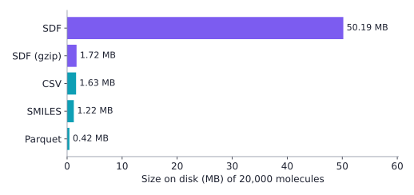
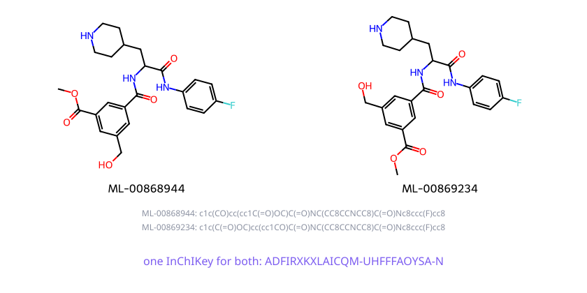
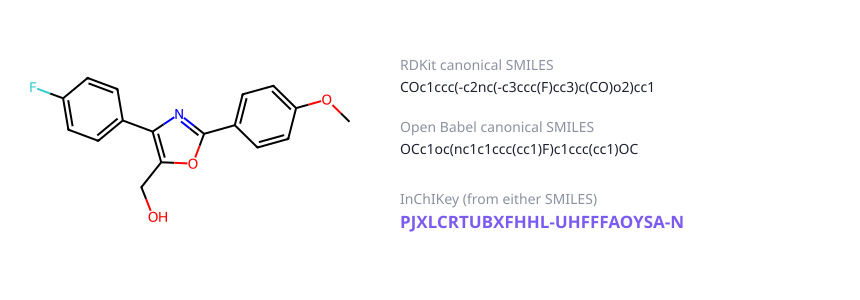

Chemical data moves between people and programs as files. A vendor sends its catalogue as an SDF,
a colleague exports hits from a spreadsheet as CSV, a pipeline writes Parquet for the next step.
Each format keeps some things and loses others, and each fails in its own way: a record that cannot
be read, an ID that loses its leading zeros, a price that arrives as text. Once the molecules are in,
you need to know which of them you already have, and that needs an identity that does not depend on
how the molecule happened to be written, or on which program wrote it.

By the end of this module you will be able to:

- write one library as SDF, SMILES, CSV and Parquet, and say what each costs and what each keeps;
- read a large SDF one record at a time, counting and recording the records that cannot be read;
- avoid the usual CSV faults with chemical data, and use a Parquet schema to keep column types;
- find duplicate molecules with InChIKeys, even when they are written as different SMILES;
- explain why identity must not depend on one toolkit's canonical SMILES;
- check that a file arrived unchanged with a SHA-256 checksum.

Everything here runs in a browser notebook or on any laptop: you need Python, RDKit, pandas, PyArrow
and Open Babel. The files the code writes go into a `work/` folder next to the lesson.

## 1. One library, five files

We use a teaching library made in code by `chemlib`, the same on every computer: 20,000 molecules,
each with an ID, a SMILES and the catalogue data a vendor file carries (vendor, price, stock).

```python
from pathlib import Path

import chemlib

work = Path("work")
work.mkdir(exist_ok=True)
library = chemlib.library(20_000, seed=3)
print(library.head(3).to_string(index=False))
```
```output
         id                                 smiles   vendor  price_usd  stock_mg
ML-00000065         c1cc(F)ccc1C(=O)NCc2ccc(CC)cc2 Vendor C     357.35       360
ML-00000098     c1cc(OC)ccc1C(=O)NCc2ccc(C(C)C)cc2 Vendor C      84.62       430
ML-00000129 c1cc(OCC)ccc1C(=O)NCc2ccc(C(F)(F)F)cc2 Vendor A     134.51       420
```

We write it in the four formats of this module, plus the gzipped SDF that vendors usually send.
**SDF** gives each molecule a connection table (atoms with 2D coordinates, then bonds) followed by
its data fields. A **SMILES file** (`.smi`) holds one SMILES and one name per line, nothing else.
**CSV** is a plain-text table. **Parquet** is a binary, column-by-column table with a schema that
records each column's type; we give the schema ourselves rather than let a tool guess it.

```python
import gzip
import shutil

import pyarrow as pa
import pyarrow.parquet as pq
from rdkit import Chem


def write_sdf(df, path):
    """Write a library as SDF: a connection table per molecule, the other columns as data fields."""
    with Chem.SDWriter(str(path)) as writer:
        for row in df.itertuples(index=False):
            mol = Chem.MolFromSmiles(row.smiles)
            mol.SetProp("_Name", row.id)  # the first line of the record
            mol.SetProp("vendor", row.vendor)
            mol.SetProp("price_usd", f"{row.price_usd:.2f}")
            mol.SetProp("stock_mg", str(row.stock_mg))
            writer.write(mol)


def write_smi(df, path):
    """Write a SMILES file: one SMILES and one name per line."""
    with open(path, "w", encoding="utf-8", newline="\n") as handle:
        for row in df.itertuples(index=False):
            handle.write(f"{row.smiles} {row.id}\n")


def gzip_copy(path):
    """A gzipped copy of a file, as path + '.gz' (mtime=0: the same input gives the same bytes)."""
    target = path.with_name(path.name + ".gz")
    with open(path, "rb") as source, gzip.GzipFile(target, "wb", mtime=0) as packed:
        shutil.copyfileobj(source, packed)
    return target


SCHEMA = pa.schema(
    [
        ("id", pa.string()),
        ("smiles", pa.string()),
        ("vendor", pa.string()),
        ("price_usd", pa.float64()),
        ("stock_mg", pa.int64()),
    ]
)

files = {
    "SDF": work / "library.sdf",
    "SMILES": work / "library.smi",
    "CSV": work / "library.csv",
    "Parquet": work / "library.parquet",
}
write_sdf(library, files["SDF"])
files["SDF (gzip)"] = gzip_copy(files["SDF"])
write_smi(library, files["SMILES"])
library.to_csv(files["CSV"], index=False)
table = pa.Table.from_pandas(library, schema=SCHEMA, preserve_index=False)
pq.write_table(table, files["Parquet"], compression="zstd")

for name, path in files.items():
    size = path.stat().st_size
    print(f"{name:11} {size / 1e6:6.2f} MB  {size / len(library):6.0f} bytes per molecule")
```
```output
SDF          50.19 MB    2510 bytes per molecule
SMILES        1.22 MB      61 bytes per molecule
CSV           1.63 MB      81 bytes per molecule
Parquet       0.42 MB      21 bytes per molecule
SDF (gzip)    1.72 MB      86 bytes per molecule
```



The SDF is more than 40 times the size of the SMILES file, because every atom and bond is a line
of text with coordinates, written out in full. Gzip shrinks it almost 30 times, to about the size
of the CSV, because those lines repeat so much; this is why vendors send `.sdf.gz`. The CSV is the
SMILES file plus the catalogue columns. Parquet is the smallest: it stores each column
together, so similar values sit side by side and compress well, and its numbers are stored as
binary numbers rather than as text. File sizes are the same every time for the same library and
the same versions of RDKit and PyArrow; other versions may differ by a few bytes.

Reading each file back into a table takes very different times:

```python
import time

import pandas as pd


def read_sdf_table(path):
    """Read every record of an SDF (plain or gzipped) into a table of its name and data fields."""
    opener = gzip.open if path.suffix == ".gz" else open
    rows = []
    with opener(path, "rb") as handle:
        for mol in Chem.ForwardSDMolSupplier(handle):
            rows.append({"id": mol.GetProp("_Name"), **mol.GetPropsAsDict()})
    return pd.DataFrame(rows)


readers = {
    "SDF": read_sdf_table,
    "SMILES": lambda path: pd.read_csv(path, sep=" ", names=["smiles", "id"]),
    "CSV": pd.read_csv,
    "Parquet": pd.read_parquet,
}
tables = {}
for name, reader in readers.items():
    start = time.perf_counter()
    tables[name] = reader(files[name])
    seconds = time.perf_counter() - start
    print(f"{name:11} {seconds:6.3f} s  {len(tables[name]):,} rows")
```
```output varies
SDF         14.654 s  20,000 rows
SMILES       0.042 s  20,000 rows
CSV          0.044 s  20,000 rows
Parquet      0.187 s  20,000 rows
```

Reading the SDF is about a hundred times slower, or more, because every record has to be parsed
into a molecule (atoms, bonds, valences, aromaticity) before its data fields can be read.
The text and Parquet tables are read as plain columns; the molecules in them are only built when
something needs them.

## 2. What each format keeps and loses

Write a table and read it back, and check what survived. Parquet gives back exactly what went in,
column types included, because the types are written in the file:

```python
print(pq.read_schema(files["Parquet"]).remove_metadata())
print("Parquet round trip equal:", tables["Parquet"].equals(library))
print("CSV round trip equal:    ", tables["CSV"].equals(library))
print("SMILES file columns:     ", list(tables["SMILES"].columns))
print("SDF columns and types:   ", tables["SDF"].dtypes.astype(str).to_dict())
```
```output
id: string
smiles: string
vendor: string
price_usd: double
stock_mg: int64
Parquet round trip equal: True
CSV round trip equal:     True
SMILES file columns:      ['smiles', 'id']
SDF columns and types:    {'id': 'str', 'vendor': 'str', 'price_usd': 'float64', 'stock_mg': 'int64'}
```

The CSV comes back equal too, but only because this table is easy: plain IDs, plain numbers, no
commas in the text. Section 4 shows what happens with real catalogue data. The SMILES file has lost
every column but the molecule and its name.

The SDF's data fields come back with types, but nobody wrote those types down: an SDF stores every
field as text, and RDKit's `GetPropsAsDict` *guessed* them from how the text looks. The guess is
right here. It goes wrong as soon as a field looks like a number but is not one, such as a
catalogue number with leading zeros:

```python
mol = Chem.MolFromSmiles("CCO")
mol.SetProp("catalogue_no", "00417")
print(mol.GetPropsAsDict())
```
```output
{'catalogue_no': 417}
```

Text also cuts the other way. Give RDKit a number to write, and it writes every digit it has:

```python
import io

mol.SetDoubleProp("price_usd", 57.66)
buffer = io.StringIO()
with Chem.SDWriter(buffer) as writer:
    writer.write(mol)
print(buffer.getvalue().split("M  END")[1])
```
```output

>  <catalogue_no>  (1) 
00417

>  <price_usd>  (1) 
57.659999999999997

$$$$

```

57.66 has no exact binary form, and the file shows the nearest double, to 17 digits. That is why
`write_sdf` above formats prices as text with two decimals itself. In short:

| Format | Keeps | Loses | Use it for |
|---|---|---|---|
| SDF | The connection table with coordinates (2D or 3D); any data fields | Field types (all text); size; reading speed | Receiving and sending libraries; 3D structures for docking |
| SMILES file | The molecule and one name | Coordinates; every other column | Lists of molecules for tools; quick exchange |
| CSV | Any columns; opens anywhere | Column types; one agreed way to quote and encode | Small tables that people read and edit |
| Parquet | Columns with their types (a schema); compression; fast reads of chosen columns | Human readability (it is binary); coordinates, unless you add a column for them | Tables inside pipelines and databases |

## 3. Reading an SDF the way industry does

`read_sdf_table` above read every record into one list before making a table. That is fine for
20,000 molecules, but vendor catalogues run to millions of records and tens of gigabytes, and a
list of millions of molecules will not fit in memory. Two habits make SDF reading safe at any size:

- **Stream.** `ForwardSDMolSupplier` reads one record at a time from any open file, including a
  gzip stream, so nothing is unpacked to disk and only one molecule is in memory at once. Wrap it
  in a generator, and the rest of the code sees records one by one.
- **Expect failures, and record them.** Some records will not parse: a valence no atom can have, a
  record cut short. The reader returns `None` for those. Count them and keep their record number
  and the reason, so someone can go back to the file and the supplier.

To see failures, we make a file like a careless vendor would: `add_defects` damages 5% of a
2,000-molecule library, and the writer below skips the valence check, so impossible molecules get
written. Records whose SMILES cannot be read at all never make it into the file. Then we cut the
last 300 bytes off, as an interrupted download would:

```python
from rdkit import RDLogger

RDLogger.DisableLog("rdApp.*")  # we record every failure ourselves, below


def write_unchecked_sdf(df, path):
    """Write an SDF without checking valences, as some tools do; skip SMILES that cannot be read."""
    no_valence_check = Chem.SanitizeFlags.SANITIZE_ALL ^ Chem.SanitizeFlags.SANITIZE_PROPERTIES
    with Chem.SDWriter(str(path)) as writer:
        for row in df.itertuples(index=False):
            mol = Chem.MolFromSmiles(row.smiles, sanitize=False)
            if mol is None:
                continue
            Chem.SanitizeMol(mol, no_valence_check)
            mol.SetProp("_Name", row.id)
            mol.SetProp("vendor", row.vendor)
            mol.SetProp("price_usd", f"{row.price_usd:.2f}")
            mol.SetProp("stock_mg", str(row.stock_mg))
            writer.write(mol)


received = chemlib.add_defects(chemlib.library(2_000, seed=5), rate=0.05, seed=6)
print(received["defect"].value_counts().to_string())
vendor_file = work / "vendor.sdf"
write_unchecked_sdf(received, vendor_file)
vendor_file.write_bytes(vendor_file.read_bytes()[:-300])  # the download stopped early
```
```output
defect
             1916
salt           17
invalid        17
valence        17
solvent        17
element        16
duplicate      16
```

The reader is a generator. It reads without sanitising, then sanitises each molecule itself, so it
can keep RDKit's reason for every failure:

```python
def records(path):
    """Yield (record number, molecule or None, reason it failed) for each record of an SDF."""
    opener = gzip.open if path.suffix == ".gz" else open
    with opener(path, "rb") as handle:
        for number, mol in enumerate(Chem.ForwardSDMolSupplier(handle, sanitize=False)):
            if mol is None:
                yield number, None, "the record could not be parsed"
                continue
            try:
                Chem.SanitizeMol(mol)
            except Exception as error:  # RDKit raises several kinds; keep its message
                yield number, None, str(error).splitlines()[0]
                continue
            yield number, mol, ""


read, failed = 0, []
for number, mol, reason in records(vendor_file):
    if mol is None:
        failed.append({"record": number, "reason": reason})
    else:
        read += 1
failed = pd.DataFrame(failed)
print(read, "molecules read;", len(failed), "records failed")
print(failed["reason"].value_counts().to_string())
print("records that failed, first five:", failed["record"].head().tolist())
```
```output
1981 molecules read; 18 records failed
reason
Explicit valence for atom # 0 C, 5, is greater than permitted    17
the record could not be parsed                                    1
records that failed, first five: [153, 297, 392, 414, 449]
```

The 17 records with a pentavalent carbon fail with RDKit's valence message, and the last record,
cut short, could not be parsed. Every other record, including the salts, solvents and the selenium
compound, is read: those are valid molecules that are wrong *for a screening library*, and finding
them is the job of validation (Module 6). The whole file was never in memory, and none of the
failures stopped the reading.

### Properties as typed columns

Section 2 showed that SDF data fields are text and that guessing their types goes wrong. So we
convert each field ourselves, to the type we chose, and write the rows to Parquet a batch at a time
with a fixed schema. Memory stays flat however long the file is, and the same code turns a
ten-million-record catalogue into Parquet. Each row also gets the molecule's InChIKey (section 5):

```python
ROW_SCHEMA = pa.schema(
    [
        ("record", pa.int64()),
        ("id", pa.string()),
        ("smiles", pa.string()),
        ("inchikey", pa.string()),
        ("vendor", pa.string()),
        ("price_usd", pa.float64()),
        ("stock_mg", pa.int64()),
    ]
)


def typed_row(number, mol):
    """One SDF record as a row of values with the types we chose, not the types a guesser picked."""
    return {
        "record": number,
        "id": mol.GetProp("_Name"),
        "smiles": Chem.MolToSmiles(mol),
        "inchikey": Chem.MolToInchiKey(mol),
        "vendor": mol.GetProp("vendor"),
        "price_usd": float(mol.GetProp("price_usd")),
        "stock_mg": int(mol.GetProp("stock_mg")),
    }


def sdf_to_parquet(source, target, batch_size=5_000):
    """Stream an SDF into Parquet one batch at a time; return the records that failed."""
    failures, batch = [], []
    with pq.ParquetWriter(target, ROW_SCHEMA, compression="zstd") as writer:
        for number, mol, reason in records(source):
            if mol is None:
                failures.append((number, reason))
                continue
            batch.append(typed_row(number, mol))
            if len(batch) == batch_size:
                writer.write_table(pa.Table.from_pylist(batch, schema=ROW_SCHEMA))
                batch = []
        if batch:
            writer.write_table(pa.Table.from_pylist(batch, schema=ROW_SCHEMA))
    return failures


keys_file = work / "library-keys.parquet"
print("failed records:", len(sdf_to_parquet(files["SDF (gzip)"], keys_file)))
print("row groups (one per batch):", pq.ParquetFile(keys_file).metadata.num_row_groups)
compounds = pd.read_parquet(keys_file)
print(compounds[["id", "inchikey", "price_usd", "stock_mg"]].head(3).to_string(index=False))
```
```output
failed records: 0
row groups (one per batch): 4
         id                    inchikey  price_usd  stock_mg
ML-00000065 CIIMLXOJFPMAPG-UHFFFAOYSA-N     357.35       360
ML-00000098 LXXHHYGMWMRNRZ-UHFFFAOYSA-N      84.62       430
ML-00000129 BCBSZRQYWOQCCI-UHFFFAOYSA-N     134.51       420
```

Module 8 takes this further, for libraries far larger than memory.

## 4. CSV and chemistry

CSV looks simple: values separated by commas. Chemistry breaks it in several ways at once. Here is
a small catalogue of the kind that arrives by email, with catalogue numbers that start with zeros,
names that contain commas and apostrophes, a SMILES with a `#` (a triple bond), prices written as
text and storage temperatures with a degree sign:

```python
import csv

catalogue = [
    {"catalogue_no": "00417", "name": "2,4-dichlorophenol", "smiles": "Oc1ccc(Cl)cc1Cl",
     "price": "$12.50", "storage": "2–8 °C"},
    {"catalogue_no": "01203", "name": "acetonitrile", "smiles": "CC#N",
     "price": "$8.00", "storage": "15–25 °C"},
    {"catalogue_no": "00090", "name": "4'-hydroxyacetophenone", "smiles": "CC(=O)c1ccc(O)cc1",
     "price": "$1,250.00", "storage": "15–25 °C"},
]
csv_file = work / "catalogue.csv"
with open(csv_file, "w", encoding="utf-8", newline="") as handle:
    writer = csv.DictWriter(handle, fieldnames=list(catalogue[0]))
    writer.writeheader()
    writer.writerows(catalogue)
print(csv_file.read_text(encoding="utf-8"))
```
```output
catalogue_no,name,smiles,price,storage
00417,"2,4-dichlorophenol",Oc1ccc(Cl)cc1Cl,$12.50,2–8 °C
01203,acetonitrile,CC#N,$8.00,15–25 °C
00090,4'-hydroxyacetophenone,CC(=O)c1ccc(O)cc1,"$1,250.00",15–25 °C

```

Python's `csv` module did the right thing: it put quotes around the values that contain commas.
Code that splits lines on commas by hand ignores the quotes, and the columns no longer line up:

```python
header, *lines = csv_file.read_text(encoding="utf-8").splitlines()
print(len(header.split(",")), "columns in the header")
for line in lines:
    print(len(line.split(",")), "fields:", line.split(",")[:3])
```
```output
5 columns in the header
6 fields: ['00417', '"2', '4-dichlorophenol"']
5 fields: ['01203', 'acetonitrile', 'CC#N']
6 fields: ['00090', "4'-hydroxyacetophenone", 'CC(=O)c1ccc(O)cc1']
```

A CSV reader that understands quotes, like pandas, gets the columns right. It then guesses each
column's type from what the values look like, and the guesses are wrong for chemistry. The
catalogue numbers become integers and lose their leading zeros, so `00417` no longer matches the
supplier's records. The prices stay text, so they cannot be summed or compared:

```python
guessed = pd.read_csv(csv_file)
print(guessed.dtypes.astype(str).to_dict())
print("catalogue numbers:", guessed["catalogue_no"].tolist())
print("prices:", guessed["price"].tolist())
```
```output
{'catalogue_no': 'int64', 'name': 'str', 'smiles': 'str', 'price': 'str', 'storage': 'str'}
catalogue numbers: [417, 1203, 90]
prices: ['$12.50', '$8.00', '$1,250.00']
```

Options meant for other kinds of file do damage too. `comment="#"` is a common way to skip comment
lines, and it also cuts every SMILES at its first triple bond, without an error:

```python
print(pd.read_csv(csv_file, comment="#")["smiles"].tolist())
```
```output
['Oc1ccc(Cl)cc1Cl', 'CC', 'CC(=O)c1ccc(O)cc1']
```

Then there is the encoding. A CSV file does not say which one it uses. The same table saved by an
older Windows program is often in the Windows-1252 code page, not UTF-8, and the degree sign and
the en dash become different bytes:

```python
old_file = work / "catalogue-cp1252.csv"
old_file.write_bytes(csv_file.read_text(encoding="utf-8").encode("cp1252"))
try:
    pd.read_csv(old_file)
except UnicodeDecodeError as error:
    print("UnicodeDecodeError:", error.reason)
print(pd.read_csv(old_file, encoding="cp1252")["storage"].tolist())
```
```output
UnicodeDecodeError: invalid start byte
['2–8 °C', '15–25 °C', '15–25 °C']
```

The fix is to stop guessing. Read the CSV once, carefully, saying what each column is, turn the
prices into numbers, and store the result as Parquet with a schema. From then on, every program
that reads the file gets the same columns with the same types, and the text is always UTF-8:

```python
clean = pd.read_csv(csv_file, dtype={"catalogue_no": str}, encoding="utf-8")
clean["price_usd"] = clean.pop("price").str.replace("[$,]", "", regex=True).astype(float)
CATALOGUE_SCHEMA = pa.schema(
    [
        ("catalogue_no", pa.string()),
        ("name", pa.string()),
        ("smiles", pa.string()),
        ("storage", pa.string()),
        ("price_usd", pa.float64()),
    ]
)
catalogue_file = work / "catalogue.parquet"
clean_table = pa.Table.from_pandas(clean, schema=CATALOGUE_SCHEMA, preserve_index=False)
pq.write_table(clean_table, catalogue_file)
print(pd.read_parquet(catalogue_file).to_string(index=False))
print("total price:", pd.read_parquet(catalogue_file)["price_usd"].sum())
```
```output
catalogue_no                   name            smiles  storage  price_usd
       00417     2,4-dichlorophenol   Oc1ccc(Cl)cc1Cl   2–8 °C       12.5
       01203           acetonitrile              CC#N 15–25 °C        8.0
       00090 4'-hydroxyacetophenone CC(=O)c1ccc(O)cc1 15–25 °C     1250.0
total price: 1270.5
```

If a CSV must be sent on, write it with the `csv` module or pandas (never by joining strings with
commas), in UTF-8, and send its column types alongside it. Module 12 checks such tables
automatically.

## 5. Identity and duplicates

A library should hold each molecule once. Comparing SMILES strings does not find repeats, because
one molecule has many SMILES (Module 2). Canonical SMILES and InChIKeys both give one string per
molecule. Count the distinct values in our 20,000-molecule library each way:

```python
print("distinct SMILES as written:", library["smiles"].nunique())
print("distinct canonical SMILES: ", compounds["smiles"].nunique())
print("distinct InChIKeys:        ", compounds["inchikey"].nunique())
sizes = compounds.groupby("inchikey").size()
print("molecules listed twice:", int((sizes == 2).sum()))
print("molecules listed more than twice:", int((sizes > 2).sum()))
```
```output
distinct SMILES as written: 20000
distinct canonical SMILES:  19891
distinct InChIKeys:         19891
molecules listed twice: 109
molecules listed more than twice: 0
```

As written, every SMILES is different. Canonical SMILES and InChIKeys agree that 109 molecules
are listed twice, each under two IDs: about 0.5% of the library.
These are real duplicates of the kind every enumerated library has: two building blocks on
symmetric positions of a scaffold, swapped, give the same molecule. One pair:



```python
first_key = sizes[sizes == 2].index[0]
pair = compounds.loc[compounds["inchikey"] == first_key, ["id", "inchikey"]]
pair = pair.merge(library[["id", "smiles"]], on="id")
print(pair.to_string(index=False))
```
```output
         id                    inchikey                                                   smiles
ML-00868944 ADFIRXKXLAICQM-UHFFFAOYSA-N c1c(CO)cc(cc1C(=O)OC)C(=O)NC(CC8CCNCC8)C(=O)Nc8ccc(F)cc8
ML-00869234 ADFIRXKXLAICQM-UHFFFAOYSA-N c1c(C(=O)OC)cc(cc1CO)C(=O)NC(CC8CCNCC8)C(=O)Nc8ccc(F)cc8
```

The two substituents sit on a 1,3,5-substituted benzene ring, so swapping them gives the same
molecule written from the other side.

The same works for duplicates that a supplier adds by mistake. `add_defects` adds some molecules a
second time, written as a different, randomly ordered SMILES, with `-dup` on the ID. Compare the
strings and you find none of them; compare InChIKeys and you find them all:

```python
def inchikey(smiles):
    """The InChIKey of a SMILES, or None if RDKit cannot read it."""
    mol = Chem.MolFromSmiles(smiles)
    return Chem.MolToInchiKey(mol) if mol is not None else None


shipment = chemlib.add_defects(chemlib.library(3_000, seed=7), rate=0.06, seed=8)
shipment["inchikey"] = shipment["smiles"].map(inchikey)
added = shipment["defect"] == "duplicate"
same_string = shipment["smiles"].duplicated(keep=False)
same_key = shipment["inchikey"].notna() & shipment["inchikey"].duplicated(keep=False)
print("duplicates added:", int(added.sum()))
print("rows sharing a SMILES string with another row:", int(same_string.sum()))
print("rows sharing an InChIKey with another row:    ", int(same_key.sum()))
print("every added duplicate found:", bool(same_key[added].all()))
added_keys = set(shipment.loc[added, "inchikey"])
from_added = same_key & shipment["inchikey"].isin(added_keys)
print("rows that are an added duplicate or its original:", int(from_added.sum()))
example = shipment.loc[added, "id"].iloc[0].removesuffix("-dup")
copies = shipment[shipment["id"].str.startswith(example)]
print(copies[["id", "smiles", "inchikey"]].to_string(index=False))
```
```output
duplicates added: 30
rows sharing a SMILES string with another row: 0
rows sharing an InChIKey with another row:     68
every added duplicate found: True
rows that are an added duplicate or its original: 60
             id                                                   smiles                    inchikey
ML-00911844-dup C(c1cc(C(F)(F)F)cc(c1)C(NC(C(=O)NC1CCNCC1)Cc1ccncc1)=O)O JQHQCTSCMYNCGE-UHFFFAOYSA-N
    ML-00911844   c1c(CO)cc(cc1C(F)(F)F)C(=O)NC(Cc8ccncc8)C(=O)NC8CCNCC8 JQHQCTSCMYNCGE-UHFFFAOYSA-N
```

Two SMILES that look nothing alike give one key. Of the 68 rows that share a key, 60 are the 30
added duplicates and their originals; the other 8 are symmetric pairs like the one above, which
were in the library before any defects were added. Which copy to keep (the
cheaper, the one in stock, the first received) is a business rule, written down and applied the same
way every time; Module 7 makes it part of standardisation.

## 6. Toolkits disagree

Canonical SMILES found the same duplicates as InChIKeys above. So why not use them as the identity?
Because "canonical" means canonical for one program. Open Babel, the other widely used open-source
toolkit, has its own canonical SMILES. Read the first 1,000 molecules of the library with both:

```python
from openbabel import pybel

pybel.ob.obErrorLog.SetOutputLevel(0)  # quiet: we compare the results ourselves


def rdkit_canonical(smiles):
    """RDKit's canonical SMILES."""
    return Chem.MolToSmiles(Chem.MolFromSmiles(smiles))


def openbabel_canonical(smiles):
    """Open Babel's canonical SMILES (its output is the SMILES, a tab, then a title)."""
    return pybel.readstring("smi", smiles).write("can").split("\t")[0].strip()


rows = []
for smiles in library["smiles"].head(1_000):
    rd, ob = rdkit_canonical(smiles), openbabel_canonical(smiles)
    rows.append(
        {
            "same canonical SMILES": rd == ob,
            "RDKit agrees with itself": rdkit_canonical(ob) == rd,
            "Open Babel agrees with itself": openbabel_canonical(rd) == ob,
            "same InChIKey": inchikey(rd) == inchikey(ob),
        }
    )
print(pd.DataFrame(rows).sum().to_string())
print("RDKit:     ", rd)
print("Open Babel:", ob)
```
```output
same canonical SMILES               0
RDKit agrees with itself         1000
Open Babel agrees with itself    1000
same InChIKey                    1000
RDKit:      COc1ccc(-c2nc(-c3ccc(F)cc3)c(CO)o2)cc1
Open Babel: OCc1oc(nc1c1ccc(cc1)F)c1ccc(cc1)OC
```



Each toolkit is consistent with itself: given the other's SMILES, it produces its own canonical
form again. But the two forms are different for every one of these molecules, so a database keyed on
RDKit's canonical SMILES would not recognise a single molecule sent in by an Open Babel pipeline.
The canonical SMILES can also change between versions of one toolkit, when its algorithm is
improved. The InChIKeys are the same whichever SMILES they are made from.

InChI avoids the problem by design: there is one InChI algorithm, maintained by IUPAC and the InChI
Trust, and toolkits call the same InChI library rather than writing their own. Open Babel can write
InChIs and InChIKeys too, when it is built with that library (check with
`"inchikey" in pybel.outformats`; the pip package for Linux includes it, the one for Windows, at
the time of writing, does not). Store the toolkit's canonical SMILES to rebuild the molecule, and
the InChIKey to identify it.

## 7. Did the file arrive unchanged?

Files are copied, downloaded, uploaded and synchronised, and somewhere along the way one can be cut
short or changed. A truncated SDF still opens (section 3 lost only one record), and a single changed
byte can turn chlorine into bromine. A **checksum** catches both. SHA-256 turns a file's bytes into
a 64-character fingerprint; change any byte and the fingerprint changes completely. Whoever sends a
file publishes its checksum, and whoever receives it computes the checksum again and compares:

```python
import hashlib


def sha256(path, chunk_size=1 << 20):
    """The SHA-256 checksum of a file, read a megabyte at a time so any size of file fits."""
    digest = hashlib.sha256()
    with open(path, "rb") as handle:
        while chunk := handle.read(chunk_size):
            digest.update(chunk)
    return digest.hexdigest()


def write_checksums(paths, manifest):
    """Write a manifest: one line per file, its checksum then its name (as sha256sum writes)."""
    lines = [f"{sha256(path)}  {path.name}\n" for path in paths]
    manifest.write_text("".join(lines), encoding="utf-8")


def verify(manifest):
    """Check every file listed in a manifest; return the names whose checksum no longer matches."""
    changed = []
    for line in manifest.read_text(encoding="utf-8").splitlines():
        expected, name = line.split("  ", 1)
        if sha256(manifest.parent / name) != expected:
            changed.append(name)
    return changed


manifest = work / "SHA256SUMS"
write_checksums([files["SMILES"], files["Parquet"]], manifest)
print(manifest.read_text(encoding="utf-8"), end="")
print("changed files:", verify(manifest))
```
```output
d694974ab38e5b235f1e5b9f4b8fef717b0f79e618220df5b862255f630569d5  library.smi
aed1fa33d0dcc7729d1b0527d4e73713b617d7de70d2d57aacbe73190da18f6c  library.parquet
changed files: []
```

Now change one character in the SMILES file, a chlorine into a bromine, the kind of change no one
would spot by eye in a 20,000-line file:

```python
text = files["SMILES"].read_text(encoding="utf-8")
files["SMILES"].write_text(text.replace("Cl", "Br", 1), encoding="utf-8", newline="\n")
print("same size:", files["SMILES"].stat().st_size == len(text.encode("utf-8")))
print("changed files:", verify(manifest))
```
```output
same size: True
changed files: ['library.smi']
```

The file is the same size and still a valid SMILES file, so only the checksum notices. The
manifest format is the one the `sha256sum` command reads (`sha256sum -c SHA256SUMS`), so the
receiver does not need Python to check it. When you download data from a repository that publishes
checksums, compare them before you use the files; Module 13 builds manifests like this one into
versioning.

## 8. Choosing a format

- **Receiving** data, you take what you are given, often SDF or CSV. Stream it, record what fails
  and why, convert the types yourself, and check its checksum if one was published.
- **Inside** a pipeline, store tables as Parquet with a schema: small, fast, typed, and the same in
  every program. Keep a SMILES column to rebuild molecules and an InChIKey column to identify them.
- **Sending** data, write the format the receiver asks for, with the `csv` module or RDKit's
  writers rather than by joining strings, and publish its checksum beside it.

## Try it yourself

The homework for this module is in `homework.md`: a few questions answered by running code like the
code above. Answers are published after the cohort's deadline.

## Further reading

- Dalby, A., Nourse, J. G., Hounshell, W. D., Gushurst, A. K. I., Grier, D. L., Leland, B. A. &
  Laufer, J. (1992). Description of several chemical structure file formats used by computer
  programs developed at Molecular Design Limited. *Journal of Chemical Information and Computer
  Sciences*, 32(3), 244–255. <https://doi.org/10.1021/ci00007a012>
- Heller, S. R., McNaught, A., Pletnev, I., Stein, S. & Tchekhovskoi, D. (2015). InChI, the IUPAC
  International Chemical Identifier. *Journal of Cheminformatics*, 7(1), 23.
  <https://doi.org/10.1186/s13321-015-0068-4>
- O'Boyle, N. M., Banck, M., James, C. A., Morley, C., Vandermeersch, T. & Hutchison, G. R. (2011).
  Open Babel: An open chemical toolbox. *Journal of Cheminformatics*, 3(1), 33.
  <https://doi.org/10.1186/1758-2946-3-33>
- Shafranovich, Y. (2005). *Common Format and MIME Type for Comma-Separated Values (CSV) Files*.
  RFC 4180. <https://www.rfc-editor.org/rfc/rfc4180>
- The Apache Parquet documentation. <https://parquet.apache.org/docs/>
- The RDKit documentation. *Getting Started with the RDKit in Python*.
  <https://www.rdkit.org/docs/GettingStartedInPython.html>
- The Open Babel documentation. <https://open-babel.readthedocs.io/en/latest/>
