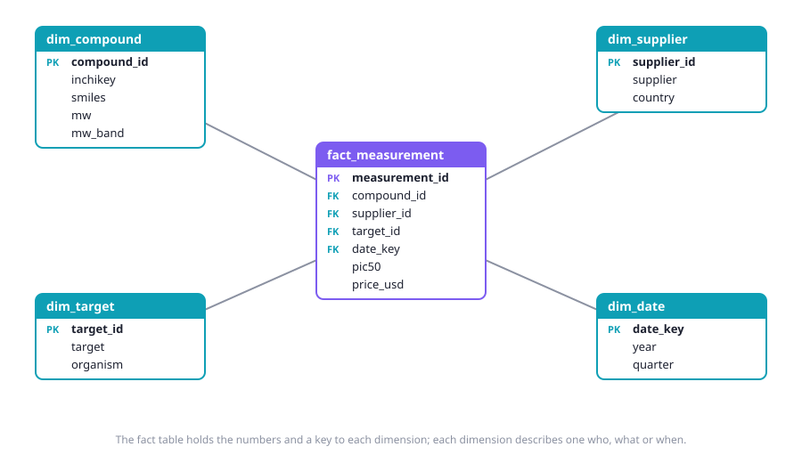

So far our molecules have lived in files: SMILES in CSV files, tables in Parquet files
([Module 3](../03-files-and-identity/)). Files are fine for one person and one question. They stop
being enough when several people add data at the same time, when the same compound arrives from
three suppliers, when an assay result must always point to the batch it was measured on, or when a
colleague asks "which acids under 300 g/mol did we test against EGFR?" and expects an answer in a
second. That is the job of a **database**: a program that stores data in an organised way, checks
it as it goes in, and answers questions about it.

This module starts with the kinds of database and what each is good at. Then it does the step most
people skip: planning the tables before storing anything (**data modelling**). We build the plan as
real tables, with rules that stop bad data getting in, describe them so others can use them, and
reshape them for analysis. Finally we put the molecules into PostgreSQL with its chemistry add-on,
search them by substructure and similarity, and give a colleague safe, read-only access.

By the end of this module you will be able to:

- name the main kinds of database (including the "NoSQL" kinds) and say which questions each
  answers best;
- plan the tables for chemical data: what things you store, how they are linked, and what rules
  each value must follow, drawn as a diagram;
- explain why each fact should be stored once, and show what goes wrong in a spreadsheet when it is
  not;
- create tables with keys and rules in SQL, and see the database refuse bad data;
- ask questions in SQL: filter, sort, join tables and summarise;
- describe a database so others can use it (a data dictionary), and record where each row came
  from;
- reshape tables for analysis (a star schema);
- store molecules in PostgreSQL with the RDKit cartridge, search them by substructure and by
  similarity, and see an index make a search faster;
- give a colleague read-only access, and keep passwords out of your code.

From earlier modules we use SMILES, InChIKeys, SMARTS patterns and fingerprints
([Module 2](../02-text-patterns-and-numbers/)), and the course's helper file `chemlib`, which makes
a library of realistic molecules ([Module 3](../03-files-and-identity/)).

The lesson uses these packages:

- **DuckDB**, a database that runs inside Python, with nothing to install or start: the whole
  database is one file (or lives in memory). We use it for sections 3 to 6, so they run anywhere,
  Colab included;
- **psycopg**, which lets Python talk to a PostgreSQL database server (section 7 onwards);
- **pandas** and **NumPy** for tables and numbers, and **RDKit** for the chemistry, as before.

**What runs where.** Sections 1 to 6 run in Colab or on any computer. Sections 7 and 8 need
**PostgreSQL**, a database server, running on your own computer in Docker; [the database
guide](https://monstrous.com.ng/learn/databases/) shows how to install Docker and start it, step by
step, in about twenty minutes. Their code starts with the line `# needs: postgres`; without the
database those blocks do nothing, and you can still read them and their outputs here.

## Setup

Every lesson starts with this block. It loads the packages and sets the lesson's settings, written
in CAPITALS, so they can be changed in one place. Run it first. Two settings come from
**environment variables** (named values your terminal passes to programs) rather than from the
code: where the PostgreSQL database is, and the password we give a colleague in section 8. On your
own computer they are kept in a file called `.env` at the repository's root, which you make once by
copying `.env.example` and choosing your own passwords (the database guide shows how);
`load_dotenv` reads it. Passwords never belong in code; section 8 explains why.

```python
import logging
import os
from pathlib import Path

import duckdb
import numpy as np
import pandas as pd
import psycopg
from dotenv import find_dotenv, load_dotenv
from psycopg import sql
from psycopg.conninfo import make_conninfo
from rdkit import Chem, RDLogger
from rdkit.Chem import Descriptors

from chemlib import library

# log lines: level and message only, so the lesson's outputs are the same on every run
# (a real job would add "%(asctime)s" to the format)
logging.basicConfig(level=logging.INFO, format="%(levelname)s %(message)s", force=True)
log = logging.getLogger(__name__)

# the lesson's data: a library from chemlib, offered by three suppliers and tested on two targets.
# The compounds are realistic; the prices and assay results are made up for the lesson.
N_COMPOUNDS = 1_500  # compounds drawn from chemlib
LIBRARY_SEED = 4  # which compounds
N_MEASUREMENTS = 4_000  # assay results
DATA_SEED = 44  # seed for the made-up batches and results
SUPPLIERS = [("Vendor A", "United Kingdom"), ("Vendor B", "Germany"), ("Vendor C", "India")]
TARGETS = [("CHEMBL203", "EGFR", "Homo sapiens"), ("CHEMBL205", "Carbonic anhydrase II", "Homo sapiens")]  # fmt: skip
LOADED_ON = "2026-11-24"  # the load date recorded with every row; fixed, so outputs never change
SOURCE = "chemlib library, seed 4"  # where the rows came from, recorded with every row

# where the lesson writes its files (git-ignored)
WORK = Path("work")
DUCKDB_FILE = WORK / "chem.duckdb"

# passwords and addresses: from the environment, or from the course's .env file (copied from
# .env.example at the repository's root); find_dotenv looks for it in this folder and the ones
# above, and settings already in the environment are kept
load_dotenv(find_dotenv(usecwd=True))
DATABASE_URL = os.environ.get("DATABASE_URL", "")
PG_SCHEMA = "module4"  # the lesson's own area inside the database, emptied at the start of section 7
ANALYST = "analyst"  # the read-only colleague of section 8
ANALYST_PASSWORD = os.environ.get("ANALYST_PASSWORD", "")
ACID_SMARTS = "[CX3](=O)[OX2H1]"  # a carboxylic acid: C=O and an O carrying one H (Module 2)

RDLogger.DisableLog("rdApp.*")  # chemlib's molecules all parse; RDKit has nothing to tell us
WORK.mkdir(exist_ok=True)
DUCKDB_FILE.unlink(missing_ok=True)  # start the lesson with an empty database file
```

## 1. Kinds of database

A database is more than a file: it is a program that holds the data, and every change and question
goes through it. That lets it do things a file cannot: refuse a value that breaks a rule, let many
people read and write at the same time without trampling on each other, and answer questions
quickly by keeping **indexes** (lookup tables, like the index at the back of a book).

There is no single best database. Each kind stores data in a different shape and is fast at
different questions:

| Kind | The data looks like | Good at | Examples | In chemistry |
|---|---|---|---|---|
| Relational (SQL) | tables of rows and columns, linked by keys | keeping data correct while many people change it | PostgreSQL, SQLite, MySQL | compound registration, assay results |
| Analytical (columnar) | tables, stored column by column | adding up millions of rows quickly | DuckDB, BigQuery, Snowflake | analysing screening campaigns |
| Document | records like JSON, each with its own fields | records whose fields vary | MongoDB, CouchDB | instrument metadata, lab notebook entries |
| Key-value | a value stored under a key | the fastest possible lookup by one key | Redis | a cache of computed descriptors, by InChIKey |
| Wide-column | huge tables spread over many machines | very large write volumes, across a cluster | Cassandra, HBase | readings from thousands of instruments |
| Graph | nodes joined by relationships | following links many steps deep | Neo4j | reaction networks, compound-target-pathway links ([Module 5](../05-graphs-and-graph-databases/)) |
| Vector | lists of numbers (embeddings) | "find the most similar" | pgvector, Milvus, Qdrant | similarity search on learned molecular embeddings |

The first row is the classic **relational database**, questioned in **SQL** (Structured Query
Language). The second stores the same kind of tables differently, for analysis; it is also
questioned in SQL. The others are together called **NoSQL** ("not only SQL"). Each gives up
something a relational database guarantees, such as joins between tables, changes to several
records that succeed or fail together, or a fixed set of columns, in exchange for scale or
flexibility. That trade is worth making for some jobs, and not for most chemical records, where a
measurement that points to a batch that does not exist is simply wrong.

The lines between kinds have blurred: PostgreSQL stores JSON documents, vectors (with the pgvector
add-on) and, with the RDKit add-on, molecules. A sound default for chemical data is a relational
database for the records and an analytical one for the questions, which is what this module
builds. Module 5 adds a graph database for questions about links.

## 2. Plan the tables before storing anything

The commonest way chemical data is stored is one big spreadsheet: a row per measurement, with the
compound's structure, the supplier's name and the target's name typed into every row. Let us build
that spreadsheet from our data and see what goes wrong. First the data itself: compounds from
`chemlib`, each offered by one to three suppliers as a **batch** (one supplier's lot of a compound,
with its own price), and assay results on two targets, each measured on a batch:

```python
compounds = library(N_COMPOUNDS, seed=LIBRARY_SEED)[["smiles"]].reset_index(drop=True)
mols = [Chem.MolFromSmiles(s) for s in compounds["smiles"]]
compounds["smiles"] = [Chem.MolToSmiles(m) for m in mols]  # canonical SMILES (Module 2)
compounds["inchikey"] = [Chem.MolToInchiKey(m) for m in mols]  # the compound's identity
compounds["mw"] = [round(Descriptors.MolWt(m), 2) for m in mols]
compounds.insert(0, "compound_id", range(1, len(compounds) + 1))

rng = np.random.default_rng(DATA_SEED)
batch_rows = []
for cid in compounds["compound_id"]:
    # each compound is sold by one, two or three of the suppliers, each at its own price
    for supplier_id in sorted(rng.choice([1, 2, 3], size=rng.integers(1, 4), replace=False)):
        batch_rows.append((cid, int(supplier_id), round(float(rng.uniform(15, 400)), 2),
                           int(rng.choice([5, 10, 25, 50, 100]))))  # fmt: skip
batches = pd.DataFrame(batch_rows, columns=["compound_id", "supplier_id", "price_usd", "amount_mg"])
batches.insert(0, "batch_id", range(1, len(batches) + 1))

# made-up assay results: pIC50 values, a little lower on Vendor C's batches (a purity problem)
pick = rng.integers(0, len(batches), size=N_MEASUREMENTS)
target = rng.integers(0, len(TARGETS), size=N_MEASUREMENTS)
pic50 = rng.normal(np.where(target == 0, 6.3, 5.5), 0.7) - 0.4 * (batches["supplier_id"].to_numpy()[pick] == 3)  # fmt: skip
measurements = pd.DataFrame({
    "measurement_id": range(1, N_MEASUREMENTS + 1),
    "batch_id": batches["batch_id"].to_numpy()[pick],
    "target_id": [TARGETS[t][0] for t in target],
    "ic50_nm": np.round(10 ** (9 - pic50), 1),
    "measured_on": pd.Timestamp("2026-01-05") + pd.to_timedelta(rng.integers(0, 300, N_MEASUREMENTS), unit="D"),
})  # fmt: skip
print(f"{len(compounds):,} compounds, {len(batches):,} batches, {len(measurements):,} measurements")
```
```output
1,500 compounds, 2,998 batches, 4,000 measurements
```

**IC50** is the concentration of a compound that halves the target's activity, here in nanomolar
(nM); **pIC50** is the same on a log scale, 9 minus the log10 of the IC50 in nM, so higher means
more potent. Now the spreadsheet: every measurement with everything about it copied into its row.
`merge` joins two tables on a shared column, as in Module 3:

```python
suppliers = pd.DataFrame([(i + 1, n, c) for i, (n, c) in enumerate(SUPPLIERS)],
                         columns=["supplier_id", "name", "country"])  # fmt: skip
targets = pd.DataFrame(TARGETS, columns=["target_id", "name", "organism"])
sheet = (
    measurements.merge(batches, on="batch_id")
    .merge(compounds, on="compound_id")
    .merge(suppliers.rename(columns={"name": "supplier"}), on="supplier_id")
    .merge(targets.rename(columns={"name": "target"}), on="target_id")
    [["measurement_id", "smiles", "inchikey", "mw", "supplier", "country", "price_usd",
      "target", "organism", "ic50_nm", "measured_on"]]
)  # fmt: skip
print(sheet.shape[0], "rows,", sheet.shape[1], "columns")
print(sheet["supplier"].value_counts().to_string())
```
```output
4000 rows, 11 columns
supplier
Vendor A    1370
Vendor B    1331
Vendor C    1299
```

Each supplier's name and country are typed out about 1,300 times, and each compound's SMILES,
InChIKey and weight once for every measurement on it. Repetition is more than wasted space. Suppose
a colleague corrects some rows by hand and types Vendor B with a trailing space, and Vendor A moves
its address to Ireland but only some rows are updated:

```python
messy = sheet.copy()
messy.loc[messy.index[::50], "supplier"] = "Vendor B "  # a stray space, typed by hand
moved = messy["supplier"].eq("Vendor A")
messy.loc[moved & (messy.index < 2000), "country"] = "Ireland"  # only half the rows updated
print("suppliers:", messy["supplier"].nunique())
print(messy[messy["supplier"] == "Vendor A"]["country"].value_counts().to_string())
```
```output
suppliers: 4
country
United Kingdom    685
Ireland           663
```

Now the spreadsheet says there are four suppliers, and Vendor A is in two countries at once. These
are called **update anomalies**: a fact stored in many places goes out of step with itself. The fix
is to store each fact **once**, in its own table, and point to it. That is the idea behind
**normalisation**, and planning those tables is **data modelling**. It goes in three steps:

1. **Conceptual model: what things do we store, and how are they related?** In plain words: a
   *compound* is a structure, identified by its InChIKey. A *supplier* sells compounds. A *batch* is
   one supplier's lot of one compound, with a price. A *target* is a protein we test against. A
   *measurement* is one result, of one batch, on one target. Each of these things is an **entity**.
   The links are **one-to-many**: one compound has many batches, one batch many measurements.
2. **Logical model: which tables and columns?** One table per entity, each row with an
   **identifier**, and links written as columns that hold another table's identifier: a batch row
   holds a `compound_id` and a `supplier_id`. This is usually drawn as an
   **entity-relationship (ER) diagram**, like the one below.
3. **Physical model: the exact database.** Column types (whole number, decimal, text, date), the
   rules each value must follow, units, and indexes, written in SQL for the database we use.


Two kinds of **key** hold the model together. A **primary key** is the column that identifies a
row, unique and never empty: `compound_id`. A **foreign key** is a column that holds another
table's primary key, and the database checks that the row it points to exists: `batch.compound_id`
must be a real compound. Where a value has a unit, the unit goes in the column's name
(`ic50_nm`, `price_usd`, `amount_mg`), so nobody has to guess it.

## 3. Build the tables, with rules

We build the model in **DuckDB**, which needs no server: `duckdb.connect` opens (or creates) a
database file. **SQL** describes tables with `CREATE TABLE`: each column has a name, a type, and
optional rules (**constraints**):

- `PRIMARY KEY` and `REFERENCES other_table` for the two kinds of key;
- `NOT NULL`: the value must be given (a missing value is `NULL` in SQL);
- `UNIQUE`: no two rows may have the same value;
- `CHECK (...)`: any condition the value must meet, such as a price of at least zero.

```python
db = duckdb.connect(DUCKDB_FILE)
db.execute("""
CREATE TABLE supplier (
    supplier_id INTEGER PRIMARY KEY,
    name        VARCHAR NOT NULL UNIQUE,
    country     VARCHAR NOT NULL
);
CREATE TABLE compound (
    compound_id INTEGER PRIMARY KEY,
    inchikey    VARCHAR NOT NULL UNIQUE CHECK (length(inchikey) = 27),
    smiles      VARCHAR NOT NULL,
    mw          DECIMAL(7, 2) NOT NULL CHECK (mw > 0),
    source      VARCHAR NOT NULL,
    loaded_on   DATE NOT NULL
);
CREATE TABLE batch (
    batch_id    INTEGER PRIMARY KEY,
    compound_id INTEGER NOT NULL REFERENCES compound (compound_id),
    supplier_id INTEGER NOT NULL REFERENCES supplier (supplier_id),
    price_usd   DECIMAL(8, 2) NOT NULL CHECK (price_usd >= 0),
    amount_mg   INTEGER NOT NULL CHECK (amount_mg > 0)
);
CREATE TABLE target (
    target_id   VARCHAR PRIMARY KEY,
    name        VARCHAR NOT NULL,
    organism    VARCHAR NOT NULL
);
CREATE TABLE measurement (
    measurement_id INTEGER PRIMARY KEY,
    batch_id    INTEGER NOT NULL REFERENCES batch (batch_id),
    target_id   VARCHAR NOT NULL REFERENCES target (target_id),
    ic50_nm     DOUBLE NOT NULL CHECK (ic50_nm > 0),
    measured_on DATE NOT NULL
);
""")
print([row[0] for row in db.sql("SHOW TABLES").fetchall()])
```
```output
['batch', 'compound', 'measurement', 'supplier', 'target']
```

`DECIMAL(7, 2)` is a number with up to 7 digits, 2 after the point, stored exactly (unlike a
floating-point `DOUBLE`, which is right for measurements but not for money). The `compound` table
has two extra columns, `source` and `loaded_on`, which record where each row came from and when it
was loaded: **provenance**, which section 5 comes back to.

To load the pandas tables, `db.register` lets SQL see a DataFrame under a name, and
`INSERT INTO ... SELECT ...` copies its rows in. Tables are filled in order, so that every row a
foreign key points to already exists:

```python
compounds["source"] = SOURCE
compounds["loaded_on"] = pd.Timestamp(LOADED_ON)
for name, frame in [("supplier", suppliers), ("compound", compounds), ("batch", batches),
                    ("target", targets), ("measurement", measurements)]:  # fmt: skip
    db.register("incoming", frame)
    columns = ", ".join(c[0] for c in db.sql(f"DESCRIBE {name}").fetchall())
    db.execute(f"INSERT INTO {name} SELECT {columns} FROM incoming")
    db.unregister("incoming")
    count = db.execute(f"SELECT count(*) FROM {name}").fetchall()[0][0]
    log.info("loaded %s rows into %s", f"{count:,}", name)
```
```output
INFO loaded 3 rows into supplier
INFO loaded 1,500 rows into compound
INFO loaded 2,998 rows into batch
INFO loaded 2 rows into target
INFO loaded 4,000 rows into measurement
```

Now the rules at work. Each of these inserts breaks one, and the database refuses it with an error
that names the rule, instead of quietly storing a wrong value. `try` runs the code and `except`
catches the error so we can print it:

```python
bad_rows = {
    "a negative price": "INSERT INTO batch VALUES (99001, 1, 1, -5.00, 10)",
    "a batch of a compound that does not exist": "INSERT INTO batch VALUES (99002, 99999, 1, 20.00, 10)",
    "the same compound registered twice": f"INSERT INTO compound VALUES (99003, '{compounds.inchikey[0]}', 'C', 16.04, 'typed by hand', DATE '2026-11-24')",
    "a measurement with no IC50": "INSERT INTO measurement VALUES (99004, 1, 'CHEMBL203', NULL, DATE '2026-11-24')",
    "a fourth supplier called Vendor B": "INSERT INTO supplier VALUES (4, 'Vendor B', 'Germany')",
}  # fmt: skip
for problem, statement in bad_rows.items():
    try:
        db.execute(statement)
        print(f"{problem}: stored (no rule stopped it)")
    except duckdb.Error as error:
        print(f"{problem}: refused, {type(error).__name__}")
```
```output
a negative price: refused, ConstraintException
a batch of a compound that does not exist: refused, ConstraintException
the same compound registered twice: refused, ConstraintException
a measurement with no IC50: refused, ConstraintException
a fourth supplier called Vendor B: refused, ConstraintException
```

Every one of these mistakes would have gone into the spreadsheet without a word. The rules are part
of the database, so they hold for every program and every person that writes to it, not only for
code that remembers to check.

## 4. Asking questions in SQL

A question in SQL is a `SELECT` statement. It reads almost like English:

- `SELECT` the columns you want (or calculations on them);
- `FROM` a table;
- `WHERE` a condition, to keep only some rows;
- `ORDER BY` a column, to sort (`DESC` for largest first), and `LIMIT` to keep the first few.

`db.sql(...)` runs the question and `.df()` returns the answer as a pandas table. The five cheapest
batches:

```python
print(db.sql("""
    SELECT batch_id, compound_id, supplier_id, price_usd
    FROM batch
    WHERE amount_mg >= 25
    ORDER BY price_usd
    LIMIT 5
""").df().to_string(index=False))
```
```output
 batch_id  compound_id  supplier_id  price_usd
      484          253            2      15.17
     2130         1070            3      15.48
      567          293            2      15.49
     2034         1023            1      15.50
     1668          848            1      15.85
```

Numbers alone are not much use: we want the supplier's name and the compound's structure. A
**join** puts tables back together through their keys, the reverse of what normalisation did.
`JOIN supplier USING (supplier_id)` matches each batch with the supplier row that has the same
`supplier_id`. A **GROUP BY** then summarises: one row per group, with `count(*)` (how many rows),
`avg(...)` and `min(...)`. Here, for each supplier, how many batches it sells and their average
price:

```python
print(db.sql("""
    SELECT supplier.name AS supplier, count(*) AS batches, round(avg(price_usd), 2) AS mean_price_usd
    FROM batch
    JOIN supplier USING (supplier_id)
    GROUP BY supplier.name
    ORDER BY supplier.name
""").df().to_string(index=False))
```
```output
supplier  batches  mean_price_usd
Vendor A     1009          213.38
Vendor B     1015          208.53
Vendor C      974          207.34
```

Questions can join several tables at once. Which compounds under 300 g/mol reached a pIC50 of 7 or
more on EGFR, and from which supplier? The pIC50 is calculated from the stored IC50 in the query
(`log10` is the logarithm to base 10), so it can never disagree with it:

```python
print(db.sql("""
    SELECT compound.inchikey, compound.mw, supplier.name AS supplier,
           round(9 - log10(measurement.ic50_nm), 2) AS pic50
    FROM measurement
    JOIN batch    USING (batch_id)
    JOIN compound USING (compound_id)
    JOIN supplier USING (supplier_id)
    JOIN target   USING (target_id)
    WHERE target.name = 'EGFR' AND compound.mw < 300 AND 9 - log10(measurement.ic50_nm) >= 7
    ORDER BY pic50 DESC
    LIMIT 5
""").df().to_string(index=False))
```
```output
                   inchikey     mw supplier  pic50
AZDAVSMQFFWVNS-UHFFFAOYSA-N 297.27 Vendor A   8.62
BSSOCPROESAAQU-UHFFFAOYSA-N 266.70 Vendor A   8.37
WAFIQPKIAIXJQX-UHFFFAOYSA-N 207.20 Vendor C   7.87
NZTLMGBTCUSIAC-UHFFFAOYSA-N 298.35 Vendor A   7.69
WKKLMVGLONEUTL-UHFFFAOYSA-N 290.28 Vendor B   7.63
```

Correcting a supplier is now one change in one row, and every question sees it at once:

```python
db.execute("UPDATE supplier SET country = 'Ireland' WHERE name = 'Vendor A'")
print(db.sql("SELECT name, country FROM supplier ORDER BY supplier_id").fetchall())
db.execute("UPDATE supplier SET country = 'United Kingdom' WHERE name = 'Vendor A'")  # put it back
```
```output
[('Vendor A', 'Ireland'), ('Vendor B', 'Germany'), ('Vendor C', 'India')]
```

## 5. Describing the database: metadata

A table called `measurement` with a column `ic50_nm` is clear to us today. It will not be clear to
a colleague in a year, or to a program that reads the database. Data that describes data is called
**metadata**, and three kinds are worth keeping in the database itself.

**Comments on tables and columns.** `COMMENT ON` attaches a description that stays with the table:

```python
db.execute("""
COMMENT ON TABLE measurement IS 'One assay result: one batch tested on one target.';
COMMENT ON COLUMN measurement.ic50_nm IS 'Half-maximal inhibitory concentration, nanomolar.';
COMMENT ON COLUMN measurement.measured_on IS 'Date the assay was run (not the date it was loaded).';
COMMENT ON TABLE compound IS 'One row per distinct structure, identified by its standard InChIKey.';
COMMENT ON COLUMN compound.smiles IS 'Canonical SMILES from RDKit.';
COMMENT ON COLUMN compound.mw IS 'Average molecular weight, g/mol, from RDKit.';
COMMENT ON COLUMN compound.source IS 'Where the row came from.';
COMMENT ON COLUMN compound.loaded_on IS 'Date the row was loaded.';
COMMENT ON COLUMN batch.price_usd IS 'Catalogue price of the batch, US dollars.';
""")
```

**A data dictionary**: a table that lists every column with its type, its rules and its meaning.
The database already knows all of it, so it can be produced by a query rather than written by hand
and left to go stale. DuckDB keeps it in `duckdb_columns()`:

```python
dictionary = db.sql("""
    SELECT table_name AS "table", column_name AS "column", data_type AS type,
           CASE WHEN is_nullable THEN '' ELSE 'required' END AS rule,
           coalesce(comment, '(not described yet)') AS comment
    FROM duckdb_columns()
    WHERE table_name IN ('compound', 'measurement')
    ORDER BY table_name, column_index
""").df()
print(dictionary.to_string(index=False))
```
```output
      table         column         type     rule                                              comment
   compound    compound_id      INTEGER required                                  (not described yet)
   compound       inchikey      VARCHAR required                                  (not described yet)
   compound         smiles      VARCHAR required                         Canonical SMILES from RDKit.
   compound             mw DECIMAL(7,2) required         Average molecular weight, g/mol, from RDKit.
   compound         source      VARCHAR required                             Where the row came from.
   compound      loaded_on         DATE required                             Date the row was loaded.
measurement measurement_id      INTEGER required                                  (not described yet)
measurement       batch_id      INTEGER required                                  (not described yet)
measurement      target_id      VARCHAR required                                  (not described yet)
measurement        ic50_nm       DOUBLE required    Half-maximal inhibitory concentration, nanomolar.
measurement    measured_on         DATE required Date the assay was run (not the date it was loaded).
```

`coalesce(a, b)` gives `a`, or `b` when `a` is missing, so the columns nobody has described yet
say so: the dictionary shows the gaps too. Written
out as a file or a web page, it is what a new colleague reads first.

**Provenance columns**: `source` and `loaded_on` on every compound record where it came from and
when. When a supplier's file later turns out to be wrong, a query finds every row it brought in.
Module 13 takes this further, recording the exact versions of code, rules and data behind every
result.

**Where a data contract fits.** The schema says what the *database* will accept. A **data
contract** is an agreement with the people who *send* the data: which columns a supplier's file
has, in which units, how often it arrives, and what happens when it breaks the agreement. The
contract is checked on the incoming file, before loading; the schema is the last line of defence
inside the database. [Module 12](../12-validating-data/) writes and checks one.

## 6. Recording versus analysing: a star schema

The normalised model is right for **recording** data: each fact once, every change in one place.
For **analysing** it, five joins in every question is a lot to ask of a colleague with a
spreadsheet habit. Data warehouses therefore reshape the same data into a **star schema**:

- one **fact table** in the middle, one row per event we count or measure (a measurement), holding
  the numbers (pIC50, price) and keys;
- **dimension tables** around it, describing the who, what and when (compound, supplier, target,
  date), with everything about each one in a single table.



We build it as **views**: saved questions that look like tables but are calculated from the
normalised tables each time they are read, so the two can never disagree. `CREATE VIEW name AS
SELECT ...` saves one:

```python
db.execute("""
CREATE VIEW fact_measurement AS
    SELECT m.measurement_id, b.compound_id, b.supplier_id, m.target_id, m.measured_on AS date_key,
           round(9 - log10(m.ic50_nm), 2) AS pic50, b.price_usd
    FROM measurement m JOIN batch b USING (batch_id);
CREATE VIEW dim_compound AS
    SELECT compound_id, inchikey, smiles, mw,
           CASE WHEN mw < 300 THEN 'under 300' WHEN mw < 400 THEN '300-400' ELSE '400 and over' END AS mw_band
    FROM compound;
CREATE VIEW dim_supplier AS SELECT supplier_id, name AS supplier, country FROM supplier;
CREATE VIEW dim_target AS SELECT target_id, name AS target, organism FROM target;
CREATE VIEW dim_date AS
    SELECT DISTINCT measured_on AS date_key, year(measured_on) AS year, quarter(measured_on) AS quarter
    FROM measurement;
""")
print(db.sql("""
    SELECT t.target, s.supplier, count(*) AS results, round(avg(f.pic50), 2) AS mean_pic50
    FROM fact_measurement f
    JOIN dim_target t USING (target_id)
    JOIN dim_supplier s USING (supplier_id)
    GROUP BY t.target, s.supplier
    ORDER BY t.target, s.supplier
""").df().to_string(index=False))
```
```output
               target supplier  results  mean_pic50
Carbonic anhydrase II Vendor A      704        5.48
Carbonic anhydrase II Vendor B      667        5.49
Carbonic anhydrase II Vendor C      614        5.10
                 EGFR Vendor A      666        6.32
                 EGFR Vendor B      664        6.33
                 EGFR Vendor C      685        5.93
```

Every question now has the same shape, the fact table joined to the dimensions it needs, and this
one finds something: Vendor C's batches read about 0.4 log units lower on both targets. In real
data that is the cue to check the purity of that supplier's batches before trusting any of their
results. (We made the data that way, to show what such a pattern looks like.)

DuckDB is an **analytical** database: it stores each column separately and works on whole columns
at a time, so summaries over millions of rows take a fraction of a second. Module 8 uses it to query
a library of millions of molecules spread over Parquet files. We close this database here: the file
`work/chem.duckdb` keeps everything, and `duckdb.connect` would open it again.

```python
db.close()
```

## 7. A chemical database: PostgreSQL with the RDKit cartridge

DuckDB is one file used by one program at a time. A group's compound database has different needs:
many people and programs reading and writing at once, accounts with different permissions, and
chemistry inside the database. That is the job of a **database server**: a program that runs all
the time (here in Docker, on your own computer), which programs connect to over the network.
**PostgreSQL** is the most widely used open-source one, and the **RDKit cartridge** is an add-on
that gives it a `mol` column type for molecules, chemical searches in SQL, and indexes that make
them fast.

*This section and the next need PostgreSQL running (see [the database
guide](https://monstrous.com.ng/learn/databases/)) and `DATABASE_URL` set in the terminal you
started Python or Jupyter from. In Colab their blocks do nothing; read them and their outputs here.*

`psycopg.connect(DATABASE_URL)` opens a connection; the address comes from the environment, so it
is not written in the code (section 8 explains why). `autocommit=True` makes each statement take
effect at once. We work inside our own **schema**, `module4`: in PostgreSQL a schema is also a named
area of the database, like a folder for tables, which lets the lesson empty its own area at the
start without touching anything else. `SET search_path` makes it the place our table names refer
to. Names of schemas, tables and accounts cannot be passed to SQL as ordinary values, so psycopg's
`sql.SQL(...).format(sql.Identifier(...))` puts them into the statement safely, quoted.

The compound table is the same as in DuckDB with one addition: a column of type `mol`, holding the
molecule itself. **COPY** is PostgreSQL's fast way to load many rows: psycopg's `cur.copy` streams
them in. We load the SMILES first, then let the cartridge build every molecule from its SMILES with
`mol_from_smiles`, and only then make the column required:

```python
# needs: postgres
pg = psycopg.connect(DATABASE_URL, autocommit=True)
schema, analyst = sql.Identifier(PG_SCHEMA), sql.Identifier(ANALYST)
pg.execute(sql.SQL("DROP SCHEMA IF EXISTS {} CASCADE").format(schema))  # empty the lesson's area
pg.execute(sql.SQL("DROP ROLE IF EXISTS {}").format(analyst))  # and remove section 8's account
pg.execute(sql.SQL("CREATE SCHEMA {}").format(schema))
pg.execute(sql.SQL("SET search_path TO {}, public").format(schema))
pg.execute("""
CREATE TABLE compound (
    compound_id integer PRIMARY KEY,
    inchikey    text NOT NULL UNIQUE CHECK (length(inchikey) = 27),
    smiles      text NOT NULL,
    mw          numeric(7, 2) NOT NULL CHECK (mw > 0),
    mol         mol
)""")
with pg.cursor() as cur, cur.copy("COPY compound (compound_id, inchikey, smiles, mw) FROM STDIN") as copy:
    for row in compounds.itertuples(index=False):
        copy.write_row((int(row.compound_id), row.inchikey, row.smiles, float(row.mw)))
pg.execute("UPDATE compound SET mol = mol_from_smiles(smiles::cstring)")
pg.execute("ALTER TABLE compound ALTER COLUMN mol SET NOT NULL")
pg.execute("ANALYZE compound")  # let PostgreSQL count what is in the table, for planning (below)
total, with_mol = pg.execute("SELECT count(*), count(mol) FROM compound").fetchone()
log.info("loaded %s compounds into PostgreSQL, %s with a molecule", f"{total:,}", f"{with_mol:,}")
```
```output
INFO loaded 1,500 compounds into PostgreSQL, 1,500 with a molecule
```

(`smiles::cstring` converts the text to the kind of string the cartridge's function expects; `::`
is SQL's way of converting a value to another type.)

### Substructure search, and the ester trap

The cartridge's `@>` means "contains": `mol @> pattern` is true when the molecule contains the
pattern. The pattern can be written as a molecule (`'C(=O)O'::mol`) or as SMARTS
(`'...'::qmol`, a query molecule). [Module 2](../02-text-patterns-and-numbers/) showed why the
difference matters: as a molecule, `C(=O)O` says nothing about what is attached to the last oxygen,
so it matches esters as well as acids. The SMARTS `[CX3](=O)[OX2H1]` asks for an oxygen with
exactly one hydrogen. The same three molecules as in Module 2, now searched inside the database
(`%s` marks a value psycopg sends separately from the SQL, the safe way to pass values in):

```python
# needs: postgres
examples = {
    "acetic acid": "CC(=O)O",
    "methyl salicylate": "COC(=O)c1ccccc1O",
    "ibuprofen": "CC(C)Cc1ccc(cc1)C(C)C(=O)O",
}
for name, smiles in examples.items():
    as_molecule, as_smarts = pg.execute(
        "SELECT %s::mol @> 'C(=O)O'::mol, %s::mol @> %s::qmol", (smiles, smiles, ACID_SMARTS)
    ).fetchone()
    print(f"{name:18} C(=O)O as a molecule: {as_molecule}   acid SMARTS: {as_smarts}")
plain, acids = pg.execute(
    "SELECT count(*) FILTER (WHERE mol @> 'C(=O)O'::mol), count(*) FILTER (WHERE mol @> %s::qmol)"
    " FROM compound", (ACID_SMARTS,)
).fetchone()  # fmt: skip
print(f"in the library: {plain} compounds contain C(=O)O as a molecule; {acids} are acids")
```
```output
acetic acid        C(=O)O as a molecule: True   acid SMARTS: True
methyl salicylate  C(=O)O as a molecule: True   acid SMARTS: False
ibuprofen          C(=O)O as a molecule: True   acid SMARTS: True
in the library: 185 compounds contain C(=O)O as a molecule; 0 are acids
```

In our library the difference is total: 185 compounds match the loose pattern and not one of them
is an acid. A colleague who asked for "the acids" and was sent the loose search would get 185 wrong
answers. Write substructure queries as SMARTS, and test them on molecules you know.

### Similarity search

`morganbv_fp(mol)` makes a Morgan fingerprint (the bits of Module 2) inside the database, and
`tanimoto_sml(a, b)` compares two fingerprints: 1 means identical bits, 0 nothing in common. The
five compounds most similar to compound 1 (`round(..., 3)` keeps three decimals; `::numeric` lets
PostgreSQL round it):

```python
# needs: postgres
query = compounds.smiles[0]
print("query:", query)
for compound_id, smiles, similarity in pg.execute("""
    SELECT compound_id, smiles,
           round(tanimoto_sml(morganbv_fp(mol), morganbv_fp(%s::mol))::numeric, 3) AS similarity
    FROM compound
    ORDER BY similarity DESC, compound_id
    LIMIT 5""", (query,)).fetchall():  # fmt: skip
    print(f"{compound_id:5}  {similarity}  {smiles}")
```
```output
query: NCc1ccc(CNC(=O)c2ccc(C(F)(F)F)cc2)cc1
    1  1.000  NCc1ccc(CNC(=O)c2ccc(C(F)(F)F)cc2)cc1
  698  0.368  NCNC(=O)C(COC(F)(F)F)NC(=O)c1cc(CN)cc(C(F)(F)F)c1
  147  0.345  CNC(=O)C(CC(=O)OC)NC(=O)c1cc(CN)cc(C(F)(F)F)c1
  203  0.327  NCc1cc(Br)cc(C(=O)NC(CF)C(=O)NC(F)(F)F)c1
  751  0.323  NCc1cc(C(=O)NC(Cc2cn[nH]c2)C(=O)Nc2ccc(F)cc2)cc(C(F)(F)F)c1
```

The first hit is the query itself, at 1.000. The others share about a third of its fingerprint
bits: this library has no close analogue of compound 1, and the nearest compounds are the ones
that share its trifluoromethyl-benzamide and aminomethyl pieces. Values above about 0.6 usually
mean a close analogue. A real
database would store the fingerprints in their own column, made once when the molecule is loaded,
rather than recalculating them for every question.

### Indexes, and how to see one at work

To answer "which molecules contain this pattern?", PostgreSQL could test every molecule in turn.
An **index** lets it skip most of them: the cartridge's index (of the kind PostgreSQL calls
**GiST**) stores a summary of each molecule, so the database tests in full only the molecules whose
summary could match. `EXPLAIN` shows the database's **query plan**, how it intends to answer a
question, without running it. Before and after making the index:

```python
# needs: postgres
search = sql.SQL("SELECT compound_id FROM compound WHERE mol @> {}::qmol").format(sql.Literal(ACID_SMARTS))


def plan(query: sql.Composable) -> str:
    """The first line of PostgreSQL's plan for a query: how it will find the rows."""
    return pg.execute(sql.SQL("EXPLAIN ") + query).fetchall()[0][0].split("  (")[0]


print("without an index:", plan(search))
pg.execute("CREATE INDEX compound_mol ON compound USING gist (mol)")
pg.execute("ANALYZE compound")
print("with the index:  ", plan(search))
```
```output
without an index: Seq Scan on compound
with the index:   Bitmap Heap Scan on compound
```

A **Seq Scan** (sequential scan) reads every row. A **Bitmap Heap Scan** first asks the index which
rows could match, then reads only those. On 1,500 molecules both take a few milliseconds; on two
million the index is the difference between a second and a minute. Indexes are not free: each one
takes space and slows every insert a little, because it must be updated too. Make them for the
searches people really run, and check with `EXPLAIN` that they are used.

## 8. Safe access: accounts, rights and passwords

Our lesson logs in as `learn`, the account that created the tables and can do anything to them. A
colleague who only needs to search should not be able to delete the compound table by mistake.
PostgreSQL controls this with **roles** (accounts) and **privileges** (what each role may do):
`CREATE ROLE ... LOGIN PASSWORD ...` makes an account, and `GRANT` gives it rights. We give the
analyst the right to read our tables, and nothing else:

```python
# needs: postgres
pg.execute(sql.SQL("CREATE ROLE {} LOGIN PASSWORD {}").format(analyst, sql.Literal(ANALYST_PASSWORD)))
pg.execute(sql.SQL("GRANT USAGE ON SCHEMA {} TO {}").format(schema, analyst))
pg.execute(sql.SQL("GRANT SELECT ON ALL TABLES IN SCHEMA {} TO {}").format(schema, analyst))

analyst_url = make_conninfo(DATABASE_URL, user=ANALYST, password=ANALYST_PASSWORD)
with psycopg.connect(analyst_url, autocommit=True) as colleague:
    colleague.execute(sql.SQL("SET search_path TO {}, public").format(schema))
    count = colleague.execute("SELECT count(*) FROM compound").fetchone()[0]
    print(f"the analyst can read: {count:,} compounds")
    try:
        colleague.execute("DELETE FROM compound")
    except psycopg.errors.InsufficientPrivilege as error:
        print("the analyst cannot delete:", str(error).strip())
pg.close()
```
```output
the analyst can read: 1,500 compounds
the analyst cannot delete: permission denied for table compound
```

`make_conninfo` builds the analyst's connection details from ours, with the user name and password
changed. This is the **principle of least privilege**: every account gets the rights its job needs
and no more. A loading program gets `INSERT`; a dashboard gets `SELECT`; only the people who change
the tables' design get to create and drop them.

**Passwords never go in code.** Code is copied, shared, emailed and pushed to GitHub, and a
password written in it goes wherever the code goes: once it is in a repository's history, assume it
is public. The habits that prevent this:

- read passwords and addresses from **environment variables**, as this lesson does with
  `DATABASE_URL` and `ANALYST_PASSWORD`;
- on your own computer, keep them in a file called `.env` (one `NAME=value` per line), loaded with
  the small package python-dotenv, and list `.env` in the repository's `.gitignore` file so Git
  never stores it. This course does exactly that: the repository holds `.env.example`, with the
  names and placeholder passwords, and each learner copies it to `.env` and chooses their own;
- never print or log a connection string: [Module 14](../14-monitoring-pipelines/) removes
  passwords from logs automatically;
- never open a database to the network: the course's `compose.yml` lets the databases be reached
  from your own computer only.

Even the passwords for these practice databases, which nobody else can reach, live in `.env` and
not in the code: good habits are cheapest to learn on something that does not matter yet. A
database on a server gets long random passwords, kept by whoever runs it, and changed if they ever
leak.

## 9. Which database for which job

What this module built, and when to reach for each:

- **Planning first.** Whatever the database, write down the things you store, how they link, and
  the rules each value follows, and draw the diagram before creating tables. Changing a plan is
  cheap; changing a database full of data is not ([Module 13](../13-versioning-everything/) shows
  how it is done safely).
- **A relational database** (PostgreSQL) for the records a group shares and changes: compounds,
  batches, results. Normalised tables, keys and rules keep them correct; roles keep them safe; the
  RDKit cartridge searches them by structure.
- **An analytical database** (DuckDB) for questions over many rows, and a star schema to make those
  questions simple. It reads Parquet files directly ([Module 8](../08-larger-than-memory/)).
- **A graph database** (Neo4j) when the questions are about links many steps deep (Module 5).
- **The others** (document, key-value, wide-column, vector) when a specific need outweighs what
  they give up: records with fields that vary, very fast lookups, enormous scale, or similarity on
  learned embeddings.

## Try it yourself

The homework is a few questions, answered by running code like the code above: in a new cell at
the end of the notebook, or in a script. It is at the end of the lesson's page, and in
`homework.md` in the module's folder. The answers are published after the cohort's deadline.

## Further reading

- Codd, E. F. (1970). A relational model of data for large shared data banks. *Communications of
  the ACM*, 13(6), 377-387. <https://doi.org/10.1145/362384.362685>
- Kleppmann, M. (2017). *Designing Data-Intensive Applications: The Big Ideas Behind Reliable,
  Scalable, and Maintainable Systems*. O'Reilly Media. ISBN 978-1-449-37332-0. Chapter 2 (data
  models: relational, document and graph).
- Kimball, R. & Ross, M. (2013). *The Data Warehouse Toolkit: The Definitive Guide to Dimensional
  Modeling* (3rd ed.). Wiley. ISBN 978-1-118-53080-1.
- The RDKit documentation. *The RDKit database cartridge*. <https://www.rdkit.org/docs/Cartridge.html>
- The PostgreSQL documentation. *Data definition* (tables, constraints, schemas, privileges).
  <https://www.postgresql.org/docs/current/ddl.html>
- The DuckDB documentation. *SQL introduction*. <https://duckdb.org/docs/stable/sql/introduction>
