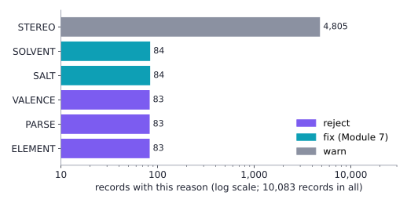

Every chemical data set has broken records in it. A vendor file holds a SMILES whose ring is never
closed, a carbon with five bonds, a hydrochloride salt written into the structure, a compound with
an element the library should never contain. If these records reach the database, they spread:
a fingerprint is computed from a salt, a model is trained on a mixture, a search misses a compound
because it is stored with its counter-ion. Fourches, Muratov and Tropsha (2010) set out the steps
of chemical curation (removing inorganic compounds, salts and mixtures, validating structures,
deleting duplicates) and described case studies where curating the raw data significantly improved
a model's predictions. Public databases now do this in code: ChEMBL, for example, checks its
structures with an open-source pipeline built on RDKit (section 7).

A data engineer turns that curation into a **gate**: every record is read and checked before it is
stored, and it leaves the gate in one of two ways. It is accepted, or it is put in **quarantine**
with the reasons written down. Nothing is dropped without a trace.

By the end of this module you will be able to:

- explain why a failed parse must become a recorded reason, never a missing row;
- capture RDKit's own error messages for each record;
- write checks that return structured reasons (a code, a message and an action), not True or False;
- check elements, fragments, charges, stereochemistry and size;
- run a validation gate over a library and produce a quarantine table and a summary by reason;
- measure a validator against a known truth: what it caught, what it missed and its false alarms.

Everything here runs in a browser notebook or on any laptop: you need Python, RDKit, pandas and
pyarrow.

## Setup

Everything this lesson needs is imported and set here, so the settings can be changed in one place.
That includes the library's policy (the elements it allows, the salts and solvents it knows, its
size limits), which section 3 explains check by check: a policy kept in one place can be read,
reviewed and changed without hunting through the code. Pipeline steps report with `log`; `print`
is kept for showing you results; Module 1 explains why.

```python
import logging
import re
from collections import Counter
from collections.abc import Callable
from pathlib import Path
from typing import NamedTuple

import pandas as pd
from rdkit import Chem, RDLogger, rdBase
from rdkit.Chem import Descriptors

import chemlib

# log lines: level and message only, so the lesson's outputs are the same on every run
# (a real job would add "%(asctime)s" to the format)
logging.basicConfig(level=logging.INFO, format="%(levelname)s %(message)s", force=True)
log = logging.getLogger(__name__)

# the teaching library and the damage done to it: change the size or seeds for another sample
LIBRARY_SIZE = 10_000  # molecules made by chemlib
LIBRARY_SEED = 6
DEFECT_RATE = 0.05  # fraction of molecules given a fault by add_defects
DEFECT_SEED = 7
WORK = Path("work")  # where the accepted records and the quarantine are written

# the library's policy (section 3): edit these lists and limits to suit another collection
ALLOWED_ELEMENTS = {"H", "B", "C", "N", "O", "F", "P", "S", "Cl", "Br", "I"}
SALTS = {"Cl": "hydrogen chloride", "[Cl-]": "chloride", "Br": "hydrogen bromide",
         "[Na+]": "sodium", "[K+]": "potassium", "O=C(O)C(F)(F)F": "trifluoroacetic acid"}
SOLVENTS = {"O": "water", "CCO": "ethanol", "CO": "methanol", "CS(C)=O": "DMSO",
            "ClCCl": "dichloromethane"}  # fmt: skip
HEAVY_ATOMS = (6, 50)  # smallest and largest number of heavy atoms in the largest piece
MAX_WEIGHT = 700.0  # largest molecular weight of the largest piece, in g/mol

WORK.mkdir(exist_ok=True)
```

## 1. What goes wrong without a gate

We start from a teaching library made by `chemlib` (the course's library generator, as in Module 2)
and damage it on purpose with `add_defects`. The damage is on record: the `defect` column says
which fault each row was given, so we can check our validator against the truth at the end.

```python
library = chemlib.library(LIBRARY_SIZE, seed=LIBRARY_SEED)
dirty = chemlib.add_defects(library, rate=DEFECT_RATE, seed=DEFECT_SEED)
print(len(dirty), "records")
print(dirty["defect"].replace("", "(none)").value_counts().sort_index().to_string())
```
```output
10083 records
defect
(none)       9583
duplicate      83
element        83
invalid        83
salt           84
solvent        84
valence        83
```

A rate of 0.05 damaged 500 of the 10,000 molecules, split as evenly as possible across six kinds
of fault: 417 rows were changed in place, and the 83 duplicates were added as new rows. Here is one example of each, as the file holds it:

```python
for kind, row in dirty[dirty["defect"] != ""].groupby("defect").head(1).iterrows():
    print(f"{row['defect']:10} {row['smiles']}")
```
```output
valence    C(C)(C)(C)(C)c1cc(Cl)c(nc1)Nc2nc(N8CCOCC8)c(c8cn[nH]c8)c(Br)n2
duplicate  S(=O)(c1cccc(c1)C(NC(C(NC)=O)CN1CCOCC1)=O)(=O)C
solvent    c1cc(c8cn[nH]c8)c(nc1)Nc2nc(c8ccc(F)cc8)c(C(=O)N)c(N(C)C)n2.CCO
element    c1c(c8ccc(F)cc8)cc(cc1c8ccco8)[Se](=O)NC(CC)C(=O)NO
salt       c1cc(c8ccco8)c(nc1)Nc2nc(C(=O)C)c(O)c(CN)n2.Cl
invalid    ccc(N8CCCC8)c(nc1)Nc2nc(C(=O)C)c(C(C)C)c(C8CC8)n2
```

The usual first script reads every SMILES with RDKit, silences RDKit's warnings because they clutter
the screen, and keeps what worked:

```python
RDLogger.DisableLog("rdApp.*")  # silence RDKit, as many scripts do
mols = [Chem.MolFromSmiles(s) for s in dirty["smiles"]]
RDLogger.EnableLog("rdApp.*")
kept = [m for m in mols if m is not None]
print(len(dirty) - len(kept), "records vanished, with no reason recorded")
in_pieces = sum(len(Chem.GetMolFrags(m)) > 1 for m in kept)
with_selenium = sum(any(a.GetSymbol() == "Se" for a in m.GetAtoms()) for m in kept)
print(in_pieces, "kept records are in more than one piece")
print(with_selenium, "kept records contain selenium")
```
```output
166 records vanished, with no reason recorded
168 kept records are in more than one piece
83 kept records contain selenium
```

Two failures at once. 166 records disappeared, and nobody can say which or why: a chemist who asks
"where is compound ML-00123456?" gets no answer. And 251 broken records went through untouched,
because RDKit reads a salt or a selenium compound without complaint: they are valid molecules,
just not ones this library should store. A gate fixes both: it keeps every record, and it checks
more than "can RDKit read it?".

## 2. Reading a record without losing the reason

### Reasons, not True or False

A check that answers only True or False tells you *that* a record failed, not *why*, and a
quarantine full of "False" cannot be acted on. Each of our checks returns a list of **issues**
instead: a short, stable **code** that programs can count and filter on, a **message** a chemist
can read, and the **action** the gate should take.

```python
class Issue(NamedTuple):
    """One problem found in a record: what it is, in words, and what to do about it."""

    code: str  # a short, stable reason code, e.g. "VALENCE"
    message: str  # what a person needs to know to act on it
    action: str  # "reject" (cannot be repaired), "fix" (Module 7 repairs it) or "warn"
```

The three actions are a policy, and writing them down makes the policy visible. **Reject** means
the record cannot be repaired automatically: someone has to go back to the source. **Fix** means
a standard repair exists (stripping a salt, neutralising a charge), which Module 7 applies; until
then the record waits in quarantine. **Warn** means the record is stored, with the issue recorded
beside it.

### Capturing RDKit's messages

When RDKit cannot read a SMILES it returns `None` and writes its reason to a log. We send that log
to Python's `logging` module, the same system our own `log` uses, and collect the messages, so each
record keeps its own.

This works because every logger can have its own **handlers**, which decide where its messages go.
The Setup block gave the root logger one handler, which writes our pipeline's lines to the screen.
RDKit's messages go to a logger named `"rdkit"`, and we give it a different handler: one that
keeps each message in a list until the gate reads it. Setting `propagate = False` stops the same
messages also reaching the root logger's screen handler, so a reason is recorded with its record
instead of scrolling past:

```python
class Collector(logging.Handler):
    """Keeps RDKit's log messages, without their timestamps, until they are read."""

    def __init__(self) -> None:
        """Start with no messages."""
        super().__init__()
        self.messages: list[str] = []

    def emit(self, record: logging.LogRecord) -> None:
        """Keep one message, with RDKit's "[hh:mm:ss] " prefix removed."""
        text = re.sub(r"^\[\d\d:\d\d:\d\d\] ", "", record.getMessage()).strip()
        self.messages.append(text)


rdBase.LogToPythonLogger()
collector = Collector()
rdkit_log = logging.getLogger("rdkit")
rdkit_log.handlers = [collector]  # replace RDKit's own handler, which prints to the screen
rdkit_log.propagate = False  # keep RDKit's messages away from our screen handler
```

Reading happens in two steps. `Chem.MolFromSmiles(s, sanitize=False)` only checks the syntax: a
ring that is never closed, or a stray bracket, fails here. **Sanitisation** then checks the
chemistry: valences, aromaticity, ring perception (the RDKit Book lists every step).
`Chem.DetectChemistryProblems` runs those checks and returns every problem it finds, each with a
type and a message, instead of stopping at the first (`Chem.SanitizeMol(mol, catchErrors=True)`
is the other way to do it, but reports only the first failure).

```python
PROBLEM_CODES = {
    "AtomValenceException": "VALENCE",
    "AtomKekulizeException": "AROMATICITY",
    "KekulizeException": "AROMATICITY",
}


def parse(smiles: str) -> tuple[Chem.Mol | None, list[Issue]]:
    """Read a SMILES and sanitise it, keeping RDKit's reasons when either step fails.

    Returns the sanitised molecule (or None) and a list of issues.
    """
    collector.messages.clear()
    mol = Chem.MolFromSmiles(smiles, sanitize=False)
    if mol is None:
        message = "; ".join(collector.messages) or "the SMILES could not be read"
        return None, [Issue("PARSE", message, "reject")]
    problems = Chem.DetectChemistryProblems(mol)
    if problems:
        issues = [
            Issue(PROBLEM_CODES.get(p.GetType(), "SANITISATION"), p.Message(), "reject")
            for p in problems
        ]
        return None, issues
    Chem.SanitizeMol(mol)
    return mol, []


examples = {
    "ethanol": "CCO",
    "unclosed ring": "c1ccccc",
    "five-bond carbon": "C(C)(C)(C)(C)C",
    "five-atom aromatic ring": "c1cccc1",
}
for name, smiles in examples.items():
    mol, issues = parse(smiles)
    print(f"{name}: {'read' if mol else 'not read'}")
    for issue in issues:
        print(f"    {issue.code}: {issue.message}")
```
```output
ethanol: read
unclosed ring: not read
    PARSE: SMILES Parse Error: unclosed ring for input: 'c1ccccc'
five-bond carbon: not read
    VALENCE: Explicit valence for atom # 0 C, 5, is greater than permitted
five-atom aromatic ring: not read
    AROMATICITY: Can't kekulize mol.  Unkekulized atoms: 0 1 2 3 4
```

Every failure now carries RDKit's own words, which point to the atom at fault.

### Turning RDKit's messages down, or off

Silencing RDKit was the first script's mistake, but some messages really are noise: a pipeline
that has recorded a parse failure as an issue does not need it on the screen as well, and a
standardiser can write several lines of chatter per molecule. RDKit gives you five controls, from
the bluntest to the most precise. To see what each one lets through, `heard` runs some code and
returns what reached our collector:

```python
def heard(action: Callable[[], object]) -> list[str]:
    """Run some RDKit code and return the messages that reached the collector."""
    collector.messages.clear()
    action()
    return collector.messages.copy()


def two_problems() -> None:
    """Read one SMILES that fails (an error) and one with a lone hydrogen (a warning)."""
    Chem.MolFromSmiles("c1ccccc")
    Chem.MolFromSmiles("C.[H]")


print("everything on:", *heard(two_problems), sep="\n    ")
```
```output
everything on:
    SMILES Parse Error: unclosed ring for input: 'c1ccccc'
    WARNING: not removing hydrogen atom without neighbors
```

RDKit sorts its messages into four channels, `rdApp.debug`, `rdApp.info`, `rdApp.warning` and
`rdApp.error`, and `LogToPythonLogger` delivers them to the `"rdkit"` logger at the matching
`logging` level. The first two controls work in RDKit itself, before a message is made, so they
apply to every handler at once:

```python
# 1. one channel off, here the warnings, then on again
RDLogger.DisableLog("rdApp.warning")
print("warnings off:", *heard(two_problems), sep="\n    ")
RDLogger.EnableLog("rdApp.warning")

# 2. everything off, but only inside the with block: the rest of the program is untouched
with rdBase.BlockLogs():
    print("inside BlockLogs:", heard(two_problems))
print("after BlockLogs:", len(heard(two_problems)), "messages")
```
```output
warnings off:
    SMILES Parse Error: unclosed ring for input: 'c1ccccc'
inside BlockLogs: []
after BlockLogs: 2 messages
```

The next two work in Python's `logging`, after the message is made, so different destinations can
get different amounts: here the collector keeps every message and a file only the errors.

```python
# 3. a level on RDKit's logger: here only errors and worse pass
rdkit_log.setLevel(logging.ERROR)
print("logger at ERROR:", *heard(two_problems), sep="\n    ")
rdkit_log.setLevel(logging.WARNING)  # back to RDKit's default: warnings and errors

# 4. a level on one handler: the collector keeps everything, a file handler only errors
to_file = logging.FileHandler(WORK / "rdkit.log", mode="w", encoding="utf-8")
to_file.setLevel(logging.ERROR)
rdkit_log.addHandler(to_file)
print("collector:", len(heard(two_problems)), "messages")
rdkit_log.removeHandler(to_file)
to_file.close()
logged = (WORK / "rdkit.log").read_text(encoding="utf-8").strip()
print("rdkit.log:", re.sub(r"^\[\d\d:\d\d:\d\d\] ", "", logged))  # without the time
```
```output
logger at ERROR:
    SMILES Parse Error: unclosed ring for input: 'c1ccccc'
collector: 2 messages
rdkit.log: SMILES Parse Error: unclosed ring for input: 'c1ccccc'
```

The fifth is the one most scripts use, and the one section 1 showed going wrong:
`RDLogger.DisableLog("rdApp.*")` switches every channel off for the whole program, until something
switches them on again. Use it only where the reason for every failure is recorded some other way,
as the later modules of this course do once they keep issues like ours. Two more things to know:
the settings belong to one process, so worker processes (Module 9) need them set in each worker;
and RDKit's logger starts at `WARNING`, which is why the info channel's chatter (a standardiser
reporting each step) is not seen until you lower the level to `INFO`.

## 3. Checks on a molecule that can be read

A molecule that RDKit reads may still be wrong for the library. Each check below looks at one
property, returns a list of issues (empty when all is well), and is short enough to read in full.

### Elements

A drug-like screening library contains a handful of elements. An **allow-list** names them
(`ALLOWED_ELEMENTS`, set in the Setup block); anything else is either a mistake or a compound the
library should not hold. An allow-list is safer than a list of forbidden elements, because it
rejects what nobody thought of:

```python
def check_elements(mol: Chem.Mol) -> list[Issue]:
    """Elements outside the allow-list."""
    found = sorted({atom.GetSymbol() for atom in mol.GetAtoms()} - ALLOWED_ELEMENTS)
    if not found:
        return []
    return [Issue("ELEMENT", f"element not allowed: {', '.join(found)}", "reject")]


print(check_elements(Chem.MolFromSmiles("CC(=O)Oc1ccccc1C(=O)O")))
print(check_elements(Chem.MolFromSmiles("C[Se]c1ccccc1")))
```
```output
[]
[Issue(code='ELEMENT', message='element not allowed: Se', action='reject')]
```

### Fragments: salts, solvents and mixtures

A record in more than one piece holds more than one molecule. Module 1 found the pieces of sodium
acetate from the graph Laplacian; RDKit's `GetMolFrags` gives the same answer directly. What to do
depends on what the extra pieces are. A counter-ion or a solvent can be stripped to leave one
parent compound (Module 7 does it), so those are fixable. Two drug-sized pieces are a **mixture**:
no rule can say which one was tested, so the record is rejected. Real pipelines keep lists of
known salts and solvents for this; ours, `SALTS` and `SOLVENTS` in the Setup block, are short
(six counter-ions and five solvents, each with its name):

```python
def check_fragments(mol: Chem.Mol) -> list[Issue]:
    """More than one molecule in the record: salts and solvents (fixable) or a mixture."""
    pieces = sorted(Chem.MolToSmiles(f) for f in Chem.GetMolFrags(mol, asMols=True))
    if len(pieces) == 1:
        return []
    largest = max(pieces, key=lambda s: Chem.MolFromSmiles(s).GetNumHeavyAtoms())
    issues = []
    for piece in pieces:
        if piece == largest:
            continue
        if piece in SALTS:
            issues.append(Issue("SALT", f"counter-ion {piece} ({SALTS[piece]})", "fix"))
        elif piece in SOLVENTS:
            issues.append(Issue("SOLVENT", f"solvent {piece} ({SOLVENTS[piece]})", "fix"))
        else:
            issues.append(Issue("MIXTURE", f"a second compound: {piece}", "reject"))
    return issues


records = {
    "sodium acetate": "CC(=O)[O-].[Na+]",
    "phenol hydrate": "c1ccccc1O.O",
    "triethylamine HCl": "CCN(CC)CC.Cl",
    "aspirin + paracetamol": "CC(=O)Oc1ccccc1C(=O)O.CC(=O)Nc1ccc(O)cc1",
    "benzene + ethanol": "c1ccccc1.CCO",
}
for name, smiles in records.items():
    for issue in check_fragments(Chem.MolFromSmiles(smiles)):
        print(f"{name:22} {issue.code}: {issue.message} -> {issue.action}")
```
```output
sodium acetate         SALT: counter-ion [Na+] (sodium) -> fix
phenol hydrate         SOLVENT: solvent O (water) -> fix
triethylamine HCl      SALT: counter-ion Cl (hydrogen chloride) -> fix
aspirin + paracetamol  MIXTURE: a second compound: CC(=O)Nc1ccc(O)cc1 -> reject
benzene + ethanol      SOLVENT: solvent CCO (ethanol) -> fix
```

The last record shows the limit of a list. Ethanol is on the solvent list and benzene is the larger
piece, so the record is read as benzene with ethanol as its solvent. For a solvate that would be
right; for a bottle of a benzene and ethanol mixture it is wrong, and no rule can tell the two
apart from the structure alone. Lists like these need a person to own them.

### Charges

A record with a net charge is either half of a salt (the other half is missing) or a charged form
of a neutral compound, such as a protonated amine. Both can usually be neutralised (Module 7).
Charges that cancel inside the molecule are different: a nitro group is written with a `+` and a
`-` in RDKit, and a zwitterionic amino acid has both. We flag only a net charge:

```python
def check_charge(mol: Chem.Mol) -> list[Issue]:
    """A net formal charge on the record (charges that cancel, as in nitro groups, are fine)."""
    net = Chem.GetFormalCharge(mol)
    if net == 0:
        return []
    return [Issue("CHARGE", f"net charge {net:+d}", "fix")]


for smiles in ["C[N+](=O)[O-]", "[NH3+]CC(=O)[O-]", "CC[NH3+]", "CC(=O)[O-]"]:
    print(f"{smiles:18} {check_charge(Chem.MolFromSmiles(smiles))}")
```
```output
C[N+](=O)[O-]      []
[NH3+]CC(=O)[O-]   []
CC[NH3+]           [Issue(code='CHARGE', message='net charge +1', action='fix')]
CC(=O)[O-]         [Issue(code='CHARGE', message='net charge -1', action='fix')]
```

### Stereochemistry

Module 2 showed that the two enantiomers of ibuprofen are different molecules. A record that has a
stereocentre but does not say which way round it is (a racemate, or simply missing information)
cannot be told apart from either enantiomer. `Chem.FindPotentialStereo` lists every atom and double
bond that could carry stereochemistry and whether the record specifies it:

```python
def check_stereo(mol: Chem.Mol) -> list[Issue]:
    """Stereocentres and double bonds whose configuration the record does not give."""
    missing = [
        info
        for info in Chem.FindPotentialStereo(mol)
        if info.specified == Chem.StereoSpecified.Unspecified
    ]
    if not missing:
        return []
    centres = sum(info.type == Chem.StereoType.Atom_Tetrahedral for info in missing)
    bonds = len(missing) - centres
    return [Issue("STEREO", f"unassigned: {centres} stereocentre(s), {bonds} double bond(s)",
                  "warn")]  # fmt: skip


for smiles in ["CC(C)Cc1ccc(cc1)[C@H](C)C(=O)O", "CC(C)Cc1ccc(cc1)C(C)C(=O)O", "CC=CC"]:
    print(f"{smiles:32} {check_stereo(Chem.MolFromSmiles(smiles))}")
```
```output
CC(C)Cc1ccc(cc1)[C@H](C)C(=O)O   []
CC(C)Cc1ccc(cc1)C(C)C(=O)O       [Issue(code='STEREO', message='unassigned: 1 stereocentre(s), 0 double bond(s)', action='warn')]
CC=CC                            [Issue(code='STEREO', message='unassigned: 0 stereocentre(s), 1 double bond(s)', action='warn')]
```

Whether this is a warning or a rejection is a policy decision. A screening library made by
combining building blocks is often sold as racemates, so rejecting every unassigned centre would
reject much of it; a registration system for a single, purified clinical compound would reject it.
Here we warn, and the warning is stored with the record.

### Size

Size limits catch records that cannot be what the library holds: a lone solvent molecule that lost
its compound, a fragment cut off by a broken export, a polymer or peptide in a small-molecule
collection. We measure the largest piece, because a counter-ion says nothing about the compound,
against the limits `HEAVY_ATOMS` and `MAX_WEIGHT` set in the Setup block:

```python
def check_size(mol: Chem.Mol) -> list[Issue]:
    """The largest piece must be between the heavy-atom limits and below the weight limit."""
    piece = max(Chem.GetMolFrags(mol, asMols=True), key=lambda f: f.GetNumHeavyAtoms())
    heavy = piece.GetNumHeavyAtoms()
    weight = Descriptors.MolWt(piece)
    issues = []
    if not HEAVY_ATOMS[0] <= heavy <= HEAVY_ATOMS[1]:
        issues.append(Issue("SIZE", f"{heavy} heavy atoms (allowed {HEAVY_ATOMS})", "reject"))
    if weight > MAX_WEIGHT:
        issues.append(Issue("WEIGHT", f"molecular weight {weight:.0f} (max {MAX_WEIGHT:.0f})",
                            "reject"))  # fmt: skip
    return issues


for smiles in ["CCO", "CC(=O)Oc1ccccc1C(=O)O", "C" * 60]:
    print(f"{smiles[:24]:26} {check_size(Chem.MolFromSmiles(smiles))}")
heavy = [Chem.MolFromSmiles(s).GetNumHeavyAtoms() for s in library["smiles"]]
print("heavy atoms in the clean library:", min(heavy), "to", max(heavy))
```
```output
CCO                        [Issue(code='SIZE', message='3 heavy atoms (allowed (6, 50))', action='reject')]
CC(=O)Oc1ccccc1C(=O)O      []
CCCCCCCCCCCCCCCCCCCCCCCC   [Issue(code='SIZE', message='60 heavy atoms (allowed (6, 50))', action='reject'), Issue(code='WEIGHT', message='molecular weight 844 (max 700)', action='reject')]
heavy atoms in the clean library: 14 to 39
```

The limits are a property of the library, not of chemistry: ours allow every molecule in the clean
library, with room to spare. Choose them from the data you expect, and write them down.

## 4. The gate

The gate runs the parse step and, if the molecule can be read, every check. A record is accepted
when it has no issues or only warnings, and quarantined otherwise. The rule fits in two functions:

```python
CHECKS = [check_elements, check_fragments, check_charge, check_stereo, check_size]


def validate(smiles: str) -> list[Issue]:
    """Every issue found in one record: from parsing, or from every check if it can be read."""
    mol, issues = parse(smiles)
    if mol is None:
        return issues
    for check in CHECKS:
        issues = issues + check(mol)
    return issues


def verdict(issues: list[Issue]) -> str:
    """Accept a record with no issues or only warnings; quarantine everything else."""
    blocking = [i for i in issues if i.action != "warn"]
    return "quarantine" if blocking else "accept"


for smiles in ["CC(=O)Oc1ccccc1C(=O)O", "CC(C)Cc1ccc(cc1)C(C)C(=O)O", "CC[NH3+].[Cl-]"]:
    issues = validate(smiles)
    print(f"{smiles:30} {verdict(issues):10} {[i.code for i in issues]}")
```
```output
CC(=O)Oc1ccccc1C(=O)O          accept     []
CC(C)Cc1ccc(cc1)C(C)C(=O)O     accept     ['STEREO']
CC[NH3+].[Cl-]                 quarantine ['SALT', 'SIZE']
```

The ethylammonium chloride record shows why every issue is kept rather than only the first: it is a
salt, and also too small for this library. A chemist fixing the record at its source needs both.


Now the whole library. Each record gets its issues, its codes and its verdict, in new columns
beside the original data, so nothing about the record is lost. This is the step a nightly job
would run unattended, so it reports with `log`, and the quarantine count is a warning: it is the
number someone should look at in the morning.

```python
results = dirty.copy()
results["issues"] = [validate(s) for s in results["smiles"]]
results["codes"] = [";".join(i.code for i in issues) for issues in results["issues"]]
results["verdict"] = [verdict(issues) for issues in results["issues"]]
assert len(results) == len(dirty), "every record leaves the gate"
n_quarantined = int((results["verdict"] == "quarantine").sum())
log.info("validated %d records: %d accepted", len(results), len(results) - n_quarantined)
log.warning("quarantined %d records", n_quarantined)
```
```output
INFO validated 10083 records: 9666 accepted
WARNING quarantined 417 records
```

The assertion is the point of the whole module: every one of the 10,083 records came out, either
accepted or quarantined. The **quarantine table** has one row per issue, so it can be filtered,
counted and handed to whoever fixes the source:

```python
quarantine = (
    results[results["verdict"] == "quarantine"]
    .explode("issues")
    .assign(
        code=lambda t: [i.code for i in t["issues"]],
        message=lambda t: [i.message for i in t["issues"]],
        action=lambda t: [i.action for i in t["issues"]],
    )[["id", "smiles", "code", "message", "action"]]
    .sort_values(["id", "code"])
    .reset_index(drop=True)
)
print(len(quarantine), "issues on", quarantine["id"].nunique(), "quarantined records")
print(quarantine[["id", "code", "message"]].head(6).to_string(index=False, max_colwidth=60))
```
```output
541 issues on 417 quarantined records
         id    code                                                      message
ML-00006917 VALENCE Explicit valence for atom # 0 C, 5, is greater than permi...
ML-00007690   PARSE SMILES Parse Error: unclosed ring for input: 'ccc(O)c(cc1...
ML-00009561 VALENCE Explicit valence for atom # 0 C, 5, is greater than permi...
ML-00015388   PARSE SMILES Parse Error: unclosed ring for input: 'ccc(c8cn[nH...
ML-00021654 SOLVENT                                        solvent CCO (ethanol)
ML-00027465    SALT                           counter-ion Cl (hydrogen chloride)
```

The **summary by reason** is what a team reviews each day: which faults arrive, how often, and
which can be repaired. It counts records, not issues, over the whole library, so warnings on
accepted records appear too. A `Counter` (from the standard library's `collections`, imported in
the Setup block) is made for this: it is a dictionary that starts every count at zero, so each
record simply adds one to each of its reasons. Taking the reasons of a record as a set first means
a record with two issues of one kind is counted once:

```python
records_per_reason = Counter()
for issues in results["issues"]:
    records_per_reason.update({(i.code, i.action) for i in issues})
summary = pd.DataFrame(
    [(code, action, n) for (code, action), n in records_per_reason.items()],
    columns=["code", "action", "records"],
).sort_values(["records", "code"], ascending=[False, True])
print(summary.to_string(index=False))
```
```output
   code action  records
 STEREO   warn     4805
   SALT    fix       84
SOLVENT    fix       84
ELEMENT reject       83
  PARSE reject       83
VALENCE reject       83
```



Two things stand out. Nearly half the records (4,805 of 10,083) have at least one unassigned
stereocentre or double bond: `chemlib` writes no stereochemistry, like many enumerated libraries,
so this is a fact about the source rather than a fault in individual records, and it is exactly
why it is a warning. And no record was flagged for a net charge, a mixture or its size: the
damaged library contains none (every salt `add_defects` wrote with this seed is a hydrochloride,
`.Cl`, which is neutral). Those checks are still worth running: the next vendor's file may be
full of them, and section 3 showed each one working.

Accepted records and the quarantine are written out side by side. The issues are stored as their
codes and messages, plain text that any tool can read:

```python
accepted = results[results["verdict"] == "accept"].drop(columns=["issues"])
accepted_path = WORK / "accepted.parquet"
quarantine_path = WORK / "quarantine.parquet"
accepted.to_parquet(accepted_path, index=False)
quarantine.to_parquet(quarantine_path, index=False)
n_quarantined = quarantine["id"].nunique()
assert len(accepted) + n_quarantined == len(dirty), "every record is in one file or the other"
log.info("wrote %d accepted records to %s", len(accepted), accepted_path.as_posix())
log.info("wrote %d issues on %d quarantined records to %s", len(quarantine), n_quarantined,
         quarantine_path.as_posix())  # fmt: skip
```
```output
INFO wrote 9666 accepted records to work/accepted.parquet
INFO wrote 541 issues on 417 quarantined records to work/quarantine.parquet
```

## 5. Checks across records: duplicates

Every check so far looks at one record at a time. A duplicate is different: it is a perfectly good
record whose molecule is already in the table, so no record-level check can see it. It takes a
check across records, on identity. As in Module 3, the InChIKey is the identity: two records with
the same key are the same molecule, however their SMILES are written. We keep the first record (by
id) and flag the rest, with a pointer to the record they repeat:

```python
readable = results[results["verdict"] == "accept"].copy()
readable["inchikey"] = [Chem.MolToInchiKey(Chem.MolFromSmiles(s)) for s in readable["smiles"]]
readable = readable.sort_values("id")
first_id = readable.groupby("inchikey")["id"].transform("first")
repeats = readable[readable["id"] != first_id]
print(len(repeats), "accepted records repeat an earlier one")
print(repeats.assign(repeats=first_id)[["id", "repeats", "defect"]].head(3).to_string(index=False))
```
```output
109 accepted records repeat an earlier one
             id     repeats    defect
ML-00057592-dup ML-00057592 duplicate
ML-00073568-dup ML-00073568 duplicate
ML-00075590-dup ML-00075590 duplicate
```

There were 83 duplicates on record, so where do the other 26 come from? They are in the library
itself. As the `chemlib` documentation says, a few combinations of scaffold and substituents give
the same molecule by symmetry (a 3,5-disubstituted benzene with the two groups swapped is the same
compound), just as in real enumerated libraries. The validator found real duplicates that the
record of defects never listed.

Flagging, not deleting, is deliberate: two records of one molecule may carry different prices or
assay results, and merging them is a decision for the next stage. Duplicates also hide behind
salts and charges (the hydrochloride and the free base have different InChIKeys); Module 7 finds
those after standardisation.

## 6. Checking the validator against the truth

A validator is software, and software is tested. Because `chemlib` recorded every fault it made,
we can compare the validator's verdicts with the truth. A **confusion table** puts the true fault in
the rows and the verdict in the columns:

```python
results["duplicate flag"] = results["id"].isin(repeats["id"])
results["outcome"] = results["verdict"].where(~results["duplicate flag"], "accept, duplicate")
truth = results["defect"].replace("", "(none)")
print(pd.crosstab(truth, results["outcome"]).to_string())
```
```output
outcome    accept  accept, duplicate  quarantine
defect                                          
(none)       9557                 26           0
duplicate       0                 83           0
element         0                  0          83
invalid         0                  0          83
salt            0                  0          84
solvent         0                  0          84
valence         0                  0          83
```

Read it row by row. Every invalid, valence, element, salt and solvent record was quarantined
(caught: 417 of 417), and no clean record was quarantined (no false alarms). Every duplicate on
record was flagged (83 of 83), and nothing was missed. The 26 clean records flagged as duplicates
look like false alarms in this table, but section 5 showed they are real: the record of truth is
incomplete, not the validator. That is the usual situation with real data, and the reason a
disagreement between a validator and a "truth" is investigated, never just counted.

A perfect score on faults we planted ourselves proves less than it seems. The validator was written
knowing what `add_defects` does; a new source will bring faults nobody planned for. The table is a
regression test: it must stay perfect when the code changes.

Which reason codes did each kind of fault produce? This is where a validator's behaviour is
understood, not just scored:

```python
quarantined = results[results["verdict"] == "quarantine"]
codes = quarantined["codes"].str.split(";").explode()
print(pd.crosstab(quarantined["defect"].reindex(codes.index), codes).to_string())
```
```output
codes    ELEMENT  PARSE  SALT  SOLVENT  STEREO  VALENCE
defect                                                 
element       83      0     0        0      47        0
invalid        0     83     0        0       0        0
salt           0      0    84        0      36        0
solvent        0      0     0       84      40        0
valence        0      0     0        0       0       84
```

Each fault produced the reason it should, and only that blocking reason. The table counts issues,
so two details need explaining. The valence row shows 84 issues for 83 records: one record had its
five-bond carbon written in front of a carbonyl oxygen (`C(C)(C)(C)(C)O=C(...`), which gave that
oxygen three bonds as well, and `DetectChemistryProblems` reported both atoms. And the stereo
warnings on element, salt and solvent records are real too: those molecules have unassigned
stereocentres like half the library. The records that failed to parse or sanitise carry no stereo
warning, because no further checks can run on a molecule that cannot be read.

## 7. From a lesson to a pipeline

The gate here checks 10,083 records in about a quarter of a minute on a laptop, one record at a
time. The same two functions scale to millions: run them on batches from `chemlib.stream` (or
chunks of a file), write each batch's accepted records and quarantine to Parquet, and spread
batches over processes (Module 9). Keep the reason codes
stable, because dashboards and alerts count them (Module 14), and record the validator's version
with its output, so a record quarantined last month can be explained today (Module 13).

The ChEMBL database has curated its structures with an open-source pipeline built on RDKit since
release 26, the ChEMBL Structure Pipeline (Bento et al., 2020). Its checker returns for each issue a description and
a penalty score from 0 to 9 that reflects how serious it is, the same idea as our code, message and
action. Module 12 returns to validation for whole records and tables, with Pydantic and Pandera.

## Try it yourself

The homework is a few questions, answered by running code like the code above: in a new cell at
the end of the notebook, or in a script. It is at the end of the lesson's page, and in
`homework.md` in the module's folder. The answers are published after the cohort's deadline.

## Further reading

- Fourches, D., Muratov, E. & Tropsha, A. (2010). Trust, But Verify: On the Importance of Chemical
  Structure Curation in Cheminformatics and QSAR Modeling Research. *Journal of Chemical
  Information and Modeling*, 50(7), 1189–1204. <https://doi.org/10.1021/ci100176x>
- Bento, A. P., Hersey, A., Félix, E., Landrum, G., Gaulton, A., Atkinson, F., Bellis, L. J.,
  De Veij, M. & Leach, A. R. (2020). An open source chemical structure curation pipeline using
  RDKit. *Journal of Cheminformatics*, 12, 51. <https://doi.org/10.1186/s13321-020-00456-1>
- The ChEMBL Structure Pipeline (source code and documentation, including its checker).
  <https://github.com/chembl/ChEMBL_Structure_Pipeline>
- The RDKit documentation. *The RDKit Book*, section "Molecular Sanitization".
  <https://www.rdkit.org/docs/RDKit_Book.html#molecular-sanitization>
- Daylight Chemical Information Systems. *Daylight Theory Manual*, chapter on SMILES (valences and
  the rules for writing a valid SMILES). <https://www.daylight.com/dayhtml/doc/theory/>
