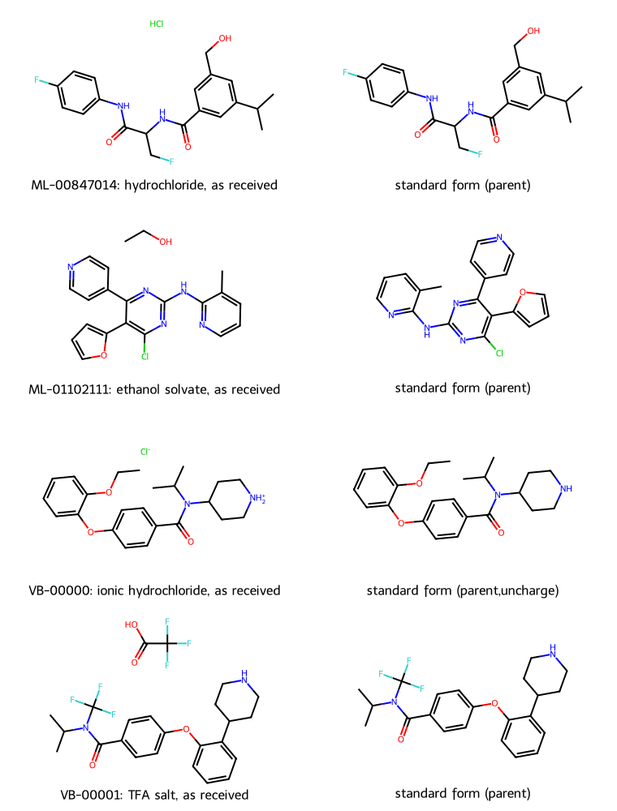

A compound reaches a database in many forms. One vendor sells it as the free base, another as the
hydrochloride salt, a third writes the salt with the charges drawn in, and an assay file records
it with a molecule of solvent. Chemically these are one compound under test; as records they have
different SMILES and different InChIKeys, so a database that stores them as they come holds four
compounds, splits their assay results four ways, and never notices.

**Standardisation** turns every record into one canonical form before its identity is computed and
before it is stored. It is a transformation of the data, so it needs the same care as any code that
changes data: it must be a single, deterministic function, its rules must be versioned and recorded
with every output, and it must be tested.

By the end of this module you will be able to:

- explain the four standard steps (clean-up, parent fragment, neutralisation, canonical tautomer)
  and what each one changes;
- run them with RDKit's `rdMolStandardize`;
- write standardisation as one pure function with a versioned, hashed configuration;
- test it for idempotency, invariance and known cases;
- run it on a library, record its provenance, and find the duplicates it reveals;
- judge when canonical tautomers are worth their cost.

Everything here runs in a browser notebook or on any laptop: you need Python, RDKit, pandas and
pyarrow.

## Setup

Everything this lesson needs is imported and set here, so the settings can be changed in one place.
Pipeline steps report with `log`; `print` is kept for showing you results; Module 1 explains why.

```python
import hashlib
import json
import logging
import time
from collections.abc import Callable
from pathlib import Path
from typing import NamedTuple

import pandas as pd
import rdkit
from rdkit import Chem, RDLogger
from rdkit.Chem.MolStandardize import rdMolStandardize

import chemlib

# log lines: level and message only, so the lesson's outputs are the same on every run
# (a real job would add "%(asctime)s" to the format)
logging.basicConfig(level=logging.INFO, format="%(levelname)s %(message)s", force=True)
log = logging.getLogger(__name__)

# tests of the standardiser (section 4): a sample of the library, and random SMILES of each
TEST_SAMPLE_SIZE = 500  # molecules checked for idempotency and invariance
TEST_SAMPLE_SEED = 31
RANDOM_SMILES = 3  # randomly written SMILES per molecule in the invariance test
RANDOM_SMILES_SEED = 7

# the dirty library of section 5: change the size or seeds for another sample
LIBRARY_SIZE = 4_000  # molecules made by chemlib for vendor A
LIBRARY_SEED = 21
DEFECT_RATE = 0.05  # fraction of molecules given a fault by add_defects
DEFECT_SEED = 22
VENDOR_B_SIZE = 200  # vendor A compounds that vendor B also sells, as salts
VENDOR_B_SEED = 5

# the short validation gate of section 5 (Module 6 has the full one)
ALLOWED_ELEMENTS = {"H", "B", "C", "N", "O", "F", "P", "S", "Cl", "Br", "I"}
SALTS_AND_SOLVENTS = {"Cl", "[Cl-]", "Br", "[Na+]", "[K+]", "O=C(O)C(F)(F)F", "O", "CCO", "CO"}

TAUTOMER_SAMPLE_SIZE = 200  # molecules timed with and without the tautomer step (section 6)
WORK = Path("work")  # where the standardised table is written

WORK.mkdir(exist_ok=True)
```

## 1. One compound, many records

Take one molecule from the course's teaching library (`chemlib`, as in Module 6), a benzamide with a
basic piperidine, and write it the ways real files do:

```python
records = {
    "free base": "O=C(NCc1ccc(F)cc1)c1ccc(C2CCNCC2)cc1",
    "hydrochloride, as HCl": "O=C(NCc1ccc(F)cc1)c1ccc(C2CCNCC2)cc1.Cl",
    "hydrochloride, ionic": "O=C(NCc1ccc(F)cc1)c1ccc(C2CC[NH2+]CC2)cc1.[Cl-]",
    "hydrate": "O=C(NCc1ccc(F)cc1)c1ccc(C2CCNCC2)cc1.O",
}
for name, smiles in records.items():
    print(f"{name:22} {Chem.MolToInchiKey(Chem.MolFromSmiles(smiles))}")
```
```output
free base              YJQXKEWIRCHOIN-UHFFFAOYSA-N
hydrochloride, as HCl  FLVGHKUJGSVPDG-UHFFFAOYSA-N
hydrochloride, ionic   FLVGHKUJGSVPDG-UHFFFAOYSA-N
hydrate                QWZLHQPGDUXVNO-UHFFFAOYSA-N
```

Four records, three identities. The standard InChI already treats the two ways of writing the
hydrochloride as one, but the free base, the salt and the hydrate are three different keys. The
InChIKey is doing its job, which is to describe exactly what the record contains; it is the records
that differ. Standardisation decides, by rule, what the
compound is, and only then is the identity computed.

## 2. The steps

RDKit's `rdMolStandardize` module provides each step. (It began as a port of MolVS, a Python
package that has had no release since version 0.1.1 in 2018; use `rdMolStandardize`, which is
maintained inside RDKit itself.)


### Clean-up: one way to draw each group

Some groups can be drawn in more than one way: a sulfoxide as `S=O` or with separated charges as
`[S+][O-]`. RDKit's sanitisation already redraws a few (a nitro group written `N(=O)=O` becomes
`[N+](=O)[O-]` as it is read), and `rdMolStandardize.Cleanup` applies a longer list of
**normalisation rules**:

```python
for smiles in ["CN(=O)=O", "CS(C)=O", "C[S+](C)[O-]"]:
    mol = Chem.MolFromSmiles(smiles)
    cleaned = rdMolStandardize.Cleanup(mol)
    print(f"{smiles:14} read as {Chem.MolToSmiles(mol):16} cleaned: {Chem.MolToSmiles(cleaned)}")
```
```output
CN(=O)=O       read as C[N+](=O)[O-]    cleaned: C[N+](=O)[O-]
CS(C)=O        read as CS(C)=O          cleaned: C[S+](C)[O-]
C[S+](C)[O-]   read as C[S+](C)[O-]     cleaned: C[S+](C)[O-]
```

RDKit's rules draw sulfoxides with separated charges. Another tool's rules may choose `S=O`;
which convention wins matters much less than applying one convention to every record.

### The parent: strip salts and solvents

The **parent** is the compound without its counter-ions and solvents. The simplest rule, and the
usual one, keeps the largest organic fragment:

```python
chooser = rdMolStandardize.LargestFragmentChooser(preferOrganic=True)
for name in ["hydrochloride, as HCl", "hydrate"]:
    parent = chooser.choose(Chem.MolFromSmiles(records[name]))
    print(f"{name:22} -> {Chem.MolToSmiles(parent)}")
```
```output
hydrochloride, as HCl  -> O=C(NCc1ccc(F)cc1)c1ccc(C2CCNCC2)cc1
hydrate                -> O=C(NCc1ccc(F)cc1)c1ccc(C2CCNCC2)cc1
```

"Largest" fails for mixtures of two drug-sized compounds, which is why Module 6 rejects mixtures
before they reach this step.

### Neutralise

After the counter-ion has gone, a protonated amine is left with a charge. The **uncharger** adds or
removes hydrogens to neutralise charges where it can, leaving charges it cannot remove (a quaternary
ammonium has no hydrogen to lose):

```python
uncharger = rdMolStandardize.Uncharger()
for smiles in ["CC[NH3+]", "CC(=O)[O-]", "[NH3+]CC(=O)[O-]", "C[N+](C)(C)C"]:
    neutral = uncharger.uncharge(Chem.MolFromSmiles(smiles))
    print(f"{smiles:18} -> {Chem.MolToSmiles(neutral)}")
```
```output
CC[NH3+]           -> CCN
CC(=O)[O-]         -> CC(=O)O
[NH3+]CC(=O)[O-]   -> NCC(=O)O
C[N+](C)(C)C       -> C[N+](C)(C)C
```

The neutral form is a convention for identity, not a claim about the compound in water: glycine is
a zwitterion at pH 7. Store the neutral parent for identity and searching; compute charge states at
a given pH separately when a model needs them.

### Canonical tautomer

Tautomers differ only by where a hydrogen sits (2-hydroxypyridine and 2-pyridone). The
`TautomerEnumerator` lists a molecule's tautomers, scores them by fixed rules and returns the best,
so every tautomer of a compound gives the same output:

```python
enumerator = rdMolStandardize.TautomerEnumerator()
for smiles in ["Oc1ccccn1", "O=c1cccc[nH]1", "O=C1C=CCC=C1"]:
    canonical = enumerator.Canonicalize(Chem.MolFromSmiles(smiles))
    print(f"{smiles:14} -> {Chem.MolToSmiles(canonical)}")
```
```output
Oc1ccccn1      -> O=c1cccc[nH]1
O=c1cccc[nH]1  -> O=c1cccc[nH]1
O=C1C=CCC=C1   -> Oc1ccccc1
```

The first two records are one compound and now give one output. The third shows that the step can
change aromaticity: a non-aromatic cyclohexadienone becomes phenol, its aromatic tautomer. It is
the most expensive step and the one that changes the most; section 6 measures what it costs and
shows when to skip it.

## 3. One pure function, with versioned rules

Each step is a choice (which fragment, which charges, which tautomer, how many tautomers to try),
and a change to any of them changes the output for some molecules. So the whole of standardisation
is written as **one pure function**: the same input and the same options always give the same
output, and it reads and changes nothing else. Its options are an immutable object, and the rules
carry a **version** and a short **hash** of the full configuration, recorded with every output:

```python
RULES_VERSION = "1.0.0"  # change it whenever a step or a default changes


class Options(NamedTuple):
    """Which standardisation steps to run, and their settings. Immutable, so it can be hashed."""

    cleanup: bool = True
    parent: bool = True
    uncharge: bool = True
    tautomer: bool = False
    max_tautomers: int = 1000


def config_hash(options: Options) -> str:
    """A short fingerprint of everything that decides the output: the rules, options and RDKit."""
    config = {"rules": RULES_VERSION, "rdkit": rdkit.__version__, **options._asdict()}
    text = json.dumps(config, sort_keys=True)
    return hashlib.sha256(text.encode("utf-8")).hexdigest()[:12]


DEFAULT = Options()
WITH_TAUTOMERS = Options(tautomer=True)
print("default:       ", config_hash(DEFAULT))
print("with tautomers:", config_hash(WITH_TAUTOMERS))
```
```output
default:        f9351755c44a
with tautomers: ef5ea73b092f
```

The RDKit version is part of the hash because a new release can change a rule or a canonical
SMILES; the same options under another RDKit are another configuration.

The function itself runs the steps that are switched on, in a fixed order, and notes which ones
changed the molecule:

```python
class Standardised(NamedTuple):
    """The canonical SMILES of a record and the steps that changed it."""

    smiles: str
    changed_by: tuple[str, ...]


def steps_for(options: Options) -> list[tuple[str, Callable[[Chem.Mol], Chem.Mol]]]:
    """The standardisation steps switched on in `options`, in the order they run."""
    steps = []
    if options.cleanup:
        steps.append(("cleanup", rdMolStandardize.Cleanup))
    if options.parent:
        chooser = rdMolStandardize.LargestFragmentChooser(preferOrganic=True)
        steps.append(("parent", chooser.choose))
    if options.uncharge:
        steps.append(("uncharge", rdMolStandardize.Uncharger().uncharge))
    if options.tautomer:
        params = rdMolStandardize.CleanupParameters()
        params.maxTautomers = options.max_tautomers
        enumerator = rdMolStandardize.TautomerEnumerator(params)
        steps.append(("tautomer", enumerator.Canonicalize))
    return steps


def standardise(smiles: str, options: Options = DEFAULT) -> Standardised:
    """The canonical form of one record under `options`. Pure: nothing else is read or changed.

    Raises ValueError for SMILES that cannot be read: validate first (Module 6).
    """
    mol = Chem.MolFromSmiles(smiles)
    if mol is None:
        raise ValueError(f"cannot read {smiles!r}: validate it first")
    changed_by = []
    for name, step in steps_for(options):
        before = Chem.MolToSmiles(mol)
        mol = step(mol)
        if Chem.MolToSmiles(mol) != before:
            changed_by.append(name)
    return Standardised(Chem.MolToSmiles(mol), tuple(changed_by))


for name, smiles in records.items():
    result = standardise(smiles)
    print(f"{name:22} {result.smiles}  changed by: {', '.join(result.changed_by) or '-'}")
```
```output
free base              O=C(NCc1ccc(F)cc1)c1ccc(C2CCNCC2)cc1  changed by: -
hydrochloride, as HCl  O=C(NCc1ccc(F)cc1)c1ccc(C2CCNCC2)cc1  changed by: parent
hydrochloride, ionic   O=C(NCc1ccc(F)cc1)c1ccc(C2CCNCC2)cc1  changed by: parent, uncharge
hydrate                O=C(NCc1ccc(F)cc1)c1ccc(C2CCNCC2)cc1  changed by: parent
```

The four records of section 1 are now one compound. A batch job, a web form and a notebook that
all call `standardise` get the same answer, because nothing else is involved.

## 4. Testing it like software

A standardiser touches every structure in the database, so a bug in it is a bug everywhere. Three
kinds of test catch most of them.

**Known cases** pin down behaviour that chemists have agreed on. If a rule changes and one of these
breaks, the change was not harmless:

```python
def test_known_cases() -> None:
    """Records whose standard form is agreed in advance."""
    assert standardise("CC(=O)[O-].[Na+]").smiles == "CC(=O)O"  # sodium acetate -> acetic acid
    assert standardise("[NH3+]CC(=O)[O-]").smiles == "NCC(=O)O"  # zwitterion -> neutral glycine
    assert standardise("CCN(CC)CC.Cl").smiles == "CCN(CC)CC"  # salt stripped
    pyridone = standardise("O=c1cccc[nH]1", WITH_TAUTOMERS).smiles
    assert standardise("Oc1ccccn1", WITH_TAUTOMERS).smiles == pyridone  # a tautomer pair
    assert standardise("Oc1ccccn1").smiles != pyridone  # ... and without the tautomer step


test_known_cases()
log.info("known cases pass")
```
```output
INFO known cases pass
```

**Idempotency**: standardising a standard form changes nothing,
`standardise(standardise(x)) == standardise(x)`. If it fails, a record's identity depends on how
many times it went through the pipeline. **Invariance**: different SMILES of the same molecule give
the same output. If it fails, the identity depends on how the vendor happened to write the record.
Both are properties that must hold for every molecule, so we test them on many:

```python
def is_idempotent(smiles: str, options: Options = DEFAULT) -> bool:
    """Standardising the output again gives the output."""
    once = standardise(smiles, options).smiles
    return standardise(once, options).smiles == once


def is_invariant(smiles: str, options: Options = DEFAULT, n: int = RANDOM_SMILES) -> bool:
    """n randomly written SMILES of the same molecule all give one output."""
    mol = Chem.MolFromSmiles(smiles)
    variants = Chem.MolToRandomSmilesVect(mol, n, randomSeed=RANDOM_SMILES_SEED)
    return len({standardise(s, options).smiles for s in [smiles, *variants]}) == 1


sample = chemlib.library(TEST_SAMPLE_SIZE, seed=TEST_SAMPLE_SEED)["smiles"]
log.info("idempotent: %d of %d", sum(is_idempotent(s) for s in sample), len(sample))
log.info("invariant: %d of %d", sum(is_invariant(s) for s in sample), len(sample))
```
```output
INFO idempotent: 500 of 500
INFO invariant: 500 of 500
```

All 500 molecules pass both tests. In a project these functions live in a test file (`test_standardise.py`) and are run by **pytest**,
which finds every function whose name starts with `test_` and reports each failure with the values
involved; continuous integration runs them on every change (Module 13). The plain `assert`s here are
exactly what pytest runs.

## 5. Standardising a dirty library

### Validate first

Standardisation assumes a molecule that can be read and is worth keeping, so it runs after the
validation gate. Here is a short version of Module 6's gate: records that cannot be read, or that
contain an element outside the allow-list (`ALLOWED_ELEMENTS`, set in the Setup block) or a fragment
that is neither a known salt nor a known solvent (`SALTS_AND_SOLVENTS`), are rejected; everything
else goes on:

```python
RDLogger.DisableLog("rdApp.*")  # the reasons are Module 6's subject; here we only need verdicts


def gate(smiles: str) -> str:
    """'reject' for unreadable records, foreign elements or unknown fragments; else 'pass'."""
    mol = Chem.MolFromSmiles(smiles)
    if mol is None:
        return "reject"
    if {atom.GetSymbol() for atom in mol.GetAtoms()} - ALLOWED_ELEMENTS:
        return "reject"
    pieces = sorted(Chem.MolToSmiles(f) for f in Chem.GetMolFrags(mol, asMols=True))
    largest = max(pieces, key=lambda s: Chem.MolFromSmiles(s).GetNumHeavyAtoms())
    if any(p not in SALTS_AND_SOLVENTS for p in pieces if p != largest):
        return "reject"
    return "pass"


library = chemlib.library(LIBRARY_SIZE, seed=LIBRARY_SEED)
vendor_a = chemlib.add_defects(library, rate=DEFECT_RATE, seed=DEFECT_SEED)
vendor_a["verdict"] = [gate(s) for s in vendor_a["smiles"]]
print(pd.crosstab(vendor_a["defect"].replace("", "(none)"), vendor_a["verdict"]).to_string())
```
```output
verdict    pass  reject
defect                 
(none)     3833       0
duplicate    33       0
element       0      33
invalid       0      33
salt         34       0
solvent      34       0
valence       0      33
```

As in Module 6, records that cannot be read and selenium records are rejected. Salts and solvates
pass this time, because standardisation can repair them, and the duplicates pass, as they should:
they are good records, and standardisation is where they are found.

### A second supplier

Duplicates hidden by salts appear when sources are merged. A second supplier, vendor B, sells some
of vendor A's compounds that have a basic amine, as hydrochloride salts written with the charges
drawn in, or as trifluoroacetate (TFA) salts, the usual form after purification by HPLC. We make
its catalogue from vendor A's records:

```python
BASIC_AMINE = Chem.MolFromSmarts("[NX3;H2,H1;!$(N-C=[O,N,S]);!$(N-a);!$(N-[S,N,O])]")


def as_hydrochloride(smiles: str) -> str:
    """The compound with its first basic amine protonated, and a chloride ion beside it."""
    mol = Chem.RWMol(Chem.MolFromSmiles(smiles))
    atom = mol.GetAtomWithIdx(mol.GetSubstructMatch(BASIC_AMINE)[0])
    atom.SetFormalCharge(1)
    atom.SetNumExplicitHs(atom.GetTotalNumHs() + 1)
    Chem.SanitizeMol(mol)
    return Chem.MolToSmiles(mol) + ".[Cl-]"


passed = vendor_a[(vendor_a["verdict"] == "pass") & (vendor_a["defect"] == "")]
basic = passed[[Chem.MolFromSmiles(s).HasSubstructMatch(BASIC_AMINE) for s in passed["smiles"]]]
picked = basic.sample(VENDOR_B_SIZE, random_state=VENDOR_B_SEED).sort_values("id")
vendor_b = pd.DataFrame(
    {
        "id": [f"VB-{k:05d}" for k in range(len(picked))],
        "smiles": [
            as_hydrochloride(s) if k % 2 == 0 else s + ".O=C(O)C(F)(F)F"
            for k, s in enumerate(picked["smiles"])
        ],
    }
)
print(len(basic), "of vendor A's clean records have a basic amine; vendor B sells", len(vendor_b))
print(vendor_b.head(2).to_string(index=False))
```
```output
906 of vendor A's clean records have a basic amine; vendor B sells 200
      id                                                              smiles
VB-00000              CCOc1ccccc1Oc1ccc(C(=O)N(C(C)C)C2CC[NH2+]CC2)cc1.[Cl-]
VB-00001 c1cc(C8CCNCC8)c(cc1)Oc2ccc(cc2)C(=O)N(C(C)C)C(F)(F)F.O=C(O)C(F)(F)F
```

### Run it, with provenance

Every record that passed the gate, from both suppliers, goes through `standardise`. The output
keeps the input SMILES beside the standard one, with the steps that changed it, the rules version
and the configuration hash. Anyone can later see where a structure came from and which rules made
it, and records made under old rules can be found and re-run when the rules change:

```python
merged = pd.concat(
    [vendor_a.loc[vendor_a["verdict"] == "pass", ["id", "smiles"]], vendor_b],
    ignore_index=True,
)
results = [standardise(s) for s in merged["smiles"]]
standard = pd.DataFrame(
    {
        "id": merged["id"],
        "input_smiles": merged["smiles"],
        "smiles": [r.smiles for r in results],
        "changed_by": [",".join(r.changed_by) for r in results],
        "rules_version": RULES_VERSION,
        "config_hash": config_hash(DEFAULT),
    }
)
changed = standard[standard["changed_by"] != ""]
log.info("standardised %d records; %d changed", len(standard), len(changed))
print(changed["changed_by"].value_counts().sort_index().to_string())
```
```output
INFO standardised 4134 records; 268 changed
changed_by
parent             168
parent,uncharge    100
```

Every change is the parent step or the parent step followed by neutralisation: vendor A's 34
salts and 34 solvates and vendor B's 100 TFA salts lost a fragment, and vendor B's 100 ionic
hydrochlorides lost a fragment and a charge. One example of each, before and after:

```python
examples = changed.groupby("changed_by").head(1)
print(examples[["id", "input_smiles", "smiles"]].to_string(index=False, max_colwidth=58))
```
```output
         id                                           input_smiles                                          smiles
ML-00847014     c1c(CO)cc(cc1C(C)C)C(=O)NC(CF)C(=O)Nc8ccc(F)cc8.Cl CC(C)c1cc(CO)cc(C(=O)NC(CF)C(=O)Nc2ccc(F)cc2)c1
   VB-00000 CCOc1ccccc1Oc1ccc(C(=O)N(C(C)C)C2CC[NH2+]CC2)cc1.[Cl-]     CCOc1ccccc1Oc1ccc(C(=O)N(C(C)C)C2CCNCC2)cc1
```



### Duplicates that only standardisation reveals

Now compare identities. The InChIKey of each record as received, and of its standard form:

```python
def inchikey(smiles: str) -> str:
    """The InChIKey of a SMILES."""
    return Chem.MolToInchiKey(Chem.MolFromSmiles(smiles))


standard["inchikey_in"] = [inchikey(s) for s in standard["input_smiles"]]
standard["inchikey"] = [inchikey(s) for s in standard["smiles"]]


def duplicate_groups(keys: pd.Series) -> int:
    """How many identities are held by more than one record."""
    sizes = keys.value_counts()
    return int((sizes > 1).sum())


before = duplicate_groups(standard["inchikey_in"])
after = duplicate_groups(standard["inchikey"])
print("duplicate groups before standardisation:", before)
print("duplicate groups after standardisation: ", after)
distinct_in, distinct_out = standard["inchikey_in"].nunique(), standard["inchikey"].nunique()
print("distinct compounds:", distinct_in, "->", distinct_out)
```
```output
duplicate groups before standardisation: 37
duplicate groups after standardisation:  236
distinct compounds: 4097 -> 3897
```

Standardisation turned 37 duplicate groups into 236, and the number of distinct compounds fell by
200. Which records did it join? Those whose identities differed before and agree after:

```python
group_ids = standard.groupby("inchikey")["id"].agg(sorted)
joined = group_ids[standard.groupby("inchikey")["inchikey_in"].nunique() > 1]
print(len(joined), "groups join records whose InChIKeys differed before; the first three:")
for key, ids in joined.head(3).items():
    print(f"  {key}: {', '.join(ids)}")
with_vendor_b = sum(any(i.startswith("VB-") for i in ids) for ids in joined)
grown = sum(standard.loc[standard["inchikey"] == key, "inchikey_in"].duplicated().any()
            for key in joined.index)  # fmt: skip
print(with_vendor_b, "of them include a vendor B record;", grown, "already held a duplicate before")
```
```output
200 groups join records whose InChIKeys differed before; the first three:
  ACIFUBKVQIZHAZ-UHFFFAOYSA-N: ML-01112212, VB-00113
  ACQBWWYNHXOFBE-UHFFFAOYSA-N: ML-00838364, VB-00079
  ADGTYJCSQSHQNF-UHFFFAOYSA-N: ML-00614039, VB-00061
200 of them include a vendor B record; 1 already held a duplicate before
```

Every one of vendor B's 200 salts has found the vendor A record it came from: 199 new duplicate
groups, and one vendor B record that joined a pair already there (a vendor A record and its planted
duplicate), which is why the count grew by 199, not 200. Vendor A's own 68 salts and solvates were
repaired but matched nothing else, which is what we expect: `add_defects` damaged different
molecules from the ones it duplicated. In a real merge, these joins are where assay results from
two suppliers meet for the first time.

Finally the table is written out, with its provenance columns, ready for loading (Module 4):

```python
standard_path = WORK / "standardised.parquet"
standard.to_parquet(standard_path, index=False)
log.info("wrote %d records to %s", len(standard), standard_path.as_posix())
print(standard.columns.tolist())
```
```output
INFO wrote 4134 records to work/standardised.parquet
['id', 'input_smiles', 'smiles', 'changed_by', 'rules_version', 'config_hash', 'inchikey_in', 'inchikey']
```

## 6. Tautomers: what they cost and when to skip them

The default configuration above leaves tautomers alone. Here is why. First, the cost, on 200
molecules from the library (timings differ from computer to computer, so yours will not match):

```python
tautomer_sample = library["smiles"].head(TAUTOMER_SAMPLE_SIZE).tolist()
start = time.perf_counter()
plain = [standardise(s) for s in tautomer_sample]
middle = time.perf_counter()
with_tautomers = [standardise(s, WITH_TAUTOMERS) for s in tautomer_sample]
end = time.perf_counter()
log.info("without tautomers: %.1f ms per molecule",
         1000 * (middle - start) / len(tautomer_sample))  # fmt: skip
log.info("with tautomers:    %.1f ms per molecule",
         1000 * (end - middle) / len(tautomer_sample))  # fmt: skip
```
```output varies
INFO without tautomers: 3.5 ms per molecule
INFO with tautomers:    12.3 ms per molecule
```

Here the tautomer step more than doubled the time per molecule. Then, what it changed, and how many
tautomers it had to consider:

```python
moved = [(p.smiles, t.smiles) for p, t in zip(plain, with_tautomers) if p.smiles != t.smiles]
same_key = sum(
    Chem.MolToInchiKey(Chem.MolFromSmiles(a)) == Chem.MolToInchiKey(Chem.MolFromSmiles(b))
    for a, b in moved
)
print(len(moved), "of", len(tautomer_sample), "changed by the tautomer step;", same_key,
      "of those keep their InChIKey")
print("for example:", moved[0][0], "->", moved[0][1])
counts = [len(enumerator.Enumerate(Chem.MolFromSmiles(s))) for s in tautomer_sample]
print("tautomers per molecule: median", sorted(counts)[len(counts) // 2], " most", max(counts))
```
```output
3 of 200 changed by the tautomer step; 3 of those keep their InChIKey
for example: CN(C)c1ccc2nc(-c3ccc(-c4ccccc4)cc3)[nH]c2c1 -> CN(C)c1ccc2[nH]c(-c3ccc(-c4ccccc4)cc3)nc2c1
tautomers per molecule: median 2  most 46
```

Only 3 of the 200 molecules changed, and every one kept its InChIKey: here a benzimidazole had its
NH moved from one ring nitrogen to the other, and the standard InChI already treats those two forms
as one. The step's cost grows with the number of tautomers to enumerate and score: a median of two
per molecule here, but 46 for one of them; molecules with many mobile hydrogens can reach the
enumerator's limit (`max_tautomers` in our options), and then the answer depends on that limit too.

Some changes look odd to a chemist. A hydroxamic acid, a common metal-binding group in drugs, is
turned into its rarely drawn hydroximic acid form:

```python
print(standardise("CC(=O)NO", WITH_TAUTOMERS).smiles)
```
```output
CC(O)=NO
```

The tautomer step can also remove stereochemistry. An atom that loses its hydrogen in some
tautomer (next to a carbonyl, for example) could invert through that tautomer, so RDKit's default
removes its stereo label. An (S)-alanine amide is a chiral drug fragment, and it loses its
stereocentre:

```python
alanine_amide = "C[C@H](N)C(=O)NC"
print("default:       ", standardise(alanine_amide).smiles)
print("with tautomers:", standardise(alanine_amide, WITH_TAUTOMERS).smiles)
```
```output
default:        CNC(=O)[C@H](C)N
with tautomers: CNC(=O)C(C)N
```

So, when to use it, and when to skip it:

- **Identity by InChIKey.** The standard InChI already treats many tautomers (those that move a
  hydrogen between heteroatoms) as one, so most tautomer duplicates are caught without this step:
  all three changes above kept their InChIKey.
- **Identity by canonical SMILES** (a SMILES-based database key, or a machine-learning set where two
  tautomers would leak between training and test): use it, so that tautomers of one compound are
  one record.
- **Stereochemistry matters** (single enantiomers): skip it, or set
  `CleanupParameters().tautomerRemoveSp3Stereo = False` and record that choice in the options.
- **Display.** The canonical tautomer is a rule's choice, not the form that predominates in
  solution, as the hydroximic acid shows. Keep the input structure for drawing.
- **Large libraries.** At ten milliseconds or more per molecule, a million molecules take hours of
  processor time; spread it over processes (Module 9), or skip it.

Whatever is chosen goes into `Options`, and so into the configuration hash stored with every
record.

## Try it yourself

The homework for this module is in `homework.md`: a few questions answered by running code like the
code above. Answers are published after the cohort's deadline.

## Further reading

- Bento, A. P., Hersey, A., Félix, E., Landrum, G., Gaulton, A., Atkinson, F., Bellis, L. J.,
  De Veij, M. & Leach, A. R. (2020). An open source chemical structure curation pipeline using
  RDKit. *Journal of Cheminformatics*, 12, 51. <https://doi.org/10.1186/s13321-020-00456-1>
- Sitzmann, M., Ihlenfeldt, W.-D. & Nicklaus, M. C. (2010). Tautomerism in large databases.
  *Journal of Computer-Aided Molecular Design*, 24(6–7), 521–551.
  <https://doi.org/10.1007/s10822-010-9346-4>
- The RDKit documentation. *rdkit.Chem.MolStandardize.rdMolStandardize module*.
  <https://www.rdkit.org/docs/source/rdkit.Chem.MolStandardize.rdMolStandardize.html>
- The ChEMBL Structure Pipeline (source code and documentation of its standardiser and parent
  steps). <https://github.com/chembl/ChEMBL_Structure_Pipeline>
- The pytest documentation. <https://docs.pytest.org/en/stable/>
