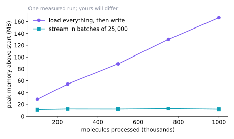

Screening libraries are large and getting larger. Make-on-demand catalogues already list tens of
billions of purchasable molecules (Irwin et al., 2020, in the further reading), and even an
in-house collection with fingerprints and descriptors soon outgrows a laptop's memory. The first
version of most pipelines reads the whole file into a pandas table, which works on a test file
and then fails on the real one, often hours in, with the machine swapping or the process killed.
Data engineers avoid this by never holding the whole library at once: they stream it in batches,
store it in a columnar format that can be read in pieces, and query it with an engine that reads
only what each question needs.

By the end of this module you will be able to:

- measure what a library costs in memory as a pandas table, an Arrow table, RDKit molecules and
  fingerprints, compared with the file on disk;
- stream a library through a processing step in batches, with memory that stays flat;
- write a partitioned Parquet dataset with an explicit schema, row groups and compression;
- read back only the columns and rows a question needs (column pruning and predicate pushdown);
- query the whole dataset with DuckDB without loading it.

The teaching library from `chemlib` (as in the earlier modules) can make 1,733,400
molecules. We use a few hundred thousand of them for plain data and a few tens of thousands for
RDKit work, so the lesson runs in about a minute, and say at each step how the same code scales.

```python
from pathlib import Path

import chemlib

Path("work").mkdir(exist_ok=True)
print(f"the generator can make {chemlib.size():,} molecules")
```
```output
the generator can make 1,733,400 molecules
```

## 1. Why loading everything fails

### What one molecule costs

Take a sample of 20,000 molecules and measure the same data five ways: as a CSV file, as a
compressed Parquet file, as an Apache Arrow table in memory, and as a pandas table in memory with
its text stored two ways. pandas reports its own size with `memory_usage(deep=True)` (deep, so the
text is counted too); Arrow reports `nbytes`:

```python
import pandas as pd
import pyarrow as pa
import pyarrow.parquet as pq

sample = chemlib.library(20_000, seed=8)
sample.to_csv("work/sample.csv", index=False)
pq.write_table(pa.Table.from_pandas(sample, preserve_index=False), "work/sample.parquet",
               compression="zstd")
text_as_objects = sample.astype({"id": object, "smiles": object, "vendor": object})

sizes = {
    "CSV file": Path("work/sample.csv").stat().st_size,
    "Parquet file (zstd)": Path("work/sample.parquet").stat().st_size,
    "Arrow table": pa.Table.from_pandas(sample, preserve_index=False).nbytes,
    "pandas, Arrow text": sample.memory_usage(deep=True).sum(),
    "pandas, Python text": text_as_objects.memory_usage(deep=True).sum(),
}
for name, size in sizes.items():
    print(f"{name:22}{size / 1e6:6.1f} MB {size / len(sample):6.0f} bytes per molecule")
```
```output
CSV file                 1.6 MB     82 bytes per molecule
Parquet file (zstd)      0.4 MB     21 bytes per molecule
Arrow table              2.1 MB    107 bytes per molecule
pandas, Arrow text       2.1 MB    107 bytes per molecule
pandas, Python text      5.1 MB    254 bytes per molecule
```

Parquet is the smallest by far: each column is compressed on its own, and a column of similar
values compresses well. In memory, the cost depends on how the text is held. Arrow stores all the
SMILES of a column one after another in a single buffer, with an offset for each, so its table is
close to the size of the raw text; pandas 3 stores text columns this way by default. Older pandas
versions, and any column of dtype `object`, hold every SMILES and every id as a separate Python
object, each with a header of around 50 bytes before its first character and a pointer to it in
the column: more than twice the size for the same molecules.

### Molecules and fingerprints cost more

Most pipelines do not stop at text: they parse each SMILES into an RDKit molecule and compute a
fingerprint. RDKit molecules live in C++ memory, which Python's own tools cannot see, so we
measure the whole process's memory (its *resident set size*) with `psutil`, before and after
parsing the sample. The number depends on the machine and the operating system:

```python
import psutil
from rdkit import Chem

process = psutil.Process()
before = process.memory_info().rss
molecules = [Chem.MolFromSmiles(smiles) for smiles in sample["smiles"]]
after = process.memory_info().rss
per_molecule = (after - before) / len(molecules)
print(f"{len(molecules):,} RDKit molecules: about {(after - before) / 1e6:.0f} MB, "
      f"{per_molecule:,.0f} bytes each")
```
```output varies
20,000 RDKit molecules: about 646 MB, 32,308 bytes each
```

A 2048-bit Morgan fingerprint stored as one byte per bit, the way many machine-learning examples
do, is 2048 bytes per molecule whatever the molecule; packed eight bits to a byte it is 256:

```python
import numpy as np
from rdkit.Chem import rdFingerprintGenerator

morgan = rdFingerprintGenerator.GetMorganGenerator(radius=2, fpSize=2048)
fingerprints = np.array([morgan.GetFingerprintAsNumPy(m) for m in molecules], dtype=np.uint8)
packed = np.packbits(fingerprints, axis=1)
print("one byte per bit:", fingerprints.shape, f"{fingerprints.nbytes / 1e6:.1f} MB")
print("packed bits:     ", packed.shape, f"{packed.nbytes / 1e6:.1f} MB")

full = chemlib.size()
for name in ["pandas, Arrow text", "pandas, Python text"]:
    print(f"all {full:,} molecules, {name}: {full * sizes[name] / len(sample) / 1e9:.2f} GB")
print(f"all {full:,} molecules, fingerprints one byte per bit: {full * 2048 / 1e9:.2f} GB")
```
```output
one byte per bit: (20000, 2048) 41.0 MB
packed bits:      (20000, 256) 5.1 MB
all 1,733,400 molecules, pandas, Arrow text: 0.19 GB
all 1,733,400 molecules, pandas, Python text: 0.44 GB
all 1,733,400 molecules, fingerprints one byte per bit: 3.55 GB
```

The catalogue data of the full teaching library fits in memory comfortably; its fingerprints
already need gigabytes, and the RDKit molecules, at the tens of kilobytes each measured above,
would need tens of gigabytes. A make-on-demand library of billions of molecules is a thousand
times larger again, and its catalogue text alone would not fit. No laptop, and no single server,
holds that in memory; the answer is to stop trying.


## 2. Streaming in batches

### Generators make data only when asked

A Python **generator** is a function that hands out its results one at a time with `yield`,
making each only when the loop asks for it. `chemlib.stream(n, batch)` is one: it makes the
molecules a batch at a time and never holds more than one batch. Creating it does no work at all:

```python
batches = chemlib.stream(300_000, batch=50_000)
print(type(batches).__name__)
first = next(batches)
print(len(first), "rows in the first batch; the other batches do not exist yet")
print(first.head(3).to_string(index=False))
```
```output
generator
50000 rows in the first batch; the other batches do not exist yet
         id                      smiles   vendor  price_usd  stock_mg
ML-00000000     c1ccccc1C(=O)NCc2ccccc2 Vendor A      20.00        10
ML-00000001  c1cc(C)ccc1C(=O)NCc2ccccc2 Vendor B      99.19       300
ML-00000002 c1cc(CC)ccc1C(=O)NCc2ccccc2 Vendor C     178.38        90
```

A file reader can be a generator in the same way: `pyarrow.parquet.ParquetFile.iter_batches`,
`pandas.read_csv(..., chunksize=...)` and RDKit's `SDMolSupplier` all hand out records a few at a
time instead of reading the whole file first.

### A processing step that works on one batch

The step we apply is ordinary pandas code that takes one batch and returns it with new columns.
For hundreds of thousands of rows, cheap string work is enough to show the idea: the number of
heavy atoms, counted from the SMILES with a regular expression (bracket atoms such as `[nH]`
count once, `Cl` and `Br` once each), and the number of halogen atoms. A cheap shortcut like this
is only acceptable once it has been checked against the real calculation, so we compare it with
RDKit on the 20,000 molecules from section 1:

```python
ATOM = r"\[[^\]]+\]|Br|Cl|[BCNOPSFI]|[bcnops]"
HALOGEN = r"Br|Cl|F|I"


def add_columns(batch: pd.DataFrame) -> pd.DataFrame:
    """Add heavy-atom and halogen counts, worked out from each SMILES string."""
    out = batch.copy()
    out["heavy_atoms"] = out["smiles"].str.count(ATOM).astype("int16")
    out["halogens"] = out["smiles"].str.count(HALOGEN).astype("int16")
    return out


checked = add_columns(sample)
rdkit_counts = [m.GetNumHeavyAtoms() for m in molecules]
print("heavy atoms agree with RDKit for all 20,000:",
      bool((checked["heavy_atoms"] == rdkit_counts).all()))
```
```output
heavy atoms agree with RDKit for all 20,000: True
```

### Writing batch by batch

Now stream 300,000 molecules through `add_columns` and write each batch to a Parquet file as soon
as it is ready, with `pyarrow.parquet.ParquetWriter`. The writer keeps the file open and appends
one **row group** (a block of rows stored column by column) per batch. We give it an explicit
**schema**: the column names and types we promise, so a batch that disagrees (a price read as
text, an id missing) stops the job instead of silently changing the file.

To compare, we also do it the loading-everything way: make all 300,000 rows, then process and
write them in one go. Python's built-in `tracemalloc` cannot measure this fairly, because it sees
only memory allocated through Python, and Arrow (which holds pandas' text) and RDKit allocate
their own. So a small helper watches the whole process's memory from a background thread while a
job runs, and reports the highest it saw above where it started:

```python
import threading
import time


def peak_memory(job, *args) -> int:
    """Run job(*args) and return the most memory (bytes) the process held above its start."""
    start = process.memory_info().rss
    peak = start
    done = threading.Event()

    def watch() -> None:
        nonlocal peak
        while not done.is_set():
            peak = max(peak, process.memory_info().rss)
            time.sleep(0.005)

    watcher = threading.Thread(target=watch)
    watcher.start()
    try:
        job(*args)
    finally:
        done.set()
        watcher.join()
    return max(peak, process.memory_info().rss) - start
```

Now the two jobs. Streaming runs first, so any memory it leaves behind with the process counts in
favour of loading everything, not against it:

```python
SCHEMA = pa.schema(
    [
        ("id", pa.string()),
        ("smiles", pa.string()),
        ("vendor", pa.string()),
        ("price_usd", pa.float64()),
        ("stock_mg", pa.int64()),
        ("heavy_atoms", pa.int16()),
        ("halogens", pa.int16()),
    ]
)
N, BATCH = 300_000, 25_000


def load_everything(path: str, n: int) -> None:
    """Make every row first, then process and write them all at once."""
    everything = pd.concat(list(chemlib.stream(n, batch=BATCH)), ignore_index=True)
    table = pa.Table.from_pandas(add_columns(everything), schema=SCHEMA, preserve_index=False)
    pq.write_table(table, path, compression="zstd")


def stream_to_parquet(path: str, n: int) -> None:
    """Make, process and write one batch at a time."""
    with pq.ParquetWriter(path, SCHEMA, compression="zstd") as writer:
        for batch in chemlib.stream(n, batch=BATCH):
            table = pa.Table.from_pandas(add_columns(batch), schema=SCHEMA, preserve_index=False)
            writer.write_table(table)


stream_to_parquet("work/warm-up.parquet", BATCH)  # one small run, so start-up costs don't count
peaks = {
    "stream": peak_memory(stream_to_parquet, "work/stream.parquet", N),
    "load everything": peak_memory(load_everything, "work/load-everything.parquet", N),
}
for name, peak in peaks.items():
    print(f"{name:16} peak {peak / 1e6:5.0f} MB above the start")
```
```output varies
stream           peak     9 MB above the start
load everything  peak    43 MB above the start
```

Both files hold the same rows; only the memory needed to make them differs:

```python
streamed = pq.ParquetFile("work/stream.parquet")
loaded = pq.read_table("work/load-everything.parquet")
print("rows:", streamed.metadata.num_rows, " row groups:", streamed.metadata.num_row_groups)
print("same contents:", streamed.read().equals(loaded))
```
```output
rows: 300000  row groups: 12
same contents: True
```

The streaming peak is set by the batch size, not by the number of molecules: stream 1,733,400 or
a billion, and it stays at about one batch (plus what the writer buffers). Loading everything
grows in step with the library until it no longer fits. Memory measured this way is noisy,
because the operating system and Python's allocators keep some freed memory for reuse, so the
figure below repeats the measurement in a fresh process for each size:



### The same pattern with RDKit

The batch step can be any function, including real chemistry. Here each batch of 5,000 molecules
is parsed with RDKit, given a canonical SMILES and two descriptors, and appended to its own
Parquet file. RDKit is slower than string work, so we stream 20,000 molecules; the memory used is
again one batch, whatever the total:

```python
from rdkit.Chem import Descriptors


def describe(batch: pd.DataFrame) -> pd.DataFrame:
    """Canonical SMILES, molecular weight and polar surface area for one batch."""
    mols = [Chem.MolFromSmiles(s) for s in batch["smiles"]]
    return pd.DataFrame(
        {
            "id": batch["id"].to_numpy(),
            "canonical_smiles": [Chem.MolToSmiles(m) for m in mols],
            "mw": [round(Descriptors.MolWt(m), 2) for m in mols],
            "tpsa": [round(Descriptors.TPSA(m), 2) for m in mols],
        }
    )


writer = None
for batch in chemlib.stream(20_000, batch=5_000, start=1_000_000):
    table = pa.Table.from_pandas(describe(batch), preserve_index=False)
    if writer is None:
        writer = pq.ParquetWriter("work/descriptors.parquet", table.schema, compression="zstd")
    writer.write_table(table)
writer.close()

described = pq.read_table("work/descriptors.parquet")
print(described.num_rows, "rows in", pq.ParquetFile("work/descriptors.parquet").num_row_groups,
      "row groups")
print(described.slice(0, 3).to_pandas().to_string(index=False))
```
```output
20000 rows in 4 row groups
         id                    canonical_smiles     mw   tpsa
ML-01000000     CCc1nc(Nc2ncccc2O)nc(C(C)C)c1CN 287.37  96.95
ML-01000001 CCc1nc(Nc2ncccc2N(C)C)nc(C(C)C)c1CN 314.44  79.96
ML-01000002   CCc1nc(Nc2ncccc2C#N)nc(C(C)C)c1CN 296.38 100.51
```

## 3. A partitioned Parquet dataset

### Why Parquet, and why partitions

**Parquet** is the standard file format for analytical data. It stores a table column by column,
in row groups, and keeps the minimum and maximum of each column in each row group in the file's
footer. A reader can therefore fetch only the columns it needs (**column pruning**) and skip row
groups whose minimum and maximum show they cannot match a filter (**predicate pushdown**). Each
column is compressed separately, and a column of similar values (vendor names, small integers)
compresses well.

A **partitioned dataset** goes one step further: a folder of Parquet files split by the value of
a column, one sub-folder per value, named `column=value` (the "Hive" layout, after the system that
introduced it). A query that asks for one vendor opens only that vendor's folder. Choose a column
that queries often filter on and that has a modest number of values: vendor, library version or
scaffold family, not the molecule id.

### Writing it with PyArrow

`pyarrow.dataset.write_dataset` writes a partitioned dataset from anything that hands out record
batches, so we can convert the 300,000-row file without loading it: the source is read and written
a row group at a time. We set the compression and the size of each row group (here 20,000 rows; in
production, row groups of 100,000 to 1,000,000 rows are common):

```python
import shutil

import pyarrow.dataset as ds

shutil.rmtree("work/library", ignore_errors=True)
ds.write_dataset(
    ds.dataset("work/stream.parquet", format="parquet"),
    "work/library",
    format="parquet",
    partitioning=["vendor"],
    partitioning_flavor="hive",
    file_options=ds.ParquetFileFormat().make_write_options(compression="zstd"),
    max_rows_per_group=20_000,
    min_rows_per_group=20_000,
    preserve_order=True,
)
for path in sorted(Path("work/library").rglob("*.parquet")):
    meta = pq.ParquetFile(path).metadata
    print(path.relative_to("work").as_posix(), f"{meta.num_rows:,} rows,",
          meta.num_row_groups, "row groups")
```
```output
library/vendor=Vendor%20A/part-0.parquet 100,000 rows, 5 row groups
library/vendor=Vendor%20B/part-0.parquet 100,000 rows, 5 row groups
library/vendor=Vendor%20C/part-0.parquet 100,000 rows, 5 row groups
```

The space in "Vendor A" is written as `%20`, the way spaces are written in web addresses, and
turned back into a space when the dataset is read. Keeping partition values short and plain
avoids surprises in tools that do not decode them.

### Reading back only what you need

Open the folder as one dataset. Nothing is read yet except the file list and the schema; the
vendor column comes back from the folder names:

```python
import pyarrow.compute as pc

library = ds.dataset("work/library", format="parquet", partitioning="hive")
print(library.schema.names)
print(f"{library.count_rows():,} rows in {len(library.files)} files")
```
```output
['id', 'smiles', 'price_usd', 'stock_mg', 'heavy_atoms', 'halogens', 'vendor']
300,000 rows in 3 files
```

Now ask a question: small molecules (at most 20 heavy atoms) without halogens from Vendor B, with
just the three columns we need. The vendor filter selects one folder; the other two are never
opened. The heavy-atom filter is pushed down to the row groups, and only the columns asked for are
decoded:

```python
wanted = (
    (pc.field("vendor") == "Vendor B")
    & (pc.field("heavy_atoms") <= 20)
    & (pc.field("halogens") == 0)
)
small = library.to_table(columns=["id", "smiles", "heavy_atoms"], filter=wanted)
print(f"{small.num_rows:,} rows, columns {small.column_names}")
print(small.slice(0, 3).to_pandas().to_string(index=False))
```
```output
3,575 rows, columns ['id', 'smiles', 'heavy_atoms']
         id                          smiles  heavy_atoms
ML-00000001      c1cc(C)ccc1C(=O)NCc2ccccc2           17
ML-00000010      c1cc(O)ccc1C(=O)NCc2ccccc2           17
ML-00000013 c1cc(C(=O)N)ccc1C(=O)NCc2ccccc2           19
```

Predicate pushdown is easiest to see with a column whose values are in order, like the id (the
library was streamed in id order). The minimum and maximum id in each row group are in the
footer, so a filter on an id range can rule out row groups before reading them:

```python
vendor_b = next(f for f in library.get_fragments() if "Vendor%20B" in f.path)
groups = vendor_b.metadata
for i in range(groups.num_row_groups):
    stats = groups.row_group(i).column(0).statistics
    print(f"row group {i}: id {stats.min} to {stats.max}")
one_range = (pc.field("id") >= "ML-00100000") & (pc.field("id") < "ML-00110000")
kept = vendor_b.split_by_row_group(filter=one_range, schema=library.schema)
print(f"row groups that could match: {len(kept)} of {groups.num_row_groups}")
```
```output
row group 0: id ML-00000001 to ML-00059998
row group 1: id ML-00060001 to ML-00119998
row group 2: id ML-00120001 to ML-00179998
row group 3: id ML-00180001 to ML-00239998
row group 4: id ML-00240001 to ML-00299998
row groups that could match: 1 of 5
```

The ids are text, so they compare as text; because every id has the same width, text order is
number order here. Sorting data by the column you filter on most, before writing, makes row-group
statistics far more useful.

## 4. Querying the dataset with DuckDB

**DuckDB** is an analytical database that runs inside your Python process, with no server to set
up (Module 4 used it on a single table). It reads Parquet files directly, and a glob such as
`work/library/**/*.parquet` with `hive_partitioning = true` makes the whole folder one table,
vendor column included. A summary per vendor:

```python
import duckdb

con = duckdb.connect()
LIBRARY = "read_parquet('work/library/**/*.parquet', hive_partitioning = true)"
summary = con.sql(f"""
    SELECT vendor,
           count(*) AS molecules,
           round(avg(price_usd), 2) AS mean_price_usd,
           min(heavy_atoms) AS min_heavy_atoms,
           max(heavy_atoms) AS max_heavy_atoms
    FROM {LIBRARY}
    GROUP BY vendor
    ORDER BY vendor
""").df()
print(summary.to_string(index=False))
```
```output
  vendor  molecules  mean_price_usd  min_heavy_atoms  max_heavy_atoms
Vendor A     100000          260.51               11               39
Vendor B     100000          260.47               12               38
Vendor C     100000          260.49               12               38
```

A filter on a descriptor range, the kind of question a chemist asks of a screening library: the
five cheapest molecules with 25 to 30 heavy atoms and no halogens, with a tie-breaker on the id
so the answer is always the same:

```python
cheapest = con.sql(f"""
    SELECT id, vendor, price_usd, heavy_atoms, smiles
    FROM {LIBRARY}
    WHERE heavy_atoms BETWEEN 25 AND 30 AND halogens = 0
    ORDER BY price_usd, id
    LIMIT 5
""").df()
print(cheapest.to_string(index=False))
```
```output
         id   vendor  price_usd  heavy_atoms                                               smiles
ML-00048100 Vendor B      20.00           25          Cc1nc(O)sc1C(=O)NC(C(=O)N)c2ccc(c8ccco8)cc2
ML-00096200 Vendor C      20.00           27    c1ccc2c(c1)c(C8CCOCC8)cn2C(=O)c3ccc(C(=O)C)c(O)c3
ML-00033079 Vendor B      20.01           25           Cc1nc(C8CC8)sc1C(=O)NC(N8CCCC8)c2ccc(C)cc2
ML-00129279 Vendor A      20.01           26         c1c(OCC)cc(cc1C8CC8)C(=O)NC(Cc8ccncc8)C(=O)N
ML-00018058 Vendor B      20.02           26 c1cc(c8cn[nH]c8)c(cc1)Oc2ccc(cc2)C(=O)N(C)S(C)(=O)=O
```

`EXPLAIN` shows how DuckDB will run a query, without running it. The vendor filter is applied to
the file paths (only 1 of the 3 files is scanned) and the heavy-atom filter is applied inside the
Parquet reader, so row groups that cannot match are skipped:

```python
plan = con.sql(f"""
    EXPLAIN SELECT count(*) FROM {LIBRARY}
    WHERE vendor = 'Vendor B' AND heavy_atoms BETWEEN 25 AND 30
""").fetchall()[0][1]
for line in plan.splitlines():
    text = line.strip("│╭╮╰╯─┬┴ ")  # drop the boxes DuckDB draws, keep their contents
    if text:
        print(text)
```
```output
Ungrouped Aggregate
Aggregates: count_star()
~1 row
Read Parquet
Function: READ_PARQUET
Filters:
(heavy_atoms >= 25) AND (heavy_atoms <= 30)
File Filters: vendor = 'Vendor B'
Scanning Files: 1/3
~1 row
```

### Why this scales

DuckDB, like the data warehouses used in industry, reads only the columns a query names, skips
partitions and row groups that cannot match, and processes data in vectors of a couple of
thousand values at a time, spread over all the computer's cores. A `GROUP BY` or `ORDER BY` that
needs more memory than it is allowed spills to temporary files on disk instead of failing. We can
cap its memory and see the same answer:

```python
con.sql("SET memory_limit = '200MB'")
capped = con.sql(f"SELECT count(*) FROM {LIBRARY} WHERE heavy_atoms BETWEEN 25 AND 30").fetchall()[0]
print(f"{capped[0]:,} molecules with 25 to 30 heavy atoms, counted within a 200 MB limit")
con.close()
```
```output
154,943 molecules with 25 to 30 heavy atoms, counted within a 200 MB limit
```

### From 300,000 to millions and beyond

Nothing in this module depends on the 300,000. To stream the whole teaching library, change `N`
to `chemlib.size()`: there are 70 batches instead of 12, the run takes about six times as long, and
peak memory stays at one batch. Past a few hundred million rows, teams make the same choices at a
larger scale: more partition columns (vendor and scaffold family, say), files kept in object
storage such as Amazon S3, which DuckDB and PyArrow read directly, and, when one machine is too
slow rather than too small, the work spread over many cores or machines, which is Module 9.

## Try it yourself

The homework for this module is in `homework.md`: a few questions answered by running code like the
code above. Answers are published after the cohort's deadline.

## Further reading

- Irwin, J. J., Tang, K. G., Young, J., Dandarchuluun, C., Wong, B. R., Khurelbaatar, M., Moroz,
  Y. S., Mayfield, J. & Sayle, R. A. (2020). ZINC20—A free ultralarge-scale chemical database for
  ligand discovery. *Journal of Chemical Information and Modeling*, 60(12), 6065–6073.
  <https://doi.org/10.1021/acs.jcim.0c00675>
- Raasveldt, M. & Mühleisen, H. (2019). DuckDB. *Proceedings of the 2019 International Conference
  on Management of Data (SIGMOD '19)*, 1981–1984. <https://doi.org/10.1145/3299869.3320212>
- The Apache Parquet documentation. *File format*. <https://parquet.apache.org/docs/file-format/>
- The Apache Arrow documentation. *Tabular Datasets* (PyArrow).
  <https://arrow.apache.org/docs/python/dataset.html>
- The DuckDB documentation. *Reading and writing Parquet files*.
  <https://duckdb.org/docs/stable/data/parquet/overview>
- The psutil documentation (process memory, used for the measurements here).
  <https://psutil.readthedocs.io/en/latest/>
