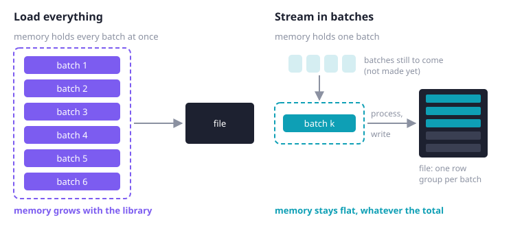
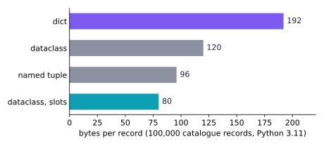

Screening libraries are large and getting larger. Make-on-demand catalogues already list tens of
billions of purchasable molecules (Irwin et al., 2020, in the further reading), and even an
in-house collection with fingerprints and descriptors soon outgrows a laptop's memory. The first
version of most pipelines reads the whole file into a pandas table, which works on a test file
and then fails on the real one, often hours in, with the machine swapping or the process killed.
Data engineers avoid this by never holding the whole library at once: they stream it in batches,
keep each record and each column in the smallest form that holds it, store it in a columnar format
that can be read in pieces, and query it with an engine that reads only what each question needs.

By the end of this module you will be able to:

- measure what a library costs in memory as a pandas table, an Arrow table, RDKit molecules and
  fingerprints, compared with the file on disk;
- measure memory before optimising, with `tracemalloc` and `DataFrame.memory_usage(deep=True)`, and
  choose a record container (dict, named tuple, dataclass with slots) by what it costs;
- stream a library through a processing step in batches, with memory that stays flat, using
  generators and `itertools` to batch, join and group streams;
- count and summarise a stream as it passes with `Counter`, `defaultdict` and a bounded `deque`,
  without holding the batches;
- shrink a table with compact types: smaller NumPy integers and floats (checked against the data),
  pandas categories and Parquet dictionary encoding;
- write a partitioned Parquet dataset with an explicit schema, row groups and compression;
- read back only the columns and rows a question needs (column pruning and predicate pushdown);
- query the whole dataset with DuckDB without loading it.

The teaching library from `chemlib` (as in the earlier modules) can make 1,733,400
molecules. We use a few hundred thousand of them for plain data and a few tens of thousands for
RDKit work, so the lesson runs in about a minute, and say at each step how the same code scales.

## Setup

Everything this lesson needs is imported and set here, so the settings can be changed in one
place. Pipeline steps report with `log`; `print` is kept for showing you results; Module 1 explains
why.

```python
import csv
import logging
import re
import shutil
import sys
import threading
import time
import tracemalloc
from collections import Counter, defaultdict, deque, namedtuple
from collections.abc import Callable, Iterable, Iterator
from dataclasses import dataclass
from itertools import chain, groupby, islice
from pathlib import Path

import duckdb
import numpy as np
import pandas as pd
import psutil
import pyarrow as pa
import pyarrow.compute as pc
import pyarrow.dataset as ds
import pyarrow.parquet as pq
from rdkit import Chem
from rdkit.Chem import Descriptors, rdFingerprintGenerator

import chemlib

# log lines: level and message only, so the lesson's outputs are the same on every run
# (a real job would add "%(asctime)s" to the format)
logging.basicConfig(level=logging.INFO, format="%(levelname)s %(message)s", force=True)
log = logging.getLogger(__name__)

# where the lesson writes its files (git-ignored)
WORK = Path("work")
SAMPLE_CSV = WORK / "sample.csv"
SAMPLE_PARQUET = WORK / "sample.parquet"
STREAMED = WORK / "stream.parquet"  # the streamed library, made in section 3
LOADED = WORK / "load-everything.parquet"  # the same, made by loading everything
DESCRIPTORS = WORK / "descriptors.parquet"
DATASET = WORK / "library"  # the partitioned dataset of section 5

SAMPLE_SIZE = 20_000  # molecules measured in sections 1 and 4; any size up to chemlib.size()
SEED = 8  # which sample; change it for different molecules
N_RECORDS = 100_000  # records built in section 2 to measure containers
N_MOLECULES = 300_000  # molecules streamed into Parquet; chemlib.size() streams them all
BATCH = 25_000  # molecules per batch: sets the streaming memory, whatever N_MOLECULES is
REBATCH = 12_000  # the batch size a later step wants, in the itertools example
DELIVERIES = [(30_000, 0), (20_000, 1_000_000)]  # (molecules, first molecule) of two deliveries
FP_RADIUS, FP_BITS = 2, 2048  # Morgan fingerprint settings
WATCH_SECONDS = 0.005  # how often the memory watcher looks at the process

N_CHECKED = 100_000  # molecules checked for defects while streaming, in batches of CHECK_BATCH
CHECK_BATCH = 10_000
DEFECT_RATE = 0.02  # share of damaged records in a normal delivery
WORSE_RATE = 0.08  # ... and in the later batches, from a supplier's worse export
WORSE_FROM = 6  # the first batch (counting from 0) of the worse export
WINDOW = 3  # how many recent batches the rolling defect rate covers
ALERT_SHARE = 0.03  # warn when the rolling defect rate is above this

RDKIT_N, RDKIT_BATCH, RDKIT_START = 20_000, 5_000, 1_000_000  # the RDKit streaming example
ROW_GROUP = 20_000  # rows per Parquet row group in the dataset; 100,000 to 1,000,000 in production
DUCKDB_MEMORY = "200MB"  # the memory limit DuckDB is held to in section 6

WORK.mkdir(exist_ok=True)
print(f"the generator can make {chemlib.size():,} molecules; we stream {N_MOLECULES:,} "
      f"in batches of {BATCH:,}")
```
```output
the generator can make 1,733,400 molecules; we stream 300,000 in batches of 25,000
```

## 1. Why loading everything fails

### What one molecule costs

Take a sample of 20,000 molecules and measure the same data five ways: as a CSV file, as a
compressed Parquet file, as an Apache Arrow table in memory, and as a pandas table in memory with
its text stored two ways. pandas reports its own size with `memory_usage(deep=True)` (deep, so the
text is counted too); Arrow reports `nbytes`:

```python
sample = chemlib.library(SAMPLE_SIZE, seed=SEED)
sample.to_csv(SAMPLE_CSV, index=False)
pq.write_table(pa.Table.from_pandas(sample, preserve_index=False), SAMPLE_PARQUET,
               compression="zstd")
text_as_objects = sample.astype({"id": object, "smiles": object, "vendor": object})

sizes = {
    "CSV file": SAMPLE_CSV.stat().st_size,
    "Parquet file (zstd)": SAMPLE_PARQUET.stat().st_size,
    "Arrow table": pa.Table.from_pandas(sample, preserve_index=False).nbytes,
    "pandas, Arrow text": sample.memory_usage(deep=True).sum(),
    "pandas, Python text": text_as_objects.memory_usage(deep=True).sum(),
}
for name, size in sizes.items():
    print(f"{name:22}{size / 1e6:6.1f} MB {size / len(sample):6.0f} bytes per molecule")
```
```output
CSV file                 1.6 MB     82 bytes per molecule
Parquet file (zstd)      0.4 MB     21 bytes per molecule
Arrow table              2.1 MB    107 bytes per molecule
pandas, Arrow text       2.1 MB    107 bytes per molecule
pandas, Python text      5.1 MB    254 bytes per molecule
```

Parquet is the smallest by far: each column is compressed on its own, and a column of similar
values compresses well. In memory, the cost depends on how the text is held. Arrow stores all the
SMILES of a column one after another in a single buffer, with an offset for each, so its table is
close to the size of the raw text; pandas 3 stores text columns this way by default. Older pandas
versions, and any column of dtype `object`, hold every SMILES and every id as a separate Python
object, each with a header of around 50 bytes before its first character and a pointer to it in
the column: more than twice the size for the same molecules.

### Molecules and fingerprints cost more

Most pipelines do not stop at text: they parse each SMILES into an RDKit molecule and compute a
fingerprint. RDKit molecules live in C++ memory, which Python's own tools cannot see, so we
measure the whole process's memory (its *resident set size*) with `psutil`, before and after
parsing the sample. The number depends on the machine and the operating system:

```python
process = psutil.Process()
before = process.memory_info().rss
molecules = [Chem.MolFromSmiles(smiles) for smiles in sample["smiles"]]
after = process.memory_info().rss
per_molecule = (after - before) / len(molecules)
print(f"{len(molecules):,} RDKit molecules: about {(after - before) / 1e6:.0f} MB, "
      f"{per_molecule:,.0f} bytes each")
```
```output varies
20,000 RDKit molecules: about 642 MB, 32,120 bytes each
```

A 2048-bit Morgan fingerprint stored as one byte per bit, the way many machine-learning examples
do, is 2048 bytes per molecule whatever the molecule; packed eight bits to a byte it is 256:

```python
morgan = rdFingerprintGenerator.GetMorganGenerator(radius=FP_RADIUS, fpSize=FP_BITS)
fingerprints = np.array([morgan.GetFingerprintAsNumPy(m) for m in molecules], dtype=np.uint8)
packed = np.packbits(fingerprints, axis=1)
print("one byte per bit:", fingerprints.shape, f"{fingerprints.nbytes / 1e6:.1f} MB")
print("packed bits:     ", packed.shape, f"{packed.nbytes / 1e6:.1f} MB")

full = chemlib.size()
for name in ["pandas, Arrow text", "pandas, Python text"]:
    print(f"all {full:,} molecules, {name}: {full * sizes[name] / len(sample) / 1e9:.2f} GB")
print(f"all {full:,} molecules, fingerprints one byte per bit: {full * FP_BITS / 1e9:.2f} GB")
```
```output
one byte per bit: (20000, 2048) 41.0 MB
packed bits:      (20000, 256) 5.1 MB
all 1,733,400 molecules, pandas, Arrow text: 0.19 GB
all 1,733,400 molecules, pandas, Python text: 0.44 GB
all 1,733,400 molecules, fingerprints one byte per bit: 3.55 GB
```

The catalogue data of the full teaching library fits in memory comfortably; its fingerprints
already need gigabytes, and the RDKit molecules, at the tens of kilobytes each measured above,
would need tens of gigabytes. A make-on-demand library of billions of molecules is a thousand
times larger again, and its catalogue text alone would not fit. No laptop, and no single server,
holds that in memory; the answer is to stop trying.



## 2. Measuring memory, and what Python's containers cost

### Measure before optimising

The rule data engineers follow is to **measure before optimising**. Guesses about where memory goes
are often wrong: the large cost may be a list of dictionaries built on one line, not the table you
suspected, and an "optimisation" made without a measurement can make the code harder to read and
save nothing. There are three tools, for three kinds of memory:

- `DataFrame.memory_usage(deep=True)` for a pandas table, column by column (section 1);
- the whole process's memory with `psutil`, for memory that Python cannot see, such as RDKit's
  molecules and Arrow's buffers (section 1);
- Python's built-in **`tracemalloc`**, for the Python objects your own code makes. Once started, it
  records every block of memory Python allocates and the line of code that asked for it. It reports
  the memory **current**ly held and the **peak** since it started, and a **snapshot** lists the
  lines that hold the most.

`tracemalloc` slows Python down while it runs, so switch it on around the code you are measuring,
not for the whole job. Here it watches a common pattern: read 100,000 records as dictionaries, keep
the cheap ones, and drop the rest. The records' values are made first, outside the measurement, so
what it sees is the cost of the containers:

```python
source = chemlib.library(N_RECORDS, seed=SEED)
FIELDS = list(source.columns)
rows = list(zip(*(source[name].tolist() for name in FIELDS)))  # plain tuples of Python values

tracemalloc.start()
as_dicts = [dict(zip(FIELDS, row)) for row in rows]
cheap = [record for record in as_dicts if record["price_usd"] < 50]
snapshot = tracemalloc.take_snapshot()
del as_dicts
current, peak = tracemalloc.get_traced_memory()
tracemalloc.stop()

print(f"{len(cheap):,} cheap records kept")
print(f"peak {peak / 1e6:.1f} MB, still held {current / 1e6:.1f} MB")
for stat in snapshot.statistics("lineno")[:2]:
    print(f"line {stat.traceback[0].lineno}: {stat.size / 1e6:.1f} MB "
          f"in {stat.count:,} allocations")
```
```output
6,147 cheap records kept
peak 19.3 MB, still held 1.2 MB
line 6: 19.2 MB in 200,005 allocations
line 7: 0.1 MB in 1 allocations
```

The snapshot points at line 6: the dictionaries hold almost all the memory. The peak is what
matters for whether a job fits, and here it is set by the moment every record existed at once;
once the list of all records is deleted, only the cheap ones stay. Had the records been filtered
as they were read, the peak would never have been reached, which is the idea of section 3.
`tracemalloc` cannot see memory that libraries allocate for themselves (Arrow's buffers, RDKit's
molecules), which is why section 1 measured the whole process instead.

### One record, four containers

A record can be held in several ways, and the choice costs memory for every row. A **dict** keeps a
hash table of keys per record. A **named tuple** (`collections.namedtuple`) is a tuple whose
positions also have names, so it stores only the values. A **dataclass** is a small class whose
fields are listed once; with `slots=True` its instances have a fixed set of fields and no
per-instance dictionary, and `frozen=True` makes them read-only, like a tuple. The same 100,000
records in each:

```python
Molecule = namedtuple("Molecule", FIELDS)


@dataclass(frozen=True)
class MoleculeRecord:
    """One catalogue record, as an ordinary dataclass."""

    id: str
    smiles: str
    vendor: str
    price_usd: float
    stock_mg: int


@dataclass(frozen=True, slots=True)
class SlottedRecord:
    """The same record, with slots: a fixed set of fields and no per-instance dictionary."""

    id: str
    smiles: str
    vendor: str
    price_usd: float
    stock_mg: int


def bytes_per_record(build: Callable[[tuple], object]) -> float:
    """Memory tracemalloc sees while one container is built per row, divided by the rows."""
    tracemalloc.start()
    made = [build(row) for row in rows]
    current, _ = tracemalloc.get_traced_memory()
    tracemalloc.stop()
    return current / len(made)


containers = {
    "dict": lambda row: dict(zip(FIELDS, row)),
    "dataclass": lambda row: MoleculeRecord(*row),
    "named tuple": Molecule._make,
    "dataclass, slots": lambda row: SlottedRecord(*row),
}
costs = {name: bytes_per_record(build) for name, build in containers.items()}
for name, cost in costs.items():
    print(f"{name:17}{cost:5.0f} bytes per record, {cost / costs['dict']:.2f} of a dict")
saved = (costs["dict"] - costs["dataclass, slots"]) * chemlib.size()
print(f"slots instead of dicts for all {chemlib.size():,} molecules: {saved / 1e6:.0f} MB less")
print(Molecule._make(rows[0]))
```
```output
dict               192 bytes per record, 1.00 of a dict
dataclass          120 bytes per record, 0.63 of a dict
named tuple         96 bytes per record, 0.50 of a dict
dataclass, slots    80 bytes per record, 0.42 of a dict
slots instead of dicts for all 1,733,400 molecules: 194 MB less
Molecule(id='ML-00000007', smiles='c1cc(Br)ccc1C(=O)NCc2ccccc2', vendor='Vendor B', price_usd=93.33, stock_mg=40)
```

Each figure includes the 8 bytes of the list's pointer to the record, and the values themselves
are shared, so this is the cost of the container alone. The numbers are for Python 3.11, which this
course uses; other versions differ by a few bytes, but the order is the same. A dataclass with
slots takes well under half the memory of a dict and, unlike a dict, rejects a misspelt field name
instead of silently adding a new key. A named tuple is almost as small and can be unpacked like any
tuple. Keep dicts for records whose fields vary (JSON from a web service, Module 11); for millions
of records with the same fields, do not keep Python objects per record at all, but columns, as
pandas and Arrow do.



## 3. Streaming in batches

### Generators make data only when asked

A Python **generator** is a function that hands out its results one at a time with `yield`,
making each only when the loop asks for it. `chemlib.stream(n, batch)` is one: it makes the
molecules a batch at a time and never holds more than one batch. Creating it does no work at all:

```python
batches = chemlib.stream(N_MOLECULES, batch=BATCH)
print(type(batches).__name__)
first = next(batches)
print(len(first), "rows in the first batch; the other batches do not exist yet")
print(first.head(3).to_string(index=False))
```
```output
generator
25000 rows in the first batch; the other batches do not exist yet
         id                      smiles   vendor  price_usd  stock_mg
ML-00000000     c1ccccc1C(=O)NCc2ccccc2 Vendor A      20.00        10
ML-00000001  c1cc(C)ccc1C(=O)NCc2ccccc2 Vendor B      99.19       300
ML-00000002 c1cc(CC)ccc1C(=O)NCc2ccccc2 Vendor C     178.38        90
```

A file reader can be a generator in the same way: `pyarrow.parquet.ParquetFile.iter_batches`,
`pandas.read_csv(..., chunksize=...)` and RDKit's `SDMolSupplier` all hand out records a few at a
time instead of reading the whole file first.

### A processing step that works on one batch

The step we apply is ordinary pandas code that takes one batch and returns it with new columns.
For hundreds of thousands of rows, cheap string work is enough to show the idea: the number of
heavy atoms, counted from the SMILES with a regular expression (bracket atoms such as `[nH]`
count once, `Cl` and `Br` once each), and the number of halogen atoms. A cheap shortcut like this
is only acceptable once it has been checked against the real calculation, so we compare it with
RDKit on the 20,000 molecules from section 1:

```python
ATOM = r"\[[^\]]+\]|Br|Cl|[BCNOPSFI]|[bcnops]"
HALOGEN = r"Br|Cl|F|I"


def add_columns(batch: pd.DataFrame) -> pd.DataFrame:
    """Add heavy-atom and halogen counts, worked out from each SMILES string."""
    out = batch.copy()
    out["heavy_atoms"] = out["smiles"].str.count(ATOM).astype("int16")
    out["halogens"] = out["smiles"].str.count(HALOGEN).astype("int16")
    return out


checked = add_columns(sample)
rdkit_counts = [m.GetNumHeavyAtoms() for m in molecules]
print("heavy atoms agree with RDKit for all 20,000:",
      bool((checked["heavy_atoms"] == rdkit_counts).all()))
```
```output
heavy atoms agree with RDKit for all 20,000: True
```

### Batches of any size, with itertools

The batches a source hands out are not always the ones the next step wants: a supplier sends
deliveries of different sizes, and a step that writes to a database may want a fixed number of rows
per call. The standard library's `itertools` works on any iterator, a row or a batch at a time,
without making a list of everything. Three of its tools do most of the work:

- `islice(iterator, n)` takes the next `n` items and stops, so repeating it cuts a stream into
  batches. (Python 3.12 added `itertools.batched`, which does this in one call; this course runs on
  Python 3.11, so we write the four lines ourselves.)
- `chain(a, b, ...)` joins several iterators into one, and `chain.from_iterable` does the same for
  an iterator of iterators: several files or deliveries become one stream.
- `groupby(iterator, key)` hands out runs of consecutive items with the same key.

Here two deliveries are joined into one stream of rows and cut into batches of 12,000; the second
delivery starts at molecule 1,000,000, and the third batch spans both:

```python
def batched(items: Iterable, size: int) -> Iterator[list]:
    """Cut any iterable into lists of `size` items (the last may be shorter), lazily."""
    iterator = iter(items)
    while batch := list(islice(iterator, size)):
        yield batch


deliveries = (chemlib.stream(n, batch=CHECK_BATCH, start=s) for n, s in DELIVERIES)
rows_in_order = chain.from_iterable(b.itertuples(index=False) for b in chain(*deliveries))
for k, batch in enumerate(batched(rows_in_order, REBATCH)):
    log.info("batch %d: %s rows, %s to %s", k, f"{len(batch):,}", batch[0].id, batch[-1].id)
```
```output
INFO batch 0: 12,000 rows, ML-00000000 to ML-00011999
INFO batch 1: 12,000 rows, ML-00012000 to ML-00023999
INFO batch 2: 12,000 rows, ML-00024000 to ML-01005999
INFO batch 3: 12,000 rows, ML-01006000 to ML-01017999
INFO batch 4: 2,000 rows, ML-01018000 to ML-01019999
```

At no point does more than one delivery batch and one output batch exist. `groupby` needs one
thing the others do not: the stream must be **sorted by the key**, because it only groups items
that are next to each other. Our sample is in id order, so grouping it by heavy-atom count gives a
new group every time the count changes; sorted by heavy atoms first, it gives one group per count,
and the loop holds one group at a time:

```python
by_id = checked.itertuples(index=False)
runs = sum(1 for _ in groupby(by_id, key=lambda row: row.heavy_atoms))
print(f"groups in id order: {runs:,}")

by_size = checked.sort_values(["heavy_atoms", "id"]).itertuples(index=False)
for heavy_atoms, group in islice(groupby(by_size, key=lambda row: row.heavy_atoms), 4):
    members = list(group)  # this group only, not the whole table
    cheapest = min(members, key=lambda row: row.price_usd)
    print(f"{heavy_atoms} heavy atoms: {len(members):>4,} molecules, "
          f"cheapest {cheapest.id} at ${cheapest.price_usd:.2f}")
```
```output
groups in id order: 17,782
13 heavy atoms:    1 molecules, cheapest ML-00067710 at $267.90
14 heavy atoms:    1 molecules, cheapest ML-00063750 at $287.50
15 heavy atoms:    8 molecules, cheapest ML-00950406 at $120.14
16 heavy atoms:   25 molecules, cheapest ML-00059495 at $34.05
```

In a real job the sorting is done once, when the file is written (DuckDB, in section 6, sorts more
data than fits in memory by spilling to disk), and every later pass can then group the file as it
streams: all the conformers of one molecule in an SDF, or all the records with one InChIKey.

### Writing batch by batch

Now stream 300,000 molecules through `add_columns` and write each batch to a Parquet file as soon
as it is ready, with `pyarrow.parquet.ParquetWriter`. The writer keeps the file open and appends
one **row group** (a block of rows stored column by column) per batch. We give it an explicit
**schema**: the column names and types we promise, so a batch that disagrees (a price read as
text, an id missing) stops the job instead of silently changing the file.

To compare, we also do it the loading-everything way: make all 300,000 rows, then process and
write them in one go. `tracemalloc` (section 2) cannot measure this fairly, because it sees only
memory allocated through Python, and Arrow (which holds pandas' text) allocates its own. So a small
helper watches the whole process's memory from a background thread while a job runs, and reports
the highest it saw above where it started:

```python
def peak_memory(job: Callable[..., None], *args: object) -> int:
    """Run job(*args) and return the most memory (bytes) the process held above its start."""
    start = process.memory_info().rss
    peak = start
    done = threading.Event()

    def watch() -> None:
        nonlocal peak
        while not done.is_set():
            peak = max(peak, process.memory_info().rss)
            time.sleep(WATCH_SECONDS)

    watcher = threading.Thread(target=watch)
    watcher.start()
    try:
        job(*args)
    finally:
        done.set()
        watcher.join()
    return max(peak, process.memory_info().rss) - start
```

Now the two jobs. Streaming runs first, so any memory it leaves behind with the process counts in
favour of loading everything, not against it:

```python
SCHEMA = pa.schema(
    [
        ("id", pa.string()),
        ("smiles", pa.string()),
        ("vendor", pa.string()),
        ("price_usd", pa.float64()),
        ("stock_mg", pa.int64()),
        ("heavy_atoms", pa.int16()),
        ("halogens", pa.int16()),
    ]
)


def load_everything(path: Path, n: int) -> None:
    """Make every row first, then process and write them all at once."""
    everything = pd.concat(list(chemlib.stream(n, batch=BATCH)), ignore_index=True)
    table = pa.Table.from_pandas(add_columns(everything), schema=SCHEMA, preserve_index=False)
    pq.write_table(table, path, compression="zstd")


def stream_to_parquet(path: Path, n: int) -> None:
    """Make, process and write one batch at a time."""
    with pq.ParquetWriter(path, SCHEMA, compression="zstd") as writer:
        for batch in chemlib.stream(n, batch=BATCH):
            table = pa.Table.from_pandas(add_columns(batch), schema=SCHEMA, preserve_index=False)
            writer.write_table(table)


stream_to_parquet(WORK / "warm-up.parquet", BATCH)  # one small run, so start-up costs don't count
peaks = {
    "stream": peak_memory(stream_to_parquet, STREAMED, N_MOLECULES),
    "load everything": peak_memory(load_everything, LOADED, N_MOLECULES),
}
for name, peak in peaks.items():
    log.info("%-16s peak %5.0f MB above the start", name, peak / 1e6)
```
```output varies
INFO stream           peak     8 MB above the start
INFO load everything  peak    48 MB above the start
```

Both files hold the same rows; only the memory needed to make them differs:

```python
streamed = pq.ParquetFile(STREAMED)
loaded = pq.read_table(LOADED)
print("rows:", streamed.metadata.num_rows, " row groups:", streamed.metadata.num_row_groups)
print("same contents:", streamed.read().equals(loaded))
```
```output
rows: 300000  row groups: 12
same contents: True
```

The streaming peak is set by the batch size, not by the number of molecules: stream 1,733,400 or
a billion, and it stays at about one batch (plus what the writer buffers). Loading everything
grows in step with the library until it no longer fits. Memory measured this way is noisy,
because the operating system and Python's allocators keep some freed memory for reuse, so the
figure below repeats the measurement in a fresh process for each size:


### Counting while streaming: Counter, defaultdict and deque

A streaming job often needs a summary of everything it has seen: how many records of each defect
kind, which elements occur, whether the latest deliveries are worse than the earlier ones. Keeping
the batches to work this out afterwards would undo the streaming; instead, the job keeps small
running summaries and updates them as each batch passes. Three containers from the standard
library's `collections`, imported in the Setup block, are made for this:

- **`Counter`** counts things: `update` adds a batch's items to the running counts, and
  `most_common()` returns them sorted, largest first, so counting and sorting take one step each.
- **`defaultdict(list)`** groups things: looking up a key it has not seen creates an empty list, so
  `flagged[kind].append(id)` needs no "is this key new?" check.
- **`deque(maxlen=n)`** is a queue that keeps only the last `n` items: appending to a full one
  drops the oldest, so a rolling window over recent batches never grows.

Here 100,000 molecules arrive in batches of 10,000, damaged with `chemlib.add_defects` (as in
Module 6): 2% of each batch, until the last four batches, which come from a supplier's worse export
at 8%. Elements are counted from the SMILES with a regular expression like `ATOM`'s, one symbol at
a time:

```python
ELEMENT = r"Br|Cl|Se|[BCNOPSFI]|[bcnops]"  # aromatic atoms are written in lower case

defects = Counter()
elements = Counter()
flagged = defaultdict(list)  # defect kind -> ids of the records that have it
recent = deque(maxlen=WINDOW)  # defect rate of the last WINDOW batches
for k, batch in enumerate(chemlib.stream(N_CHECKED, batch=CHECK_BATCH)):
    rate = DEFECT_RATE if k < WORSE_FROM else WORSE_RATE
    batch = chemlib.add_defects(batch, rate=rate, seed=SEED + k)
    bad = batch[batch["defect"] != ""]
    defects.update(bad["defect"])
    for kind, molecule_id in zip(bad["defect"], bad["id"], strict=True):
        flagged[kind].append(molecule_id)
    for smiles in batch["smiles"]:
        elements.update(symbol.capitalize() for symbol in re.findall(ELEMENT, smiles))
    recent.append(len(bad) / len(batch))
    rolling = sum(recent) / len(recent)
    log.info("batch %d: %4.1f%% defective, last %d batches %4.1f%%",
             k, 100 * recent[-1], len(recent), 100 * rolling)
    if rolling > ALERT_SHARE:
        log.warning("rolling defect rate %.1f%% is above %.0f%%", 100 * rolling, 100 * ALERT_SHARE)
```
```output
INFO batch 0:  2.0% defective, last 1 batches  2.0%
INFO batch 1:  2.0% defective, last 2 batches  2.0%
INFO batch 2:  2.0% defective, last 3 batches  2.0%
INFO batch 3:  2.0% defective, last 3 batches  2.0%
INFO batch 4:  2.0% defective, last 3 batches  2.0%
INFO batch 5:  2.0% defective, last 3 batches  2.0%
INFO batch 6:  7.9% defective, last 3 batches  4.0%
WARNING rolling defect rate 4.0% is above 3%
INFO batch 7:  7.9% defective, last 3 batches  5.9%
WARNING rolling defect rate 5.9% is above 3%
INFO batch 8:  7.9% defective, last 3 batches  7.9%
WARNING rolling defect rate 7.9% is above 3%
INFO batch 9:  7.9% defective, last 3 batches  7.9%
WARNING rolling defect rate 7.9% is above 3%
```

The warning starts with the first batch of the worse export, because the window of three batches
then includes it; a monitoring system (Module 14) would raise the same alert. When the job ends,
the summaries are all that is left, and they are small whatever the size of the library:

```python
print("defects:", defects.most_common())
print("elements:", elements.most_common())
for kind, ids in sorted(flagged.items()):
    print(f"{kind:9} {len(ids):>4} records, first {ids[0]}")
print("the rolling window holds", len(recent), "rates:", [f"{r:.3f}" for r in recent])
```
```output
defects: [('salt', 740), ('solvent', 740), ('duplicate', 730), ('element', 730), ('invalid', 730), ('valence', 730)]
elements: [('C', 1851475), ('O', 266265), ('N', 230255), ('F', 79097), ('S', 37513), ('Cl', 11078), ('Br', 10341), ('Se', 712)]
duplicate  730 records, first ML-00005944-dup
element    730 records, first ML-00006079
invalid    730 records, first ML-00008671
salt       740 records, first ML-00008586
solvent    740 records, first ML-00002800
valence    730 records, first ML-00003611
the rolling window holds 3 rates: ['0.079', '0.079', '0.079']
```

The element counts are a quick check on what a supplier really sent: selenium appears only because
of the element defect, and the chlorine count includes the chloride counter-ions of the salts as
well as the chlorine substituents. The defect `Counter` has one entry per kind and the `deque`
three numbers. The `defaultdict` grows with the number of damaged records, not with the
library; in a real job it would be written out batch by batch, like the data.

### The same pattern with RDKit

The batch step can be any function, including real chemistry. Here each batch of 5,000 molecules
is parsed with RDKit, given a canonical SMILES and two descriptors, and appended to its own
Parquet file. RDKit is slower than string work, so we stream 20,000 molecules; the memory used is
again one batch, whatever the total:

```python
def describe(batch: pd.DataFrame) -> pd.DataFrame:
    """Canonical SMILES, molecular weight and polar surface area for one batch."""
    mols = [Chem.MolFromSmiles(s) for s in batch["smiles"]]
    return pd.DataFrame(
        {
            "id": batch["id"].to_numpy(),
            "canonical_smiles": [Chem.MolToSmiles(m) for m in mols],
            "mw": [round(Descriptors.MolWt(m), 2) for m in mols],
            "tpsa": [round(Descriptors.TPSA(m), 2) for m in mols],
        }
    )


writer = None
for batch in chemlib.stream(RDKIT_N, batch=RDKIT_BATCH, start=RDKIT_START):
    table = pa.Table.from_pandas(describe(batch), preserve_index=False)
    if writer is None:
        writer = pq.ParquetWriter(DESCRIPTORS, table.schema, compression="zstd")
    writer.write_table(table)
writer.close()

described = pq.read_table(DESCRIPTORS)
log.info("wrote %d rows in %d row groups to %s", described.num_rows,
         pq.ParquetFile(DESCRIPTORS).num_row_groups, DESCRIPTORS.as_posix())
print(described.slice(0, 3).to_pandas().to_string(index=False))
```
```output
INFO wrote 20000 rows in 4 row groups to work/descriptors.parquet
         id                    canonical_smiles     mw   tpsa
ML-01000000     CCc1nc(Nc2ncccc2O)nc(C(C)C)c1CN 287.37  96.95
ML-01000001 CCc1nc(Nc2ncccc2N(C)C)nc(C(C)C)c1CN 314.44  79.96
ML-01000002   CCc1nc(Nc2ncccc2C#N)nc(C(C)C)c1CN 296.38 100.51
```

## 4. Compact types

Streaming bounds how many rows are in memory; the type of each column sets what each row costs.
Libraries usually store numbers in the widest types (64-bit integers and floats) and text as text,
whatever the values, and narrower types often hold the same data in a fraction of the space. The
rule from section 2 applies: measure first, and check that the narrower type really holds every
value, because NumPy does not stop you: `np.array([300]).astype(np.uint8)` silently gives 44.

### Smaller numbers, checked

The damaged sample has prices, stock amounts and the two counts from `add_columns`. A helper picks
the smallest integer type that holds a column's minimum and maximum (pandas'
`pd.to_numeric(..., downcast="integer")` does the same job). Prices have two decimal places and are
under 1,000 dollars, so a 32-bit float, which keeps about seven significant digits, holds them; we
check that rounding to the cent gives back every price exactly:

```python
def smallest_int(values: pd.Series) -> pd.Series:
    """The column in the smallest integer type that holds every value (checked, not assumed)."""
    for dtype in (np.uint8, np.int8, np.uint16, np.int16, np.uint32, np.int32):
        limits = np.iinfo(dtype)
        if limits.min <= values.min() and values.max() <= limits.max:
            return values.astype(dtype)
    return values


damaged = add_columns(chemlib.add_defects(sample, rate=DEFECT_RATE, seed=SEED))
compact = damaged.copy()
for name in ["stock_mg", "heavy_atoms", "halogens"]:
    compact[name] = smallest_int(damaged[name])
    print(f"{name:12} {damaged[name].min():>3} to {damaged[name].max():>3}: "
          f"{damaged[name].dtype} -> {compact[name].dtype}")
compact["price_usd"] = damaged["price_usd"].astype(np.float32)
back = compact["price_usd"].astype(np.float64).round(2)
print("float32 prices give back every price to the cent:", bool((back == damaged["price_usd"]).all()))
```
```output
stock_mg      10 to 500: int64 -> uint16
heavy_atoms   13 to  42: int16 -> uint8
halogens       0 to  10: int16 -> uint8
float32 prices give back every price to the cent: True
```

### Categories for repeated text

The vendor column holds three different names, and the defect column seven values (six kinds and
the empty string of clean rows), repeated over 20,000 rows. A pandas **category** column stores
each different value once and, for every row, a small integer code pointing at it. The text of
unique values, such as ids and SMILES, gains nothing and stays as it is:

```python
compact = compact.astype({"vendor": "category", "defect": "category"})
print(compact["defect"].cat.categories.tolist(), compact["defect"].cat.codes.dtype)

memory = pd.DataFrame(
    {
        "before": damaged.dtypes.astype(str),
        "bytes per row": damaged.memory_usage(deep=True, index=False) / len(damaged),
        "after": compact.dtypes.astype(str),
        "bytes per row, after": compact.memory_usage(deep=True, index=False) / len(compact),
    }
)
print(memory.round(1).to_string())
total_before = damaged.memory_usage(deep=True).sum()
total_after = compact.memory_usage(deep=True).sum()
print(f"whole table: {total_before / 1e6:.2f} MB -> {total_after / 1e6:.2f} MB, "
      f"{total_after / total_before:.0%} of the original")
```
```output
['', 'duplicate', 'element', 'invalid', 'salt', 'solvent', 'valence'] int8
              before  bytes per row     after  bytes per row, after
id               str           19.1       str                  19.1
smiles           str           56.2       str                  56.2
vendor           str           16.1  category                   1.0
price_usd    float64            8.0   float32                   4.0
stock_mg       int64            8.0    uint16                   2.0
defect           str            8.3  category                   1.0
heavy_atoms    int16            2.0     uint8                   1.0
halogens       int16            2.0     uint8                   1.0
whole table: 2.40 MB -> 1.71 MB, 71% of the original
```

The numbers and the repeated text shrink by a factor of 2 to 16; the whole table less, because the
SMILES and ids, which nothing here can shrink, are most of it. On a table of descriptors and
fingerprint bits, mostly numbers, compact types matter far more. pandas can also read a file
straight into compact types, with `pd.read_csv(..., dtype={"vendor": "category", "stock_mg":
"uint16"})`, so the wide version never exists.

### Dictionary encoding in Arrow and Parquet

Arrow has the same idea, called a **dictionary** type, and a pandas category column becomes one.
Parquet goes further and dictionary-encodes every column by default: each column chunk stores its
distinct values once and then small codes, falling back to plain values when there are too many
different ones. The column metadata shows which encodings were used, and switching dictionary
encoding off (with compression off too, so only the encoding differs) shows what it saves on the
vendor column. The sizes are of the column's data in the file, without the file's footer:

```python
vendor_table = pa.Table.from_pandas(compact[["vendor"]], preserve_index=False)
print(vendor_table.schema.field("vendor").type)
for use_dictionary in [True, False]:
    path = WORK / f"vendor-dictionary-{use_dictionary}.parquet"
    pq.write_table(vendor_table, path, compression="none", use_dictionary=use_dictionary)
    column = pq.ParquetFile(path).metadata.row_group(0).column(0)
    print(f"use_dictionary={use_dictionary!s:5} {column.total_uncompressed_size / 1e3:6.1f} kB, "
          f"encodings {sorted(column.encodings)}")
```
```output
dictionary<values=large_string, indices=int8, ordered=0>
use_dictionary=True     5.2 kB, encodings ['PLAIN', 'RLE', 'RLE_DICTIONARY']
use_dictionary=False  240.9 kB, encodings ['PLAIN', 'RLE']
```

With the dictionary, the file stores the three names once and a few bits per row; without it,
every row repeats its vendor's name in full, more than 40 times the space. Parquet does this on its
own, so the vendor column costs almost nothing on disk even when it is plain text in pandas. The
`RLE` in the list is run-length encoding, which stores a run of repeated codes as one value and a
count, and works best when the file is sorted by that column.

### One copy of each string: `sys.intern`

Plain Python has a smaller version of the same trick. Text read with the `csv` module gives a new
string object for every field, so the vendor column read that way is 20,000 objects for three
names. `sys.intern` returns one shared copy of each distinct string, so equal strings become the
same object:

```python
with SAMPLE_CSV.open(encoding="utf-8", newline="") as handle:
    vendors = [row["vendor"] for row in csv.DictReader(handle)]
interned = [sys.intern(vendor) for vendor in vendors]
print(f"{len(vendors):,} vendor names: {len({id(v) for v in vendors}):,} string objects as read, "
      f"{len({id(v) for v in interned})} after sys.intern")
```
```output
20,000 vendor names: 20,000 string objects as read, 3 after sys.intern
```

It helps when a pure-Python job keeps many records with repeated text (vendor names, element
symbols, defect kinds) in memory. Once data is in pandas or Arrow, categories and dictionary
encoding do the same job for a whole column.

## 5. A partitioned Parquet dataset

### Why Parquet, and why partitions

**Parquet** is the standard file format for analytical data. It stores a table column by column,
in row groups, and keeps the minimum and maximum of each column in each row group in the file's
footer. A reader can therefore fetch only the columns it needs (**column pruning**) and skip row
groups whose minimum and maximum show they cannot match a filter (**predicate pushdown**). Each
column is compressed separately, and a column of similar values (vendor names, small integers)
compresses well.

A **partitioned dataset** goes one step further: a folder of Parquet files split by the value of
a column, one sub-folder per value, named `column=value` (the "Hive" layout, after the system that
introduced it). A query that asks for one vendor opens only that vendor's folder. Choose a column
that queries often filter on and that has a modest number of values: vendor, library version or
scaffold family, not the molecule id.

### Writing it with PyArrow

`pyarrow.dataset.write_dataset` writes a partitioned dataset from anything that hands out record
batches, so we can convert the 300,000-row file without loading it: the source is read and written
a row group at a time. We set the compression and the size of each row group (here 20,000 rows; in
production, row groups of 100,000 to 1,000,000 rows are common):

```python
shutil.rmtree(DATASET, ignore_errors=True)
ds.write_dataset(
    ds.dataset(STREAMED, format="parquet"),
    DATASET,
    format="parquet",
    partitioning=["vendor"],
    partitioning_flavor="hive",
    file_options=ds.ParquetFileFormat().make_write_options(compression="zstd"),
    max_rows_per_group=ROW_GROUP,
    min_rows_per_group=ROW_GROUP,
    preserve_order=True,
)
for path in sorted(DATASET.rglob("*.parquet")):
    meta = pq.ParquetFile(path).metadata
    print(path.relative_to(WORK).as_posix(), f"{meta.num_rows:,} rows,",
          meta.num_row_groups, "row groups")
```
```output
library/vendor=Vendor%20A/part-0.parquet 100,000 rows, 5 row groups
library/vendor=Vendor%20B/part-0.parquet 100,000 rows, 5 row groups
library/vendor=Vendor%20C/part-0.parquet 100,000 rows, 5 row groups
```

The space in "Vendor A" is written as `%20`, the way spaces are written in web addresses, and
turned back into a space when the dataset is read. Keeping partition values short and plain
avoids surprises in tools that do not decode them.

### Reading back only what you need

Open the folder as one dataset. Nothing is read yet except the file list and the schema; the
vendor column comes back from the folder names:

```python
library = ds.dataset(DATASET, format="parquet", partitioning="hive")
print(library.schema.names)
print(f"{library.count_rows():,} rows in {len(library.files)} files")
```
```output
['id', 'smiles', 'price_usd', 'stock_mg', 'heavy_atoms', 'halogens', 'vendor']
300,000 rows in 3 files
```

Now ask a question: small molecules (at most 20 heavy atoms) without halogens from Vendor B, with
just the three columns we need. The vendor filter selects one folder; the other two are never
opened. The heavy-atom filter is pushed down to the row groups, and only the columns asked for are
decoded:

```python
wanted = (
    (pc.field("vendor") == "Vendor B")
    & (pc.field("heavy_atoms") <= 20)
    & (pc.field("halogens") == 0)
)
small = library.to_table(columns=["id", "smiles", "heavy_atoms"], filter=wanted)
print(f"{small.num_rows:,} rows, columns {small.column_names}")
print(small.slice(0, 3).to_pandas().to_string(index=False))
```
```output
3,575 rows, columns ['id', 'smiles', 'heavy_atoms']
         id                          smiles  heavy_atoms
ML-00000001      c1cc(C)ccc1C(=O)NCc2ccccc2           17
ML-00000010      c1cc(O)ccc1C(=O)NCc2ccccc2           17
ML-00000013 c1cc(C(=O)N)ccc1C(=O)NCc2ccccc2           19
```

Predicate pushdown is easiest to see with a column whose values are in order, like the id (the
library was streamed in id order). The minimum and maximum id in each row group are in the
footer, so a filter on an id range can rule out row groups before reading them:

```python
vendor_b = next(f for f in library.get_fragments() if "Vendor%20B" in f.path)
groups = vendor_b.metadata
for i in range(groups.num_row_groups):
    stats = groups.row_group(i).column(0).statistics
    print(f"row group {i}: id {stats.min} to {stats.max}")
one_range = (pc.field("id") >= "ML-00100000") & (pc.field("id") < "ML-00110000")
kept = vendor_b.split_by_row_group(filter=one_range, schema=library.schema)
print(f"row groups that could match: {len(kept)} of {groups.num_row_groups}")
```
```output
row group 0: id ML-00000001 to ML-00059998
row group 1: id ML-00060001 to ML-00119998
row group 2: id ML-00120001 to ML-00179998
row group 3: id ML-00180001 to ML-00239998
row group 4: id ML-00240001 to ML-00299998
row groups that could match: 1 of 5
```

The ids are text, so they compare as text; because every id has the same width, text order is
number order here. Sorting data by the column you filter on most, before writing, makes row-group
statistics far more useful.

## 6. Querying the dataset with DuckDB

**DuckDB** is an analytical database that runs inside your Python process, with no server to set
up (Module 4 used it on a single table). It reads Parquet files directly, and a glob such as
`work/library/**/*.parquet` with `hive_partitioning = true` makes the whole folder one table,
vendor column included. A summary per vendor:

```python
con = duckdb.connect()
LIBRARY = f"read_parquet('{DATASET.as_posix()}/**/*.parquet', hive_partitioning = true)"
summary = con.sql(f"""
    SELECT vendor,
           count(*) AS molecules,
           round(avg(price_usd), 2) AS mean_price_usd,
           min(heavy_atoms) AS min_heavy_atoms,
           max(heavy_atoms) AS max_heavy_atoms
    FROM {LIBRARY}
    GROUP BY vendor
    ORDER BY vendor
""").df()
print(summary.to_string(index=False))
```
```output
  vendor  molecules  mean_price_usd  min_heavy_atoms  max_heavy_atoms
Vendor A     100000          260.51               11               39
Vendor B     100000          260.47               12               38
Vendor C     100000          260.49               12               38
```

A filter on a descriptor range, the kind of question a chemist asks of a screening library: the
five cheapest molecules with 25 to 30 heavy atoms and no halogens, with a tie-breaker on the id
so the answer is always the same:

```python
cheapest = con.sql(f"""
    SELECT id, vendor, price_usd, heavy_atoms, smiles
    FROM {LIBRARY}
    WHERE heavy_atoms BETWEEN 25 AND 30 AND halogens = 0
    ORDER BY price_usd, id
    LIMIT 5
""").df()
print(cheapest.to_string(index=False))
```
```output
         id   vendor  price_usd  heavy_atoms                                               smiles
ML-00048100 Vendor B      20.00           25          Cc1nc(O)sc1C(=O)NC(C(=O)N)c2ccc(c8ccco8)cc2
ML-00096200 Vendor C      20.00           27    c1ccc2c(c1)c(C8CCOCC8)cn2C(=O)c3ccc(C(=O)C)c(O)c3
ML-00033079 Vendor B      20.01           25           Cc1nc(C8CC8)sc1C(=O)NC(N8CCCC8)c2ccc(C)cc2
ML-00129279 Vendor A      20.01           26         c1c(OCC)cc(cc1C8CC8)C(=O)NC(Cc8ccncc8)C(=O)N
ML-00018058 Vendor B      20.02           26 c1cc(c8cn[nH]c8)c(cc1)Oc2ccc(cc2)C(=O)N(C)S(C)(=O)=O
```

`EXPLAIN` shows how DuckDB will run a query, without running it. The vendor filter is applied to
the file paths (only 1 of the 3 files is scanned) and the heavy-atom filter is applied inside the
Parquet reader, so row groups that cannot match are skipped:

```python
plan = con.sql(f"""
    EXPLAIN SELECT count(*) FROM {LIBRARY}
    WHERE vendor = 'Vendor B' AND heavy_atoms BETWEEN 25 AND 30
""").fetchall()[0][1]
for line in plan.splitlines():
    text = line.strip("│╭╮╰╯─┬┴ ")  # drop the boxes DuckDB draws, keep their contents
    if text:
        print(text)
```
```output
Ungrouped Aggregate
Aggregates: count_star()
~1 row
Read Parquet
Function: READ_PARQUET
Filters:
(heavy_atoms >= 25) AND (heavy_atoms <= 30)
File Filters: vendor = 'Vendor B'
Scanning Files: 1/3
~1 row
```

### Why this scales

DuckDB, like the data warehouses used in industry, reads only the columns a query names, skips
partitions and row groups that cannot match, and processes data in vectors of a couple of
thousand values at a time, spread over all the computer's cores. A `GROUP BY` or `ORDER BY` that
needs more memory than it is allowed spills to temporary files on disk instead of failing. We can
cap its memory and see the same answer:

```python
con.sql(f"SET memory_limit = '{DUCKDB_MEMORY}'")
capped = con.sql(f"SELECT count(*) FROM {LIBRARY} WHERE heavy_atoms BETWEEN 25 AND 30").fetchall()[0]
print(f"{capped[0]:,} molecules with 25 to 30 heavy atoms, counted within a {DUCKDB_MEMORY} limit")
con.close()
```
```output
154,943 molecules with 25 to 30 heavy atoms, counted within a 200MB limit
```

### From 300,000 to millions and beyond

Nothing in this module depends on the 300,000. To stream the whole teaching library, change
`N_MOLECULES` in the Setup block to `chemlib.size()`: there are 70 batches instead of 12, the run
takes about six times as long, and peak memory stays at one batch. Past a few hundred million rows,
teams make the same choices at a larger scale: more partition columns (vendor and scaffold family,
say), compact column types chosen once in the schema, files kept in object storage such as Amazon
S3, which DuckDB and PyArrow read directly, and, when one machine is too slow rather than too
small, the work spread over many cores or machines, which is Module 9.

## Try it yourself

The homework for this module is in `homework.md`: a few questions answered by running code like the
code above. Answers are published after the cohort's deadline.

## Further reading

- Irwin, J. J., Tang, K. G., Young, J., Dandarchuluun, C., Wong, B. R., Khurelbaatar, M., Moroz,
  Y. S., Mayfield, J. & Sayle, R. A. (2020). ZINC20—A free ultralarge-scale chemical database for
  ligand discovery. *Journal of Chemical Information and Modeling*, 60(12), 6065–6073.
  <https://doi.org/10.1021/acs.jcim.0c00675>
- Raasveldt, M. & Mühleisen, H. (2019). DuckDB. *Proceedings of the 2019 International Conference
  on Management of Data (SIGMOD '19)*, 1981–1984. <https://doi.org/10.1145/3299869.3320212>
- The Apache Parquet documentation. *File format*. <https://parquet.apache.org/docs/file-format/>
- The Apache Arrow documentation. *Tabular Datasets* (PyArrow).
  <https://arrow.apache.org/docs/python/dataset.html>
- The DuckDB documentation. *Reading and writing Parquet files*.
  <https://duckdb.org/docs/stable/data/parquet/overview>
- The pandas documentation. *Scaling to large datasets* (compact types, categories, chunking).
  <https://pandas.pydata.org/docs/user_guide/scale.html>
- The Python documentation. *collections: container datatypes* (`Counter`, `defaultdict`, `deque`,
  `namedtuple`). <https://docs.python.org/3/library/collections.html>
- The Python documentation. *tracemalloc: trace memory allocations*.
  <https://docs.python.org/3/library/tracemalloc.html>
- The Python documentation. *itertools: functions creating iterators for efficient looping*.
  <https://docs.python.org/3/library/itertools.html>
- The psutil documentation (process memory, used for the measurements here).
  <https://psutil.readthedocs.io/en/latest/>
