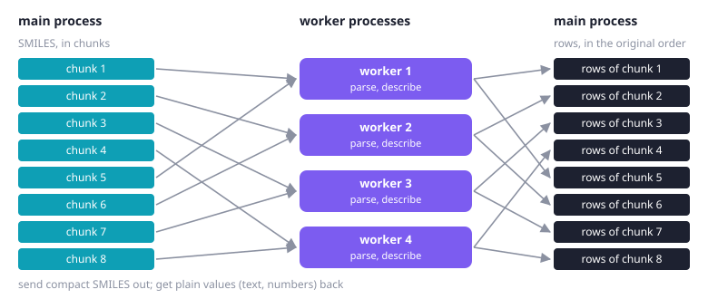

Standardising a library and computing its fingerprints is the same small job repeated for every
molecule, and no molecule depends on another. That makes it the easiest kind of work to spread out:
split the library into chunks, give each chunk to a different processor core, and put the results
back together. A laptop has several cores and a server dozens, yet a plain Python loop uses one.
Data engineers parallelise this kind of work routinely, and they also know where it goes wrong:
code that runs on Linux and fails on Windows, chunks so small that the overheads eat the gain, and
jobs that never get faster however many cores they are given.

By the end of this module you will be able to:

- run a function over chunks of a library on several cores with joblib, on Windows, macOS and
  Linux, and check that the results are identical to a serial run;
- explain why worker functions belong in a module file, and why workers should be sent SMILES
  rather than RDKit molecules;
- choose a chunk size, and measure the speed-up;
- predict where the speed-up levels off, with Amdahl's law, and use threads for work that mostly
  waits;
- run the same function over a partitioned Parquet dataset with Dask, lazily, on a local cluster
  that can be replaced by a real one.

We use 12,000 molecules from the teaching library (`chemlib`, as in the earlier modules) and at most
4 workers, so the lesson runs in about a minute on any laptop. The text says how each step scales to
the full 1,733,400 molecules and beyond.

## 1. One core at a time

### The worker function

The job for each molecule: read the SMILES, write the canonical SMILES (a stand-in for the full
standardisation of Module 7), and compute the molecular weight, the polar surface area and a Morgan
fingerprint. The function that does it lives in its own file, `workers.py`, next to this lesson.
Section 2 explains why; for now, import it:

```python
import sys
from pathlib import Path

import chemlib

# Worker processes must import the functions they run by name, so those functions live in a file
# of their own, workers.py, in this folder. Putting the folder first on the import path lets this
# process, and the worker processes it starts (they copy the path), import it.
sys.path.insert(0, str(Path().resolve()))
import workers  # noqa: E402  (after the path is set)

Path("work").mkdir(exist_ok=True)
library = chemlib.library(12_000, seed=9)
smiles = list(library["smiles"])
print(len(smiles), "molecules; the first:", smiles[0])
print(workers.describe(smiles[:2]))
```
```output
12000 molecules; the first: c1cc(N8CCOCC8)ccc1C(=O)NCc2ccccc2
[('O=C(NCc1ccccc1)c1ccc(N2CCOCC2)cc1', 296.37, 41.57, 36), ('CCOc1ccc(C(=O)NCc2ccc(F)cc2)cc1', 273.31, 38.33, 35)]
```

`describe` takes a list of SMILES and returns one row per molecule, in the same order. Working on a
list, not one molecule, matters: each call to a worker has a fixed cost, so we want each call to do
a good amount of work.

### The serial run

First, the plain way, on one core. Timings depend on the computer, so this output is an example:

```python
import time

start = time.perf_counter()
serial = workers.describe(smiles)
serial_seconds = time.perf_counter() - start
per_molecule = serial_seconds / len(smiles)
print(f"{len(smiles):,} molecules in {serial_seconds:.1f} s, {per_molecule * 1e6:.0f} µs each")
print(f"all {chemlib.size():,} would take about {chemlib.size() * per_molecule / 60:.0f} minutes")
```
```output varies
12,000 molecules in 2.8 s, 234 µs each
all 1,733,400 would take about 7 minutes
```

## 2. Several cores with joblib

### Chunks and workers

**joblib** is the standard tool for this in Python (scikit-learn uses it). `Parallel` starts a set of
worker processes, `delayed(f)(chunk)` describes one call without making it, and joblib sends the
calls to the workers and returns the results in the order the calls were given, whichever worker
finished first. We split the SMILES into chunks of 1,500 and use 4 workers:



```python
from joblib import Parallel, delayed


def chunked(items: list, size: int) -> list[list]:
    """Split a list into consecutive chunks of at most `size` items."""
    return [items[i : i + size] for i in range(0, len(items), size)]


chunks = chunked(smiles, 1_500)
parts = Parallel(n_jobs=4)(delayed(workers.describe)(chunk) for chunk in chunks)
in_parallel = [row for part in parts for row in part]
print(len(chunks), "chunks of", len(chunks[0]), "->", len(in_parallel), "rows")
print("identical to the serial run:", in_parallel == serial)
```
```output
8 chunks of 1500 -> 12000 rows
identical to the serial run: True
```

Always check this. Parallel code that changes the answer (rows out of order, a chunk lost, a
different random seed in each worker) is worse than slow code, and the check costs one line.
`describe` is deterministic, and joblib keeps the order, so the results are exactly the same.

### The speed-up

Now time the same job with 2 and 4 workers, against the serial run. joblib keeps its workers
running between calls, so a small call first starts them, and the timings measure the work rather
than the start-up:

```python
speed_up = {1: 1.0}
for n_jobs in [2, 4]:
    Parallel(n_jobs=n_jobs)(delayed(workers.describe)(c) for c in chunked(smiles[:40], 10))
    start = time.perf_counter()
    Parallel(n_jobs=n_jobs)(delayed(workers.describe)(chunk) for chunk in chunks)
    seconds = time.perf_counter() - start
    speed_up[n_jobs] = serial_seconds / seconds
    print(f"n_jobs={n_jobs}: {seconds:.1f} s, {speed_up[n_jobs]:.1f} times the serial speed")
```
```output varies
n_jobs=2: 1.4 s, 2.0 times the serial speed
n_jobs=4: 0.8 s, 3.5 times the serial speed
```

The speed-up grows with the workers but falls short of the number of workers, and the gap widens
as workers are added. Section 5 explains why, and the figure there shows the same measurement up to
8 workers.

### Why joblib, and not multiprocessing directly

Python's standard library has `multiprocessing`, and joblib is built on the same idea, so why not
use it directly? Because of how new processes start, which differs between operating systems:

- **fork** copies the running process, with everything already defined in it. It was the default on
  Linux until Python 3.14.
- **spawn** starts a fresh Python, which must *import* the function it is asked to run, and imports
  the script that started it too. It is the default on Windows and macOS, and Python 3.14 made
  **forkserver**, which works the same way in this respect, the default on Linux.

So code written and tested on a Linux server with fork often fails on a colleague's Windows laptop:
a function defined in a notebook cannot be found by the workers, and a script without the
`if __name__ == "__main__":` guard is re-run by every worker, which then tries to start workers of
its own and stops with an error. With
plain `multiprocessing`, a script that works everywhere looks like this (shown here, not run,
because the guard only works in a script run on its own):

```py
import multiprocessing

from workers import describe

if __name__ == "__main__":  # without this, each spawned worker re-runs the script
    with multiprocessing.get_context("spawn").Pool(4) as pool:
        parts = pool.map(describe, chunks)
```

joblib's default backend, **loky**, avoids both problems: it starts its workers without re-running
your script, and it serialises functions with `cloudpickle`, which can send a function defined in a
notebook. The same `Parallel` call therefore works in a notebook, in a script and in CI, on Windows,
macOS and Linux. Keeping worker functions in a module file is still the safest habit: it works with
every backend, including `multiprocessing` and Dask clusters, and the functions can be tested.

## 3. What to send: SMILES, not molecules

Everything sent to a worker process is **pickled** (turned into bytes), copied to the other
process and unpickled there, and the results come back the same way. What we send therefore has a
cost. Compare one chunk of SMILES with the same chunk as RDKit molecules:

```python
import pickle

from rdkit import Chem

chunk = chunks[0]
as_text = pickle.dumps(chunk)
as_molecules = pickle.dumps([Chem.MolFromSmiles(s) for s in chunk])
print(f"{len(chunk):,} SMILES:   {len(as_text) / 1e3:6.0f} kB")
print(f"{len(chunk):,} molecules: {len(as_molecules) / 1e3:6.0f} kB, "
      f"{len(as_molecules) / len(as_text):.0f} times as much")
```
```output
1,500 SMILES:       72 kB
1,500 molecules:    577 kB, 8 times as much
```

The molecules are about eight times larger to send, and they had to be parsed first, in the main
process, one core at a time: the slowest step moved *out* of the parallel part. Send the compact
text, parse in the worker, and send back plain values (strings, numbers), not molecules.

## 4. Choosing a chunk size

Each chunk is a separate task, and each task has a fixed cost: it is pickled, queued, sent and
collected. Very small chunks spend their time on that; very large ones leave workers idle, because
when there are fewer chunks than workers, or one chunk is slow, the others wait at the end. Time
the 12,000 molecules with 4 workers and three chunk sizes. `batch_size=1` tells joblib to send
every chunk as a task of its own, as plain `multiprocessing` would:

```python
for size in [5, 1_500, 6_000]:
    pieces = chunked(smiles, size)
    start = time.perf_counter()
    Parallel(n_jobs=4, batch_size=1)(delayed(workers.describe)(piece) for piece in pieces)
    print(f"chunks of {size:>5,}: {len(pieces):>5,} tasks, {time.perf_counter() - start:.1f} s")
```
```output varies
chunks of     5: 2,400 tasks, 1.4 s
chunks of 1,500:     8 tasks, 0.7 s
chunks of 6,000:     2 tasks, 1.4 s
```

Thousands of tiny tasks spend part of their time on the overheads, and 2 chunks of 6,000 keep only
2 of the 4 workers busy. A good rule is a few chunks per worker, each taking from a fraction of a
second to a few seconds. joblib can also decide for itself: pass one molecule per call and it
groups calls into batches (`batch_size="auto"`, the default), timing them as it goes.

## 5. When parallel stops helping

### Amdahl's law

Some part of every job is not parallel: making the chunks, starting the workers, sending the data
and joining the results. If a fraction `p` of the time can run in parallel and the rest cannot,
then with `n` workers the best possible speed-up is

`speed-up = 1 / ((1 - p) + p / n)`

This is **Amdahl's law** (Amdahl, 1967). However many workers you add, the speed-up never passes
`1 / (1 - p)`:

```python
def amdahl(p: float, n: int) -> float:
    """The best speed-up with n workers when a fraction p of the work runs in parallel."""
    return 1 / ((1 - p) + p / n)


counts = [2, 4, 8, 16, 64]
print("best speed-up with this many workers:")
print(f"{'parallel fraction':>17}" + "".join(f"{n:>7}" for n in counts) + f"{'limit':>8}")
for p in [0.5, 0.9, 0.99]:
    row = "".join(f"{amdahl(p, n):7.1f}" for n in counts)
    print(f"{p:>17}{row}{1 / (1 - p):8.0f}")
```
```output
best speed-up with this many workers:
parallel fraction      2      4      8     16     64   limit
              0.5    1.3    1.6    1.8    1.9    2.0       2
              0.9    1.8    3.1    4.7    6.4    8.8      10
             0.99    2.0    3.9    7.5   13.9   39.3     100
```

With 10% of the job serial, 64 workers give less than a tenfold speed-up. That is why it pays to
look for the serial part first: reading one big file in the main process, parsing molecules before
sending them (section 3), or writing every result through one connection.


Other limits are physical: a laptop with 4 performance cores gains little from 16 workers, workers
compete for memory and memory bandwidth, and libraries that already use several threads (NumPy's
linear algebra, for example) can slow each other down when run in many processes at once.

### Work that mostly waits: threads

Some jobs are slow because they wait, not because they compute: downloading records from PubChem or
ChEMBL (Module 11), or reading from a database. Waiting needs no processor, so threads, which are
cheaper to start than processes and share memory, are enough. `workers.look_up` stands in for a web
request that takes 50 milliseconds:

```python
ids = list(library["id"][:40])
start = time.perf_counter()
one_by_one = [workers.look_up(i) for i in ids]
waited = time.perf_counter() - start
start = time.perf_counter()
threaded = Parallel(n_jobs=8, prefer="threads")(delayed(workers.look_up)(i) for i in ids)
print(f"40 look-ups one by one: {waited:.1f} s; with 8 threads: {time.perf_counter() - start:.1f} s")
print("same results:", threaded == one_by_one)
```
```output varies
40 look-ups one by one: 2.2 s; with 8 threads: 0.3 s
same results: True
```

For computing in pure Python, threads do not help: Python's global interpreter lock lets only one
thread run Python code at a time (Python 3.13 added an optional build without it, which not
every package supports yet). Use processes to compute, threads to wait, and for real web services,
keep to their rate limits whichever you use (Module 11).

## 6. Beyond one machine's memory: Dask

joblib spreads work over the cores of one computer, and the data still pass through the main
process. **Dask** goes further: it splits a table into **partitions**, plans the work as a graph of
small tasks, and runs the graph on the cores of one computer or on the workers of a cluster, reading
each partition only when a task needs it. Module 8 showed how to keep a library as a folder of
Parquet files; Dask works directly on such a folder.

### A Parquet folder to work on

Write 24,000 molecules (twice as many as before) as six Parquet files of 4,000, streaming them so
they are never all in memory:

```python
import shutil

folder = Path("work/molecules")
shutil.rmtree(folder, ignore_errors=True)
folder.mkdir(parents=True)
for k, batch in enumerate(chemlib.stream(24_000, batch=4_000, start=1_200_000)):
    batch.to_parquet(folder / f"part-{k:02d}.parquet", index=False)
print(sorted(p.name for p in folder.iterdir()))
```
```output
['part-00.parquet', 'part-01.parquet', 'part-02.parquet', 'part-03.parquet', 'part-04.parquet', 'part-05.parquet']
```

### Lazy partitions and a task graph

`dask.dataframe.read_parquet` reads only the files' footers: their schema and size. The table it
returns looks like a pandas table but holds a plan, not data. `map_partitions` adds "run this
function on each partition" to the plan; `meta` tells Dask what the result will look like, so it
does not have to run the function to find out. Nothing is computed yet:

```python
import dask.dataframe as dd
import pandas as pd

molecules = dd.read_parquet(folder)
meta = pd.DataFrame({"id": [], "vendor": [], **{c: [] for c in workers.COLUMNS}})
meta = meta.astype({"id": "string", "vendor": "string", **workers.COLUMNS})
described = molecules.map_partitions(workers.describe_frame, meta=meta)
print(type(described).__name__, "with", described.npartitions, "partitions")
print(dict(described.dtypes.astype(str)))
```
```output
DataFrame with 6 partitions
{'id': 'string', 'vendor': 'string', 'canonical_smiles': 'string', 'mw': 'float64', 'tpsa': 'float64', 'bits_on': 'int64'}
```

### A local cluster, and computing the result

A **Client** connects to a Dask cluster; `LocalCluster` makes one on this computer. Here its
workers are threads in this process (`processes=False`), so the same code runs in a notebook, a
script and CI with no `if __name__ == "__main__":` guard. That keeps the lesson portable, but
threads share Python's interpreter lock, so this cluster shows *how* Dask runs the work, not a
speed-up; for RDKit work, a cluster needs worker processes, as below. The cluster also serves a
**dashboard**, a web page showing every task as it runs; `client.dashboard_link` gives its address
(it needs the `bokeh` package installed).

`to_parquet` runs the whole plan: each partition is read, described and written to its own file,
and no partition waits for the others to finish:

```python
from dask.distributed import Client, LocalCluster

cluster = LocalCluster(n_workers=1, threads_per_worker=4, processes=False)
client = Client(cluster)
shutil.rmtree("work/described", ignore_errors=True)  # old files would be read back with the new
described.to_parquet("work/described", write_index=False)

result = dd.read_parquet("work/described")
summary = result.groupby("vendor").agg({"id": "count", "mw": "mean", "bits_on": "mean"})
print(summary.compute().round(2).sort_index().to_string())
client.close()
cluster.close()
```
```output
            id      mw  bits_on
vendor                         
Vendor A  8000  346.41    47.70
Vendor B  8000  346.54    47.15
Vendor C  8000  351.27    48.21
```

The output folder is again one Parquet file per partition, ready for DuckDB (Module 8) or for the
next Dask step. As with joblib, check the answer: the rows Dask wrote for the first input file are
the rows a direct, serial call gives:

```python
first_file = pd.read_parquet(folder / "part-00.parquet")
direct = workers.describe(list(first_file["smiles"]))
from_dask = pd.read_parquet("work/described").set_index("id").loc[first_file["id"]]
rows = list(from_dask[list(workers.COLUMNS)].itertuples(index=False, name=None))
print(len(rows), "rows; Dask matches a direct call:", rows == direct)
```
```output
4000 rows; Dask matches a direct call: True
```

### The same code on a cluster

Nothing in the Dask code above depends on where the workers are. On a cluster, the only change is
the `Client`:

```py
client = Client("tcp://scheduler-address:8786")   # a cluster someone has started
```

and the same `read_parquet`, `map_partitions` and `to_parquet` run on its workers, which read their
partitions straight from shared storage (a network drive, or object storage such as Amazon S3).
Universities' batch systems (SLURM, PBS) start Dask workers as ordinary jobs with the
`dask-jobqueue` package, and cloud platforms with Kubernetes. To describe all 1,733,400 molecules,
or a billion, change the input folder: more partitions, the same code, and memory per worker set by
the partition size, not the library size.

## Try it yourself

The homework for this module is in `homework.md`: a few questions answered by running code like the
code above. Answers are published after the cohort's deadline.

## Further reading

- Amdahl, G. M. (1967). Validity of the single processor approach to achieving large scale
  computing capabilities. *Proceedings of the April 18–20, 1967, Spring Joint Computer Conference
  (AFIPS '67 Spring)*, 483. <https://doi.org/10.1145/1465482.1465560>
- Rocklin, M. (2015). Dask: parallel computation with blocked algorithms and task scheduling.
  *Proceedings of the 14th Python in Science Conference (SciPy 2015)*, 126–132.
  <https://doi.org/10.25080/Majora-7b98e3ed-013>
- The joblib documentation. *Embarrassingly parallel for loops*.
  <https://joblib.readthedocs.io/en/stable/user_guide/parallel.html>
- The Python documentation. *multiprocessing: contexts and start methods*.
  <https://docs.python.org/3/library/multiprocessing.html>
- The Dask documentation. *Dask DataFrame*. <https://docs.dask.org/en/stable/dataframe.html>
- The Dask documentation. *Deploy Dask clusters*. <https://docs.dask.org/en/stable/deploying.html>
