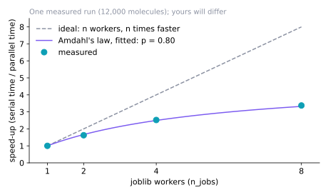

Standardising a library and computing its fingerprints is the same small job repeated for every
molecule, and no molecule depends on another. That makes it the easiest kind of work to spread out.
A computer's processor chip contains several **cores**, each of which can run a program on its own:
a laptop has 4 to 16, a server dozens. Yet a plain Python loop uses only one of them. To use more,
we split the library into **chunks** (for example, 1,500 molecules each), give each chunk to a
different core, and put the results back together. Doing one thing after another on one core is
called **serial**; doing several at the same time on several cores is **parallel**.

Data engineers do this kind of work routinely, and they also know where it goes wrong: code that
runs on Linux and fails on Windows, chunks so small that the extra costs of sending them eat the
gain, and jobs that never get faster however many cores they are given.

By the end of this module you will be able to:

- run a function over chunks of a library on several cores with joblib, on Windows, macOS and
  Linux, and check that the results are the same as from an ordinary loop;
- explain why the functions that run on other cores are kept in a file of their own, and why they
  should be sent SMILES rather than RDKit molecules;
- choose a chunk size, and measure how much faster the job runs;
- predict where adding cores stops helping, and use threads for work that mostly waits;
- run the same function over a folder of Parquet files with Dask, which reads one file at a time
  and can use the cores of many computers.

This module builds on [Module 8](../08-larger-than-memory/), which wrote a library as a folder of
Parquet files and processed it in batches; the canonical SMILES of
[Module 7](../07-standardisation/) and the Morgan fingerprints of
[Module 2](../02-text-patterns-and-numbers/) are the work we spread out. We use 12,000 molecules
from the teaching library (`chemlib`, as in the earlier modules) and at most 4 workers, so the
lesson runs in about a minute on any laptop. The text says how each step scales to the full
1,733,400 molecules and beyond.

The lesson uses these packages, each introduced again where it is first used:

- **joblib**, which runs a function on several cores at once;
- **Dask** (the `dask` and `distributed` packages), which does the same over a folder of files, on
  one computer or on many;
- **RDKit** and **pandas** (with **PyArrow** to read Parquet files), as in the earlier modules.

Colab's free computers usually have only two cores, so in Colab, 4 workers will not run four times
as fast: the timings in this lesson come from a laptop with more cores, and yours will differ.

## Setup

Everything this lesson needs is imported and set here, so the settings can be changed in one
place. Pipeline steps report with `log`; `print` is kept for showing you results; Module 1 explains
why.

A running program is called a **process**. To use several cores, Python starts extra processes,
called **workers**, and hands each one a chunk. The functions the workers run are kept in their own
file, `workers.py`, next to this lesson (section 2 explains why). A Python file like this, loaded
with `import`, is called a **module**. In Colab, the first cell of the notebook downloads
`workers.py` for you; you can open it from the Files panel on the left to read it. The line
`sys.path.insert(...)` adds the lesson's folder to the list of places Python looks for modules, so
`import workers` finds the file.

```python
import logging
import pickle
import shutil
import sys
import time
from pathlib import Path

import dask.dataframe as dd
import pandas as pd
from dask.distributed import Client, LocalCluster
from joblib import Parallel, delayed
from rdkit import Chem

import chemlib

# Worker processes must import the functions they run by name, so those functions live in a file
# of their own, workers.py, in this folder. Putting the folder first on the import path lets this
# process, and the worker processes it starts (they copy the path), import it.
sys.path.insert(0, str(Path().resolve()))
import workers  # noqa: E402  (after the path is set)

# log lines: level and message only, so the lesson's outputs are the same on every run
# (a real job would add "%(asctime)s" to the format)
logging.basicConfig(level=logging.INFO, format="%(levelname)s %(message)s", force=True)
log = logging.getLogger(__name__)

WORK = Path("work")  # where the lesson writes its files (git-ignored)
N_MOLECULES = 12_000  # molecules described with joblib; any number up to chemlib.size()
SEED = 9  # which molecules; change it for a different sample
CHUNK = 1_500  # molecules per chunk sent to a worker
N_JOBS = 4  # worker processes; at most the number of cores your computer has
WORKER_COUNTS = [2, 4]  # the numbers of workers timed in section 2
WARM_UP_SMILES, WARM_UP_CHUNK = 40, 10  # a small first call that starts the workers
CHUNK_SIZES = [5, CHUNK, 6_000]  # the chunk sizes timed in section 4
N_LOOK_UPS = 40  # stand-in web requests in section 5
N_THREADS = 8  # threads for work that mostly waits
DASK_MOLECULES = 24_000  # molecules in the Parquet folder Dask works on
DASK_PARTITION = 4_000  # molecules per Parquet file (one Dask partition each)
DASK_START = 1_200_000  # the number of the first of those molecules
DASK_THREADS = 4  # threads in the local Dask cluster
MOLECULES = WORK / "molecules"  # Dask's input folder
DESCRIBED = WORK / "described"  # ... and its output folder

WORK.mkdir(exist_ok=True)
```

## 1. One core at a time

### The worker function

The job for each molecule: read the SMILES, write the canonical SMILES (a stand-in for the full
standardisation of Module 7), and compute the molecular weight, the polar surface area (TPSA) and a
Morgan fingerprint, of which we keep the number of bits set to 1 (`bits_on`). The function that
does it, `workers.describe`, was imported in the Setup block:

```python
library = chemlib.library(N_MOLECULES, seed=SEED)
smiles = list(library["smiles"])
print(len(smiles), "molecules; the first:", smiles[0])
for row in workers.describe(smiles[:2]):
    print(row)
```
```output
12000 molecules; the first: c1cc(N8CCOCC8)ccc1C(=O)NCc2ccccc2
Description(canonical_smiles='O=C(NCc1ccccc1)c1ccc(N2CCOCC2)cc1', mw=296.37, tpsa=41.57, bits_on=36)
Description(canonical_smiles='CCOc1ccc(C(=O)NCc2ccc(F)cc2)cc1', mw=273.31, tpsa=38.33, bits_on=35)
```

`describe` takes a list of SMILES and returns one row per molecule, in the same order. Working on a
list, not one molecule, matters: each call to a worker has a fixed cost, so we want each call to do
a good amount of work. Each row is a named tuple (`collections.namedtuple`, defined in
`workers.py`): a tuple whose positions also have names, so it prints readably and can be read as
`row.mw`, yet compares equal to a plain tuple and is as cheap to send between processes.

### The serial run

First, the plain way, on one core. `time.perf_counter()` reads a stopwatch: the difference between
two readings is the time in seconds between them. µs is a microsecond, a millionth of a second.
Timings depend on the computer, so this output is an example:

```python
start = time.perf_counter()
serial = workers.describe(smiles)
serial_seconds = time.perf_counter() - start
per_molecule = serial_seconds / len(smiles)
log.info("%s molecules in %.1f s, %.0f µs each", f"{len(smiles):,}", serial_seconds,
         per_molecule * 1e6)
log.info("all %s would take about %.0f minutes", f"{chemlib.size():,}",
         chemlib.size() * per_molecule / 60)
```
```output varies
INFO 12,000 molecules in 2.8 s, 234 µs each
INFO all 1,733,400 would take about 7 minutes
```

## 2. Several cores with joblib

### Chunks and workers

**joblib** is the standard tool for this in Python (scikit-learn, the machine-learning package, uses
it). It needs three things:

- `Parallel(n_jobs=4)` starts a set of 4 worker processes;
- `delayed(workers.describe)(chunk)` writes down the call `workers.describe(chunk)` without making
  it, so joblib can send it to a worker instead;
- `Parallel(...)(... for chunk in chunks)` takes one such call per chunk, sends the calls to the
  workers, and returns the results in the order the calls were given, whichever worker finished
  first.

We split the SMILES into chunks of 1,500 (`CHUNK`) and use 4 workers (`N_JOBS`). In `chunked`,
`items[i : i + size]` is a slice, the items from position `i` up to (not including) `i + size`.
joblib gives back one list of rows per chunk, and `[row for part in parts for row in part]` joins
them into one list:


```python
def chunked(items: list, size: int) -> list[list]:
    """Split a list into consecutive chunks of at most `size` items."""
    return [items[i : i + size] for i in range(0, len(items), size)]


chunks = chunked(smiles, CHUNK)
parts = Parallel(n_jobs=N_JOBS)(delayed(workers.describe)(chunk) for chunk in chunks)
in_parallel = [row for part in parts for row in part]
log.info("%d chunks of %d -> %d rows", len(chunks), len(chunks[0]), len(in_parallel))
print("identical to the serial run:", in_parallel == serial)
```
```output
INFO 8 chunks of 1500 -> 12000 rows
identical to the serial run: True
```

Always check this. Parallel code that changes the answer (rows out of order, a chunk lost, a
different random seed in each worker) is worse than slow code, and the check costs one line.
`describe` is deterministic, and joblib keeps the order, so the results are exactly the same.

### The speed-up

Now time the same job with 2 and 4 workers, against the serial run. joblib keeps its workers
running between calls, so a small call first starts them, and the timings measure the work rather
than the start-up:

```python
warm_up = chunked(smiles[:WARM_UP_SMILES], WARM_UP_CHUNK)
speed_up = {1: 1.0}
for n_jobs in WORKER_COUNTS:
    Parallel(n_jobs=n_jobs)(delayed(workers.describe)(c) for c in warm_up)
    start = time.perf_counter()
    Parallel(n_jobs=n_jobs)(delayed(workers.describe)(chunk) for chunk in chunks)
    seconds = time.perf_counter() - start
    speed_up[n_jobs] = serial_seconds / seconds
    log.info("n_jobs=%d: %.1f s, %.1f times the serial speed", n_jobs, seconds, speed_up[n_jobs])
```
```output varies
INFO n_jobs=2: 1.4 s, 2.0 times the serial speed
INFO n_jobs=4: 0.8 s, 3.5 times the serial speed
```

The **speed-up** is the serial time divided by the parallel time: 2.0 means twice as fast. It grows
with the workers but falls short of the number of workers, and the gap widens as workers are added. Section 5 explains why, and the figure there shows the same measurement up to
8 workers.

### Why joblib, and not multiprocessing directly

Python's standard library (the modules that come with Python itself) has `multiprocessing`, and
joblib is built on the same idea, so why not use it directly? Because of how new processes start,
which differs between operating systems (Windows, macOS, Linux):

- **fork** copies the running process, with everything already defined in it. It was the default on
  Linux until Python 3.14.
- **spawn** starts a fresh Python, which must *import* the function it is asked to run, and imports
  the script that started it too. It is the default on Windows and macOS, and Python 3.14 made
  **forkserver**, which works the same way in this respect, the default on Linux.

So code written and tested on a Linux server with fork often fails on a colleague's Windows laptop:
a function defined in a notebook cannot be found by the workers, and a script without the
`if __name__ == "__main__":` guard is re-run by every worker, which then tries to start workers of
its own and stops with an error. The guard is a line that is true only in the script you started
yourself, not when a worker imports it, so the code under it runs once.

With plain `multiprocessing`, a script that works everywhere looks like this. It is shown here, not
run: the guard only works in a script run on its own, so it cannot run in Colab or a notebook. On
your own computer you would save it as a file, say `describe_all.py`, in the lesson's folder (next
to `workers.py`), and run it from a terminal opened in that folder with
`uv run python describe_all.py` (the Start here page shows how to set this up). As written it
prints nothing; it is the shape of such a script, not a finished one (`chunks` would have to be
made first):

```py
import multiprocessing

from workers import describe

if __name__ == "__main__":  # without this, each spawned worker re-runs the script
    with multiprocessing.get_context("spawn").Pool(4) as pool:
        parts = pool.map(describe, chunks)
```

joblib's default way of starting workers (its **backend**), called **loky**, avoids both problems:
it starts its workers without re-running your script, and it packs functions up for sending with
`cloudpickle`, which can send a function defined in a notebook. The same `Parallel` call therefore
works in a notebook, in a script and in CI (continuous integration: the automatic test runs the
course's code gets on every change), on Windows, macOS and Linux. Keeping worker functions in a module file is still the safest habit: it works with
every backend, including `multiprocessing` and Dask clusters, and the functions can be tested.

## 3. What to send: SMILES, not molecules

Each worker process has its own memory, so it cannot simply look at the main process's data.
Everything sent to a worker is **pickled** (turned into bytes, with Python's `pickle` module),
copied to the other process and unpickled there, and the results come back the same way. What we
send therefore has a cost. Compare one chunk of SMILES with the same chunk as RDKit molecules
(`pickle.dumps` returns the bytes, and `len` counts them; a kB is a thousand bytes):

```python
chunk = chunks[0]
as_text = pickle.dumps(chunk)
as_molecules = pickle.dumps([Chem.MolFromSmiles(s) for s in chunk])
print(f"{len(chunk):,} SMILES:   {len(as_text) / 1e3:6.0f} kB")
print(f"{len(chunk):,} molecules: {len(as_molecules) / 1e3:6.0f} kB, "
      f"{len(as_molecules) / len(as_text):.0f} times as much")
```
```output
1,500 SMILES:       72 kB
1,500 molecules:    577 kB, 8 times as much
```

The molecules are about eight times larger to send, and they had to be parsed first, in the main
process, one core at a time: the slowest step moved *out* of the parallel part. Send the compact
text, parse in the worker, and send back plain values (strings, numbers), not molecules.

## 4. Choosing a chunk size

Each chunk is a separate **task** (one piece of work handed to a worker), and each task has a fixed
cost, its **overhead**: it is pickled, queued, sent and collected. Very small chunks spend their
time on that; very large ones leave workers idle, because when there are fewer chunks than workers,
or one chunk is slow, the others wait at the end. Time
the 12,000 molecules with 4 workers and three chunk sizes. `batch_size=1` tells joblib to send
every chunk as a task of its own, as plain `multiprocessing` would:

```python
for size in CHUNK_SIZES:
    pieces = chunked(smiles, size)
    start = time.perf_counter()
    Parallel(n_jobs=N_JOBS, batch_size=1)(delayed(workers.describe)(piece) for piece in pieces)
    log.info("chunks of %5s: %5s tasks, %.1f s", f"{size:,}", f"{len(pieces):,}",
             time.perf_counter() - start)
```
```output varies
INFO chunks of     5: 2,400 tasks, 1.4 s
INFO chunks of 1,500:     8 tasks, 0.7 s
INFO chunks of 6,000:     2 tasks, 1.4 s
```

Thousands of tiny tasks spend part of their time on the overheads, and 2 chunks of 6,000 keep only
2 of the 4 workers busy. A good rule is a few chunks per worker, each taking from a fraction of a
second to a few seconds. joblib can also decide for itself: pass one molecule per call and it
groups calls into batches (`batch_size="auto"`, the default), timing them as it goes.

## 5. When parallel stops helping

### Amdahl's law

Some part of every job is not parallel: making the chunks, starting the workers, sending the data
and joining the results. If a fraction `p` of the time can run in parallel and the rest cannot,
then with `n` workers the best possible speed-up is

`speed-up = 1 / ((1 - p) + p / n)`

This is **Amdahl's law** (Amdahl, 1967). For example, if 90% of a job can run in parallel
(`p = 0.9`) and we use 4 workers, the serial 10% still takes its full time and the other 90% takes
a quarter of its time: `0.1 + 0.9 / 4 = 0.325` of the original time, a speed-up of
`1 / 0.325 = 3.1`, not 4. However many workers you add, the speed-up never passes `1 / (1 - p)`,
because the serial part never shrinks. The table works this out for several cases (in the
f-strings, `>17` and `>7` right-align a value in a space of 17 or 7 characters, so the columns line
up):

```python
def amdahl(p: float, n: int) -> float:
    """The best speed-up with n workers when a fraction p of the work runs in parallel."""
    return 1 / ((1 - p) + p / n)


counts = [2, 4, 8, 16, 64]
print("best speed-up with this many workers:")
print(f"{'parallel fraction':>17}" + "".join(f"{n:>7}" for n in counts) + f"{'limit':>8}")
for p in [0.5, 0.9, 0.99]:
    row = "".join(f"{amdahl(p, n):7.1f}" for n in counts)
    print(f"{p:>17}{row}{1 / (1 - p):8.0f}")
```
```output
best speed-up with this many workers:
parallel fraction      2      4      8     16     64   limit
              0.5    1.3    1.6    1.8    1.9    2.0       2
              0.9    1.8    3.1    4.7    6.4    8.8      10
             0.99    2.0    3.9    7.5   13.9   39.3     100
```

With 10% of the job serial, 64 workers give less than a tenfold speed-up. That is why it pays to
look for the serial part first: reading one big file in the main process, parsing molecules before
sending them (section 3), or writing every result through one connection.



Other limits are physical: a laptop with 4 fast cores gains little from 16 workers, workers
compete for memory and for the speed at which data moves to and from it, and libraries that already use several threads (NumPy's
linear algebra, for example) can slow each other down when run in many processes at once.

### Work that mostly waits: threads

Some jobs are slow because they wait, not because they compute: downloading records from PubChem or
ChEMBL (Module 11), or reading from a database. Waiting needs no processor, so threads are enough.
A **thread** is a second line of work inside the same process: threads are cheaper to start than
processes and share the process's memory, so nothing has to be pickled. `prefer="threads"` tells
joblib to use threads instead of worker processes. `workers.look_up` stands in for a web request
that takes 50 milliseconds:

```python
ids = list(library["id"][:N_LOOK_UPS])
start = time.perf_counter()
one_by_one = [workers.look_up(i) for i in ids]
waited = time.perf_counter() - start
start = time.perf_counter()
threaded = Parallel(n_jobs=N_THREADS, prefer="threads")(delayed(workers.look_up)(i) for i in ids)
log.info("%d look-ups one by one: %.1f s; with %d threads: %.1f s", len(ids), waited, N_THREADS,
         time.perf_counter() - start)
print("same results:", threaded == one_by_one)
```
```output varies
INFO 40 look-ups one by one: 2.2 s; with 8 threads: 0.3 s
same results: True
```

For computing in pure Python, threads do not help: Python's **global interpreter lock** (the GIL, a
rule inside Python that keeps its threads from getting in each other's way) lets only one thread
run Python code at a time (Python 3.13 added an optional build without it, which not
every package supports yet). Use processes to compute, threads to wait, and for real web services,
keep to their rate limits (the number of requests per second they allow) whichever you use
(Module 11).

## 6. Beyond one machine's memory: Dask

joblib spreads work over the cores of one computer, and all the data still pass through the main
process, so they must fit in its memory. **Dask** goes further: it splits a table into
**partitions** (pieces of the table, here one per Parquet file; a broader use of the word than the
vendor folders of Module 8), plans the work as a set of small tasks, and runs them on the cores of
one computer or on the workers of a **cluster** (a group of computers that work together), reading
each partition only when a task needs it. Module 8 showed how to keep a library as a folder of
Parquet files; Dask works directly on such a folder.

This section is a step up from joblib, because Dask first writes down a plan and only runs it when
asked. The steps are: write a folder of files; tell Dask what to do with each file (nothing runs);
start a cluster of workers; then ask for the result, which runs the plan.

### A Parquet folder to work on

Write 24,000 molecules (twice as many as before) as six Parquet files of 4,000, streaming them so
they are never all in memory (as in Module 8). `f"part-{k:02d}.parquet"` writes the batch number
with two digits, so the files are named `part-00`, `part-01` and so on, and sort in order:

```python
shutil.rmtree(MOLECULES, ignore_errors=True)
MOLECULES.mkdir(parents=True)
for k, batch in enumerate(chemlib.stream(DASK_MOLECULES, batch=DASK_PARTITION, start=DASK_START)):
    batch.to_parquet(MOLECULES / f"part-{k:02d}.parquet", index=False)
print(sorted(p.name for p in MOLECULES.iterdir()))
```
```output
['part-00.parquet', 'part-01.parquet', 'part-02.parquet', 'part-03.parquet', 'part-04.parquet', 'part-05.parquet']
```

### Lazy partitions and a task graph

`dask.dataframe.read_parquet` reads only the files' footers (the short summary at the end of each
Parquet file): their schema and size. The table it returns looks like a pandas table but holds a
plan, not data; work that waits until it is asked for like this is called **lazy**.
`map_partitions` adds "run this function on each partition" to the plan. The function,
`workers.describe_frame`, takes one partition as a pandas table and returns its described rows.

`meta` tells Dask what the result will look like (its columns and their types), so it does not
have to run the function to find out. We build it as an empty pandas table: `workers.COLUMNS` is a
dictionary from each result column's name to its type, and `**` unpacks a dictionary into another,
so `{"id": [], "vendor": [], **{...}}` is one dictionary with all the columns. Nothing is computed
yet:

```python
molecules = dd.read_parquet(MOLECULES)
meta = pd.DataFrame({"id": [], "vendor": [], **{c: [] for c in workers.COLUMNS}})
meta = meta.astype({"id": "string", "vendor": "string", **workers.COLUMNS})
described = molecules.map_partitions(workers.describe_frame, meta=meta)
print(type(described).__name__, "with", described.npartitions, "partitions")
print(dict(described.dtypes.astype(str)))
```
```output
DataFrame with 6 partitions
{'id': 'string', 'vendor': 'string', 'canonical_smiles': 'string', 'mw': 'float64', 'tpsa': 'float64', 'bits_on': 'int64'}
```

### A local cluster, and computing the result

A **Client** connects to a Dask cluster; `LocalCluster` makes one on this computer. Here its
workers are threads in this process (`processes=False`), so the same code runs in a notebook, a
script and CI with no `if __name__ == "__main__":` guard. That keeps the lesson portable, but
threads share Python's interpreter lock, so this cluster shows *how* Dask runs the work, not a
speed-up; for RDKit work, a cluster needs worker processes, as below. The cluster also serves a
**dashboard**, a web page showing every task as it runs; `client.dashboard_link` gives its address
(it needs the `bokeh` package installed, and is not used in this lesson).

`to_parquet` runs the whole plan: each partition is read, described and written to its own file,
and no partition waits for the others to finish. We then read the results back and summarise them
by vendor; `.compute()` is the call that tells Dask "run the plan now and give me a pandas table".
At the end, `close()` stops the cluster:

```python
cluster = LocalCluster(n_workers=1, threads_per_worker=DASK_THREADS, processes=False)
client = Client(cluster)
shutil.rmtree(DESCRIBED, ignore_errors=True)  # old files would be read back with the new
described.to_parquet(DESCRIBED, write_index=False)

result = dd.read_parquet(DESCRIBED)
summary = result.groupby("vendor").agg({"id": "count", "mw": "mean", "bits_on": "mean"})
print(summary.compute().round(2).sort_index().to_string())
client.close()
cluster.close()
```
```output
            id      mw  bits_on
vendor                         
Vendor A  8000  346.41    47.70
Vendor B  8000  346.54    47.15
Vendor C  8000  351.27    48.21
```

The output folder is again one Parquet file per partition, ready for DuckDB (Module 8) or for the
next Dask step. As with joblib, check the answer: the rows Dask wrote for the first input file are
the rows a direct, serial call gives:

```python
first_file = pd.read_parquet(MOLECULES / "part-00.parquet")
direct = workers.describe(list(first_file["smiles"]))
from_dask = pd.read_parquet(DESCRIBED).set_index("id").loc[first_file["id"]]
rows = list(from_dask[list(workers.COLUMNS)].itertuples(index=False, name=None))
print(len(rows), "rows; Dask matches a direct call:", rows == direct)
```
```output
4000 rows; Dask matches a direct call: True
```

### The same code on a cluster

Nothing in the Dask code above depends on where the workers are. On a cluster, the only change is
the `Client`, which is given the network address of the cluster's **scheduler** (the program that
hands tasks to the workers). This line is shown, not run, because it needs a real cluster:

```py
client = Client("tcp://scheduler-address:8786")   # a cluster someone has started
```

and the same `read_parquet`, `map_partitions` and `to_parquet` run on its workers, which read their
partitions straight from shared storage (a network drive, or cloud storage such as Amazon S3).
Universities' shared computers (often run with a queue of jobs, by systems called SLURM or PBS)
start Dask workers as ordinary jobs with the `dask-jobqueue` package, and cloud platforms do it
with a system called Kubernetes. To describe all 1,733,400 molecules,
or a billion, change the input folder: more partitions, the same code, and memory per worker set by
the partition size, not the library size.

## Try it yourself

The homework is a few questions, answered by running code like the code above: in a new cell at
the end of the notebook, or in a script. It is at the end of the lesson's page, and in
`homework.md` in the module's folder. The answers are published after the cohort's deadline.

## Further reading

- Amdahl, G. M. (1967). Validity of the single processor approach to achieving large scale
  computing capabilities. *Proceedings of the April 18–20, 1967, Spring Joint Computer Conference
  (AFIPS '67 Spring)*, 483. <https://doi.org/10.1145/1465482.1465560>
- Rocklin, M. (2015). Dask: parallel computation with blocked algorithms and task scheduling.
  *Proceedings of the 14th Python in Science Conference (SciPy 2015)*, 126–132.
  <https://doi.org/10.25080/Majora-7b98e3ed-013>
- The joblib documentation. *Embarrassingly parallel for loops*.
  <https://joblib.readthedocs.io/en/stable/user_guide/parallel.html>
- The Python documentation. *multiprocessing: contexts and start methods*.
  <https://docs.python.org/3/library/multiprocessing.html>
- The Dask documentation. *Dask DataFrame*. <https://docs.dask.org/en/stable/dataframe.html>
- The Dask documentation. *Deploy Dask clusters*. <https://docs.dask.org/en/stable/deploying.html>
