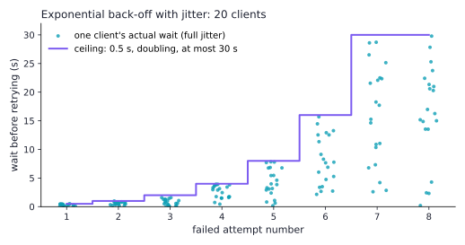

A run over a large library takes hours. Somewhere in those hours something goes wrong: the laptop
goes to sleep, the shared server restarts, a network drive stops answering for ten seconds, or one
record in two million holds a SMILES that RDKit cannot read. A **pipeline** (a program that takes
data through a series of steps, such as read, check, compute and store) written as one long loop
loses everything when that happens, and the usual fix, "run it again from the start", is slow and
often wrong: rows already written are written a second time, and a file that was half-written when
the run died is read later as if it were complete.

Industry pipelines are written on the assumption that they *will* fail, and are built so that a
failure costs little: the work is cut into batches, each batch can be re-run without harm, finished
batches are recorded, short-lived errors are retried, bad records are set aside with a reason, and
files are only ever seen whole. This module builds each of those habits by hand, on a library of
12,000 molecules with faults in it, and shows that a run that crashes halfway and is then resumed
gives exactly the same tables as a run that never crashed.

By the end of this module you will be able to:

- check a run's settings (batch size, output folder and so on) before any work starts, so a typing
  mistake stops the run in the first second;
- tell failures that go away if you wait (try again) from failures that never go away (set the
  record aside with a reason);
- try a failed call again, waiting a little longer each time, by hand and with a package;
- save results so that saving the same batch twice leaves the same table as saving it once;
- record which batches are finished, and restart a crashed run from the last finished batch;
- explain why "every batch is done exactly once" is hard to promise, and what pipelines do instead;
- write a file so that a crash never leaves a half-written copy behind;
- keep the results of a slow step on disk so they are not computed twice, and know when they go
  out of date;
- run a long job on a server or a rented computer so it keeps going after you disconnect.

From earlier modules we use SMILES and RDKit ([Module 1](../01-graphs-and-matrices/),
[Module 2](../02-text-patterns-and-numbers/)), the course's `chemlib` file, which makes test
libraries and can add faults to them on purpose ([Module 6](../06-validating-molecules/)), and
joblib from [Module 9](../09-parallel-and-distributed/). Tables and SQL come from Module 4, but you
do not need it to follow along: every SQL statement here is explained where it appears.

The lesson uses these packages:

- **RDKit** reads the molecules and computes their descriptors;
- **pandas** holds tables of records (one table is a *DataFrame*);
- **Pydantic** and **pydantic-settings** check values against rules you write down;
- **tenacity** tries a failed call again, with waits in between;
- **joblib** keeps the results of a function on disk (its `Memory` class);
- **SQLite** is a small database kept in a single file; it comes with Python as the `sqlite3`
  module, so there is nothing to install.

Sections 1 to 8 run in Colab or on any laptop. Section 9 is about running jobs on another computer:
its commands are typed into a terminal, not into Colab.

## Setup

Everything this lesson needs is imported and set here, so the settings can be changed in one place.
Pipeline steps report with `log`; `print` is kept for showing you results; Module 1 explains why.
The run's own settings (library size, batch size, retry limits) are the defaults of the settings
class in section 2, which can override them from the environment (section 2 explains what that
means). The many `import` lines are not all needed at once: each section says which of them it uses.
`chemlib` is not a package from the internet but the course's own helper file; Colab's first cell
downloads it next to the notebook.

```python
import csv
import logging
import math
import os
import random
import sqlite3
import time
from collections.abc import Callable
from contextlib import closing
from pathlib import Path
from typing import Any, TextIO

import pandas as pd
from joblib import Memory
from pydantic import Field, ValidationError, field_validator, model_validator
from pydantic_settings import BaseSettings, SettingsConfigDict
from rdkit import Chem, RDLogger
from rdkit.Chem import Descriptors
from tenacity import retry, retry_if_exception_type, stop_after_attempt, wait_random_exponential

from chemlib import add_defects, library

# log lines: level and message only, so the lesson's outputs are the same on every run
# (a real job would add "%(asctime)s" to the format)
logging.basicConfig(level=logging.INFO, format="%(levelname)s %(message)s", force=True)
log = logging.getLogger(__name__)

# defaults of the run settings (section 2); environment variables CHEMRUN_* override them
WORK = Path("work")  # every file the lesson writes goes here
N_MOLECULES = 12_000  # molecules drawn from chemlib
BATCH_SIZE = 1_000  # records per batch: smaller batches lose less in a crash
MAX_ATTEMPTS = 5  # calls in all before a transient failure is given up
FIRST_DELAY_S = 0.5  # ceiling of the first retry wait, in seconds; it doubles after each failure
MAX_DELAY_S = 30.0  # the largest retry ceiling, in seconds

# the faulty library
LIBRARY_SEED = 10  # chemlib's seed for the molecules
DEFECT_RATE = 0.03  # fraction of records given a fault
DEFECT_SEED = 11  # chemlib's seed for which records get which fault
ALLOWED_ELEMENTS = {"C", "N", "O", "S", "F", "Cl", "Br"}  # anything else is quarantined

# the lesson's demonstrations
JITTER_SEED = 1  # seed for the random retry waits, so they are the same on every run
CRASH_AT_BATCH = 7  # the batch at which the pipeline is made to crash
CRASH_AFTER_ROWS = 4_000  # the row at which the CSV export is made to crash

RDLogger.DisableLog("rdApp.*")  # bad molecules are reported in a table, not as RDKit messages
WORK.mkdir(exist_ok=True)
```

## 1. What "surviving failure" means

Failures come in two kinds, and a pipeline has to treat them differently:

- **Transient failures** go away on their own: a timeout (an answer that did not come in time), a
  database that is busy for a moment, a web service (a program on another computer that answers
  requests over the internet) that answers "try again later". The right response is to wait and
  try again.
- **Permanent failures** do not: a SMILES with a ring that never closes will fail on every attempt,
  today and tomorrow. Retrying wastes time. The right response is to set the record aside with a
  reason, and carry on with the rest. Setting records aside like this is called **quarantine**.

And then there are crashes, where the whole process dies (power, memory, a restart). Nothing inside
the program can catch those, so the program has to be written so that starting it again is safe and
cheap. To make that possible, the library is cut into **batches** (here, 1,000 records each), and
the program records each batch it finishes. The figure shows the run we build in this module: it
crashes at batch 7 and the second run picks up from there, without redoing batches 0 to 6 and
without duplicating batch 7.


## 2. Settings checked before a run starts

The cheapest failure is the one that happens before any work is done. A run that reads a batch size
of 0 from a configuration file, or a folder name with a typing mistake, should stop in the first
second with a clear message, not after three hours. **pydantic-settings** does this: a settings
class lists every setting with its type and its limits, reads values from the environment (or a
`.env` file, a text file of such values), and refuses to start if any is wrong. Its defaults are the
constants of the Setup block.

A few words first. The **environment** is a list of named values, called **environment
variables**, that every program receives from whatever started it: a terminal, a server, Colab. In
Python they are in `os.environ`, a dictionary. Setting `CHEMRUN_BATCH_SIZE=500` there before a run
changes the batch size without editing the code. In the class below:

- `n_molecules: int = Field(N_MOLECULES, gt=0)` reads "an integer, by default `N_MOLECULES`, greater
  than 0" (`gt` is greater than, `ge` greater than or equal, `le` less than or equal). The `: int`
  is a **type hint**: it says what kind of value is expected, and pydantic checks it.
- `-> Path` after a function's brackets is also a type hint: what the function returns.
- A line starting with `@`, such as `@field_validator("work_dir")`, is a **decorator**: it hands the
  function below it to pydantic, which then calls it at the right moment. `@field_validator` checks
  one setting; `@model_validator(mode="after")` checks settings against each other once all are read.
  `@classmethod` is needed by pydantic for field validators; you can copy it as it is.
- `model_config = SettingsConfigDict(env_prefix="CHEMRUN_")` says the environment variables all start
  with `CHEMRUN_`, so `batch_size` is read from `CHEMRUN_BATCH_SIZE`.

In the `print`, `{name:14}` pads the name to 14 characters so the values line up.

```python
class RunSettings(BaseSettings):
    """Everything a run needs to know, checked before it starts.

    Each setting can be overridden by an environment variable: CHEMRUN_BATCH_SIZE, and so on.
    """

    model_config = SettingsConfigDict(env_prefix="CHEMRUN_")

    n_molecules: int = Field(N_MOLECULES, gt=0)
    batch_size: int = Field(BATCH_SIZE, gt=0)
    work_dir: Path = WORK
    max_attempts: int = Field(MAX_ATTEMPTS, ge=1, le=10)
    first_delay_s: float = Field(FIRST_DELAY_S, gt=0)
    max_delay_s: float = Field(MAX_DELAY_S, gt=0)

    @field_validator("work_dir")
    @classmethod
    def folder_exists(cls, folder: Path) -> Path:
        """The output folder must exist before the run, so a typing mistake fails now."""
        if not folder.is_dir():
            raise ValueError(f"no folder called '{folder}'")
        return folder

    @model_validator(mode="after")
    def delays_in_order(self) -> "RunSettings":
        """The first retry delay cannot be longer than the longest delay allowed."""
        if self.first_delay_s > self.max_delay_s:
            raise ValueError("first_delay_s is longer than max_delay_s")
        return self


settings = RunSettings()
for name, value in settings.model_dump().items():
    print(f"{name:14} {value}")
```
```output
n_molecules    12000
batch_size     1000
work_dir       work
max_attempts   5
first_delay_s  0.5
max_delay_s    30.0
```

Now the same run started with two mistakes in its environment: a batch size of 0 and the output
folder misspelt. Both are reported together, with the setting, the reason and the value given.
When a check fails, pydantic **raises** an error called `ValidationError`: Python stops what it was
doing and jumps to the nearest `except ValidationError` that is waiting for it. The code in
`try:` is attempted, the code in `except` runs only if that error happened, and the code in
`finally:` always runs, here to remove the two bad values again so later cells are not affected:

```python
os.environ["CHEMRUN_BATCH_SIZE"] = "0"
os.environ["CHEMRUN_WORK_DIR"] = "wrok"
try:
    RunSettings()
except ValidationError as err:
    log.error("refused to start: %d bad settings", err.error_count())
    for problem in err.errors():
        log.error("  %s: %s (got %r)", problem["loc"][0], problem["msg"], problem["input"])
finally:
    del os.environ["CHEMRUN_BATCH_SIZE"], os.environ["CHEMRUN_WORK_DIR"]
```
```output
ERROR refused to start: 2 bad settings
ERROR   batch_size: Input should be greater than 0 (got '0')
ERROR   work_dir: Value error, no folder called 'wrok' (got 'wrok')
```

Without the check, a batch size of 0 would either loop for ever or divide by zero somewhere deep in
the run, and the misspelt folder would be created silently and filled with results nobody finds.
The same class serves every way a run is started (a laptop, a server, a scheduler, which is a
program that starts jobs at set times), because they all pass settings through the environment.

## 3. One molecule at a time: quarantine, don't crash

Our pipeline does three things to each record: a light validation (can the SMILES be read, is it
one molecule, are its elements ones we expect), canonicalisation (writing the SMILES in RDKit's one
standard spelling, as in Module 2), and three descriptors: molecular weight, logP (the octanol-water
partition coefficient) and TPSA (topological polar surface area). [Module 6](../06-validating-molecules/)
validates properly and [Module 7](../07-standardisation/) standardises properly; here the point is
what happens when a record fails.

Each problem raises `BadMolecule` with a reason a person can read. `class BadMolecule(Exception)`
makes a new kind of error of our own, so the code can catch exactly this kind and let others pass.
`raise ... from err` keeps RDKit's original error attached, for whoever reads the message. In
`prepare_batch`, `**prepare(record.smiles)` unpacks the dictionary that `prepare` returns into the
new one, so its four keys sit next to `id` and `smiles`; `batch.itertuples()` goes through a
table's rows one by one. The type hint `tuple[pd.DataFrame, pd.DataFrame]` says the function returns
two tables. The elements we expect are `ALLOWED_ELEMENTS`, set in the Setup block.

```python
class BadMolecule(Exception):
    """A permanent problem with a record: trying again will not fix it."""


def prepare(smiles: str) -> dict:
    """Check a SMILES lightly, canonicalise it and compute three descriptors.

    Args:
        smiles: The record's SMILES.

    Returns:
        The canonical SMILES, molecular weight, logP and TPSA.

    Raises:
        BadMolecule: If the record cannot be used, with the reason.
    """
    mol = Chem.MolFromSmiles(smiles, sanitize=False)
    if mol is None:
        raise BadMolecule("cannot be parsed")
    try:
        Chem.SanitizeMol(mol)
    except Chem.MolSanitizeException as err:
        raise BadMolecule(f"fails sanitisation ({type(err).__name__})") from err
    if len(Chem.GetMolFrags(mol)) > 1:
        raise BadMolecule("more than one component")
    unexpected = sorted({atom.GetSymbol() for atom in mol.GetAtoms()} - ALLOWED_ELEMENTS)
    if unexpected:
        raise BadMolecule(f"unexpected element {', '.join(unexpected)}")
    return {
        "canonical": Chem.MolToSmiles(mol),
        "mol_wt": round(Descriptors.MolWt(mol), 3),
        "logp": round(Descriptors.MolLogP(mol), 3),
        "tpsa": round(Descriptors.TPSA(mol), 2),
    }


def prepare_batch(batch: pd.DataFrame) -> tuple[pd.DataFrame, pd.DataFrame]:
    """Prepare every record of a batch; bad records go to quarantine and the batch carries on.

    Args:
        batch: Records with id and smiles.

    Returns:
        The prepared molecules, and the quarantined records with the reason for each.
    """
    good, bad = [], []
    for record in batch.itertuples(index=False):
        try:
            good.append({"id": record.id, "smiles": record.smiles, **prepare(record.smiles)})
        except BadMolecule as err:
            bad.append({"id": record.id, "smiles": record.smiles, "reason": str(err)})
    good_columns = ["id", "smiles", "canonical", "mol_wt", "logp", "tpsa"]
    return (pd.DataFrame(good, columns=good_columns),
            pd.DataFrame(bad, columns=["id", "smiles", "reason"]))
```

The library is 12,000 molecules from chemlib, with faults added at a rate of 3%: salts, solvents,
unreadable SMILES, impossible valences, selenium, and duplicates. Sorting by `id` matters more than
it looks: it fixes which records belong to which batch, so batch 7 holds the same records in every
run. Without a fixed order, "resume from batch 7" would mean something different each time.
(`f"{len(source):,}"` writes the number with commas, 12,060; in a `log` message, each `%s` or
`%d` is filled in with the next value after the message; `.iloc[a:b]` takes rows a to b-1 of a
table.)

```python
source = add_defects(library(settings.n_molecules, seed=LIBRARY_SEED), rate=DEFECT_RATE,
                     seed=DEFECT_SEED)
source = source.sort_values("id").reset_index(drop=True)
n_batches = math.ceil(len(source) / settings.batch_size)
log.info("%s records in %d batches of up to %s", f"{len(source):,}", n_batches,
         f"{settings.batch_size:,}")
print(source["defect"].replace("", "(none)").value_counts().to_string())
```
```output
INFO 12,060 records in 13 batches of up to 1,000
defect
(none)       11700
solvent         60
duplicate       60
valence         60
salt            60
invalid         60
element         60
```

The 60 duplicates are new rows, so there are 12,060 records and 13 batches, the last one short.
Here is the first batch:

```python
good, bad = prepare_batch(source.iloc[: settings.batch_size])
log.info("prepared %d, quarantined %d", len(good), len(bad))
print(bad["reason"].value_counts().to_string())
```
```output
INFO prepared 969, quarantined 31
reason
unexpected element Se                        9
more than one component                      8
fails sanitisation (AtomValenceException)    8
cannot be parsed                             6
```

Thirty-one bad records in a thousand did not stop the batch. Each one is kept, with its reason, in a quarantine
table where someone can look at it later; nothing is dropped silently. If quarantine starts to fill
quickly (a new supplier's file in a different format, say), that is a signal to stop and look, and
Module 14 turns such counts into alerts.

## 4. Retries with back-off and jitter

Now the transient kind. Suppose the descriptors came from a shared service on another machine,
which sometimes answers "busy". We stand one in with a class that fails its first few calls and then
works, so the lesson behaves the same on every run. Two special methods make it work: `__init__`
runs once when the object is made (`FlakyService(failures=3)`) and stores its settings, and
`__call__` lets the object be called like a function, `service("CCO")`, so it can stand in for
one:

```python
class TransientError(Exception):
    """A failure that may go away if we wait and try again: a timeout, a busy server."""


class FlakyService:
    """A stand-in for a remote service that fails its first `failures` calls, then works."""

    def __init__(self, failures: int) -> None:
        self.failures = failures
        self.calls = 0

    def __call__(self, smiles: str) -> dict:
        """Prepare a molecule, unless this is one of the calls that fail."""
        self.calls += 1
        if self.calls <= self.failures:
            raise TransientError(f"call {self.calls}: service busy")
        return prepare(smiles)
```

The standard response is **exponential back-off**: wait a little after the first failure, twice as
long after the second, four times as long after the third, up to a ceiling. Waiting longer each
time gives a struggling service room to recover. **Jitter** picks the actual wait at random between
zero and that ceiling ("full jitter"). Without it, a hundred workers that failed together all retry
at the same instants and knock the service over again; with it, their retries spread out. The
function takes `sleep` as an argument so the lesson can record the waits instead of sitting through
them, and `rng` so the random waits are the same on every run. Each retry is a warning in the log:
someone reading a nightly job's log wants to know the service was struggling, even when it
recovered.

Some notation in the function. `*args` collects any further arguments into a tuple, which the
function passes on to `func` unchanged; `Callable` in a type hint means "something you can call",
such as a function. `2 ** (attempt - 1)` is 2 to the power `attempt - 1`, so the ceiling goes 0.5,
1, 2, 4 seconds. `rng.uniform(0, ceiling)` picks a random number between 0 and the ceiling. In the
lesson we pass `sleep=waits.append`, so instead of waiting, each wait is added to the list `waits`.

```python
def with_retries(func: Callable, *args, max_attempts: int = MAX_ATTEMPTS,
                 first_delay: float = FIRST_DELAY_S, max_delay: float = MAX_DELAY_S,
                 rng: random.Random | None = None,
                 sleep: Callable[[float], None] = time.sleep) -> Any:
    """Call func(*args), retrying transient failures with exponential back-off and full jitter.

    Args:
        func: What to call.
        *args: Its arguments.
        max_attempts: How many calls in all before giving up.
        first_delay: The ceiling of the first wait, in seconds; it doubles after each failure.
        max_delay: The largest ceiling, in seconds.
        rng: The random number generator for the jitter (a fresh, unseeded one if not given).
        sleep: How to wait (time.sleep unless told otherwise).

    Returns:
        What func returns.

    Raises:
        TransientError: If every attempt failed. Any other error is raised at once, unretried.
    """
    rng = rng or random.Random()
    for attempt in range(1, max_attempts + 1):
        try:
            return func(*args)
        except TransientError as err:
            if attempt == max_attempts:
                raise
            ceiling = min(max_delay, first_delay * 2 ** (attempt - 1))
            delay = rng.uniform(0, ceiling)
            log.warning("attempt %d failed (%s); waiting %.2f s of up to %s s",
                        attempt, err, delay, ceiling)
            sleep(delay)


waits = []
service = FlakyService(failures=3)
result = with_retries(service, "CC(=O)Oc1ccccc1C(=O)O", rng=random.Random(JITTER_SEED),
                      sleep=waits.append)
print(f"succeeded on call {service.calls}: aspirin, MW {result['mol_wt']}")
print(f"waited {sum(waits):.2f} s in all")
```
```output
WARNING attempt 1 failed (call 1: service busy); waiting 0.07 s of up to 0.5 s
WARNING attempt 2 failed (call 2: service busy); waiting 0.85 s of up to 1.0 s
WARNING attempt 3 failed (call 3: service busy); waiting 1.53 s of up to 2.0 s
succeeded on call 4: aspirin, MW 180.159
waited 2.44 s in all
```

Two other cases matter as much. A service that never recovers must not be retried for ever: after
`max_attempts` the error is raised, and the run (or the batch) fails visibly. And a permanent error
is not retried at all: a broken SMILES raises `BadMolecule` on the first call, which goes straight
to quarantine:

```python
try:
    with_retries(FlakyService(failures=10), "CCO", rng=random.Random(JITTER_SEED),
                 sleep=waits.append)
except TransientError as err:
    log.error("gave up: %s", err)

broken = FlakyService(failures=0)
try:
    with_retries(broken, "C1CC", rng=random.Random(JITTER_SEED), sleep=waits.append)
except BadMolecule as err:
    log.warning("not retried (%d call), quarantined: %s", broken.calls, err)
```
```output
WARNING attempt 1 failed (call 1: service busy); waiting 0.07 s of up to 0.5 s
WARNING attempt 2 failed (call 2: service busy); waiting 0.85 s of up to 1.0 s
WARNING attempt 3 failed (call 3: service busy); waiting 1.53 s of up to 2.0 s
WARNING attempt 4 failed (call 4: service busy); waiting 1.02 s of up to 4.0 s
ERROR gave up: call 5: service busy
WARNING not retried (1 call), quarantined: cannot be parsed
```



### The same with tenacity

Writing retry loops by hand in every project leads to small differences and small bugs. The
industry-standard Python library is **tenacity**: a decorator (the `@retry(...)` line in the code
below, as with pydantic's validators in section 2) wraps the function in a retry loop like ours,
and its arguments state which errors to retry, when to stop and how long to wait. `wait_random_exponential` is the same full-jitter back-off as above, and
the limits come from the settings checked in section 2 (the four names from tenacity are imported
in the Setup block):

```python
service = FlakyService(failures=2)
waits = []


@retry(
    retry=retry_if_exception_type(TransientError),  # BadMolecule is not retried
    stop=stop_after_attempt(settings.max_attempts),
    wait=wait_random_exponential(multiplier=settings.first_delay_s, max=settings.max_delay_s),
    sleep=waits.append,  # leave this out in real use: tenacity then waits with time.sleep
    reraise=True,  # after the last attempt, raise the original error, not a wrapper
)
def prepare_remotely(smiles: str) -> dict:
    """Prepare a molecule on the (flaky) remote service, retrying transient failures."""
    return service(smiles)


random.seed(JITTER_SEED)  # tenacity draws its jitter from Python's random module
print(prepare_remotely("CN1C=NC2=C1C(=O)N(C(=O)N2C)C"))
print(f"{service.calls} calls; waits of {[round(w, 2) for w in waits]} s")
```
```output
{'canonical': 'Cn1c(=O)c2c(ncn2C)n(C)c1=O', 'mol_wt': 194.194, 'logp': -1.029, 'tpsa': 61.82}
3 calls; waits of [0.07, 0.85] s
```

Which errors count as transient is a decision you write down once: in practice
`TimeoutError`, `ConnectionError`, `sqlite3.OperationalError("database is locked")` and HTTP
responses 429 and 5xx are transient; a bad SMILES, a missing column or HTTP 404 are not. (HTTP is
how web services talk, and every answer carries a number: 429 means "too many requests", 5xx
(500 to 599) means the service itself failed, and 404 means "not found".) [Module 11](../11-incremental-ingestion/)
uses tenacity in exactly this way against the ChEMBL and PubChem web services.

## 5. Idempotent batches

A step is **idempotent** if running it twice leaves the same result as running it once. Setting a
light switch to "on" is idempotent; pressing a toggle button is not. That is the property that
makes "just run it again" safe. The common way to write results is not idempotent: appending rows. Here is the first batch appended twice with pandas, as happens when a
run dies after writing a batch and the batch is then run again. `sqlite3.connect(path)` opens the
database file (creating it if needed) and returns a **connection**, through which we send it
commands written in **SQL**, the language databases understand: `DROP TABLE IF EXISTS molecules`
deletes the table if there is one, and `SELECT COUNT(*), COUNT(DISTINCT id) FROM molecules` counts
the rows and the different ids. The connection is opened in a `with closing(...)` block
(`closing`, from `contextlib`, is imported in the Setup block). A `with` block runs some set-up
when it starts and some tidying when it ends; here the tidying closes the connection, even if
something inside the block fails:

```python
with closing(sqlite3.connect(WORK / "naive.sqlite")) as naive:
    naive.execute("DROP TABLE IF EXISTS molecules")
    for attempt in (1, 2):
        good.to_sql("molecules", naive, if_exists="append", index=False)
        count = naive.execute("SELECT COUNT(*), COUNT(DISTINCT id) FROM molecules").fetchone()
        print(f"after writing batch 0 {attempt}x: {count[0]} rows, {count[1]} different molecules")
```
```output
after writing batch 0 1x: 969 rows, 969 different molecules
after writing batch 0 2x: 1938 rows, 969 different molecules
```

Every molecule of the batch is now in the table twice, and every count, average and export made
from it is wrong without any error being raised.

The idempotent version has two parts. The table has a **primary key**, the record's `id`, so the
database itself refuses two rows for one molecule. And rows are written with an **upsert**
(`INSERT … ON CONFLICT … DO UPDATE`): insert the row if it is new, overwrite it if it is already
there. SQLite, PostgreSQL and DuckDB all use this syntax. The batch's rows go in inside one
**transaction** (`with con:`): a group of changes the database saves all together or not at all.
So a crash halfway through a batch leaves none of its rows, not some.

In the code, `SCHEMA` holds the `CREATE TABLE` statements: each names a table and its columns
(`TEXT` for text, `REAL` for decimal numbers, `INTEGER` for whole numbers). `IF NOT EXISTS` makes
them safe to run again. In `UPSERT_MOLECULE`, `:id`, `:smiles` and so on are placeholders filled
from each row's dictionary, and `excluded.smiles` means "the value we just tried to insert".
`executemany` runs the statement once for every row in a list.
Note the difference between the two `with` blocks: sqlite3's own `with con:` commits or rolls back
a transaction but leaves the connection open; `with closing(con):` closes it.

```python
SCHEMA = """
CREATE TABLE IF NOT EXISTS molecules (
    id TEXT PRIMARY KEY, smiles TEXT, canonical TEXT, mol_wt REAL, logp REAL, tpsa REAL);
CREATE TABLE IF NOT EXISTS quarantine (id TEXT PRIMARY KEY, smiles TEXT, reason TEXT);
CREATE TABLE IF NOT EXISTS checkpoints (batch INTEGER PRIMARY KEY, n_good INTEGER, n_bad INTEGER);
"""
UPSERT_MOLECULE = """
INSERT INTO molecules VALUES (:id, :smiles, :canonical, :mol_wt, :logp, :tpsa)
ON CONFLICT (id) DO UPDATE SET smiles = excluded.smiles, canonical = excluded.canonical,
    mol_wt = excluded.mol_wt, logp = excluded.logp, tpsa = excluded.tpsa
"""
UPSERT_QUARANTINE = """
INSERT INTO quarantine VALUES (:id, :smiles, :reason)
ON CONFLICT (id) DO UPDATE SET smiles = excluded.smiles, reason = excluded.reason
"""


def connect(path: Path) -> sqlite3.Connection:
    """Open the run's database, creating its tables if they are not there yet."""
    con = sqlite3.connect(path)
    con.executescript(SCHEMA)
    return con


def save_batch(con: sqlite3.Connection, good: pd.DataFrame, bad: pd.DataFrame) -> None:
    """Write a batch's results idempotently: all its rows in one transaction, upserted by id."""
    with con:  # commits at the end, or rolls everything back if anything fails
        con.executemany(UPSERT_MOLECULE, good.to_dict("records"))
        con.executemany(UPSERT_QUARANTINE, bad.to_dict("records"))


def count_rows(con: sqlite3.Connection) -> str:
    """How many rows each table holds, as one line."""
    tables = ["molecules", "quarantine", "checkpoints"]
    counts = [con.execute(f"SELECT COUNT(*) FROM {t}").fetchone()[0] for t in tables]
    return ", ".join(f"{t} {n:,}" for t, n in zip(tables, counts, strict=True))


demo_path = WORK / "demo.sqlite"
demo_path.unlink(missing_ok=True)
with closing(connect(demo_path)) as con:
    for attempt in (1, 2):
        save_batch(con, good, bad)
        print(f"after writing batch 0 {attempt}x: {count_rows(con)}")
```
```output
after writing batch 0 1x: molecules 969, quarantine 31, checkpoints 0
after writing batch 0 2x: molecules 969, quarantine 31, checkpoints 0
```

Idempotency also needs the step itself to be repeatable: the same batch must give the same rows.
That is why the batches have a fixed order, and why the rows carry no timestamp of when they were
computed (a run's start time belongs in a separate table about runs, not in every row).

## 6. Checkpoints, crashes and resuming

A **checkpoint table** records which batches are finished. The pipeline reads it at the start,
skips the finished batches, and writes a checkpoint after each batch's rows are saved. To show a
crash, `run_pipeline` can raise `SimulatedCrash` at a chosen batch, at the worst possible moment:
after the batch's rows are committed (saved for good) but before its checkpoint is written.

Reading the code: `BatchPreparer` is a short name for a type, "a function that takes a table and
returns two tables", used in a type hint. `crash_at: int | None = None` means the argument is a
whole number or `None` (nothing), and is `None` unless given. `{row[0] for row in ...}` builds a
**set** (a collection where each value appears once and looking one up is fast) of the batch
numbers already finished. `INSERT OR REPLACE` is SQLite's short form of an upsert.

```python
class SimulatedCrash(Exception):
    """Stands in for the process dying: power cut, out of memory, a server restart."""


BatchPreparer = Callable[[pd.DataFrame], tuple[pd.DataFrame, pd.DataFrame]]


def run_pipeline(source: pd.DataFrame, db_path: Path, batch_size: int,
                 prepare_fn: BatchPreparer = prepare_batch,
                 crash_at: int | None = None) -> list[int]:
    """Prepare every batch not yet checkpointed, saving each idempotently.

    Args:
        source: The records, in a fixed order (it decides which records are in which batch).
        db_path: The run's SQLite database.
        batch_size: Records per batch.
        prepare_fn: The function that prepares one batch.
        crash_at: The batch at which to simulate a crash, after saving it and before its checkpoint.

    Returns:
        The batches this call ran.
    """
    ran = []
    with closing(connect(db_path)) as con:
        done = {row[0] for row in con.execute("SELECT batch FROM checkpoints")}
        for k in range(math.ceil(len(source) / batch_size)):
            if k in done:
                continue
            good, bad = prepare_fn(source.iloc[k * batch_size : (k + 1) * batch_size])
            save_batch(con, good, bad)
            if k == crash_at:
                raise SimulatedCrash(f"died after saving batch {k}, before its checkpoint")
            with con:
                con.execute("INSERT OR REPLACE INTO checkpoints VALUES (?, ?, ?)",
                            (k, len(good), len(bad)))
            ran.append(k)
    return ran
```

First the reference: a run that is never interrupted.

```python
reference_path = settings.work_dir / "reference.sqlite"
reference_path.unlink(missing_ok=True)
ran = run_pipeline(source, reference_path, settings.batch_size)
log.info("ran batches %d to %d", ran[0], ran[-1])
with closing(sqlite3.connect(reference_path)) as con:
    print(count_rows(con))
```
```output
INFO ran batches 0 to 12
molecules 11,761, quarantine 299, checkpoints 13
```

Now the same run on a fresh database, crashing at batch 7. The lesson catches the crash so we can
look at what it left behind; a real crash would simply end the process.

```python
run_path = settings.work_dir / "run.sqlite"
run_path.unlink(missing_ok=True)
try:
    run_pipeline(source, run_path, settings.batch_size, crash_at=CRASH_AT_BATCH)
except SimulatedCrash as err:
    log.error("crashed: %s", err)
with closing(sqlite3.connect(run_path)) as con:
    print(count_rows(con))
    finished = [row[0] for row in con.execute("SELECT batch FROM checkpoints ORDER BY batch")]
print(f"checkpointed batches: {finished}")
```
```output
ERROR crashed: died after saving batch 7, before its checkpoint
molecules 7,792, quarantine 208, checkpoints 7
checkpointed batches: [0, 1, 2, 3, 4, 5, 6]
```

Batches 0 to 6 are checkpointed. Batch 7's rows are in the tables, but its checkpoint is not, so
the database cannot tell that batch 7 is finished. Resuming is simply running the same command
again:

```python
ran = run_pipeline(source, run_path, settings.batch_size)
log.info("resumed: skipped %d finished batches, ran batches %s", len(finished), ran)
with closing(sqlite3.connect(run_path)) as con:
    print(count_rows(con))
```
```output
INFO resumed: skipped 7 finished batches, ran batches [7, 8, 9, 10, 11, 12]
molecules 11,761, quarantine 299, checkpoints 13
```

Batch 7 ran twice, once before the crash and once after, and the tables hold it once, because
`save_batch` is idempotent. The real test is whether the result equals the uninterrupted run, row for
row. `pd.testing.assert_frame_equal` compares two tables and raises an error if they differ in any
value, column or type; if it is silent, they are the same:

```python
def read_tables(db_path: Path) -> dict[str, pd.DataFrame]:
    """Every table of a run's database, sorted by its key, for comparison."""
    keys = {"molecules": "id", "quarantine": "id", "checkpoints": "batch"}
    with closing(sqlite3.connect(db_path)) as con:
        return {t: pd.read_sql(f"SELECT * FROM {t} ORDER BY {k}", con) for t, k in keys.items()}


reference, resumed = read_tables(reference_path), read_tables(run_path)
for table in reference:
    pd.testing.assert_frame_equal(reference[table], resumed[table])  # raises if they differ
    print(f"{table}: identical ({len(reference[table]):,} rows)")
```
```output
molecules: identical (11,761 rows)
quarantine: identical (299 rows)
checkpoints: identical (13 rows)
```

The quarantine table says why each record was set aside. Joined back to chemlib's record of which
faults it added, it shows how each kind of fault was caught. The 60 duplicates passed: they are
valid molecules, and finding them is Module 7's job. `merge` joins the two tables on `id`, as in
[Module 3](../03-files-and-identity/), and `pd.crosstab` counts how often each pair of values (fault, reason) occurs:

```python
caught = source.merge(reference["quarantine"][["id", "reason"]], on="id", how="left")
caught["reason"] = caught["reason"].fillna("(prepared)")
print(pd.crosstab(caught["defect"].replace("", "(none)"), caught["reason"]).to_string())
```
```output
reason     (prepared)  cannot be parsed  fails sanitisation (AtomValenceException)  more than one component  unexpected element Se
defect                                                                                                                            
(none)          11700                 0                                          0                        0                      0
duplicate          60                 0                                          0                        0                      0
element             1                 0                                          0                        0                     59
invalid             0                60                                          0                        0                      0
salt                0                 0                                          0                       60                      0
solvent             0                 0                                          0                       60                      0
valence             0                 0                                         60                        0                      0
```

One record marked `element` was prepared. Looking at it (`c1cc(c8ccccc8)ccc1-c2nc(c8ccncc8)c(O)o2`)
explains why: chemlib adds selenium by replacing an aliphatic carbon, and this molecule has none, so
the "fault" left it unchanged and it is a valid molecule. Labels of what is wrong can be wrong too;
checking a pipeline against them is how such cases come to light.

### At-least-once and exactly-once

Every batch here is processed **at least once**: a batch that crashed before its checkpoint is run
again, so some batches are processed twice. What we would like is **exactly once**: every batch's
effect appears once, no matter what fails. Within one database, a transaction can give that: if the
rows and the checkpoint were written in the same transaction, they would be saved together or not
at all. But the moment a step touches two systems (rows into a database and a file on disk, or a
call to a web service and a row recording it), no transaction covers both, and there is always a
moment where one has happened and the other has not. That is exactly the moment our simulated crash
picked.

The practical answer, used across the industry, is **at-least-once delivery plus idempotent
steps**: accept that work may be repeated, and make repeating it harmless. The effect is the same as
exactly once, and it needs nothing more than a key and an upsert. Kleppmann's book (further
reading) explains this in depth for databases and for message queues (programs that pass work from
one program to another).

At scale the pattern is the same. For two million molecules, batches of 10,000 give 200
checkpoints; a crash costs at most one batch of work. Smaller batches lose less in a crash but write
more checkpoints; most pipelines choose batches that take seconds to minutes. With PostgreSQL
(Module 4), a larger database that runs as a server many people share, the tables and the upserts are the same, and many workers can write to one database at
once (Module 9).

## 7. Atomic writes

Results usually leave the database as files: a CSV for a colleague, a Parquet file (a compact file
format for tables, from [Module 3](../03-files-and-identity/)) for the next pipeline. Writing a file takes time, and a crash in the middle leaves a **half-written file** that
looks like a complete one. Here is the export done the obvious way, crashing a third of the way
through. Python's `csv` module, imported in the Setup block, writes the rows. `open(path, "w")`
opens a file for writing (`"w"` empties it first), and the `with` block closes it at the end;
`enumerate` numbers the rows as it goes, so the function knows when to crash:

```python
molecules = reference["molecules"]
export_path = settings.work_dir / "molecules.csv"


def write_rows(handle: TextIO, table: pd.DataFrame, crash_after: int | None = None) -> None:
    """Write a table as CSV to an open file, one row at a time, optionally crashing partway."""
    writer = csv.writer(handle)
    writer.writerow(table.columns)
    for i, row in enumerate(table.itertuples(index=False)):
        if i == crash_after:
            raise SimulatedCrash(f"died after writing {i:,} rows")
        writer.writerow(row)


export_path.unlink(missing_ok=True)
try:
    with open(export_path, "w", newline="", encoding="utf-8") as handle:
        write_rows(handle, molecules, crash_after=CRASH_AFTER_ROWS)
except SimulatedCrash as err:
    log.error("crashed: %s", err)
rows_seen = len(pd.read_csv(export_path))
print(f"the file exists: {export_path.exists()}, rows a reader sees: {rows_seen:,}")
```
```output
ERROR crashed: died after writing 4,000 rows
the file exists: True, rows a reader sees: 4,000
```

A reader the next morning finds a well-formed CSV with fewer rows and no sign that anything went
wrong. The fix is an **atomic write**: write to a temporary file in the same folder, make sure it
is on disk (`flush` and `os.fsync`), then rename it over the target with `os.replace`. Renaming a
file within one folder is atomic on Windows, macOS and Linux: other programs see either the old file
or the new one, never a mixture. (**Atomic** means it happens completely or not at all, with nothing
in between to be seen.) If the run dies first, the target is untouched and the temporary file is
removed, by the `finally:` part, which runs whether or not there was an error:

```python
def write_csv_atomic(table: pd.DataFrame, path: Path, crash_after: int | None = None) -> None:
    """Write a table as CSV so that readers only ever see the old file or the complete new one.

    Args:
        table: What to write.
        path: The file to write.
        crash_after: Simulate a crash after this many rows (for the lesson).
    """
    tmp = path.with_name(path.name + ".tmp")
    try:
        with open(tmp, "w", newline="", encoding="utf-8") as handle:
            write_rows(handle, table, crash_after)
            handle.flush()
            os.fsync(handle.fileno())  # the bytes are on the disk, not only in memory
        os.replace(tmp, path)  # atomic: the old file or the new one, never half of one
    finally:
        tmp.unlink(missing_ok=True)


write_csv_atomic(molecules, export_path)
print(f"complete export: {len(pd.read_csv(export_path)):,} rows")
try:
    write_csv_atomic(molecules, export_path, crash_after=CRASH_AFTER_ROWS)
except SimulatedCrash as err:
    log.error("crashed: %s", err)
print(f"after the crash: {len(pd.read_csv(export_path)):,} rows, "
      f"temporary file left behind: {export_path.with_name('molecules.csv.tmp').exists()}")
```
```output
complete export: 11,761 rows
ERROR crashed: died after writing 4,000 rows
after the crash: 11,761 rows, temporary file left behind: False
```

The same applies to every file a pipeline writes: Parquet files, JSON reports, model files. Two
details matter. The temporary file must be in the same folder (a rename between two drives is a
copy, which is not atomic). And readers should ignore `*.tmp` files. Object stores (file storage
in the cloud, such as Amazon S3) give the same guarantee differently: an upload becomes visible only once it is complete.

## 8. Cached results with joblib.Memory

Resuming skips finished batches, but sometimes you rerun everything on purpose: a new database, a
new export format, a colleague's copy of the pipeline. If a step is expensive (descriptors here;
3D conformers, docking or quantum chemistry in real work), computing it again for unchanged input
is waste. `joblib.Memory` remembers a function's results on disk, keyed by a **hash** of its arguments (a
short code computed from them: the same arguments always give the same hash, different ones almost
never do):
call it again with the same arguments, in the same run or a later one, and it returns the stored
result without running the function. The list `computed` records each time the function body really
runs. (`memory.cache` is usually written as a decorator, `@memory.cache`; here it is applied after
setting a short name, for the reason in the comment. You do not need that detail to follow the
rest: `prepare_batch_cached` simply behaves like `prepare_batch` with a memory.)

```python
memory = Memory(settings.work_dir / "cache", verbose=0)
memory.clear(warn=False)  # start the lesson with an empty cache
computed = []


def prepare_batch_cached(batch: pd.DataFrame) -> tuple[pd.DataFrame, pd.DataFrame]:
    """prepare_batch, with its results kept on disk: each different batch is computed once."""
    computed.append(batch["id"].iloc[0])
    return prepare_batch(batch)


# joblib names the cache folder after where the function is defined: for a script, its full path,
# which can pass Windows' 260-character path limit. A short module name keeps the folder short.
prepare_batch_cached.__module__ = "module10"
prepare_batch_cached = memory.cache(prepare_batch_cached)


for name in ("first", "second"):
    path = settings.work_dir / f"cached-{name}.sqlite"
    path.unlink(missing_ok=True)
    before = len(computed)
    run_pipeline(source, path, settings.batch_size, prepare_fn=prepare_batch_cached)
    print(f"{name} full run: {len(computed) - before} batches computed")
same = read_tables(settings.work_dir / "cached-second.sqlite")["molecules"]
print("cached results equal the reference:", same.equals(reference["molecules"]))
```
```output
first full run: 13 batches computed
second full run: 0 batches computed
cached results equal the reference: True
```

The cache lives in `work/cache`, so a new Python session, or tomorrow's run, reuses it too. One
warning, which catches out many users: joblib notices when the code of the cached function changes,
but **not** when a function it calls changes. If we changed `prepare` (a new descriptor, a fixed
bug), `prepare_batch_cached` would keep returning the old results. Clear the cache when the logic
changes (`memory.clear()`), or pass a version number as an argument so new logic gets new cache
entries. A cache that can return stale chemistry is worse than no cache.

## 9. Running a long job on a server or virtual machine

*This section cannot run in Colab: its commands are typed into a terminal, first on your own
computer and then on a server. Nothing later in the course depends on it, so you can read it now
and come back to it when you have a long job to run.*

Everything so far makes a crash cheap. The other half is not crashing for silly reasons: a run of
two million molecules started on a laptop dies when the lid is closed, and one started in an SSH
window on a server dies when the Wi-Fi drops, because a program started in a terminal is ended
with that terminal. Long jobs belong on a machine that stays on, in a session that outlives your
connection.

**Where.** Two kinds of machine are common. Both usually run **Linux**, an operating system like
Windows or macOS, used by most servers:

- **A shared server**: your group's or department's Linux machine, many users, many cores.
- **A virtual machine (VM)**: a computer simulated on someone else's hardware, with its own Linux,
  CPUs, memory and disk. Universities' research computing services offer them, and so do the cloud
  providers (Google Cloud, Microsoft Azure, Amazon Web Services and others), billed by the hour,
  with free tiers and student credits that are enough for this course. You choose its size from the
  job: [Module 8](../08-larger-than-memory/) showed how to measure what a run needs in memory.

Treat a VM as disposable. Everything needed to rebuild it comes from the repository and its lock
file (Module 13: `git clone`, then `uv sync --locked`), the input comes from its source, and the
results are copied off before the VM is deleted. A VM you have forgotten keeps costing money, so
stop it when the job is done.

**How you reach it.** With **SSH** (Secure Shell): a command that logs you in to another computer,
so that what you type in your terminal runs there. Windows 10 and 11, macOS and Linux have the
`ssh` command built in, and phones have terminal apps. Whoever runs the server or VM gives you
its address and your user name.

Open a terminal on your own computer (PowerShell on Windows, Terminal on macOS; the course's Start
here page shows how), type the first line below with your own user name and address, and press
Enter. Everything after a `#` is a comment for you to read, not to type. The first time, `ssh` asks
`Are you sure you want to continue connecting (yes/no)?`: type `yes`. It then asks for your
password (nothing appears on the screen while you type it; that is normal) unless your server uses
a key instead. Once you are in, the prompt changes to show the server's name, for example
`you@server:~$`, and **every command from now on runs on the server**, not on your computer.

The next three lines are typed there, one at a time. They need Git and uv on the server: if
`uv --version` says the command is not found, install uv with the macOS and Linux command on the
Start here page. `git clone` prints `Cloning into 'monstrous-learn'...`, `cd` moves into the
course's Series 1 folder and prints nothing, and `uv sync --locked` installs exactly the package
versions written in the course's lock file, ending with a line like `Installed 136 packages`:

```bash
ssh you@server.example.org                 # log in (the address is your server's or VM's)
git clone https://github.com/David-Alobo/monstrous-learn.git
cd monstrous-learn/data-engineering/series-1
uv sync --locked                           # the same environment as on your laptop
```

**tmux keeps the job running when you leave.** tmux starts a terminal session that lives on the
server, not in your window: you start the job inside it, *detach* (step out and leave it running),
log out, and later log in again and *attach* (step back in) to find it still running, or finished.
It is installed on most Linux servers; if not, `sudo apt install tmux` installs it on your own VM
(`sudo` runs a command as the machine's administrator, and `apt` is the installer of Ubuntu and
Debian Linux). Name one session per job.

Type the commands below on the server, in the `series-1` folder you moved into above. What each
one does and what you see:

- `tmux new -s library` starts a session called "library". The screen clears and a coloured bar
  with `[library]` appears at the bottom: you are now inside tmux.
- `mkdir -p work` makes the folder the log goes in (nothing is printed; `-p` means "no error if it
  is already there").
- The long command runs the job. The `\` at the end of its first line means "the command carries on
  on the next line", so type both lines (or type it as one line without the `\`).
  `CHEMRUN_N_MOLECULES=1000000` in front sets that environment variable for this one command, so
  section 2's settings read a library of a million molecules. The `|` (a "pipe") passes everything
  the job prints to `tee`, which shows it on the screen and also adds it (`-a`, append) to
  `work/run.log`. You see the job's log lines appear, like this lesson's outputs. Here the
  lesson's own script stands in for your pipeline.
- To detach, hold Ctrl and press b, let go, then press d. The bar disappears and you are back at
  the normal prompt; the job carries on. You can now log out with `exit`, or close the window.
- Later, after logging in again with `ssh` and moving into the `series-1` folder with `cd`,
  `tmux ls` lists the sessions still running, for example `library: 1 windows (created ...)`.
  `tmux attach -t library` takes you back into the session, where you see the job's latest lines.
  Instead of attaching, `tail -f work/run.log` shows the end of the log and keeps adding new lines
  as they are written; Ctrl and c stops following (it does not stop the job).

```bash
tmux new -s library        # a new session called "library"; you are now inside it
mkdir -p work              # the folder the log goes in

# inside tmux: run the job (here the lesson's script stands in for your pipeline), with its log going to a file as well as the screen
CHEMRUN_N_MOLECULES=1000000 uv run python 10-pipelines-that-survive-failure/code.py \
    2>&1 | tee -a work/run.log

# press Ctrl-b, then d, to detach: the job keeps running and you can log out

tmux ls                    # later: which sessions are running?
tmux attach -t library     # go back into the session
tail -f work/run.log       # or follow the log without attaching (Ctrl-c stops following)
```

Three details. The settings come from the environment, so the same `code.py` runs the full
library on the server and the small one on your laptop (section 2 checks them before any work
starts). `2>&1` matters: a program has two output channels, *stdout* for normal output and
*stderr* for messages and errors. Python's `logging` writes to stderr, and `2>&1` sends it into
stdout, so without it the log lines would reach the screen but not the file. And on a server, add
the time to every log line (`format="%(asctime)s %(levelname)s %(message)s"`, as the comment in the
Setup block says): "ERROR at batch 1,412" means far more next to the time it happened.

If tmux is not available, `nohup` gives the minimum: the job survives the logout, but you cannot
reattach to it. Type the line below on the server, in the `series-1` folder. `>> work/run.log`
adds everything the job prints to the log file instead of the screen, and the `&` at the end runs
the job in the background, so the prompt comes back at once, usually after a line such as
`[1] 48213` (the job's number and its process id). Follow its progress with
`tail -f work/run.log`.

```bash
nohup uv run python 10-pipelines-that-survive-failure/code.py >> work/run.log 2>&1 &
```

**Be a good neighbour on a shared machine.** Run long jobs at low priority with `nice`, so other
people's interactive work stays fast, and give them a memory limit, so a job that grows too large
is stopped on its own instead of making the whole machine *swap* (use the disk as slow extra
memory, which slows everyone down) or kill other people's processes. On Linux with systemd (the
part of Linux that starts and looks after programs, in most current versions) one command does
both. In it, `MemoryMax=32G` stops the job if it uses more than 32 GB of memory, `MemorySwapMax=0`
forbids swapping, and `nice -n 19` gives it the lowest priority. Type it on the server, in the
`series-1` folder, inside a tmux session, in place of the plain `uv run` command above. Nothing is
printed on the screen, because the output goes to the log; detach and follow it with
`tail -f work/run.log`:

```bash
systemd-run --user --scope -p MemoryMax=32G -p MemorySwapMax=0 \
    nice -n 19 uv run python 10-pipelines-that-survive-failure/code.py >> work/run.log 2>&1
```

Ask your server's administrators what limits they expect; on a VM of your own the machine is yours,
but a memory limit still keeps your SSH session alive when the job runs out of memory.

**When it dies anyway** (the server restarts, the memory limit is reached), attach, read the end of
the log, fix the cause if there is one, and run *the same command again*: the checkpoints of
section 6 skip the finished batches and the run carries on from the last good one. (That is true of
a pipeline built like `run_pipeline`. The lesson's `code.py` is only a stand-in: it deletes its
databases at the start on purpose, so that its outputs match the page, and so it starts again from
the beginning.) tmux and a resumable pipeline are made for each other. What tmux does not do is
start jobs for you: a job that must run every Monday, or after another job finishes, needs a
scheduler or an orchestrator (a program that runs jobs in the right order and keeps track of
them), which is Module 15.

## 10. The same ideas in industry tools

Everything in this module is what workflow tools (programs that run a pipeline's steps for you and
keep track of them) do for you at scale. Prefect, Dagster and Airflow
let you declare retries with back-off on each task, cache task results by their inputs, and record
which tasks of a run finished so a failed run resumes from the failure. dlt, a loading library,
keeps the state of each load and merges rows by key. Series 2 swaps such tools in (dlt, dbt, a tool
for building tables with SQL, and Prefect); the ideas you need to judge them are the ones built here:

- check the settings first, and fail before any work is done;
- retry what is transient, with back-off and jitter and a limit; quarantine what is permanent;
- cut the work into batches with a fixed order, write them idempotently, and checkpoint them;
- write files atomically;
- cache expensive steps, and know what makes the cache stale;
- run long jobs where they outlive your connection, at low priority and with a memory limit.

## Try it yourself

The homework is a few questions, answered by running code like the code above: in a new cell at
the end of the notebook, or in a script. It is at the end of the lesson's page, and in
`homework.md` in the module's folder. The answers are published after the cohort's deadline.

## Further reading

- Kleppmann, M. (2017). *Designing Data-Intensive Applications: The Big Ideas Behind Reliable,
  Scalable, and Maintainable Systems*. O'Reilly Media. ISBN 978-1-449-37332-0. Chapters 7 (transactions) and 11 (stream processing: idempotence and
  exactly-once).
- Beyer, B., Jones, C., Petoff, J. & Murphy, N. R. (eds.) (2016). *Site Reliability Engineering*.
  O'Reilly Media. Chapter 22, Addressing Cascading Failures (retries, back-off and jitter).
  <https://sre.google/sre-book/addressing-cascading-failures/>
- Brooker, M. (2015). Exponential backoff and jitter. *AWS Architecture Blog*, 4 March 2015.
  <https://aws.amazon.com/blogs/architecture/exponential-backoff-and-jitter/>
- The tenacity documentation. <https://tenacity.readthedocs.io/en/latest/>
- The pydantic-settings documentation. *Settings Management*.
  <https://docs.pydantic.dev/latest/concepts/pydantic_settings/>
- The joblib documentation. *Disk-based caching* (the Memory class).
  <https://joblib.readthedocs.io/en/stable/user_guide/memory.html>
- The SQLite documentation. *UPSERT*. <https://www.sqlite.org/lang_upsert.html>
- The tmux wiki. *Getting Started*. <https://github.com/tmux/tmux/wiki/Getting-Started>
- The systemd documentation. *systemd-run*.
  <https://www.freedesktop.org/software/systemd/man/latest/systemd-run.html>
- Microsoft. *OpenSSH for Windows overview*.
  <https://learn.microsoft.com/windows-server/administration/openssh/openssh_overview>
