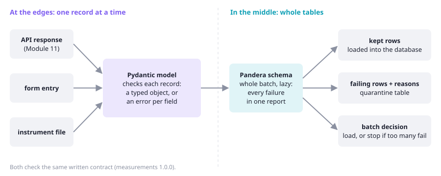
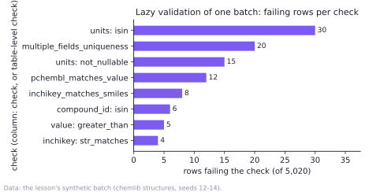

[Module 6](../06-validating-molecules/) checked molecules. This module checks everything that
travels with them. A table of bioactivity measurements (an IC50 here, a Ki there) is where most of
the value in medicinal chemistry data sits, and it breaks in ordinary ways: a unit column left
empty, a micromolar value typed as `uM` by one lab and `µM` by another, a minus sign from a
spreadsheet formula, the same measurement loaded twice, an InChIKey (the fixed-length code worked
out from a structure, [Module 3](../03-files-and-identity/)) pasted from the wrong row. None of
these stops a pipeline.
Each one quietly moves a mean pIC50, doubles the weight of one compound in a model or joins a
result to the wrong structure. Public data has these problems too: when Kramer and co-workers
set out to measure how well independent Ki values in ChEMBL agree, they first had to filter out
unit-transcription errors, stereoisomers that were not told apart, and single measurements cited
again and again by later papers.

Data engineers deal with this by writing down, once, what a table must contain (a **data
contract**) and checking it with code at every boundary the data crosses: every point where data
passes from one person, program or step to the next. This module builds that contract for
activity data and checks it two ways: one record (one row) at a time with Pydantic, and a whole
table at once with Pandera.

By the end of this module you will be able to:

- write down, with a version number, what a table of bioactivity measurements must contain (its
  data contract);
- check one record at a time with Pydantic, including rules that link several fields, and read
  its error messages;
- convert activities to one unit (nM) and work out pIC50, and test that conversion;
- check a whole table at once with Pandera, see every failure in one report, and move the rows
  that fail into a separate table (a quarantine) while keeping the rest;
- decide whether to stop a batch (one delivery of rows) or let it through, and record why;
- time the two ways of checking, and say when to use which.

From earlier modules we use the quarantine and the idea of checking against data with known
faults ([Module 6](../06-validating-molecules/)), standardisation rules and tests run by pytest
([Module 7](../07-standardisation/)), Pydantic models for settings
([Module 10](../10-pipelines-that-survive-failure/)), records from a web API
([Module 11](../11-incremental-ingestion/)), and DuckDB, the database in one file, from [Module 4](../04-databases-and-schemas/).

The lesson uses these packages:

- **RDKit**, the chemistry toolkit: it reads SMILES and works out InChIKeys;
- **Pydantic**, which checks one record (a Python dictionary) against a description of its fields;
- **Pandera**, which checks a whole pandas table (a **DataFrame**) against a description of its
  columns;
- **pandas**, for tables, and **NumPy**, for arrays of numbers and random numbers;
- **DuckDB**, a database kept in one file, which we load the checked rows into;
- **chemlib**, the course's own small package that makes a teaching library of molecules.

Everything here runs in a browser notebook (Google Colab) or on any laptop.

## Setup

Everything this lesson needs is imported and set here, so the settings can be changed in one
place. Pipeline steps report with `log`; `print` is kept for showing you results;
[Module 1](../01-graphs-and-matrices/) explains why.

Besides the packages above, the block imports a few tools that come with Python itself: `json`,
for writing dictionaries to text files; `math`, for logarithms; `time`, for the stopwatch of
section 5; `dataclass` and `Enum`, two ways of making small classes (explained in sections 2
and 4); `Path`, for file names; and `Self`, used in a **type hint** (the notes after a colon or
`->` that say what kind of value a function takes or returns). A **seed** fixes the random numbers
a program draws, so that everyone who runs the lesson gets the same test data.

```python
import json
import logging
import math
import time
from dataclasses import dataclass
from enum import Enum
from pathlib import Path
from typing import Self

import duckdb
import numpy as np
import pandas as pd
import pandera.pandas as pa
import pint
from pydantic import BaseModel, ConfigDict, Field, ValidationError, field_validator, model_validator
from rdkit import Chem, RDLogger
from rdkit.Chem import Descriptors

import chemlib

# log lines: level and message only, so the lesson's outputs are the same on every run
# (a real job would add "%(asctime)s" to the format)
logging.basicConfig(level=logging.INFO, format="%(levelname)s %(message)s", force=True)
log = logging.getLogger(__name__)

# where the lesson writes its files (git-ignored); change it to write somewhere else
WORK = Path("work")
# the database the checked measurements and the quarantine are loaded into
DB_PATH = WORK / "activity.duckdb"
# the test data: how many compounds and measurements, and the seeds that make them
N_COMPOUNDS = 2_000
COMPOUND_SEED = 12
N_MEASUREMENTS = 5_000
MEASUREMENT_SEED = 13
FAULT_SEED = 14
# the name of the batch we check (a real job takes it from the file or the run)
BATCH_ID = "batch-0001"
# the targets we screen: the only target_id values the contract allows
TARGETS = ["ABL1", "BRAF", "CDK2", "EGFR", "JAK2"]
# how far a stored pChEMBL may be from 9 - log10(value in nM) and still be accepted
PCHEMBL_TOLERANCE = 0.01
# the largest share of failing rows a batch may have and still be loaded (0.05 is 5%)
MAX_FAILED_SHARE = 0.05
# the timing comparison repeats the batch this many times (40 gives about 200,000 rows)
BENCHMARK_COPIES = 40

WORK.mkdir(exist_ok=True)
RDLogger.DisableLog("rdApp.*")  # RDKit's own warnings would repeat what our errors say
```

## 1. A data contract

A data contract is a short, versioned document that says what a table holds: its columns, their
types, which may be empty, which values are allowed, and which rules link columns together. The
team that produces the table and every team that reads it agree on it. Code then checks it,
because a contract that is only written down is broken within a week.

Ours describes one row per measurement. The rules are the ones a medicinal chemist would state
out loud; the contract just makes them exact. We write it as a Python dictionary and save it as a
**JSON** file, a plain-text format for dictionaries and lists that almost every program can read.
"14-10-1 capital letters" is the shape of an InChIKey, and pChEMBL is the activity on a log scale
(section 2 explains it):

```python
CONTRACT = {
    "name": "measurements",
    "version": "1.0.0",
    "columns": {
        "measurement_id": "text, required, unique, M- and six digits",
        "compound_id": "text, required, ML- and eight digits, must exist in the compounds table",
        "smiles": "text, required, readable by RDKit",
        "inchikey": "text, required, 14-10-1 capital letters, must match the SMILES",
        "target_id": "text, required, one of the targets we screen",
        "activity_type": "text, required, one of IC50, Ki, Kd, EC50",
        "value": "number, required, greater than 0",
        "units": "text, required, one of nM, µM, mM",
        "pchembl": "number, optional, 0 to 14, equal to 9 - log10(value in nM) "
                   f"within {PCHEMBL_TOLERANCE}",
    },
    "rows": "no two rows with the same compound, target, activity type, value and units",
}

contract_file = WORK / f"contract-{CONTRACT['name']}-{CONTRACT['version']}.json"
contract_file.write_text(json.dumps(CONTRACT, indent=2, ensure_ascii=False), encoding="utf-8")
log.info("wrote %s with %d columns", contract_file.name, len(CONTRACT["columns"]))
```
```output
INFO wrote contract-measurements-1.0.0.json with 9 columns
```

The file name carries the version, `1.0.0`. The version follows the usual convention for
software, three numbers that mean major.minor.patch: a change that cannot break a reader (a new
optional column) raises the middle number; a change that can (a column renamed, a unit removed, a
rule tightened) raises the first; the last is for small fixes that change no rule. A reader can
then refuse a table whose contract version it does not know, instead of misreading it.
[Module 13](../13-versioning-everything/) versions the code that checks it in the same way.

The contract is checked at two kinds of place. At the **edges**, data arrives one record at a
time: an API response (an answer from a web service such as ChEMBL's, Module 11), a row typed into
a form, a message from an instrument. There
we check each record as it arrives and turn it into a typed Python object, with Pydantic. In the
**middle** of a pipeline, data moves in tables of thousands or millions of rows, between steps
and into the database. There we check whole tables at once, with Pandera.



## 2. Records at the edges, with Pydantic

### A model for one measurement

A **class** is a template for making objects of one kind, each holding named values (its
**fields**). A Pydantic model is a class whose fields have types and constraints. Pydantic checks
every value when the object is made and refuses to make it if any check fails. You met Pydantic
models for a run's settings in Module 10 and for API records in Module 11; here the record is one
measurement. Fixed lists of allowed values are written as **enumerations** (`Enum`): a class whose
only possible values are the ones listed in it, so a typo cannot slip through as a new category.

We build the model in two parts: `Activity` holds the measured value and its context, and
`Measurement` adds the compound. The numbers and units are checked by field constraints; the
SMILES by a **field validator** that asks RDKit to read it; and the agreement between `pchembl`,
`value` and `units`, which involves three fields at once, by a **model validator** that runs after
every field has passed.

The code uses a few pieces of Python that may be new:

- `class Activity(BaseModel):` makes a new class built on Pydantic's `BaseModel`, so it gets all of
  Pydantic's checking. `class Measurement(Activity):` builds on `Activity` in the same way: it has
  all of `Activity`'s fields and checks, plus its own.
- A line such as `value: float = Field(gt=0)` declares one field: its name, its type after the
  colon (a number with a decimal point), and its rules in `Field(...)` (`gt=0` is "greater than
  0", `ge` and `le` are "greater than or equal" and "less than or equal"). `float | None` means a
  number or nothing, and `default=None` makes the field optional.
- `pattern=` takes a **regular expression**, a pattern that a piece of text must match:
  `^M-\d{6}$` reads "start (`^`), the letters `M-`, six digits (`\d{6}`), end (`$`)". The `r`
  before the quotes stops Python from treating the backslash as special.
- A line starting with `@` just above a function is a **decorator**: it hands the function to
  something else. `@model_validator` and `@field_validator` tell Pydantic to run the function as a
  check; `@property` lets us write `m.value_nm` without brackets, like a field, although it is
  worked out each time; `@classmethod` is required by Pydantic for field validators, and can be
  copied as it is.
- `raise ValueError("...")` stops the check with that message, which Pydantic then reports. The
  validator ends with `return self` (the object that passed), which is why its type hint is
  `Self`.
- `f"{expected:.2f}"` writes a number with two decimal places.

```python
MEASUREMENT_ID = r"^M-\d{6}$"  # the identifier formats the contract gives
COMPOUND_ID = r"^ML-\d{8}$"


class ActivityType(str, Enum):
    """The kinds of activity this table accepts."""

    IC50 = "IC50"
    KI = "Ki"
    KD = "Kd"
    EC50 = "EC50"


class Unit(str, Enum):
    """Concentration units, written exactly as the contract says (with the micro sign µ)."""

    NM = "nM"
    UM = "µM"
    MM = "mM"


NM_PER_UNIT = {Unit.NM: 1.0, Unit.UM: 1_000.0, Unit.MM: 1_000_000.0}


class Activity(BaseModel):
    """One measured activity: what was measured, against what, and its value."""

    model_config = ConfigDict(extra="forbid", frozen=True)

    target_id: str = Field(pattern=r"^[A-Z0-9]{2,10}$")
    activity_type: ActivityType
    value: float = Field(gt=0)
    units: Unit
    pchembl: float | None = Field(default=None, ge=0, le=14)

    @property
    def value_nm(self) -> float:
        """The value in nanomolar."""
        return self.value * NM_PER_UNIT[self.units]

    @model_validator(mode="after")
    def pchembl_matches_value(self) -> Self:
        """pChEMBL is -log10 of the molar value, so it must agree with value and units."""
        if self.pchembl is not None:
            expected = 9 - math.log10(self.value_nm)
            if abs(self.pchembl - expected) > PCHEMBL_TOLERANCE:
                raise ValueError(
                    f"pchembl {self.pchembl} does not match {self.value} {self.units.value} "
                    f"(expected {expected:.2f})"
                )
        return self


class Measurement(Activity):
    """An activity together with the compound it was measured for."""

    measurement_id: str = Field(pattern=MEASUREMENT_ID)
    compound_id: str = Field(pattern=COMPOUND_ID)
    smiles: str

    @field_validator("smiles")
    @classmethod
    def readable_by_rdkit(cls, smiles: str) -> str:
        """Refuse a SMILES that RDKit cannot read."""
        if Chem.MolFromSmiles(smiles) is None:
            raise ValueError("RDKit cannot read this SMILES")
        return smiles
```

`extra="forbid"` refuses fields the model does not know, so a renamed column in an API fails
loudly instead of being dropped. `frozen=True` makes the object read-only once checked, so nothing
later can make it invalid again.

### Good records and bad records

A good record becomes an object with real types: the units are a `Unit`, not a string (a piece of
text) that might be spelled several ways. `Measurement.model_validate(good)` checks a dictionary
and makes the object from it. An `Activity` on its own works too, for a source that reports
activities without structures; here we make one by giving the fields by name, and the optional
`pchembl` is then `None`.

```python
good = {
    "measurement_id": "M-000001",
    "compound_id": "ML-00012345",
    "smiles": "CC(=O)Oc1ccccc1C(=O)O",
    "target_id": "EGFR",
    "activity_type": "IC50",
    "value": 0.25,
    "units": "µM",
    "pchembl": 6.6,
}
m = Measurement.model_validate(good)
print(m.activity_type, m.units, m.value_nm, "nM")
a = Activity(target_id="JAK2", activity_type="Ki", value=4.2, units="nM")
print(a)
```
```output
ActivityType.IC50 Unit.UM 250.0 nM
target_id='JAK2' activity_type=<ActivityType.KI: 'Ki'> value=4.2 units=<Unit.NM: 'nM'> pchembl=None
```

A bad record raises a `ValidationError` that lists every problem, each with where it is and what
is wrong. A small helper prints them one per line. It uses `try:` and `except ValidationError`:
Python runs the `try` part, and if that raises a `ValidationError` it runs the `except` part
instead of stopping. To make bad records we change a copy of `good`: `{**good, "units": "uM"}` is
a copy of `good` with `units` replaced, and `{k: v for k, v in good.items() if k != "units"}` is a
copy without `units` at all (a **dictionary comprehension**, a loop written inside the brackets);
`|` then adds a new SMILES to that copy.

```python
def show_errors(record: dict) -> None:
    """Validate a record and print 'valid' or one line per problem."""
    try:
        Measurement.model_validate(record)
        print("valid")
    except ValidationError as error:
        for problem in error.errors():
            where = ".".join(str(part) for part in problem["loc"]) or "record"
            print(f"  {where}: {problem['msg']}")


print("micromolar typed as uM, and a negative value:")
show_errors({**good, "units": "uM", "value": -0.25})
print("units missing, and a SMILES with a ring that never closes:")
show_errors({k: v for k, v in good.items() if k != "units"} | {"smiles": "c1ccccc"})
print("pchembl worked out as if the value were in nM:")
show_errors({**good, "pchembl": 9.6})
print("an extra column:")
show_errors({**good, "assay_ref": "lab book 7"})
```
```output
micromolar typed as uM, and a negative value:
  value: Input should be greater than 0
  units: Input should be 'nM', 'µM' or 'mM'
units missing, and a SMILES with a ring that never closes:
  units: Field required
  smiles: Value error, RDKit cannot read this SMILES
pchembl worked out as if the value were in nM:
  record: Value error, pchembl 9.6 does not match 0.25 µM (expected 6.60)
an extra column:
  assay_ref: Extra inputs are not permitted
```

The pchembl check reports `record`, not a field: it is a rule about the record as a whole, and it
runs only once every field has passed on its own, so the first two records never reach it.

What to do with `uM` is a decision, not a validation. The contract says `µM`, and the model
refuses anything else. If a supplier always writes `uM`, the right fix is a written, versioned
list of known spellings applied *before* validation (a standardisation rule, Module 7), so that
the change is on record. Silently accepting every spelling inside the model would hide where the
data came from. The same goes for the Greek letter mu (μ, U+03BC), which looks identical to the
micro sign (µ, U+00B5) on screen but is a different character. (U+03BC is the character's number
in Unicode, the list of every character a computer can write.) To show which is which, the code
prints each spelling with `encode('unicode_escape')`, which writes any character outside plain
English letters as its code; `:>10` lines the spellings up on the right, ten characters wide:

```python
UNIT_SPELLINGS = {"uM": "µM", "μM": "µM", "nm": "nM", "um": "µM", "mm": "mM"}


def normalise_units(units: str | None) -> str | None:
    """Map a known alternative spelling of a unit to the contract's spelling; leave others."""
    if units is None:
        return None
    return UNIT_SPELLINGS.get(units, units)


print("Greek mu and micro sign are the same character:", "μM" == "µM")
for spelling in ["uM", "μM", "µM", "nM", "pM"]:
    print(f"{spelling.encode('unicode_escape').decode():>10} -> {normalise_units(spelling)}")
```
```output
Greek mu and micro sign are the same character: False
        uM -> µM
   \u03bcM -> µM
     \xb5M -> µM
        nM -> nM
        pM -> pM
```

`pM` is left alone: it is a real unit that the contract does not allow, so the model should
refuse it and a person should decide whether to add it.

### One unit, one scale: nanomolar and pIC50

Activities arrive in nM, µM and mM. Before they can be compared, averaged or modelled they go on
one scale. We convert every value to nanomolar and then to the negative log of the molar
concentration, which is what ChEMBL calls pChEMBL (pIC50 for an IC50):

pIC50 = −log10(IC50 in M) = 9 − log10(IC50 in nM)

so 1 nM is 9, 1 µM is 6 and 1 mM is 3, and every factor of ten in potency is one unit. Conversion
code is the kind of code that is wrong by exactly a factor of 1,000 and still looks plausible, so
it gets a test: a function that runs the code on values whose answers we know. Each `assert` line
stops with an error if what follows it is not true, so if the test runs to the end, every answer
was right:

```python
def to_nm(value: float, units: str) -> float:
    """A concentration in nanomolar."""
    return value * NM_PER_UNIT[Unit(units)]


def p_activity(value_nm: float) -> float:
    """-log10 of the molar concentration, from a value in nanomolar."""
    return 9 - math.log10(value_nm)


def test_conversion() -> None:
    """Known values: 50 nM written three ways, and the anchor points of the log scale."""
    assert math.isclose(to_nm(50, "nM"), 50)
    assert math.isclose(to_nm(0.05, "µM"), 50)
    assert math.isclose(to_nm(0.00005, "mM"), 50)
    assert math.isclose(p_activity(to_nm(1, "nM")), 9)
    assert math.isclose(p_activity(to_nm(1, "µM")), 6)
    assert math.isclose(p_activity(to_nm(1, "mM")), 3)
    assert math.isclose(p_activity(to_nm(250, "nM")), 6.60, abs_tol=0.01)


test_conversion()
log.info("conversion tests passed")
```
```output
INFO conversion tests passed
```

In a project this test lives in a test file and runs with pytest (a program that finds and runs
every test) on every change, as in Module 7. `math.isclose` is used because `0.05 * 1000` is not
exactly `50` in floating point, the way computers store decimal numbers, which rounds them very
slightly.

### Letting a library check the units

*This part is optional. The rest of the module keeps the table of spellings and `NM_PER_UNIT`
above; here we see what a units library adds, and what it cannot do for us.*

Our table knows three units, and every line of it can be read and checked. A **units library**
knows thousands, and something more useful: what each unit *measures*. That is its
**dimension**. A nanomolar is an amount of substance per volume, a microgram per millilitre is a
mass per volume, and a nanometre is a length. Values can only be converted between units of the
same dimension. The best-known library for Python is **pint**. `ureg` (short for unit registry)
holds every unit pint knows, and `ureg.Unit("uM")` reads a spelling. Here pint reads the spellings
from earlier, plus two more:

```python
ureg = pint.UnitRegistry()
for spelling in ["nM", "uM", "µM", "μM", "pM", "nm", "ug/mL"]:
    unit = ureg.Unit(spelling)
    code = spelling.encode("unicode_escape").decode()
    print(f"{code:>10} -> {unit!s:22} measures {unit.dimensionality}")
```
```output
        nM -> nanomolar              measures [substance] / [length] ** 3
        uM -> micromolar             measures [substance] / [length] ** 3
     \xb5M -> micromolar             measures [substance] / [length] ** 3
   \u03bcM -> micromolar             measures [substance] / [length] ** 3
        pM -> picomolar              measures [substance] / [length] ** 3
        nm -> nanometer              measures [length]
     ug/mL -> microgram / milliliter measures [mass] / [length] ** 3
```

pint reads `uM`, the micro sign and the Greek mu all as micromolar, which saves us part of the
table. `[length] ** 3` is a volume, so `[substance] / [length] ** 3` is amount per volume: a molar
concentration. But look at `nm`: pint reads it as a **nanometre**, a length, because that is what
the letters mean. Our table maps `nm` to `nM` because *we decided* that a supplier who writes `nm`
in a concentration column means nanomolar. A library reads exactly what is written; deciding what
a supplier meant stays a written, versioned decision of ours.

What the library adds is a check that cannot be fooled by spelling: converting between units of
different dimensions is refused, with an error that says why. A **quantity** is a number with its
unit, made with `ureg.Quantity(value, unit)`, and `.to(...)` converts it:

```python
print(ureg.Quantity(4.2, "uM").to("nM"))
try:
    ureg.Quantity(5, "ug/mL").to("nM")
except pint.DimensionalityError as error:
    print("refused:", error)
```
```output
4200.0 nanomolar
refused: Cannot convert from 'microgram / milliliter' ([mass] / [length] ** 3) to 'nanomolar' ([substance] / [length] ** 3)
```

Some assays do report potency as a mass per volume, such as µg/mL. Turning grams into moles needs
the **molecular weight** (grams per mole), and that comes from the structure, which RDKit gives us
(`Descriptors.MolWt`). pint has a built-in **context** called `"chemistry"` that does the
conversion once it is given the molecular weight as `mw`. In the formats, `.2f` means two decimal
places and `~P` writes the unit's short symbol:

```python
aspirin = Chem.MolFromSmiles("CC(=O)Oc1ccccc1C(=O)O")
mw = ureg.Quantity(Descriptors.MolWt(aspirin), "g/mol")
dose = ureg.Quantity(5, "ug/mL")
in_nm = dose.to("nM", "chemistry", mw=mw)
print(f"aspirin, {mw:.2f~P}: {dose:~P} is {in_nm:.1f~P}, pIC50 {p_activity(in_nm.magnitude):.2f}")
```
```output
aspirin, 180.16 g/mol: 5 µg/ml is 27753.3 nM, pIC50 4.56
```

This is also the kind of conversion that goes wrong silently by hand: forget the factor of 1,000
between millilitres and litres and the answer is still a plausible-looking number. pint keeps
track of every factor. Even so, the molecular weight must be the right one: that of the compound
as tested (a salt such as a hydrochloride weighs more than the parent), which is one more reason
to standardise structures (Module 7) before converting.

Finally, the dimension gives a check that a column holds concentrations at all, whatever the
spelling. A spelling pint does not know raises an error, and so does a value with a number in it,
so the function treats both as "no":

```python
MOLAR = ureg.Unit("M").dimensionality


def is_concentration(units: str) -> bool:
    """Whether pint reads a spelling as an amount per volume (a molar concentration)."""
    try:
        return ureg.Unit(units).dimensionality == MOLAR
    except (pint.PintError, ValueError, TypeError):
        return False


for spelling in ["µM", "umol/L", "nm", "ug/mL", "%", "n/a", "10 nM", ""]:
    print(f"{spelling!r:>9} -> {is_concentration(spelling)}")
```
```output
     'µM' -> True
 'umol/L' -> True
     'nm' -> False
  'ug/mL' -> False
      '%' -> False
    'n/a' -> False
  '10 nM' -> False
       '' -> False
```

`umol/L` is a concentration (it is the same as µM) even though our contract does not list it: a
library check answers "is this a concentration?", and the contract answers "is this one of the
units we agreed?". A pipeline can use both. In section 4's Pandera schema this function could be a
check on the `units` column, `pa.Check(is_concentration, element_wise=True)`, to report rows whose
unit is not a concentration at all, before the stricter list of allowed units is applied.

**Which to use?** For a few units that never change, a short table with a test, as above, is
simple, has no extra package, and is easy to read. When data arrive in many units, in mixed
dimensions (molar and mass per volume, or temperatures and volumes from lab instruments), a
library such as pint is safer, because every conversion is checked. Other Python units libraries
include `astropy.units` and `unyt` (both fast on large NumPy arrays); clinical and laboratory
systems often write units in **UCUM**, a standard set of unit codes (`umol/L`, `mg/dL`).

The same approach works for any quantity, not only concentrations. Reaction times and
temperatures typed by hand (`1 min`, `1mins`, `90 s`, `rt`, `o/n` for overnight) are the classic
case: a library reads most of them, a written list of local shorthand covers the rest, and the
dimension check catches a slip such as `1m` (a metre, not a minute). Reading lab conditions
safely into tables is part of Series 3, *Data Pipelines for Digital and Autonomous Chemistry*
(Module 3, "Reaction and synthesis metadata"; planned). Homework question 7 is a first taste.

## 3. Test data with known faults

To see whether checks work, we need data whose faults we know. As in Module 6 we take molecules
from `chemlib` and add the measurements ourselves, with fixed seeds so everyone gets the same
table. First the compounds table, with an InChIKey for each structure (the square brackets around
the `for` loop make a list, one key per SMILES: a **list comprehension**):

```python
compounds = chemlib.library(N_COMPOUNDS, seed=COMPOUND_SEED)[["id", "smiles"]]
compounds = compounds.rename(columns={"id": "compound_id"})
compounds["inchikey"] = [Chem.MolToInchiKey(Chem.MolFromSmiles(s)) for s in compounds["smiles"]]
log.info("made %d compounds", len(compounds))
print(compounds.head(3).to_string(index=False))
```
```output
INFO made 2000 compounds
compound_id                                          smiles                    inchikey
ML-00000267        c1cc(c8ccc(F)cc8)ccc1C(=O)NCc2ccc(OC)cc2 OVAABZUXCGPVDU-UHFFFAOYSA-N
ML-00002909 c1nc(C8CCNCC8)cc(n1)N2CCN(CC2)C(=O)c3ccc(Cl)cc3 LLUXFYAMPKXHKJ-UHFFFAOYSA-N
ML-00004719            c1cc(OCC)c(cc1)Oc2ccc(cc2)C(=O)N(Br) ADTGZEKAFDLMAF-UHFFFAOYSA-N
```

Then 5,000 measurements against five kinase targets. Each potency is drawn on the log scale (as
real potencies spread), turned into a value in nM or µM the way a lab would report it, and rounded
to three significant figures; the pChEMBL value is worked out from the rounded value, and about
one in ten is left empty, as ChEMBL does for values it cannot put on that scale (a value given
only as "> 10 µM", for example). In the code, `rng` is NumPy's random number generator, started
from the seed; `np.where(condition, a, b)` takes `a` where the condition is true and `b` where it
is not; `f"{v:.3g}"` writes a number to three significant figures; and `f"M-{i:06d}"` writes `i`
as six digits with leading zeros, so `1` becomes `M-000001`. The empty pChEMBL values are `NaN`
("not a number"), which is how pandas and NumPy mark an empty cell in a column of numbers.

```python
def make_measurements(compounds: pd.DataFrame, n: int, seed: int) -> pd.DataFrame:
    """n synthetic measurements for random compounds, with consistent values, units and pChEMBL."""
    rng = np.random.default_rng(seed)
    rows = compounds.iloc[rng.integers(0, len(compounds), n)].reset_index(drop=True)
    potency = rng.normal(6.5, 1.2, n).clip(3.5, 10.5)  # on the pIC50 scale
    value_nm = 10 ** (9 - potency)
    micromolar = (value_nm >= 1_000) | (rng.random(n) < 0.2)
    units = np.where(micromolar, "µM", "nM")
    value = np.where(micromolar, value_nm / 1_000, value_nm)
    value = np.array([float(f"{v:.3g}") for v in value])  # three significant figures
    pchembl = np.round(9 - np.log10(np.where(micromolar, value * 1_000, value)), 2)
    pchembl[rng.random(n) < 0.1] = np.nan
    return pd.DataFrame(
        {
            "measurement_id": [f"M-{i:06d}" for i in range(1, n + 1)],
            "compound_id": rows["compound_id"],
            "smiles": rows["smiles"],
            "inchikey": rows["inchikey"],
            "target_id": rng.choice(TARGETS, n),
            "activity_type": rng.choice([t.value for t in ActivityType], n,
                                        p=[0.6, 0.2, 0.1, 0.1]),
            "value": value,
            "units": units,
            "pchembl": pchembl,
        }
    )


clean = make_measurements(compounds, N_MEASUREMENTS, seed=MEASUREMENT_SEED)
print(clean[["measurement_id", "compound_id", "target_id", "activity_type", "value", "units",
             "pchembl"]].head(4).to_string(index=False))
print(clean["units"].value_counts().to_dict())
```
```output
measurement_id compound_id target_id activity_type  value units  pchembl
      M-000001 ML-01564933      BRAF          EC50 451.00    nM     6.35
      M-000002 ML-01522653      CDK2          EC50   2.94    µM     5.53
      M-000003 ML-01441112      CDK2          IC50   6.78    µM     5.17
      M-000004 ML-01506847      ABL1            Ki   4.20    µM     5.38
{'nM': 2694, 'µM': 2306}
```

Now the faults. Each kind goes into a few rows, more for the common faults than for the rare
ones, chosen with a fixed seed; a separate `fault` series (a pandas `Series`, a single column with
the same row labels as the table) records which row got which, so we can
check the checks afterwards. These are the faults real activity files have: units missing or
misspelled, a sign error, a row loaded twice, a broken or misplaced InChIKey, a pChEMBL worked out
in the wrong units, and a compound the compounds table does not know.

The function is longer than most in the course, but each `for` loop does one thing: it picks rows
for one kind of fault and spoils them. You do not need to follow every line. What matters is what
comes out: the damaged table, `batch`, and the series `truth`, which says which row got which fault
(`""` for none). Inside it, `pick` is a small function defined within the function; `used` is a
**set** (a collection with no repeats), so no row gets two faults; and `tuple[pd.DataFrame,
pd.Series]` in the first line is a type hint saying the function returns two things, a table and a
series, which `batch, truth = ...` then receives.

```python
FAULTS = {
    "µM written as uM": 30,
    "duplicate measurement": 20,
    "units missing": 15,
    "pchembl in wrong units": 12,
    "InChIKey of another compound": 8,
    "unknown compound": 6,
    "negative value": 5,
    "malformed InChIKey": 4,
}


def inject_faults(df: pd.DataFrame, seed: int) -> tuple[pd.DataFrame, pd.Series]:
    """A copy of df with FAULTS added, and a series saying which row has which ("" if none)."""
    rng = np.random.default_rng(seed)
    out = df.copy()
    fault = pd.Series("", index=out.index)
    micromolar = out.index[out["units"] == "µM"]
    with_pchembl = out.index[out["pchembl"].notna() & (out["units"] == "µM")]
    used: set[int] = set()

    def pick(kind: str, pool: pd.Index) -> list[int]:
        """FAULTS[kind] rows from pool that have no fault yet."""
        free = [i for i in pool if i not in used]
        chosen = [int(i) for i in rng.choice(free, FAULTS[kind], replace=False)]
        used.update(chosen)
        if kind != "duplicate measurement":  # duplicates are new rows, added below
            fault[chosen] = kind
        return chosen

    for i in pick("units missing", out.index):
        out.loc[i, "units"] = None
    for i in pick("µM written as uM", micromolar):
        out.loc[i, "units"] = "uM"
    for i in pick("negative value", out.index):
        out.loc[i, "value"] = -out.loc[i, "value"]
    for i in pick("malformed InChIKey", out.index):
        out.loc[i, "inchikey"] = out.loc[i, "inchikey"][:-2]  # the final "-N" cut off
    for i in pick("InChIKey of another compound", out.index):
        others = compounds.loc[compounds["inchikey"] != out.loc[i, "inchikey"], "inchikey"]
        out.loc[i, "inchikey"] = others.iloc[int(rng.integers(len(others)))]
    for i in pick("pchembl in wrong units", with_pchembl):
        out.loc[i, "pchembl"] = round(9 - math.log10(out.loc[i, "value"]), 2)  # as if in nM
    for i in pick("unknown compound", out.index):
        out.loc[i, "compound_id"] = f"ML-9{i:07d}"
    copies = out.loc[pick("duplicate measurement", out.index)].copy()  # loaded a second time
    copies["measurement_id"] = [f"M-{len(out) + k:06d}" for k in range(1, len(copies) + 1)]
    out = pd.concat([out, copies], ignore_index=True)
    fault = pd.concat([fault, pd.Series("duplicate measurement", index=range(len(df), len(out)))])
    return out, fault


batch, truth = inject_faults(clean, seed=FAULT_SEED)
print(len(batch), "rows,", int((truth != "").sum()), "with a fault")
print(truth[truth != ""].value_counts().sort_index().to_string())
```
```output
5020 rows, 100 with a fault
InChIKey of another compound     8
duplicate measurement           20
malformed InChIKey               4
negative value                   5
pchembl in wrong units          12
units missing                   15
unknown compound                 6
µM written as uM                30
```

## 4. Tables with Pandera

### A schema for the whole table

A **schema** is the description of a table: its columns, their types and the rules the data must
follow. A Pandera schema is the contract written as code for a pandas DataFrame: one entry per
column with its type, whether it may be empty, whether it must be unique, and its checks; then
checks that involve several columns or the whole table. The built-in checks are `isin` (the value
is one of a list), `gt` (greater than), `in_range` (between two numbers) and `str_matches` (the
text matches a regular expression). They are **vectorised**: each runs once over a whole column,
in fast compiled code, not once per row in a Python loop.

Two rules need our own code. The pChEMBL rule compares three columns, so it is a table-level
check that returns `True` or `False` for every row. The InChIKey rule needs RDKit, so it works out
the key once for each different SMILES (there are fewer SMILES than rows) and compares. Rows that
fail a simpler rule (a negative value, a missing unit) pass these two, so that each fault is
reported once, by the check that names it.

In these two functions, `~` means "not" and `|` means "or" for a whole column of `True` and
`False` values at once; `.map(...)` looks up each value of a column in a dictionary; and
`.where(checkable, 1.0)` keeps a value where `checkable` is true and puts 1.0 elsewhere, so that
the logarithm is never taken of a missing or negative value.

```python
INCHIKEY = r"^[A-Z]{14}-[A-Z]{10}-[A-Z]$"


def pchembl_matches_value(df: pd.DataFrame) -> pd.Series:
    """True where pchembl is empty, cannot be checked yet, or equals 9 - log10(value in nM)."""
    factor = df["units"].map({u.value: f for u, f in NM_PER_UNIT.items()})
    checkable = df["pchembl"].notna() & factor.notna() & (df["value"] > 0)
    value_nm = (df["value"] * factor).where(checkable, 1.0)
    expected = 9 - np.log10(value_nm.astype(float))
    return ~checkable | ((df["pchembl"] - expected).abs() <= PCHEMBL_TOLERANCE)


def inchikey_matches_smiles(df: pd.DataFrame) -> pd.Series:
    """True where the InChIKey is malformed (another check reports it) or matches the SMILES."""
    keys = {s: Chem.MolToInchiKey(Chem.MolFromSmiles(s)) for s in df["smiles"].unique()}
    well_formed = df["inchikey"].str.match(INCHIKEY)
    return ~well_formed | (df["smiles"].map(keys) == df["inchikey"])


def measurement_schema(known_compounds: pd.Series) -> pa.DataFrameSchema:
    """The measurements contract, version 1.0.0, as a Pandera schema."""
    return pa.DataFrameSchema(
        {
            "measurement_id": pa.Column(str, pa.Check.str_matches(MEASUREMENT_ID), unique=True),
            "compound_id": pa.Column(str, [pa.Check.str_matches(COMPOUND_ID),
                                           pa.Check.isin(known_compounds.tolist())]),
            "smiles": pa.Column(str),
            "inchikey": pa.Column(str, pa.Check.str_matches(INCHIKEY)),
            "target_id": pa.Column(str, pa.Check.isin(TARGETS)),
            "activity_type": pa.Column(str, pa.Check.isin([t.value for t in ActivityType])),
            "value": pa.Column(float, pa.Check.gt(0)),
            "units": pa.Column(str, pa.Check.isin([u.value for u in Unit])),
            "pchembl": pa.Column(float, pa.Check.in_range(0, 14), nullable=True),
        },
        checks=[
            pa.Check(pchembl_matches_value, name="pchembl_matches_value"),
            pa.Check(inchikey_matches_smiles, name="inchikey_matches_smiles"),
        ],
        unique=["compound_id", "target_id", "activity_type", "value", "units"],
        report_duplicates="exclude_first",
        strict=True,
        name=f"measurements {CONTRACT['version']}",
    )


schema = measurement_schema(compounds["compound_id"])
print("schema columns match the contract:", list(schema.columns) == list(CONTRACT["columns"]))
log.info("the clean table passes: %d rows", len(schema.validate(clean)))
```
```output
schema columns match the contract: True
INFO the clean table passes: 5000 rows
```

`strict=True` refuses a table with columns the contract does not name, the table-level twin of
Pydantic's `extra="forbid"`. The first line checks that the schema and the written contract name
the same columns, so the two cannot drift apart unnoticed. The check that every `compound_id`
exists in the compounds table is a link between tables, the job a **foreign key** does in a
database (a column whose values must exist in another table, Module 4); checking it here catches
the problem before the load, with the row that caused it. `unique=[...]` says that no two rows may
have the same values in all five of those columns, and `report_duplicates="exclude_first"` reports
the second copy of a duplicated measurement and keeps the first.

Pandera can also write a schema as a class (`pa.DataFrameModel`), in the same style as a
Pydantic model; the checks are the same, and a function that returns a `DataFrameSchema` is
easier when part of the schema (here the list of known compounds) is only known at run time.

### Lazy validation: every failure at once

By default Pandera stops at the first failure, like Python stops at the first error. For a
batch that is not useful: fixing one problem, rerunning and finding the next wastes a day. With
`lazy=True` it runs every check and raises one `SchemaErrors` whose `failure_cases` table lists
every failure: which column, which check, the value that failed and the row's index (its row
label: row 5000 is the 5,001st row, since counting starts at 0).

```python
try:
    schema.validate(batch, lazy=True)
except pa.errors.SchemaErrors as error:
    failures = error.failure_cases
print(len(failures), "failure cases")
print(failures[["column", "check", "failure_case", "index"]].head(6).to_string(index=False))
```
```output
339 failure cases
     column                      check failure_case  index
compound_id multiple_fields_uniqueness  ML-00345391   5000
compound_id multiple_fields_uniqueness  ML-00214734   5001
compound_id multiple_fields_uniqueness  ML-01539024   5002
compound_id multiple_fields_uniqueness  ML-01601965   5003
compound_id multiple_fields_uniqueness  ML-01557373   5004
compound_id multiple_fields_uniqueness  ML-00398134   5005
```

A check that involves several columns (uniqueness over five columns, our two table-level checks)
lists one failure case per column for each failing row, so failure cases are not rows. Counting
the different rows each check fails gives the report we want, with a short label for each check.
`failures.apply(label, axis=1)` runs `label` on every row of the failures table; `drop_duplicates`
then keeps one line per check and row, and `groupby("label").size()` counts the rows for each
check:

```python
def label(row: pd.Series) -> str:
    """A short name for a failed check: the column (for column checks) and the check's name."""
    check = str(row["check"]).split("(")[0]
    if row["schema_context"] == "Column":
        return f"{row['column']}: {check}"
    return check


failures["label"] = failures.apply(label, axis=1)
failed_rows = failures.dropna(subset=["index"]).drop_duplicates(["label", "index"])
by_check = failed_rows.groupby("label").size().sort_values(ascending=False)
print(by_check.to_string())
```
```output
label
units: isin                   30
multiple_fields_uniqueness    20
units: not_nullable           15
pchembl_matches_value         12
inchikey_matches_smiles        8
compound_id: isin              6
value: greater_than            5
inchikey: str_matches          4
```



The malformed InChIKeys are counted once, by the format check, because the matching check skips
keys it cannot read. Every kind of fault we injected is caught by the check that names it. Is that
all of them, and did any clean row fail? The `fault` series, which we called `truth`, lets us
check the checks. With two sets of row numbers, `&` gives the rows in both and `-` the rows in the
first but not the second:

```python
caught = set(failed_rows["index"].astype(int))
injected = set(truth.index[truth != ""])
print("injected faults caught:", len(injected & caught), "of", len(injected))
print("clean rows flagged:", len(caught - injected))
```
```output
injected faults caught: 100 of 100
clean rows flagged: 0
```

### Quarantine the failing rows, keep the rest

A failing row is not deleted. It goes to a **quarantine** table with the reasons it failed, so
someone can fix it at the source, and the batch carries on without it. The rest is validated
again: what goes into the database must pass the whole contract. A row that fails several checks
gets all their names, joined by `; `. The `lambda s: ...` in the first line is a **lambda**, a
one-line function without a name, written where it is used.

```python
reasons = failed_rows.groupby("index")["label"].apply(lambda s: "; ".join(sorted(s)))
reasons.index = reasons.index.astype(int)
quarantine = batch.loc[reasons.index].assign(reason=reasons)
kept = batch.drop(index=reasons.index)
schema.validate(kept, lazy=True)  # raises if anything that fails is still there
log.info("kept %d rows, quarantined %d", len(kept), len(quarantine))
print(quarantine[["measurement_id", "units", "value", "reason"]].head(4).to_string(index=False))
```
```output
INFO kept 4920 rows, quarantined 100
measurement_id units   value                  reason
      M-000089    µM   9.000   pchembl_matches_value
      M-000153    uM   5.600             units: isin
      M-000176    uM   0.446             units: isin
      M-000235    nM 806.000 inchikey_matches_smiles
```

The quarantine is a table like any other, so it belongs in the database next to the data, with
the batch it came from. Here it goes into DuckDB, a database in one file (Module 4); the same SQL
works in PostgreSQL, the database server of Module 4. **SQL** is the language databases are asked questions in, and a question
written in it is a **query**. Then a question such as "what goes wrong most often, and from which
batch?" is one query.

`with duckdb.connect(...) as db:` opens the database file and closes it again when the indented
block ends, even if something in it fails (a `with` block). Inside, `CREATE TABLE ... AS SELECT *
FROM kept` copies the pandas table `kept` into the database; DuckDB finds it by its Python name.
The `?` is filled in with `BATCH_ID`, and `GROUP BY ALL` counts the rows for each batch and
reason:

```python
DB_PATH.unlink(missing_ok=True)
with duckdb.connect(str(DB_PATH)) as db:
    db.execute("CREATE TABLE measurements AS SELECT * FROM kept")
    db.execute("CREATE TABLE quarantine AS SELECT ? AS batch_id, * FROM quarantine", [BATCH_ID])
    for row in db.sql(
        "SELECT batch_id, reason, count(*) AS n_rows FROM quarantine "
        "GROUP BY ALL ORDER BY n_rows DESC, reason"
    ).fetchall():
        print(row)
```
```output
('batch-0001', 'units: isin', 30)
('batch-0001', 'multiple_fields_uniqueness', 20)
('batch-0001', 'units: not_nullable', 15)
('batch-0001', 'pchembl_matches_value', 12)
('batch-0001', 'inchikey_matches_smiles', 8)
('batch-0001', 'compound_id: isin', 6)
('batch-0001', 'value: greater_than', 5)
('batch-0001', 'inchikey: str_matches', 4)
```

### Stop the batch, or let it through?

Quarantining a few rows is right when the batch is mostly good. When many rows fail, the problem
is usually the whole batch (a supplier changed a column's units, an export was cut short), and
loading the good part would give a table that looks complete but is not. A pipeline therefore
decides per batch, with a threshold written down in advance, and records the decision.

Two more checks belong here, and neither looks at single rows. A missing column fails the whole
table at once: there is nothing to quarantine. And the counts must agree with the source: if the
supplier's **manifest** (a short list sent with the file, saying what is in it) says 5,020 rows,
the rows we kept and quarantined must add up to 5,020, or rows have been lost or added on the way.

The decision is a small record of its own, so it is written as a frozen dataclass (met in
[Module 8](../08-larger-than-memory/)): a class that only holds named fields, cannot be changed
once made, and prints itself readably (`slots=True` stops a misspelt field being added by
accident). The `@dataclass(...)` line above it is a decorator, as in section 2: it writes the
class's plumbing for us.

In the `log.info` line, each `%d` is filled with a whole number, `%s` with text and `%.2f` with a
number to two decimal places, in order; `%%` prints a plain `%`. The last part of the code checks
the same batch with its `units` column removed, and `.query(...)` picks out the failure for the
missing column.

```python
@dataclass(frozen=True, slots=True)
class BatchDecision:
    """What was decided about one batch, and the numbers it was decided on."""

    batch_id: str
    n_rows: int
    n_failed: int
    action: str  # "load" or "stop"


def decide(batch_id: str, n_rows: int, n_failed: int,
           max_failed_share: float = MAX_FAILED_SHARE) -> BatchDecision:
    """Load the batch if its share of failing rows is within the threshold, otherwise stop it."""
    action = "load" if n_failed / n_rows <= max_failed_share else "stop"
    return BatchDecision(batch_id, n_rows, n_failed, action)


supplier_manifest = {"file": f"{BATCH_ID}.csv", "rows": 5_020}
print("rows agree with the manifest:",
      len(kept) + len(quarantine) == len(batch) == supplier_manifest["rows"])
decision = decide(BATCH_ID, len(batch), len(quarantine))
log.info("%s: %d of %d rows failed (%.2f%%), %s", decision.batch_id, decision.n_failed,
         decision.n_rows, 100 * decision.n_failed / decision.n_rows, decision.action)
print(decision)

try:
    schema.validate(batch.drop(columns="units"), lazy=True)
except pa.errors.SchemaErrors as error:
    missing = error.failure_cases.query("check == 'column_in_dataframe'")
    log.error("batch stopped, column missing: %s", missing["failure_case"].tolist())
```
```output
rows agree with the manifest: True
INFO batch-0001: 100 of 5020 rows failed (1.99%), load
BatchDecision(batch_id='batch-0001', n_rows=5020, n_failed=100, action='load')
ERROR batch stopped, column missing: ['units']
```

With 1.99% of rows failing against a threshold of 5%, this batch is loaded and its 100
failing rows wait in quarantine. The same batch without its `units` column is stopped outright.
The decision and its reason are themselves data: a run that stopped a batch should say which
batch, which checks failed and how often, and Module 14 turns exactly these counts into alerts.

## 5. Records or tables? Measuring the difference

*The timing in this section is optional: it measures why we use two tools. If you are short of
time, read the list at the end of the section and move on; nothing later in the course depends on
the timing code.*

Pydantic could check the whole table too: turn each row into a dictionary and validate it. The
answer would be the same, but the cost is not, because the work is done once per row in Python
instead of once per column in compiled code. To compare fairly, both check the same rules: the
activity part of the contract, without RDKit (which costs the same in both). We use about 200,000
rows, the batch repeated forty times, and time the two parts of the Pydantic route separately:
turning rows into dictionaries, and validating them. `time.perf_counter()` reads a stopwatch, so
the time a step took is the reading after it minus the reading before; `enumerate(records)` gives
each record together with its position.

```python
ACTIVITY_COLUMNS = ["target_id", "activity_type", "value", "units", "pchembl"]
activity_schema = pa.DataFrameSchema(
    {name: schema.columns[name] for name in ACTIVITY_COLUMNS},
    checks=[pa.Check(pchembl_matches_value, name="pchembl_matches_value")],
)
big = pd.concat([batch[ACTIVITY_COLUMNS]] * BENCHMARK_COPIES, ignore_index=True)


def as_records(df: pd.DataFrame) -> list[dict]:
    """One dictionary per row, with empty cells as None (what Pydantic expects)."""
    return df.astype(object).where(df.notna(), None).to_dict("records")


def failing_records(records: list[dict]) -> set[int]:
    """Validate every record as an Activity; the positions of the records that fail."""
    failed: set[int] = set()
    for i, record in enumerate(records):
        try:
            Activity.model_validate(record)
        except ValidationError:
            failed.add(i)
    return failed


def failing_rows(df: pd.DataFrame) -> set[int]:
    """Validate the table in one lazy pass; the positions of the rows that fail."""
    try:
        activity_schema.validate(df, lazy=True)
    except pa.errors.SchemaErrors as error:
        return set(error.failure_cases["index"].dropna().astype(int))
    return set()


start = time.perf_counter()
records = as_records(big)
to_records_s = time.perf_counter() - start
start = time.perf_counter()
by_record = failing_records(records)
pydantic_s = time.perf_counter() - start
start = time.perf_counter()
by_table = failing_rows(big)
pandera_s = time.perf_counter() - start
```

Both find exactly the same rows:

```python
print(len(big), "rows;", len(by_record), "fail;", "same rows:", by_record == by_table)
```
```output
200800 rows; 2480 fail; same rows: True
```

and the times, with what they mean for a million rows. Your times will differ from these, since
they depend on the computer (the box is labelled **Example output** on the lesson's page):

```python
per_million = 1_000_000 / len(big)
record_route = to_records_s + pydantic_s
print(f"rows to dictionaries:          {to_records_s:.2f} s")
print(f"Pydantic, one record at a time: {pydantic_s:.2f} s "
      f"({pydantic_s / len(big) * 1e6:.1f} microseconds per record)")
print(f"Pandera, one pass over the table: {pandera_s:.2f} s")
print(f"for a million rows: about {record_route * per_million:.1f} s one record at a time, "
      f"{pandera_s * per_million:.1f} s as a table ({record_route / pandera_s:.0f} times faster)")
```
```output varies
rows to dictionaries:          1.01 s
Pydantic, one record at a time: 1.06 s (5.3 microseconds per record)
Pandera, one pass over the table: 0.13 s
for a million rows: about 10.3 s one record at a time, 0.6 s as a table (16 times faster)
```

Pydantic's core is written in Rust, a language that is compiled to fast machine code, and is
fast for what it does: a few microseconds per record
is nothing when records arrive one at a time from an API. The cost of the record route is
everything around it: every row becomes a Python dictionary first (often as long as the validation
itself) and every record a Python object, and a pipeline that checks a million rows at several
steps pays that every time. Vectorised checks pay once per column, and the gap widens as tables
grow, because Pandera's fixed cost per check is spread over more rows. Speed is not the only
difference: the table route also gives one report of every failure, ready to quarantine.

So the rule of thumb is:

- **Pydantic at the edges**: one record, one message, one API response, one settings file. You
  want a typed object to work with, and an error that says exactly which field of which record is
  wrong, at the moment it arrives.
- **Pandera in the middle**: tables between steps and before a load. You want every failure in
  one report, a quarantine and a count, at the speed of the table.

Both check the same contract, so a rule should not live in only one of them. Pandera also checks
Polars, Dask and PySpark tables (the table packages for data larger than memory and for many
computers, Modules 8 and 9), so the same schema follows a pipeline as it grows. Teams that check
data inside a **data warehouse** (a large database built for analysis) use tools such as dbt
tests, Great Expectations or Soda for the same job; dbt, which Series 2 introduces, has tests for
it too.

## Try it yourself

The homework is a few questions, answered by running code like the code above: in a new cell at
the end of the notebook, or in a script. It is at the end of the lesson's page, and in
`homework.md` in the module's folder. The answers are published after the cohort's deadline.

## Further reading

- The Pydantic documentation, in particular *Validators*.
  <https://docs.pydantic.dev/latest/concepts/validators/>
- The Pandera documentation, in particular *Lazy Validation*.
  <https://pandera.readthedocs.io/en/stable/lazy_validation.html>
- Bantilan, N. (2020). pandera: Statistical Data Validation of Pandas Dataframes. *Proceedings of
  the 19th Python in Science Conference*, 116–124. <https://doi.org/10.25080/Majora-342d178e-010>
- Kramer, C., Kalliokoski, T., Gedeck, P. & Vulpetti, A. (2012). The Experimental Uncertainty of
  Heterogeneous Public Ki Data. *Journal of Medicinal Chemistry*, 55(11), 5165–5173.
  <https://doi.org/10.1021/jm300131x>
- Papadatos, G., Gaulton, A., Hersey, A. & Overington, J. P. (2015). Activity, assay and target
  data curation and quality in the ChEMBL database. *Journal of Computer-Aided Molecular Design*,
  29(9), 885–896. <https://doi.org/10.1007/s10822-015-9860-5>
