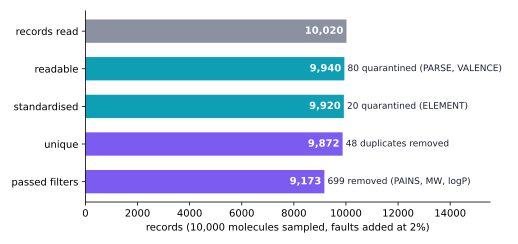

Every module so far has built one piece of a data pipeline for chemistry. This one puts the pieces
together, the way a cheminformatics team would before it trusts a library enough to screen it,
model it or buy from it: read a supplier's library in batches, reject what cannot be used and say
why, reduce every record to one standard form, keep one record per molecule, remove compounds that
cause trouble in assays, calculate fingerprints and descriptors, and store the result where it can
be queried. Then the parts that make the result trustworthy: the run can be stopped and resumed
without changing the answer, every count adds up, and a manifest records exactly what produced it.

By the end of this module you will be able to:

- run one pipeline that takes a library of molecules from the supplier's records all the way to
  clean, searchable tables on disk;
- say which earlier module each stage comes from, and why the stages run in this order;
- stop a run halfway on purpose, start it again, and show that the result is exactly the same as a
  run that was never stopped;
- check that every record is accounted for at every stage, and that the files on disk agree with
  the pipeline's own record;
- read the run's manifest (the record of what produced the output) and ask questions of the output
  in DuckDB;
- plan your own capstone project, which three other learners review against the marking table
  (the rubric) at the end of this page.

This module uses every module before it. The table in Section 1 shows which stage comes from where;
the ones it leans on most are [Module 10](../10-pipelines-that-survive-failure/) (settings, retries,
checkpoints, atomic writes), [Module 13](../13-versioning-everything/) (hashes and the manifest)
and [Module 14](../14-monitoring-pipelines/) (JSON logs, the run history and reconciliation).

The pipeline lives in one file next to this lesson, `pipeline.py`. It is a Python module: a `.py`
file of functions that other code loads with `import` (not to be confused with the course's
modules). We keep it as a file rather than notebook cells because that is how pipeline code is
kept: other code can import it, tests can check it, and it can run on its own from a terminal. The
lesson imports it and walks through it stage by stage. In Colab, the notebook's first cell
downloads `pipeline.py` for you. If you want to read the code itself, open
[`pipeline.py` on GitHub](https://github.com/David-Alobo/monstrous-learn/blob/main/data-engineering/series-1/15-capstone/pipeline.py); every function in it has a short description.

The pipeline uses these Python packages, all met in earlier modules:

- **RDKit**, for the chemistry;
- **NumPy** and **pandas**, for arrays and tables;
- **pyarrow**, for writing Parquet files ([Module 8](../08-larger-than-memory/));
- **DuckDB**, the one-file database ([Module 8](../08-larger-than-memory/));
- **joblib**, for running work on several processor cores at once
  ([Module 9](../09-parallel-and-distributed/));
- **Pydantic** and **pydantic-settings**, for settings that are checked before the run starts
  ([Module 10](../10-pipelines-that-survive-failure/));
- **tenacity**, for trying a failed read again ([Module 10](../10-pipelines-that-survive-failure/)).

## Setup

Everything this lesson needs is imported and set here, so the settings can be changed in one place.
The pipeline's own settings live in its settings class (Section 2); these are the lesson's.
Pipeline steps report with `log`; `print` is kept for showing you results; Module 1 explains why.
`sys.path.insert(0, ".")` tells Python to look for modules in the current folder too, so that
`import pipeline` finds `pipeline.py`; the `# noqa: E402` note tells the course's code checker
that this import is meant to come after other code. The block also deletes the output folders of
any earlier run (`shutil.rmtree`), so the lesson starts from nothing. `{...:,}` in the last line
prints a number with commas between the thousands.

```python
import json
import logging
import shutil
import sys
import time
from datetime import datetime, timedelta
from pathlib import Path

import duckdb
import numpy as np
import pandas as pd
from pydantic import ValidationError

sys.path.insert(0, ".")  # this module's folder, where pipeline.py lives, so Python can find it
import pipeline  # noqa: E402  (after the path is set)

# log lines: level and message only, so the lesson's outputs are the same on every run
# (a real job would add "%(asctime)s" to the format)
logging.basicConfig(level=logging.INFO, format="%(levelname)s %(message)s", force=True)
log = logging.getLogger(__name__)

# where the lesson's runs write: data, run record (DuckDB), log and manifest
WORK = Path("work")
OUT_DIR = WORK / "capstone"  # the run that crashes and resumes
OUT_DIR_AGAIN = WORK / "capstone-again"  # the uninterrupted run of Section 9
DATABASE = OUT_DIR / "pipeline.duckdb"
MANIFEST = OUT_DIR / "manifest.json"

RETRY_WAIT_S = 0.01  # seconds before the first retry; short, so the lesson runs quickly
START = datetime(2027, 1, 18, 2, 0)  # the injected clock starts at 02:00 UTC
FLAKY_READS = {3: 2}  # injected fault: batch 3's first two reads fail
CRASH_IN_BATCH = 12  # injected fault: the process "dies" in batch 12, before its checkpoint
MOVED_BATCH = 7  # the batch whose compounds file is moved away in Section 7

WORK.mkdir(exist_ok=True)
for old in (OUT_DIR, OUT_DIR_AGAIN):  # start the lesson from nothing
    shutil.rmtree(old, ignore_errors=True)
print(f"molecules the library generator can make: {pipeline.chemlib.size():,}")
```
```output
molecules the library generator can make: 1,733,400
```

## 1. The plan

![The capstone pipeline. Batches are read from the library with retries, validated, standardised, described and flagged in parallel worker processes, then deduplicated against every InChIKey already seen, filtered, written as partitioned Parquet and checkpointed in DuckDB, one batch at a time. Quarantined and removed records go to their own tables with a reason. At the end the counts are reconciled, the tables are registered in DuckDB and a manifest records the input, rules, versions and the hash of every output](figures/pipeline-overview.svg)

| Stage | What it does | Module |
|---|---|---|
| Settings | Every setting typed, limited and checked before any work starts | 10, 12 |
| Ingest | Read one batch at a time, never the whole library; retry a flaky source | 8, 10 |
| Validate | Reject records that cannot be read or sanitised, with a reason code | 6 |
| Standardise | Parent fragment, neutralised; rules versioned and hashed | 7, 13 |
| Deduplicate | One record per InChIKey, across all batches | 3, 7 |
| Filter | Remove PAINS and molecules outside property limits, with a reason | 2 |
| Describe | Morgan fingerprint and descriptors | 2 |
| Store | Partitioned Parquet, registered in DuckDB | 4, 8 |
| Checkpoint | A batch is done only when its checkpoint is committed | 10 |
| Reconcile, record, manifest | Counts add up; the run record and the manifest say what happened | 13, 14 |

Some of the words in the table, in short. To **ingest** is to read data into the pipeline. A
**batch** is a slice of the input, here 500 records, handled as one piece. **Partitioned Parquet**
means one Parquet file per batch, each in its own folder (`compounds/batch=00007/part-0.parquet`),
which DuckDB reads as one table. A **checkpoint** is a row in the database saying "this batch is
finished", so a stopped run knows where to start again. The **run record** is the run history of
Module 14, and the **manifest** is a file that lists what went into the run and what came out
([Module 13](../13-versioning-everything/)).

Two design choices shape the code. First, the per-molecule work of a batch (validate,
standardise, describe, flag) is a **pure function** of the batch: its result depends only on the
batch it is given, and it changes nothing else (no files, no shared tables). That means several
batches can be processed at once in **worker processes**, separate copies of Python running on
different processor cores ([Module 9](../09-parallel-and-distributed/)). Second, everything that
depends on earlier batches (deduplication against molecules already seen, and the checkpoint)
runs in the main process, one batch at a time, in order. That split is what makes the output the
same however many workers run and however often the run is stopped.

## 2. Settings

The settings class is the pipeline's only way in for configuration. Each setting has a type and
limits, and each can be overridden by an environment variable (a named setting kept by the
operating system outside the code: `CAPSTONE_N_MOLECULES`, `CAPSTONE_WORKERS` and so on), so the
same code runs a 10,000-molecule lesson and the full library. It is a Pydantic settings class, as
in [Module 10](../10-pipelines-that-survive-failure/); `model_dump` returns the settings as a
dictionary of names and values, which we print one per line:

```python
settings = pipeline.Settings(out_dir=OUT_DIR, retry_wait_s=RETRY_WAIT_S)
for name, value in settings.model_dump(exclude={"out_dir"}).items():
    print(f"{name:14} {value}")
```
```output
n_molecules    10000
seed           15
defect_rate    0.02
batch_size     500
workers        4
max_mw         500.0
max_logp       5.0
max_attempts   4
retry_wait_s   0.01
```

The lesson shortens the wait between retries so it runs quickly. A mistake in the settings stops
the run in its first second, with every problem listed, rather than three hours in. Pydantic
reports the problems as a `ValidationError`, and `err.errors()` lists them, one for each setting:

```python
try:
    pipeline.Settings(batch_size=0, defect_rate=2, n_molecules=5_000_000)
except ValidationError as err:
    for problem in err.errors():
        print(f"{problem['loc'][0]}: {problem['msg']}")
```
```output
n_molecules: Input should be less than or equal to 1733400
defect_rate: Input should be less than or equal to 0.5
batch_size: Input should be greater than 0
```

## 3. Ingest, with retries

`read_batch` returns batch number *k* of the input, and nothing else: no state, no files. Asked for
the same batch twice, it returns the same rows, which is what lets a resumed run redo a batch and
get the same answer. For a sample (this lesson) it slices a seeded sample of the library; for the
whole library it streams the batch straight from the generator, so 1.7 million molecules are never
in memory at once (Module 8). Each batch carries faults added at 2%, with chemlib's `defect` column
recording the truth, so we can check the pipeline against it later. In the code below,
`.replace("", "(clean)")` gives the records with no fault a readable label, and `value_counts()`
counts each label.

```python
batch = pipeline.read_batch(settings, 0)
print(len(batch), "records in batch 0")
print(batch["defect"].replace("", "(clean)").value_counts().to_string())
print("the same rows when read again:", batch.equals(pipeline.read_batch(settings, 0)))
```
```output
501 records in batch 0
defect
(clean)      491
solvent        2
invalid        2
valence        2
salt           2
element        1
duplicate      1
the same rows when read again: True
```

There are 501 records because a duplicate is an extra record, not a damaged one. One detail
was needed to make that last line True: chemlib writes each duplicate as a random SMILES from
RDKit's random generator, whose state depends on whatever the process did before, so `read_batch`
rewrites those few SMILES with a seeded random generator. Hidden randomness of this kind is a
common reason for a "resumable" pipeline to give a different answer after a resume.

Reading from a real supplier or database fails now and then: a connection is reset, a server is
busy. `read_with_retries` wraps the read in tenacity (Module 10): connection errors are retried
with exponential back-off (each wait twice as long as the one before, so a busy server gets time
to recover), up to `max_attempts`, and every retry is logged as a JSON line (Module 14). Here the
source fails twice on purpose before it answers. The faults are switched on with
`pipeline.Faults`, a named tuple that says which faults to inject: `flaky_reads={3: 2}` means "the
first two reads of batch 3 fail".

The pipeline logs with `logging.getLogger(__name__)`, kept in the module as `log` (so here it is
`pipeline.log`: the variable, not the file of that name). During a run it writes to the run's log
file only. For this demonstration we add a screen handler to it, a plain `StreamHandler` with the
pipeline's JSON formatter, and stop it passing its lines on to the Setup block's plain handler,
which would show each one a second time. The clock is injected (as in Module 14), so the times in
the log are the same on every run. Here the clock, `Tick`, is a class with a `__call__` method,
which lets an object be called like a function: `clock()` returns the next time, one second after
the last:

```python
class Tick:
    """A clock for repeatable run records: each reading is one second after the last."""

    def __init__(self, start):
        self.time = start

    def __call__(self):
        """The next time."""
        self.time += timedelta(seconds=1)
        return self.time


screen = logging.StreamHandler()
screen.setFormatter(pipeline.JsonFormatter(Tick(START)))
pipeline.log.addHandler(screen)  # run() replaces it with the run's log file
pipeline.log.propagate = False
```

```python
flaky = pipeline.Faults(flaky_reads=FLAKY_READS)
batch, attempts = pipeline.read_with_retries(settings, 3, flaky)
print("batch 3 read after", attempts, "attempts:", len(batch), "records")
```
```output
{"time": "2027-01-18T02:00:01", "level": "WARNING", "event": "read failed; retrying", "batch": 3, "attempt": 1, "error": "supplier connection reset reading batch 3"}
{"time": "2027-01-18T02:00:02", "level": "WARNING", "event": "read failed; retrying", "batch": 3, "attempt": 2, "error": "supplier connection reset reading batch 3"}
batch 3 read after 3 attempts: 501 records
```

## 4. Validate and standardise

`process_batch` is the pure part. For each record it runs `validate` (can the SMILES be read and
sanitised? as in [Module 6](../06-validating-molecules/)), then `standardise` (keep the parent
fragment, the largest organic piece, which drops counter-ions and solvents, and neutralise it, as
in [Module 7](../07-standardisation/); then check the elements), then calculates the InChIKey,
descriptors, a packed Morgan fingerprint and the first PAINS match. PAINS are substructures known
to give false hits in many assays; Section 5 says more. It returns two tables: the rows that passed
and the rows it quarantined. Eight hand-made records show every outcome:

```python
examples = pd.DataFrame(
    {
        "id": [f"EX-{k}" for k in range(1, 9)],
        "smiles": [
            "CC(=O)Oc1ccccc1C(=O)[O-].[Na+]",  # aspirin, as its sodium salt
            "CC(=O)Oc1ccccc1C(=O)O",  # aspirin
            "c1ccccc1C(=O)NCc1ccc(cc1",  # a ring that never closes
            "C(C)(C)(C)(C)c1ccccc1",  # a carbon with five bonds
            "C[Se]c1ccc(cc1)C(=O)N",  # selenium
            "S=C1SC(=Cc2ccccc2)C(=O)N1",  # a benzylidene rhodanine
            "CCCCCCCCCCCCCCCCCCCC(=O)NCc1ccccc1",  # a long fatty amide
            "O=C(NCc1ccccc1)c1ccc(F)cc1",  # an ordinary benzamide
        ],
        "defect": "",
    }
)
rows, quarantined = pipeline.process_batch(examples)
print(quarantined[["id", "stage", "reason"]].to_string(index=False))
print()
print(rows[["id", "smiles", "mw", "logp", "pains"]].to_string(index=False))
```
```output
  id       stage  reason
EX-3    validate   PARSE
EX-4    validate VALENCE
EX-5 standardise ELEMENT

  id                             smiles      mw  logp           pains
EX-1              CC(=O)Oc1ccccc1C(=O)O 180.159 1.310                
EX-2              CC(=O)Oc1ccccc1C(=O)O 180.159 1.310                
EX-6            O=C1NC(=S)SC1=Cc1ccccc1 221.306 2.175 ene_rhod_A(235)
EX-7 CCCCCCCCCCCCCCCCCCCC(=O)NCc1ccccc1 401.679 8.345                
EX-8         O=C(NCc1ccccc1)c1ccc(F)cc1 229.254 2.756                
```

The three records that cannot be used are quarantined with a stage and a reason code, never
dropped. The sodium salt was not rejected: a counter-ion is a "fix" in Module 6's terms, and the
parent step removed it, so EX-1 and EX-2 are now the same molecule. The element check runs after
the parent step for the same reason: sodium in a counter-ion is fine, selenium in the molecule is
not.

The rules that decide all of this are written down in one place, with a version and a hash that is
stored in every output row (Modules 7 and 13). A hash is a short code calculated from the text of
the rules: the same rules always give the same code, and any change gives a different one. Change a
rule, or the RDKit version, and the hash
changes, so outputs made under different rules can never be mixed up silently:

```python
for key, value in pipeline.RULES.items():
    print(f"{key:17} {value}")
print("rules hash:", pipeline.rules_hash())
```
```output
version           1.0.0
standardise       ['FragmentParent (largest organic fragment)', 'Uncharger']
allowed_elements  ['Br', 'C', 'Cl', 'F', 'H', 'N', 'O', 'S']
filters           ['RDKit FilterCatalog PAINS (A, B, C)', 'max_mw', 'max_logp']
fingerprint       Morgan radius 2, 2048 bits
rdkit             2026.09.2
rules hash: 893ff7c1bbf5
```

## 5. Deduplicate, filter, describe

Deduplication cannot be done inside a batch alone: the same molecule can arrive in batch 2 and
batch 17. The pipeline keeps a table of every InChIKey it has kept (`seen`, in DuckDB), and the
first record of each molecule wins. Then the filters: RDKit's `FilterCatalog` with the **PAINS**
substructure filters of Baell and Holloway (pan-assay interference compounds, which give false
hits in many assays), and two property limits from the settings. Both functions return what they
removed, with a reason, so nothing leaves without a record. Here `seen={}` starts from an empty
table of InChIKeys, as if this were the first batch:

```python
unique, duplicates = pipeline.deduplicate(rows, seen={})
print(duplicates[["id", "reason", "detail"]].to_string(index=False))
kept, filtered = pipeline.apply_filters(unique, settings)
print(filtered[["id", "reason", "detail"]].to_string(index=False))
print("kept:", kept["id"].tolist())
```
```output
  id    reason detail
EX-2 DUPLICATE   EX-1
  id reason          detail
EX-6  PAINS ene_rhod_A(235)
EX-7   LOGP           8.345
kept: ['EX-1', 'EX-8']
```

The order matters for the counts, not for the result: a molecule is counted once, as a duplicate,
however many filters it would also fail. In the code, the features are calculated in the parallel
step for every valid record, before deduplication, because deduplication has to wait for the
batches before it; that costs a little extra work on the few duplicates and saves a second pass.

Each kept molecule carries its descriptors and a 2048-bit Morgan fingerprint packed into 256 bytes
(a byte holds 8 bits), eight times smaller than one byte per bit and easy to unpack with NumPy:
`np.unpackbits` turns the bytes back into 2048 zeros and ones. The descriptors are molecular
weight (`mw`), logP, polar surface area (`tpsa`), hydrogen-bond donors (`hbd`) and acceptors
(`hba`), and the number of heavy atoms:

```python
fingerprint = kept["morgan2"].iloc[0]
bits = np.unpackbits(np.frombuffer(fingerprint, dtype=np.uint8))
print(f"{len(fingerprint)} bytes, {len(bits)} bits, {bits.sum()} set")
print(kept[["id", "mw", "logp", "tpsa", "hbd", "hba", "heavy_atoms"]].to_string(index=False))
```
```output
256 bytes, 2048 bits, 24 set
  id      mw  logp  tpsa  hbd  hba  heavy_atoms
EX-1 180.159 1.310  63.6    1    3           13
EX-8 229.254 2.756  29.1    1    1           17
```

## 6. A crash halfway, and a resume

`run` processes the batches in waves of `workers` batches: with 4 workers, batches 0 to 3 are
worked on at the same time, then 4 to 7, and so on. Each batch is then committed (saved for good)
in order: its three Parquet files (compounds, quarantine, removed) are written atomically (written
to a temporary file, then renamed into place, so a file is either complete or not there at all,
[Module 10](../10-pipelines-that-survive-failure/)), and only after that is its **checkpoint**
committed, in one transaction with its InChIKeys. A transaction is a group of database changes that
are saved all together or not at all. A crash between the files and the checkpoint leaves files but
no checkpoint, so the batch is simply done again on resume.

Now the run, with two injected faults: batch 3's first two reads fail, and the process "dies" in
batch 12, after writing its files and before its checkpoint (the pipeline raises a
`SimulatedCrash` error there, which stands in for the power going off). The clock is injected, so
the run record is the same on every computer; the timer, `time.perf_counter()`, measures the real
time. Afterwards we look in the database. `with duckdb.connect(...) as db:` opens it for the
indented lines only and closes it after them, even if one of them fails; `read_only=True` means we
only look:

```python
clock = Tick(START)
faults = pipeline.Faults(flaky_reads=FLAKY_READS, crash_in_batch=CRASH_IN_BATCH)
started = time.perf_counter()
try:
    pipeline.run(settings, clock, faults)
except pipeline.SimulatedCrash as crash:
    log.error("crashed: %s", crash)
seconds = {"crashed run": time.perf_counter() - started}

with duckdb.connect(str(DATABASE), read_only=True) as db:
    print(db.sql("SELECT run_id, status FROM runs").df().to_string(index=False))
    done = db.sql("SELECT count(*), max(batch) FROM batches").fetchall()[0]
print(f"checkpointed: {done[0]} batches (0 to {done[1]}) of {pipeline.n_batches(settings)}")
print(f"batch {CRASH_IN_BATCH}'s files are on disk:",
      pipeline.partition(settings, "compounds", CRASH_IN_BATCH).exists())
```
```output
ERROR crashed: killed after writing batch 12, before its checkpoint
 run_id  status
run-001 running
checkpointed: 12 batches (0 to 11) of 20
batch 12's files are on disk: True
```

The run record still says `running`: a killed process cannot write anything, which is exactly why
a stuck `running` row is worth an alert (Module 14). Batch 12's files exist but it has no
checkpoint, so it does not count. To resume, run the same command again:

```python
started = time.perf_counter()
manifest = pipeline.run(settings, clock)
seconds["resumed run"] = time.perf_counter() - started

with duckdb.connect(str(DATABASE), read_only=True) as db:
    print(db.sql("SELECT run_id, status, batches FROM runs ORDER BY run_id").df()
          .to_string(index=False))
    print(db.sql("SELECT run_id, count(*) AS batches, min(batch) AS first, max(batch) AS last, "
                 "sum(attempts)::INTEGER AS reads FROM batches GROUP BY run_id ORDER BY run_id").df()
          .to_string(index=False))
```
```output
 run_id    status  batches
run-001 abandoned        0
run-002 succeeded        8
 run_id  batches  first  last  reads
run-001       12      0    11     14
run-002        8     12    19      8
```

The second run marked the first as `abandoned`, skipped the twelve checkpointed batches, redid
batch 12 (overwriting its files with the same content) and finished it and the seven after it. The
`reads` column shows batch 3's two failed attempts: 12 batches took 14 reads.

## 7. Counts that reconcile

The last steps of `run` are the checks of Module 14, applied to the whole library. `reconcile`
confirms that every batch is done, that each batch's records add up (in = quarantined + duplicates
+ filtered + out), and that the Parquet files hold exactly the number of rows the checkpoints say.
`run` returned the manifest (Section 8), and its `counts` hold the totals, which we add up here:

```python
counts = manifest["counts"]
for stage, count in counts.items():
    print(f"{stage:24} {count:>7,}")
accounted = sum(count for stage, count in counts.items() if stage not in ("batches", "rows_in"))
print("in = quarantined + duplicates + filtered + out:", counts["rows_in"] == accounted)
```
```output
batches                       20
rows_in                   10,020
quarantined_validate          80
quarantined_standardise       20
duplicates                    48
filtered                     699
rows_out                   9,173
in = quarantined + duplicates + filtered + out: True
```

Checking the files against the record catches what counting inside the code cannot: a file lost or
overwritten after the run. Move one partition (one batch's file) away by renaming it, reconcile
again, and put it back:

```python
moved = pipeline.partition(settings, "compounds", MOVED_BATCH)
moved.rename(moved.with_suffix(".bak"))
with duckdb.connect(str(DATABASE)) as db:
    try:
        pipeline.reconcile(db, settings)
    except pipeline.ReconciliationError as err:
        print("ReconciliationError:", err)
moved.with_suffix(".bak").rename(moved)
```
```output
ReconciliationError: compounds files hold 8702 rows, record says 9173
```

Because chemlib recorded which faults it added, the pipeline can also be checked against the truth,
as in Module 6: every unreadable, impossible or selenium record should be in quarantine with the
matching reason, every salt and solvent should have been fixed, and one record of every duplicated
pair removed. The query stacks three small tallies into one table with `UNION ALL`: what is in
quarantine, what was removed, and what was kept, each counted by fault. `GROUP BY ALL` groups by
every column that is not a count, and `||` joins two pieces of text:

```python
with duckdb.connect(str(DATABASE), read_only=True) as db:
    truth = db.sql("""
        SELECT defect, 'quarantine: ' || reason AS outcome, count(*) AS records
        FROM quarantine GROUP BY ALL
        UNION ALL
        SELECT defect, 'removed: ' || reason, count(*) FROM removed
        WHERE defect <> '' GROUP BY ALL
        UNION ALL
        SELECT defect, 'kept', count(*) FROM compounds WHERE defect <> '' GROUP BY ALL
        ORDER BY defect, outcome
    """).df()
print(truth.to_string(index=False))
```
```output
   defect             outcome  records
duplicate                kept       10
duplicate  removed: DUPLICATE        9
duplicate       removed: LOGP        1
  element quarantine: ELEMENT       20
  invalid   quarantine: PARSE       40
     salt                kept       38
     salt       removed: LOGP        1
     salt         removed: MW        1
  solvent                kept       39
  solvent       removed: LOGP        1
  valence quarantine: VALENCE       40
```

Each fault went where it should. The 40 unreadable and 40 impossible records, and the 20 with
selenium, are all in quarantine with the matching reason. The salts and solvents were standardised
and kept, except three whose parent fails a property limit. The duplicates need a second look: 10 of
the 20 added duplicates were *kept*. Those arrived in the file before their original, so the
duplicate was the first record of the molecule and the original was removed instead; the pair is
still reduced to one. That is why the table counts 48 duplicates removed while only 9 of them carry
chemlib's `duplicate` label: the rest are originals that came second, and molecules that two
different substituent combinations make by symmetry.

## 8. The provenance manifest

Provenance means where something came from. The run ends by writing `manifest.json` beside the
data ([Module 13](../13-versioning-everything/)): the input and its settings, the rules and their
hash, the package versions, the reconciled counts, and the SHA-256 of every output file (a hash
of the file's contents: change one byte and it changes), with one hash over all of them for the
whole dataset. `json.loads` reads the file back into a Python dictionary:

```python
manifest = json.loads(MANIFEST.read_text(encoding="utf-8"))
print("runs:", manifest["runs"])
print("input:", manifest["input"]["source"], manifest["input"]["n_molecules"], "molecules, seed",
      manifest["input"]["seed"], "defect rate", manifest["input"]["defect_rate"])
print("rules hash:", manifest["rules_hash"])
print("versions recorded:", ", ".join(manifest["versions"]))
print("output files:", len(manifest["outputs"]))
print("data sha256:", manifest["data_sha256"][:16], "...")
```
```output
runs: ['run-001', 'run-002']
input: chemlib 10000 molecules, seed 15 defect rate 0.02
rules hash: 893ff7c1bbf5
versions recorded: python, rdkit, numpy, pandas, pyarrow, duckdb
output files: 60
data sha256: 04bdecb569e122a2 ...
```

## 9. The same answer without the crash

The test of resumability is simple to state: a run that crashed and resumed must produce exactly
what a run that never crashed produces. Run the pipeline again, uninterrupted, into another folder,
and compare the hash of every output file. `model_copy(update=...)` makes a copy of the settings
with only the output folder changed:

```python
again_settings = settings.model_copy(update={"out_dir": OUT_DIR_AGAIN})
started = time.perf_counter()
again = pipeline.run(again_settings, Tick(START))
seconds["uninterrupted run"] = time.perf_counter() - started
print("same counts:", again["counts"] == manifest["counts"])
print("same files, byte for byte:", again["outputs"] == manifest["outputs"])
print("same data hash:", again["data_sha256"] == manifest["data_sha256"])
```
```output
same counts: True
same files, byte for byte: True
same data hash: True
```

They are identical, byte for byte. Three things made that possible, and each is worth checking in
your own capstone: every batch is read the same way every time; the work on a batch depends only on
the batch; and everything that depends on order (deduplication, checkpoints) happens in batch
order, in one place.

How long it took on this computer (yours will differ):

```python
for name, value in seconds.items():
    print(f"{name:18} {value:5.1f} s")
rate = counts["rows_in"] / seconds["uninterrupted run"]
print(f"about {rate:,.0f} records per second with {settings.workers} workers")
print(f"the whole library at that rate: about {pipeline.chemlib.size() / rate / 3600:.1f} hours")
```
```output varies
crashed run         27.6 s
resumed run         10.8 s
uninterrupted run   24.5 s
about 409 records per second with 4 workers
the whole library at that rate: about 1.2 hours
```

## 10. Querying the result

The run registered its three tables as DuckDB views over the Parquet files. A view is a saved query
that looks like a table: the data stays in the Parquet files, and DuckDB reads them each time the
view is used. So the database file is the way in: anyone with DuckDB can open `pipeline.duckdb` and
query the library without loading it. The funnel, from records in to compounds out:



Two queries follow. The first counts the removed records by reason, and splits PAINS by family:
`regexp_replace(detail, '\\(\\d+\\)$', '')` is a regular expression that cuts the number in
brackets off the end of a PAINS name, so `anil_di_alk_G(...)` becomes `anil_di_alk_G`. The second
summarises the compounds kept: how many, their median weight, logP and polar surface area, and
how many different rule sets made them:

```python
with duckdb.connect(str(DATABASE), read_only=True) as db:
    print(db.sql("""
        SELECT reason, count(*) AS records FROM removed
        WHERE reason <> 'PAINS' GROUP BY reason
        UNION ALL
        SELECT 'PAINS: ' || regexp_replace(detail, '\\(\\d+\\)$', ''), count(*) FROM removed
        WHERE reason = 'PAINS' GROUP BY ALL
        ORDER BY records DESC
    """).df().to_string(index=False))
    print()
    print(db.sql("""
        SELECT count(*) AS compounds, round(median(mw), 1) AS median_mw,
               round(median(logp), 2) AS median_logp, round(median(tpsa), 1) AS median_tpsa,
               count(DISTINCT rules_hash) AS rule_sets
        FROM compounds
    """).df().to_string(index=False))
```
```output
              reason  records
                LOGP      552
                  MW      120
           DUPLICATE       48
PAINS: anil_di_alk_G       19
PAINS: anil_di_alk_E        5
PAINS: anil_di_alk_A        2
PAINS: anil_di_alk_D        1

 compounds  median_mw  median_logp  median_tpsa  rule_sets
      9173      383.5         2.48         97.0          1
```

PAINS removed 27 compounds, all from one family of PAINS patterns (dialkylanilines); the property
limits removed 672, most of them for a logP above 5. That is a fact about this library (the scaffolds carry lipophilic substituents), and the kind
of thing a summary query should make obvious before anyone screens the output. `rule_sets` is 1:
every compound was made under the same rules, which the hash lets us prove.

## 11. Running the whole library

*This section is optional: it runs the whole library, which takes an hour or more, and nothing
later in the lesson needs it.*

The same code runs the full 1,733,400 molecules; only the settings change. This is a run for your
own computer, not for Colab: Colab's free machines have only two processor cores, and Colab ends a
session that runs for many hours or sits idle, so a long run may not finish there. You need the
course set up on your computer with a terminal, Git and uv, as in
[Start here](https://monstrous.com.ng/learn/start/) ("With a terminal, Git and uv").

Open a terminal and move into this module's folder: from the `series-1` folder, type
`cd 15-capstone` and press Enter. Then set the settings as environment variables and start the
pipeline. On macOS and Linux it is one line:

```text
CAPSTONE_N_MOLECULES=1733400 CAPSTONE_BATCH_SIZE=20000 CAPSTONE_WORKERS=8 python pipeline.py
```

In Windows PowerShell, set each variable on its own line, then run the pipeline:

```text
$env:CAPSTONE_N_MOLECULES = "1733400"
$env:CAPSTONE_BATCH_SIZE = "20000"
$env:CAPSTONE_WORKERS = "8"
python pipeline.py
```

If you installed the course with uv, write `uv run python pipeline.py` instead of
`python pipeline.py`, so it uses the course's packages. Set `CAPSTONE_WORKERS` to at most the
number of processor cores your computer has. The terminal shows nothing while the run works; the
run writes its JSON log to `work/capstone/pipeline.log` (inside the `15-capstone` folder), and you
can open that file to follow it. When it finishes it prints the count at every stage, as in
Section 7, and the dataset's SHA-256.

If the run fails, it says so in two places, as [Module 10](../10-pipelines-that-survive-failure/)
taught: the terminal shows a short message ("The run failed:" and the error), and the last line of
`pipeline.log` is a `run failed` event with the error and its full traceback. The program then ends
with exit code 1 instead of 0, so a scheduler or a script that runs it knows it failed. In
PowerShell, `$LASTEXITCODE` shows the last program's exit code; in bash, `echo $?`.

Bigger batches mean fewer files and checkpoints; more workers use more cores. The rate measured in
Section 9 gives the time to expect. If the run is interrupted (a laptop closed, a power cut), run
the same command again and it resumes. Nothing in the main process grows with the library except
the `seen` table, which DuckDB keeps on disk. At larger scale, the same design is what Spark, Dask
(Module 9) or a workflow tool such as Prefect or Dagster (Series 2) would run: pure per-batch
work, ordered commits, checkpoints and a manifest.

## The capstone brief

The capstone is your own project, and the end of the course. You build a pipeline like this
lesson's, run it on data of your choice, and hand in the code and the record of its final run. If
you are in a cohort, three other learners from the cohort (your **peers**) review it against the
marking table at the end of this section (the **rubric**), and you review three other learners'
projects in the same way; a project that passes earns the course certificate. If you are following
on your own, you can build the same project and use the rubric to check it yourself.

### What to build

Build your own resumable, monitored pipeline over a library that is not the lesson's, and show that
it can be trusted. Choose one input:

- a chemlib library with your own seed, size (at least 100,000 molecules) and defect rate; or
- the compounds tested against one ChEMBL target (one protein, such as a kinase), downloaded
  incrementally as in [Module 11](../11-incremental-ingestion/), with your own validation rules for
  the activity values ([Module 12](../12-validating-data/)).

You may start from the lesson's `pipeline.py` and change it. Say in your README what you kept, what
you changed and what you added: the lesson's pipeline has no alert rules, drift check or tests, so
those at least are yours to write.

### Requirements

Each requirement names the part of the course it comes from.

1. **Stages.** Ingest in batches, validate with reason codes, standardise with versioned and hashed
   rules, deduplicate by InChIKey across batches, filter (PAINS and at least one rule of your own,
   explained), calculate fingerprints and descriptors, and write partitioned Parquet registered in
   DuckDB (or PostgreSQL). Sections 3 to 6 and 10 of this lesson show each stage. A rule of your
   own could be a limit on another property, such as rotatable bonds or polar surface area;
   "explained" means one or two sentences in your README on why the rule suits your data.
2. **Settings** in one typed settings class, overridable from the environment, checked before the
   run starts (Section 2, and [Module 10](../10-pipelines-that-survive-failure/)).
3. **Resumability.** Demonstrate a crash and a resume, and show with file hashes that the output
   equals an uninterrupted run. Inject the crash as Section 6 does, and compare the manifests'
   hashes as Section 9 does.
4. **Reconciliation.** Counts at every stage that add up, checked by code that fails loudly (raises
   an error), and the files checked against the run record (Section 7).
5. **Monitoring.** Structured logs, a run history, and at least two alert rules (for example a
   quarantine rate and a drift check on one descriptor, as in
   [Module 14](../14-monitoring-pipelines/)), with one alert shown firing. To show an alert firing,
   make it happen on purpose (for example, run one batch with a much higher defect rate) and include
   the alert's log line in your README.
6. **Provenance.** A manifest with the input, settings, rules and their hash, versions and output
   hashes (Section 8, and [Module 13](../13-versioning-everything/)).
7. **Code.** A package-like module with docstrings, tests for the stages that change data, a lock
   file, and a README that lets someone else run it. In plain words:
   - a **package-like module** is code kept in `.py` files that other code can import, as
     `pipeline.py` is, rather than in notebook cells;
   - a **docstring** is the short description at the top of each function, as every function in
     `pipeline.py` has;
   - **tests** are small functions that run a stage on a few hand-made records and check the answer,
     such as Section 4's eight examples, run with pytest
     ([Module 7](../07-standardisation/));
   - the **lock file** is the file that pins the exact version of every package, such as `uv.lock`
     ([Module 13](../13-versioning-everything/));
   - the **README** is a text file, `README.md`, at the top of your repository: it is the first
     thing a reviewer reads.

### What to hand in

1. **A link to a public Git repository** holding your code, tests, `pyproject.toml` and lock file,
   and README. A public repository is one anyone can open with the link. If you have not made one
   before: create a free account at [github.com](https://github.com), click **New repository**,
   choose **Public**, then add your files with **Add file → Upload files** (or, from a terminal,
   with Git, as in [Module 13](../13-versioning-everything/)).
2. **The run record of your final run**, in the same repository (for example in a folder named
   `run-record`): its `manifest.json`, and the run history table saved as a CSV file. For the
   lesson's pipeline, one line in Python saves it:
   `duckdb.connect("work/capstone/pipeline.duckdb").sql("SELECT * FROM runs").df().to_csv("runs.csv", index=False)`.
3. **The README** (at most two pages): what the pipeline does, how to run it, what its counts
   were, what went wrong while you built it and how you found out.

Leave out the data files (the Parquet output and the DuckDB database): they are large, and anyone
can make them again from your code and settings. To keep Git from adding them, create a text file
named `.gitignore` at the top of the repository containing the line `work/`.

If you are in a cohort, you will be told where to send the link and by which date, as for the
homework.

### How it is judged: the peer-review rubric

Three peers review each submission, each against the six criteria below, and each criterion is
marked *not yet*, *meets* or *exceeds*. A submission earns the certificate when, for every
criterion, at least two of the three reviewers mark it *meets* or *exceeds*. Reviewers write one
sentence of evidence for each mark. *Exceeds* is not needed for the certificate: it marks work that
goes further. Reviewers judge from your repository and README, and follow the README to run your
code, so check that it works for someone who has only the link. The settings (requirement 2) are
judged under *Code quality and documentation*, and the manifest (requirement 6) under
*Standardisation and versioning*.

| Criterion | Not yet | Meets | Exceeds |
|---|---|---|---|
| Correctness and reconciliation | Counts are missing or do not add up; rows can disappear without a record | Every stage's counts add up and a check fails loudly when they do not; files agree with the record | Also checked against a known truth (recorded defects, or a hand-checked sample) and the result reported |
| Resumability | A crash means starting again, or the resumed output differs | A crash and a resume are shown, with file hashes equal to an uninterrupted run | Also idempotent under repeated resumes and retries, and the reasons are explained in the README |
| Validation and quarantine | Bad records crash the run or vanish | Every rejected record is stored with a stage and a reason code | Reasons are summarised and reviewed; rules justified for the chosen data |
| Standardisation and versioning | No standard form, or rules not recorded | Parent and neutralisation applied; rules version and hash stored with every row and in the manifest | A change of rules is shown to change the hash, and outputs under two rule sets kept apart |
| Monitoring | Prints only | Structured logs, a run history and two alert rules, one shown firing | Drift or freshness monitored with justified thresholds; a dashboard or report from the history |
| Code quality and documentation | Notebook cells only, or the README does not let a reviewer run it | A documented module, tests for the data-changing stages, a lock file, a README that works | Settings and code clean enough for a colleague to extend; tests run in CI |

Words in the rubric:

- **known truth**: the right answer, known in advance, such as the faults chemlib records in its
  `defect` column (Section 7), or a few dozen records you checked by hand;
- **idempotent**: doing it again gives the same result and does no harm, so resuming twice, or
  retrying a batch, changes nothing ([Module 10](../10-pipelines-that-survive-failure/));
- **freshness**: how old the newest data is ([Module 14](../14-monitoring-pipelines/));
- **CI** (continuous integration): a service, such as GitHub Actions, that runs your tests every
  time you change the code ([Module 7](../07-standardisation/)).

## Try it yourself

The homework is a few questions, answered by running code like the code above: in a new cell at
the end of the notebook, or in a script. It is at the end of the lesson's page, and in
`homework.md` in the module's folder. The answers are published after the cohort's deadline.

## Further reading

- Baell, J. B. & Holloway, G. A. (2010). New substructure filters for removal of pan assay
  interference compounds (PAINS) from screening libraries and for their exclusion in bioassays.
  *Journal of Medicinal Chemistry*, 53(7), 2719–2740. <https://doi.org/10.1021/jm901137j>
- Bento, A. P., Hersey, A., Félix, E., Landrum, G., Gaulton, A., Atkinson, F., Bellis, L. J.,
  De Veij, M. & Leach, A. R. (2020). An open source chemical structure curation pipeline using
  RDKit. *Journal of Cheminformatics*, 12, 51. <https://doi.org/10.1186/s13321-020-00456-1>
- Kleppmann, M. (2017). *Designing Data-Intensive Applications: The Big Ideas Behind Reliable,
  Scalable, and Maintainable Systems*. O'Reilly Media. ISBN 978-1-449-37332-0.
  <https://dataintensive.net/>
- The RDKit documentation. *rdkit.Chem.rdfiltercatalog module* (PAINS and other filter catalogues)
  and *rdkit.Chem.MolStandardize.rdMolStandardize module*.
  <https://www.rdkit.org/docs/source/rdkit.Chem.rdfiltercatalog.html>,
  <https://www.rdkit.org/docs/source/rdkit.Chem.MolStandardize.rdMolStandardize.html>
- The pydantic-settings documentation. *Settings Management*.
  <https://docs.pydantic.dev/latest/concepts/pydantic_settings/>
- The tenacity documentation. <https://tenacity.readthedocs.io/en/latest/>
