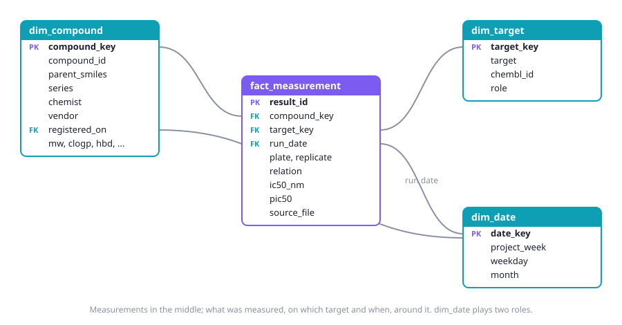

[Module 1](../01-lab-data-architecture/) built the lab's three layers and two marts, each made for
one question. [Module 2](../02-declarative-ingestion/) handed the raw layer to dlt. This module
designs the marts properly. The chemists keep asking new questions, and a warehouse cannot add a
mart for each one: it needs one shape that answers questions nobody has asked yet.

That shape is the **star schema**, which [Series 1, Module
4](../../series-1/04-databases-and-schemas/) introduced: a **fact table** of measurements in the
middle, and **dimension tables** around it that describe the who, what and when of each
measurement. There we reshaped a small normalised database to see the idea. Here we design a star
from the start, for a real project, and meet the decisions that come with it: what one row of the
fact table means, which descriptions belong in which dimension, which keys to use, and which
numbers may be added up or averaged.

By the end of this module you will be able to:

- design a star schema in the four steps data teams use: the process, the grain, the dimensions
  and the facts;
- build a compound dimension that works out chemistry once (properties, and the chemical series by
  substructure) so that no query has to;
- use a date dimension in more than one role, and surrogate keys, and say why each matters;
- make the database enforce the star's keys with primary and foreign key constraints;
- tell additive measures from those that cannot be summed or averaged as they are, and handle
  results reported only as "weaker than";
- answer the chemists' questions from the star, and build a wide table for dashboards from it.

## Setup

The raw and staging layers come from the earlier modules. `labstack.py`, in the series folder,
holds their code as those modules wrote it: `labstack.load_raw` runs Module 2's dlt pipeline for
the first six weeks of the lab, and `labstack.stage` creates Module 1's staging views on top. The
chemistry comes from RDKit: `Chem` reads SMILES, and `Crippen`, `Descriptors` and `Lipinski` work
out properties.

```python
import logging
import shutil
from pathlib import Path

import duckdb
import pandas as pd
from rdkit import Chem, RDLogger
from rdkit.Chem import Crippen, Descriptors, Lipinski

import labdata
import labstack

RDLogger.DisableLog("rdApp.*")  # RDKit's warnings would clutter the outputs; we check structures
logging.basicConfig(level=logging.INFO, format="%(levelname)s %(message)s", force=True)
log = logging.getLogger(__name__)

# where the lesson writes its files (git-ignored); change it to write somewhere else
WORK = Path("work")
WAREHOUSE = WORK / "lab.duckdb"
WEEKS = 6  # the lab is at the end of week 6, as in Modules 1 and 2
# the three chemical series, each as the substructure its compounds share (its core)
SERIES = {
    "aminopyrimidines": "c1ccc(nc1)Nc2ncccn2",
    "pyrimidine piperazines": "c1nccc(n1)N2CCN(CC2)C(=O)c3ccccc3",
    "ureas": "O=C(Nc1ccccc1)Nc2cccnc2",
}

shutil.rmtree(WORK, ignore_errors=True)  # start clean
lab = labdata.Lab()
labstack.load_raw(lab, WEEKS, WORK / "inbox", WAREHOUSE, WORK / "dlt")
db = duckdb.connect(str(WAREHOUSE))
labstack.stage(db)
db.execute("CREATE SCHEMA marts")
```

## 1. Four decisions

The chemists' questions this week:

1. How potent is each compound on EGFR, and is each series getting better week by week?
2. Which chemist's compounds are the most potent, and which vendor's building blocks work best?
3. Are the potent compounds just the greasy ones? (Potency often rises with lipophilicity, which
   brings problems of its own.)
4. Which compounds are potent on EGFR and weak on the four other kinases?

They share a pattern. Each asks for a **number** (a potency) about a **measurement**, sliced by
**descriptions** of what was measured: the compound's series, chemist, vendor or properties, the
target, the week. That is exactly what a star separates: the numbers go in the fact table, the
descriptions in the dimensions. Kimball and Ross, who wrote the standard book on this, design a
star in four steps, and this module follows them:

1. **The process.** Which activity of the lab do we record? Measuring compounds in assays.
2. **The grain.** What exactly is one row of the fact table?
3. **The dimensions.** What describes each row?
4. **The facts.** Which numbers does each row hold?



## 2. The grain

The **grain** says what one row of the fact table stands for, in one sentence. It is the decision
everything else depends on: a fact table whose rows mean different things is how a warehouse
starts giving wrong totals. The finest grain the lab has is one result from the plate reader, so
we choose that: *one row per measurement of one compound on one target, in one well of one plate
(one replicate)*. A coarser grain (one row per compound and target, averaged) would answer
question 1, but no question about plates or weeks could ever be asked of it again. Start at the
finest grain; averages can always be made from it, never the other way round.

A grain is a claim, so we check it: the columns that name it must identify every row once.

```python
print(db.sql("""
    SELECT count(*)                                                  AS results,
           count(DISTINCT (compound_id, target, plate, replicate))   AS distinct_at_grain
    FROM staging.results
""").df().to_string(index=False))
```
```output
 results  distinct_at_grain
     656                656
```


Every result is one compound, one target, one plate, one replicate. If two rows had shared those
four, the grain would be wrong (or the data would hold a duplicate) and we would have to find out
which before going on.

## 3. The compound dimension

A dimension has one row per thing it describes, with every description a question might slice
by. For a compound that is its structure, salt, chemist, vendor and registration date, from the
registry, and also things the registry does not say but chemists ask about: its chemical series,
and properties such as molecular weight and lipophilicity.

Working those out is chemistry, and doing it in the dimension means doing it **once**. Every query
and every dashboard then reads the same series and the same cLogP, instead of each one computing
its own (and getting slightly different answers, with slightly different code). Here is the
chemistry, as Python functions:

- the **series** is the one whose core the compound contains (`HasSubstructMatch`). A core
  written as SMILES and used as a query matches any molecule that contains it, whatever is
  attached; [Series 1, Module 2](../../series-1/02-text-patterns-and-numbers/), section 6, showed
  where that is a trap, but here it is exactly what we want. A compound matching no core, or more
  than one, gets no series, so that a person looks at it;
- the properties come from RDKit (Series 1, Module 2, section 8): molecular weight, **cLogP** (Crippen's estimate of the
  octanol-water partition coefficient, a measure of how greasy a molecule is), hydrogen-bond
  donors and acceptors, and the number of heavy (non-hydrogen) atoms.

```python
CORES = {name: Chem.MolFromSmiles(core) for name, core in SERIES.items()}


def series_of(mol: Chem.Mol) -> str | None:
    """The chemical series whose core the molecule contains (None if no core, or several)."""
    hits = [name for name, core in CORES.items() if mol.HasSubstructMatch(core)]
    return hits[0] if len(hits) == 1 else None


def describe(smiles: str) -> dict:
    """A compound's series and properties, worked out once for the dimension."""
    mol = Chem.MolFromSmiles(smiles)
    return {
        "series": series_of(mol),
        "mw": round(Descriptors.MolWt(mol), 1),
        "clogp": round(Crippen.MolLogP(mol), 2),
        "hbd": Lipinski.NumHDonors(mol),
        "hba": Lipinski.NumHAcceptors(mol),
        "heavy_atoms": mol.GetNumHeavyAtoms(),
    }


compounds = db.sql("SELECT * FROM staging.compounds ORDER BY compound_id").df()
chemistry = pd.DataFrame([describe(s) for s in compounds["parent_smiles"]])
compounds = pd.concat([compounds, chemistry], axis=1)
print(compounds["series"].value_counts(dropna=False).to_string())
print(compounds[compounds["series"].isna()][["compound_id", "parent_smiles"]]
      .to_string(index=False))
```
```output
series
aminopyrimidines          132
pyrimidine piperazines     55
ureas                      52
NaN                         1
compound_id                   parent_smiles
   LAB-0042 O=C(Cc1ccc(O)cc1)Nc2ccc(C#N)nc2
```

Every compound fell into one series but one: `LAB-0042`. Its SMILES starts `O=C(Cc1...`, where a
urea would start `O=C(Nc1...`: one nitrogen was registered as a carbon. The dimension did not
guess a series for it; it left the gap where a person will see it. (The registry is corrected in
week 7, and [Module 6](../06-history-and-corrections/) keeps both versions.) A dimension built
with care is also a check on the data it describes.

Now the table. We create it with its columns and types written out, and a **primary key**: a
column whose values the database guarantees are present and unique. The key is not the
`compound_id` the lab uses but a new number, `compound_key`, given by the warehouse. That is a
**surrogate key**. The lab's own ID (the **natural key**) stays in the table, but the warehouse's
joins use the surrogate. The reason comes in Module 6: when LAB-0042's structure is corrected, the
dimension will hold two versions of the same compound, both with the ID `LAB-0042`, and only a key
of the warehouse's own can tell them apart.

```python
db.execute("""
    CREATE TABLE marts.dim_compound (
        compound_key  INTEGER PRIMARY KEY,
        compound_id   VARCHAR NOT NULL,
        parent_smiles VARCHAR NOT NULL,
        salt          VARCHAR,
        series        VARCHAR,
        chemist       VARCHAR,
        vendor        VARCHAR,
        registered_on DATE,
        mw            DOUBLE,
        clogp         DOUBLE,
        hbd           INTEGER,
        hba           INTEGER,
        heavy_atoms   INTEGER
    )
""")
db.execute("""
    INSERT INTO marts.dim_compound
    SELECT row_number() OVER (ORDER BY compound_id), compound_id, parent_smiles, salt, series,
           chemist, vendor, registered_on, mw, clogp, hbd, hba, heavy_atoms
    FROM compounds
""")
print(db.sql("SELECT * FROM marts.dim_compound LIMIT 3").df().to_string(index=False))
```
```output
 compound_key compound_id                                             parent_smiles salt                 series chemist   vendor registered_on    mw  clogp  hbd  hba  heavy_atoms
            1    LAB-0001     c1nc(c8ccco8)cc(n1)N2CCN(CC2)C(=O)c3ccc(OC(F)(F)F)cc3      pyrimidine piperazines      CN Vendor A    2026-09-11 418.4   3.60    0    6           30
            2    LAB-0002         c1cc(CC)c(nc1)Nc2nc(c8ccco8)c(c8ccc(F)cc8)c(OC)n2  TFA       aminopyrimidines      AO Vendor C    2026-09-11 390.4   5.25    1    6           29
            3    LAB-0003 c1cc(C(C)C)c(nc1)Nc2nc(N(C)C)c(c8cn[nH]c8)c(c8cn[nH]c8)n2            aminopyrimidines      AO Vendor A    2026-09-11 389.5   3.58    3    7           29
```

`FROM compounds` reads the pandas table of that name directly: DuckDB can query a pandas table in
the same Python session as if it were one of its own. `row_number() OVER (ORDER BY compound_id)`
numbers the compounds 1, 2, 3 and so on, which becomes their surrogate key.

## 4. Targets and dates

The target dimension is small: one row per kinase, with its ChEMBL ID and its role in the project.
It is also **conformed**: when ChEMBL's activities join the warehouse, they will use the same
`dim_target`, so the lab's own potencies and published ones line up target by target.

```python
targets = pd.DataFrame(
    [(gene, chembl_id, "primary" if gene == labdata.PRIMARY else "panel")
     for gene, chembl_id in labdata.TARGETS.items()],
    columns=["target", "chembl_id", "role"],
)
db.execute("""
    CREATE TABLE marts.dim_target (
        target_key INTEGER PRIMARY KEY,
        target     VARCHAR NOT NULL UNIQUE,
        chembl_id  VARCHAR NOT NULL,
        role       VARCHAR NOT NULL
    )
""")
db.execute("INSERT INTO marts.dim_target "
           "SELECT row_number() OVER (ORDER BY role DESC, target), * FROM targets")
print(db.sql("SELECT * FROM marts.dim_target ORDER BY target_key").df().to_string(index=False))
```
```output
 target_key target  chembl_id    role
          1   EGFR  CHEMBL203 primary
          2   ABL1 CHEMBL1862   panel
          3   BRAF CHEMBL5145   panel
          4   CDK2  CHEMBL301   panel
          5   JAK2 CHEMBL2971   panel
```

`ORDER BY role DESC` puts the primary target first (`primary` sorts after `panel`, and `DESC`
reverses that), so EGFR gets key 1. `UNIQUE` asks the database to keep each gene name once.

Dates get a dimension too, although a date seems to describe itself. The chemists think in the
project's weeks, the managers in months, and a query should not have to work out "week 4 of the
project" from a date each time. The **date dimension** has one row per day of the project and a
column for each way of grouping days. DuckDB's `generate_series` makes the days, and the date
itself is the key: a date is unique and never changes, so it needs no surrogate.

```python
db.execute(f"""
    CREATE TABLE marts.dim_date AS
    SELECT day::DATE                                            AS date_key,
           (datediff('day', DATE '{labdata.START}', day) // 7) + 1 AS project_week,
           isodow(day) > 5                                      AS weekend,
           dayname(day)                                         AS weekday,
           monthname(day)                                       AS month
    FROM generate_series(DATE '{labdata.START}',
                         DATE '{labdata.monday(labdata.WEEKS + 1)}', INTERVAL 1 DAY) AS t(day)
""")
db.execute("ALTER TABLE marts.dim_date ADD PRIMARY KEY (date_key)")
print(db.sql("SELECT * FROM marts.dim_date WHERE date_key BETWEEN DATE '2026-09-16' "
             "AND DATE '2026-09-21'").df().to_string(index=False))
```
```output
  date_key  project_week  weekend   weekday     month
2026-09-16             2    False Wednesday September
2026-09-17             2    False  Thursday September
2026-09-18             2    False    Friday September
2026-09-19             2     True  Saturday September
2026-09-20             2     True    Sunday September
2026-09-21             3    False    Monday September
```

`//` divides and keeps the whole part, so days 0 to 6 of the project fall in week 1, days 7 to 13
in week 2. The same date dimension serves two **roles**: the date a measurement was run (from the
fact table) and the date a compound was registered (from `dim_compound`). A dimension used in
several roles is called a **role-playing dimension**, and it means that "project week" is worked
out one way for both.

## 5. The fact table

The fact table holds, for each measurement at the grain, a key to each dimension and the
measurements themselves. Its keys are **foreign keys**: each value must exist in the dimension it
points to, and the database checks that on every insert. A measurement of a compound the
dimension does not know is refused, instead of quietly dropping out of every join later.

Some descriptions belong to a single measurement and to no dimension: the plate, the replicate,
the result ID and the file it came from. They stay in the fact table as **degenerate dimensions**
(a dimension with nothing to describe but its own value).

```python
db.execute("""
    CREATE TABLE marts.fact_measurement (
        result_id    VARCHAR PRIMARY KEY,
        compound_key INTEGER NOT NULL REFERENCES marts.dim_compound (compound_key),
        target_key   INTEGER NOT NULL REFERENCES marts.dim_target (target_key),
        run_date     DATE    NOT NULL REFERENCES marts.dim_date (date_key),
        plate        VARCHAR NOT NULL,
        replicate    INTEGER NOT NULL,
        relation     VARCHAR NOT NULL,
        ic50_nm      DOUBLE,
        pic50        DOUBLE,
        source_file  VARCHAR NOT NULL
    )
""")
db.execute("""
    INSERT INTO marts.fact_measurement
    SELECT r.result_id, c.compound_key, t.target_key, r.run_date, r.plate, r.replicate,
           r.relation, r.ic50_nm, r.pic50, r.source_file
    FROM staging.results AS r
    JOIN marts.dim_compound AS c USING (compound_id)
    JOIN marts.dim_target AS t USING (target)
""")
print(db.sql("SELECT count(*) AS measurements FROM marts.fact_measurement").fetchall()[0][0],
      "measurements in the fact table, of", db.sql("SELECT count(*) FROM staging.results")
      .fetchall()[0][0], "in staging")
```
```output
656 measurements in the fact table, of 656 in staging
```

The two counts must agree: a staging result whose compound or target was missing from a dimension
would have been dropped by the joins. Now watch the database refuse a measurement of a compound it
does not know (key 9999). `duckdb.ConstraintException` is the error DuckDB raises when a
constraint is broken:

```python
try:
    db.execute("""
        INSERT INTO marts.fact_measurement
        VALUES ('R-TEST', 9999, 1, DATE '2026-09-16', 'P02-01', 1, '=', 10.0, 8.0, 'test.csv')
    """)
except duckdb.ConstraintException as error:
    log.error("refused: %s", str(error).splitlines()[0])
```
```output
ERROR refused: Constraint Error: Violates foreign key constraint because key "compound_key: 9999" does not exist in the referenced table
```

Constraints cost a little time on every insert and save a great deal of time later. A warehouse
that does not enforce them (several large cloud warehouses only record them) needs tests instead,
which is what [Module 5](../05-tests-and-contracts/) adds with dbt.

## 6. Which numbers can be averaged

The facts are `ic50_nm` and `pic50`, with `relation` saying whether each is a measured value (`=`)
or only a bound (`>`, weaker than the highest concentration tested). Facts come in three kinds:

- **additive** facts can be summed across every dimension (a count of measurements, an amount in
  milligrams);
- **semi-additive** facts can be summed across some dimensions but not others (stock in a
  freezer: sum across freezers, but not across days);
- **non-additive** facts cannot be summed at all, and must be averaged or combined with care.

Potencies are non-additive, and they have a trap of their own. An IC50 is a concentration, and
IC50s spread over orders of magnitude, so their plain average is pulled up by the weakest few. The
right average is taken on the log scale: the mean pIC50, which is the same as the **geometric
mean** of the IC50s. Here are both, by series, for EGFR:

```python
print(db.sql("""
    SELECT c.series,
           count(*)                                    AS measured,
           round(avg(f.ic50_nm))                       AS mean_ic50_nm,
           round(10 ** (9 - avg(f.pic50)))             AS geometric_mean_nm,
           round(avg(f.pic50), 2)                      AS mean_pic50
    FROM marts.fact_measurement AS f
    JOIN marts.dim_compound AS c USING (compound_key)
    JOIN marts.dim_target AS t USING (target_key)
    WHERE t.target = 'EGFR' AND f.relation = '='
    GROUP BY ALL ORDER BY mean_pic50 DESC
""").df().to_string(index=False))
```
```output
                series  measured  mean_ic50_nm  geometric_mean_nm  mean_pic50
                   NaN         2          14.0               12.0        7.91
      aminopyrimidines       214         562.0              206.0        6.69
pyrimidine piperazines        98         314.0              222.0        6.65
                 ureas        86         589.0              330.0        6.48
```


The plain mean of the IC50s is larger than the geometric mean in every series, nearly three
times larger for the aminopyrimidines: a handful of weak compounds decide it. Worse, it changes
the order. By the plain mean, the pyrimidine piperazines look the best series (314 nM against
562 nM); by the geometric mean, and so by pIC50, the aminopyrimidines are (206 nM against 222 nM).
A dashboard that averaged `ic50_nm` would rank the series by their weakest compounds. (The row
with no series is LAB-0042, the compound of section 3.) In the warehouse, the rule goes where
everyone will see it: potencies are averaged as pIC50, and only measured values (`=`) are
averaged.

The bounds need their own rule. A result reported as `> 30 µM` is not 30 µM; it is "too weak to
measure here", and averaging it in as 30 µM would make a weak compound look stronger than it is.
They are counted, not averaged:

```python
print(db.sql("""
    SELECT t.target,
           count(*)                                    AS results,
           count(*) FILTER (WHERE f.relation = '>')    AS too_weak_to_measure
    FROM marts.fact_measurement AS f JOIN marts.dim_target AS t USING (target_key)
    GROUP BY ALL ORDER BY results DESC, t.target
""").df().to_string(index=False))
```
```output
target  results  too_weak_to_measure
  EGFR      400                    0
  ABL1       64                    8
  BRAF       64                    7
  CDK2       64                   19
  JAK2       64                   13
```

No EGFR result is a bound (the compounds were made for EGFR), but almost a third of the CDK2
results are. On the panel, "too weak to measure" is the result the project hopes for, so a mart
that dropped the bounds would throw away the best news about selectivity.

## 7. The questions, answered from the star

Every question now has the same shape: the fact table, joined to the dimensions it needs, grouped
by the descriptions it slices by. Question 1, the series week by week, uses the date dimension in
its *registration* role: each EGFR measurement counts towards the week its compound was
registered, so a week's row shows how good that week's new compounds were:

```python
print(db.sql("""
    SELECT d.project_week AS registered_in_week, c.series,
           count(DISTINCT c.compound_key) AS compounds, round(avg(f.pic50), 2) AS mean_pic50
    FROM marts.fact_measurement AS f
    JOIN marts.dim_compound AS c USING (compound_key)
    JOIN marts.dim_target AS t USING (target_key)
    JOIN marts.dim_date AS d ON d.date_key = c.registered_on
    WHERE t.target = 'EGFR' AND f.relation = '=' AND c.series IS NOT NULL
    GROUP BY ALL ORDER BY c.series, registered_in_week
""").df().pivot(index="registered_in_week", columns="series", values="mean_pic50")
    .to_string())
```
```output
series              aminopyrimidines  pyrimidine piperazines  ureas
registered_in_week                                                 
1                               6.90                    6.60   6.40
2                               6.59                    6.69   6.50
3                               6.58                    6.64   6.67
4                               6.58                    6.77   6.19
5                               6.77                    6.58   6.47
```

`pivot` (pandas) turns the series into columns, so each series reads down the page. Week 6's
compounds have not been tested yet: they are tested the week after they are registered.

Question 3 needs a property and a potency together, which is where computing cLogP in the
dimension pays off. Medicinal chemists combine them as **lipophilic efficiency** (LipE, also
called LLE): pIC50 minus cLogP. A compound that gains potency only by gaining greasiness keeps the
same LipE; real improvements raise it. The query computes it for each compound's mean EGFR
potency, then compares the series:

```python
print(db.sql("""
    WITH per_compound AS (
        SELECT c.compound_key, c.series, c.clogp, avg(f.pic50) AS pic50
        FROM marts.fact_measurement AS f
        JOIN marts.dim_compound AS c USING (compound_key)
        JOIN marts.dim_target AS t USING (target_key)
        WHERE t.target = 'EGFR' AND f.relation = '=' AND c.series IS NOT NULL
        GROUP BY ALL
    )
    SELECT series, count(*) AS compounds,
           round(avg(pic50), 2) AS mean_pic50, round(avg(clogp), 2) AS mean_clogp,
           round(avg(pic50 - clogp), 2) AS mean_lipe,
           round(corr(pic50, clogp), 2) AS potency_vs_clogp
    FROM per_compound GROUP BY ALL ORDER BY mean_lipe DESC
""").df().to_string(index=False))
```
```output
                series  compounds  mean_pic50  mean_clogp  mean_lipe  potency_vs_clogp
pyrimidine piperazines         49        6.65        2.37       4.29              0.18
      aminopyrimidines        107        6.69        3.04       3.65              0.04
                 ureas         43        6.48        3.64       2.85              0.19
```

`corr` is the correlation between two columns, from −1 to 1: near 0 means potency does not simply
follow greasiness in that series. The aminopyrimidines are the most potent series on average, but
the pyrimidine piperazines reach almost the same potency with much lower cLogP, so their LipE is
the highest. That difference is what the question was really after. (The lab's
potencies are synthetic: the numbers here show how to ask the question, not a finding about real
kinase inhibitors.)

## 8. A wide table for dashboards

Dashboard tools and spreadsheets read one table more easily than five. A common answer is a
**wide table** (some call it "one big table"): the star, joined once, with every description next
to every measurement. It is not a replacement for the star. It repeats each compound's
descriptions on every one of its measurements, and it is built *from* the star, so the rules (one
series per compound, one definition of a project week) are the star's. We make it a view, so it
always matches the tables beneath:

```python
db.execute("""
    CREATE VIEW marts.measurements_wide AS
    SELECT f.result_id, f.plate, f.replicate, f.relation, f.ic50_nm, f.pic50,
           c.compound_id, c.parent_smiles, c.series, c.chemist, c.vendor, c.mw, c.clogp,
           t.target, t.role AS target_role,
           d.date_key AS run_date, d.project_week AS run_week
    FROM marts.fact_measurement AS f
    JOIN marts.dim_compound AS c USING (compound_key)
    JOIN marts.dim_target AS t USING (target_key)
    JOIN marts.dim_date AS d ON d.date_key = f.run_date
""")
wide = db.sql("SELECT * FROM marts.measurements_wide").df()
print(len(wide), "rows,", len(wide.columns), "columns")
print(wide.query("relation == '='").groupby(["chemist", "target"])["pic50"].mean().round(2)
      .unstack().to_string())
```
```output
656 rows, 17 columns
target   ABL1  BRAF  CDK2  EGFR  JAK2
chemist                              
AO       5.59  5.17  5.58  6.55  5.27
BK       5.32  5.59  5.39  6.49  5.36
CN       5.17  5.43  5.31  6.78  5.31
DS       5.29  5.40  5.60  6.72  5.60
```

Question 2, by chemist, is a one-line `groupby` on the wide table, which is exactly what a
dashboard does. Here is what the warehouse holds now:

```python
print(db.sql("""
    SELECT table_name, table_type FROM information_schema.tables
    WHERE table_schema = 'marts' ORDER BY table_type, table_name
""").df().to_string(index=False))
db.close()
```
```output
       table_name table_type
     dim_compound BASE TABLE
         dim_date BASE TABLE
       dim_target BASE TABLE
 fact_measurement BASE TABLE
measurements_wide       VIEW
```

Four tables, with keys the database enforces, and a view for the tools that want everything in one
place. In [Module 4](../04-transformations-with-lineage/), dbt takes over building them: each table
becomes a SQL file, dbt works out the order to build them in, and the chemistry of the compound
dimension moves into a Python model that dbt runs as well.

## Try it yourself

The homework is a few questions, answered by running code like the code above: in a new cell at
the end of the notebook, or in a script. It is at the end of the lesson's page, and in
`homework.md` in the module's folder. The answers are published after the cohort's deadline.

## Further reading

- Kimball, R. & Ross, M. (2013). *The Data Warehouse Toolkit: The Definitive Guide to Dimensional
  Modeling* (3rd ed.). Wiley. Chapters 1 to 3: the four steps, grain, facts and dimensions,
  surrogate keys and date dimensions.
- The DuckDB documentation. *Constraints*: primary keys, foreign keys, `UNIQUE`, `NOT NULL` and
  `CHECK`, and what DuckDB enforces. <https://duckdb.org/docs/stable/sql/constraints>
- Leeson, P. D. & Springthorpe, B. (2007). The influence of drug-like concepts on decision-making
  in medicinal chemistry. *Nature Reviews Drug Discovery*, 6(11), 881–890.
  <https://doi.org/10.1038/nrd2445>
- Hopkins, A. L., Keserü, G. M., Leeson, P. D., Rees, D. C. & Reynolds, C. H. (2014). The role of
  ligand efficiency metrics in drug discovery. *Nature Reviews Drug Discovery*, 13(2), 105–121.
  <https://doi.org/10.1038/nrd4163>
- Reis, J. & Housley, M. (2022). *Fundamentals of Data Engineering*. O'Reilly Media. Chapter 8,
  on data modelling for analytics: Kimball, Inmon, Data Vault and wide tables compared.
