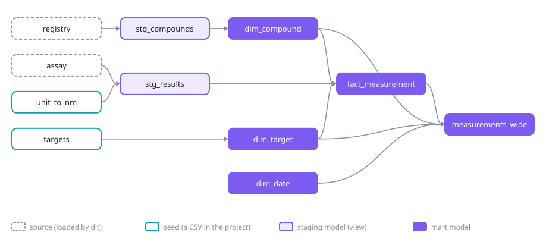
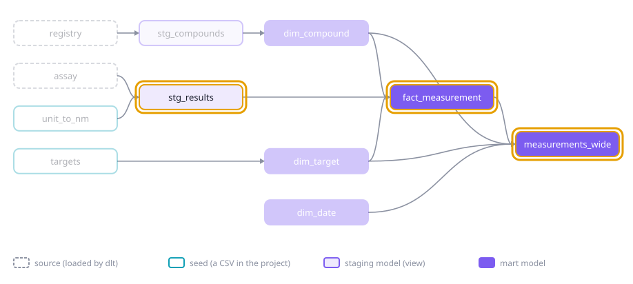

In Modules [1](../01-lab-data-architecture/) and [3](../03-modelling-the-warehouse/) we built the
staging and mart layers with SQL statements run one after another from Python. That works for one
person on one afternoon. It stops working when the warehouse grows: the order of the statements
lives in one script and in its author's head, a change to a staging view means working out by hand
which marts to rebuild, and nobody can see at a glance where a column in a dashboard came from. In
Series 1 the [capstone](../../series-1/15-capstone/)'s `pipeline.py` had the same problem, solved
with careful code.

**dbt** (data build tool) is the open-source tool most data teams use for this layer. In dbt each
table or view is a **model**: one `SELECT` statement in its own file, named after the table it
makes. A model names the models it reads with `ref('...')` instead of writing table names, and from
those references dbt works out the order to build everything in, builds it, and records the
**lineage**: which tables each one was built from, all the way back to the raw layer. dbt does not
store or move data itself. It turns each model into SQL and sends that SQL to the warehouse (here
DuckDB, through the dbt-duckdb **adapter**), so the work happens where the data already is.

By the end of this module you will be able to:

- set up a dbt project and its connection to DuckDB;
- declare the raw tables dlt loads as **sources**, and small decision tables as **seeds**;
- write the lab's staging and mart layers as models that reference each other, including a Python
  model that works out the chemistry of the compound dimension with RDKit;
- build the whole project in the right order with one command, and see the SQL dbt sent;
- read the lineage, select a model with everything upstream or downstream of it, and rebuild only
  what a change affects;
- document models and columns, and generate the documentation site.

## Setup

The raw layer comes from Module 2's dlt pipeline, as in Module 3 (`labstack.load_raw`, for the
first six weeks). dbt is run from Python with `dbtRunner`, which does exactly what typing `dbt` and
its arguments in a terminal does; that way the lesson runs the same in a notebook. Three settings
help: `write` saves a file of the dbt project (each one shown in full in the lesson); `dbt` runs a
dbt command on the project and logs what it built; and one environment variable stops dbt sending
anonymous usage statistics to its makers.

```python
import json
import logging
import os
import shutil
from pathlib import Path

import duckdb
import pandas as pd
from dbt.cli.main import dbtRunner

import labdata
import labstack

os.environ["DBT_SEND_ANONYMOUS_USAGE_STATS"] = "false"  # no usage statistics sent to dbt's makers
logging.basicConfig(level=logging.INFO, format="%(levelname)s %(message)s", force=True)
log = logging.getLogger(__name__)

# where the lesson writes its files (git-ignored); change it to write somewhere else
WORK = Path("work")
WAREHOUSE = WORK / "lab.duckdb"
PROJECT = WORK / "lab_dbt"  # the lab's dbt project: one folder of text files
WEEKS = 6  # the lab is at the end of week 6, as in Modules 1 to 3

shutil.rmtree(WORK, ignore_errors=True)  # start clean
lab = labdata.Lab()
labstack.load_raw(lab, WEEKS, WORK / "inbox", WAREHOUSE, WORK / "dlt")


def write(name: str, text: str) -> None:
    """Save one file of the dbt project (made, with its folders, if it is new)."""
    path = PROJECT / name
    path.parent.mkdir(parents=True, exist_ok=True)
    path.write_text(text.lstrip("\n"), encoding="utf-8", newline="\n")


def dbt(*args: str):
    """Run a dbt command on the lab's project, like `dbt <args>` in a terminal; log what it did."""
    result = dbtRunner().invoke(
        [*args, "--quiet", "--project-dir", str(PROJECT), "--profiles-dir", str(PROJECT)]
    )
    if result.exception:
        raise result.exception
    if args[0] in ("build", "run", "seed", "test"):
        for item in result.result:
            log.info("%s %s: %s", item.node.resource_type, item.node.name, item.status)
        broken = [item.node.name for item in result.result if item.status == "error"]
        if broken:
            raise RuntimeError(f"dbt could not build {broken}: see {PROJECT}/logs/dbt.log")
    return result.result


def query(sql: str) -> pd.DataFrame:
    """Run one SQL query on the warehouse and return the answer as a table."""
    with duckdb.connect(str(WAREHOUSE)) as db:
        return db.sql(sql).df()
```

`--quiet` keeps dbt's own messages (which carry times that change on every run) off the screen;
the `dbt` function logs one line per thing built instead, and stops the lesson if anything could not
be built (dbt's full log, with the reason, is in the project's `logs/` folder). `query` opens the database only for as
long as one query takes, so it never holds the file while dbt is writing to it.

## 1. A dbt project

A dbt project is a folder of text files. The first, `dbt_project.yml`, names the project and sets
defaults for its folders. It is written in **YAML**, a format for settings where indentation shows
what belongs to what (Series 1 used it for [pandera-chem's
rules](../../series-1/12-validating-data/)). Ours says that models in `models/staging/` become
views in the `staging` schema and models in `models/marts/` become tables in `marts`, the layers of
Module 1. How a model is stored is its **materialization**: a `view` is rebuilt every time it is
read, a `table` is stored once per build. Staging is cheap to read and should always be current, so
it is views; marts are read often by dashboards, so they are tables.

```python
write("dbt_project.yml", """
name: lab
version: "1.0.0"
profile: lab

vars:  # settings the models read with var('...')
  project_start: "2026-09-07"  # the Monday of week 1
  project_end: "2026-11-30"  # the Monday after week 12

models:
  lab:
    staging:
      +schema: staging
      +materialized: view
    marts:
      +schema: marts
      +materialized: table

seeds:
  lab:
    +schema: staging
""")
```

The second file says how to reach the warehouse. dbt calls it a **profile**, and it usually lives
outside the project (it often holds passwords); ours has none, so it sits in the project folder.
`env_var('LAB_WAREHOUSE', 'work/lab.duckdb')` reads the database's path from an environment
variable, with a default for when it is not set: the same project can then build a copy of the
warehouse for testing ([Module 9](../09-continuous-integration/) does exactly that) without
changing a file.

```python
write("profiles.yml", """
lab:
  target: dev
  outputs:
    dev:
      type: duckdb
      path: "{{ env_var('LAB_WAREHOUSE', 'work/lab.duckdb') }}"
      threads: 1
""")
```

The `{{ ... }}` is **Jinja**, a template language: dbt fills in everything between double braces
before using a file. Models use it too. The last setting file is a small **macro**, a reusable
piece of Jinja. By default dbt puts a model whose schema is `staging` into a schema called
`main_staging` (the default schema's name, then the model's), which keeps different people's builds
apart in a shared warehouse. Ours is one person's file, so this macro, which replaces dbt's own
`generate_schema_name`, keeps the names as written:

```python
write("macros/generate_schema_name.sql", """

    {{ custom_schema_name or target.schema }}

""")
```

## 2. Sources and seeds

The raw tables are not built by dbt; dlt loads them. dbt still needs to know about them, so that
models can read them by name and the lineage starts at the right place. Tables that something else
loads are **sources**, declared in a YAML file. A description on each makes the documentation say
where they come from:

```python
write("models/staging/_sources.yml", """
sources:
  - name: raw
    description: The lab's files, loaded unchanged by dlt (Module 2).
    schema: raw
    tables:
      - name: registry
        description: The latest compound registry export. Replaced on every load.
      - name: assay
        description: Every row of every assay file, merged on result_id.
""")
```

Some tables are neither loaded nor computed: they are **decisions**, such as which unit spellings
mean micromolar (Module 1 made that table with SQL). dbt's place for those is a **seed**, a small
CSV file in the project. It is kept in version control next to the models, so a change to it is
reviewed like a change to code, and `dbt seed` loads it into the warehouse. The targets are a
decision too: which kinases the project measures, and which is the primary target.

```python
write("seeds/unit_to_nm.csv", """
unit,factor
nM,1.0
µM,1000.0
uM,1000.0
μM,1000.0
""")
targets = pd.DataFrame(
    [(gene, chembl_id, "primary" if gene == labdata.PRIMARY else "panel")
     for gene, chembl_id in labdata.TARGETS.items()],
    columns=["target", "chembl_id", "role"],
)
write("seeds/targets.csv", targets.to_csv(index=False, lineterminator="\n"))
dbt("seed")
print(query("SELECT * FROM staging.targets").to_string(index=False))
```
```output
INFO seed targets: success
INFO seed unit_to_nm: success
target  chembl_id    role
  EGFR  CHEMBL203 primary
  ABL1 CHEMBL1862   panel
  BRAF CHEMBL5145   panel
  CDK2  CHEMBL301   panel
  JAK2 CHEMBL2971   panel
```

## 3. Staging models

A model is a `SELECT` with no `CREATE` around it: dbt adds that, according to the model's
materialization. Here is Module 1's `staging.compounds`, as a model. The only change is the `FROM`:
`{{ source('raw', 'registry') }}` instead of a table name.

```python
write("models/staging/stg_compounds.sql", """
-- the current registry: one row per compound, the salt split from the parent that was tested
select compound_id,
       smiles                      as smiles_as_registered,
       split_part(smiles, '.', 1)  as parent_smiles,
       coalesce(salt, '')          as salt,
       batch::integer              as batch,
       chemist,
       vendor,
       registered_on::date         as registered_on
from {{ source('raw', 'registry') }}
""")
```

The results read a source and a seed. A seed is referenced like a model, with `ref`:

```python
write("models/staging/stg_results.sql", """
-- one row per result: the unit columns joined back together, every value in nanomolar
with typed as (
    select result_id, compound_id, target, plate,
           replicate::integer      as replicate,
           relation,
           value::double           as value,
           coalesce(unit, units)   as unit,  -- 'units' was renamed 'unit' in week 5
           run_date::date          as run_date,
           file_name
    from {{ source('raw', 'assay') }}
)
select typed.* exclude (file_name),
       value * u.factor              as ic50_nm,
       9 - log10(value * u.factor)   as pic50,
       file_name                     as source_file
from typed
left join {{ ref('unit_to_nm') }} as u using (unit)
""")
dbt("run", "--select", "staging")
```
```output
INFO model stg_compounds: success
INFO model stg_results: success
```

`--select staging` builds only the models in the `staging` folder. Before sending a model to the
warehouse, dbt **compiles** it: it fills in the Jinja and wraps the `SELECT` in the statement its
materialization needs. The compiled SQL is kept in the project's `target/` folder, so you can always
see exactly what dbt ran:

```python
compiled = PROJECT / "target" / "compiled" / "lab" / "models" / "staging" / "stg_results.sql"
print("\n".join(compiled.read_text(encoding="utf-8").splitlines()[-3:]))
```
```output
       file_name                     as source_file
from typed
left join "lab"."staging"."unit_to_nm" as u using (unit)
```

`ref('unit_to_nm')` became `"lab"."staging"."unit_to_nm"`: the database (`lab`, after the file's
name), the schema and the table. Write `ref` and `source`, never the table name: they are how dbt
learns the order and the lineage.


## 4. The marts

The marts are Module 3's star. The target dimension adds a surrogate key to the seed. The date
dimension reads the project's dates from `vars`, so a longer project changes one setting:

```python
write("models/marts/dim_target.sql", """
-- one row per kinase; the primary target gets key 1
select row_number() over (order by role desc, target) as target_key,
       target, chembl_id, role
from {{ ref('targets') }}
""")
write("models/marts/dim_date.sql", """
-- one row per day of the project, with each way the lab groups days
with days as (
    select day::date as date_key
    from generate_series(date '{{ var("project_start") }}', date '{{ var("project_end") }}',
                         interval 1 day) as t(day)
)
select date_key,
       (datediff('day', date '{{ var("project_start") }}', date_key) // 7) + 1 as project_week,
       isodow(date_key) > 5   as weekend,
       dayname(date_key)      as weekday,
       monthname(date_key)    as month
from days
""")
```

The compound dimension needs RDKit, which SQL cannot call. dbt-duckdb also runs **Python models**:
a file with a function `model(dbt, session)` that returns a table. `dbt.ref(...)` reads another
model, and whatever the function returns becomes the model's table. The chemistry is Module 3's,
moved into the project, so that it is built, ordered and documented like everything else:

```python
write("models/marts/dim_compound.py", '''
"""One row per compound, with its series and properties worked out once (Module 3)."""
from rdkit import Chem, RDLogger
from rdkit.Chem import Crippen, Descriptors, Lipinski

RDLogger.DisableLog("rdApp.*")
# the three chemical series, each as the core its compounds share
SERIES = {
    "aminopyrimidines": "c1ccc(nc1)Nc2ncccn2",
    "pyrimidine piperazines": "c1nccc(n1)N2CCN(CC2)C(=O)c3ccccc3",
    "ureas": "O=C(Nc1ccccc1)Nc2cccnc2",
}
CORES = {name: Chem.MolFromSmiles(core) for name, core in SERIES.items()}


def series_of(mol):
    """The series whose core the molecule contains (None if no core, or several)."""
    hits = [name for name, core in CORES.items() if mol.HasSubstructMatch(core)]
    return hits[0] if len(hits) == 1 else None


def model(dbt, session):
    compounds = dbt.ref("stg_compounds").df().sort_values("compound_id", ignore_index=True)
    mols = [Chem.MolFromSmiles(s) for s in compounds["parent_smiles"]]
    compounds.insert(0, "compound_key", range(1, len(compounds) + 1))
    compounds["series"] = [series_of(m) for m in mols]
    compounds["mw"] = [round(Descriptors.MolWt(m), 1) for m in mols]
    compounds["clogp"] = [round(Crippen.MolLogP(m), 2) for m in mols]
    compounds["hbd"] = [Lipinski.NumHDonors(m) for m in mols]
    compounds["hba"] = [Lipinski.NumHAcceptors(m) for m in mols]
    compounds["heavy_atoms"] = [m.GetNumHeavyAtoms() for m in mols]
    return compounds
''')
```

The fact table and the wide view are Module 3's SQL, with `ref` in place of table names. The wide
view is set to be a view by a `config` line at the top of its file, which overrides the folder's
default:

```python
write("models/marts/fact_measurement.sql", """
-- one row per measurement: one compound, one target, one well (replicate) of one plate
select r.result_id,
       c.compound_key,
       t.target_key,
       r.run_date,
       r.plate,
       r.replicate,
       r.relation,
       r.ic50_nm,
       r.pic50,
       r.source_file
from {{ ref('stg_results') }} as r
join {{ ref('dim_compound') }} as c using (compound_id)
join {{ ref('dim_target') }} as t using (target)
""")
write("models/marts/measurements_wide.sql", """
{{ config(materialized='view') }}
-- the star joined once, for dashboards and spreadsheets
select f.result_id, f.plate, f.replicate, f.relation, f.ic50_nm, f.pic50,
       c.compound_id, c.parent_smiles, c.series, c.chemist, c.vendor, c.mw, c.clogp,
       t.target, t.role as target_role,
       d.date_key as run_date, d.project_week as run_week
from {{ ref('fact_measurement') }} as f
join {{ ref('dim_compound') }} as c using (compound_key)
join {{ ref('dim_target') }} as t using (target_key)
join {{ ref('dim_date') }} as d on d.date_key = f.run_date
""")
```

Now one command builds everything. `dbt build` loads the seeds, builds every model in order (and
runs the tests, which Module 5 adds):

```python
built = dbt("build")
```
```output
INFO model dim_date: success
INFO model stg_compounds: success
INFO seed targets: success
INFO seed unit_to_nm: success
INFO model dim_compound: success
INFO model dim_target: success
INFO model stg_results: success
INFO model fact_measurement: success
INFO model measurements_wide: success
```

Nine things, in an order nobody wrote down: each model came after every model it references.
`dim_date` references nothing, so it could go first; `dim_compound` waited for `stg_compounds`,
`dim_target` for the `targets` seed, the fact table for the staging results and two dimensions,
and the wide view came last, because it reads the other four. A quick check that the result is
Module 3's star:

```python
print(query("""
    SELECT (SELECT count(*) FROM marts.dim_compound)      AS compounds,
           (SELECT count(*) FROM marts.dim_compound WHERE series IS NULL) AS without_series,
           (SELECT count(*) FROM marts.dim_date)          AS days,
           (SELECT count(*) FROM marts.fact_measurement)  AS measurements,
           (SELECT count(*) FROM marts.measurements_wide) AS wide_rows
""").to_string(index=False))
```
```output
 compounds  without_series  days  measurements  wide_rows
       240               1    85           656        656
```

The same numbers as Module 3: 240 compounds, LAB-0042 still in no series, 656 measurements.

## 5. Lineage

Every `ref` and `source` is an edge in a **graph**: from each table to the tables built from it.
Because every edge points forward and none leads back to where it started, it is a **directed
acyclic graph** (a DAG, which [Series 1, Module 5](../../series-1/05-graphs-and-graph-databases/)
met as a kind of graph), and that is what lets dbt find a build order: a table comes after
everything with an edge into it. dbt writes the graph, with everything else it knows about the
project, to `target/manifest.json`. Here is each model with the tables it is built from:

```python
manifest = json.loads((PROJECT / "target" / "manifest.json").read_text(encoding="utf-8"))
for node in sorted(manifest["nodes"].values(), key=lambda n: n["name"]):
    if node["resource_type"] == "model":
        parents = sorted(p.split(".")[-1] for p in node["depends_on"]["nodes"])
        print(f"{node['name']:18} <- {', '.join(parents)}")
```
```output
dim_compound       <- stg_compounds
dim_date           <- 
dim_target         <- targets
fact_measurement   <- dim_compound, dim_target, stg_results
measurements_wide  <- dim_compound, dim_date, dim_target, fact_measurement
stg_compounds      <- registry
stg_results        <- assay, unit_to_nm
```



dbt's **selection** syntax reads the same graph. `+` before a name adds everything **upstream**
(what the model is built from), `+` after it everything **downstream** (what is built from it).
`dbt ls` lists what a selection picks, without building anything, and prints each as
`project.schema.name` (sources begin `source:`):

```python
log.info("upstream of fact_measurement:")
upstream = dbt("ls", "--select", "+fact_measurement")
log.info("downstream of stg_compounds:")
downstream = dbt("ls", "--select", "stg_compounds+")
```
```output
INFO upstream of fact_measurement:
lab.marts.dim_compound
lab.marts.dim_target
lab.marts.fact_measurement
lab.staging.stg_compounds
lab.staging.stg_results
lab.targets
lab.unit_to_nm
source:lab.raw.assay
source:lab.raw.registry
INFO downstream of stg_compounds:
lab.marts.dim_compound
lab.marts.fact_measurement
lab.marts.measurements_wide
lab.staging.stg_compounds
```

The first answers "what does this table depend on?", which is how you trace a strange number in a
dashboard back to its file. The second answers "what does a change here affect?". Note that
`dim_date` is in neither list: it depends on nothing but the project's settings.

Here is that second question in practice. The chemists want to filter measured values easily, so
`stg_results` gets a new column, `is_measured`. Only `stg_results` and the models downstream of it
need rebuilding:

```python
text = (PROJECT / "models" / "staging" / "stg_results.sql").read_text(encoding="utf-8")
write("models/staging/stg_results.sql", text.replace(
    "       9 - log10(value * u.factor)   as pic50,",
    "       9 - log10(value * u.factor)   as pic50,\n"
    "       relation = '='                as is_measured,  -- a value, not a bound",
))
rebuilt = dbt("build", "--select", "stg_results+")
print(query("SELECT is_measured, count(*) AS results FROM staging.stg_results "
            "GROUP BY ALL ORDER BY is_measured").to_string(index=False))
```
```output
INFO model stg_results: success
INFO model fact_measurement: success
INFO model measurements_wide: success
 is_measured  results
       False       47
        True      609
```

Three models were rebuilt, and the dimensions, which the change cannot affect, were left alone. In
a warehouse with hundreds of models, that is the difference between a rebuild of seconds and one of
an hour.



## 6. Documentation

The last piece is the one most often skipped: saying what each table and column means. In dbt, the
descriptions live in YAML files next to the models, and reach the documentation, the warehouse's
catalogue and, in [Module 5](../05-tests-and-contracts/), the tests:

```python
write("models/marts/_marts.yml", """
models:
  - name: dim_compound
    description: One row per compound in the current registry, with its chemical series and
      properties worked out once with RDKit.
    columns:
      - name: compound_key
        description: The warehouse's key for the compound (a surrogate key).
      - name: compound_id
        description: The lab's ID for the compound (the natural key), e.g. LAB-0042.
      - name: series
        description: The series whose core the parent contains; empty if none or several, for a
          person to check.
      - name: clogp
        description: Crippen's estimate of the octanol-water partition coefficient (RDKit).
  - name: fact_measurement
    description: One row per measurement of one compound on one target, in one well of one plate.
    columns:
      - name: relation
        description: "'=' for a measured value; '>' when the compound was weaker than the highest
          concentration tested, so ic50_nm is only a bound."
      - name: pic50
        description: 9 - log10(ic50_nm). Average potencies as pIC50, over measured values only.
  - name: measurements_wide
    description: The star joined once, for dashboards. Built from the star; never edit it.
""")
dbt("docs", "generate")
catalog = json.loads((PROJECT / "target" / "catalog.json").read_text(encoding="utf-8"))
columns = catalog["nodes"]["model.lab.fact_measurement"]["columns"]
print({name: column["type"] for name, column in columns.items()})
manifest = json.loads((PROJECT / "target" / "manifest.json").read_text(encoding="utf-8"))
print(manifest["nodes"]["model.lab.fact_measurement"]["columns"]["pic50"]["description"])
```
```output
{'result_id': 'VARCHAR', 'compound_key': 'BIGINT', 'target_key': 'BIGINT', 'run_date': 'DATE', 'plate': 'VARCHAR', 'replicate': 'INTEGER', 'relation': 'VARCHAR', 'ic50_nm': 'DOUBLE', 'pic50': 'DOUBLE', 'source_file': 'VARCHAR'}
9 - log10(ic50_nm). Average potencies as pIC50, over measured values only.
```

`dbt docs generate` reads the descriptions (into `manifest.json`) and asks the warehouse for every
column's type (into `catalog.json`), then writes `target/index.html`, a website of the whole
project: every model, its columns, its SQL and an interactive lineage graph. On your own computer,
`dbt docs serve` (in a terminal, in the project's folder) opens it in the browser. A new colleague
can read it before ever opening the code.

Here is the project as it stands, the folder the next modules build on:

```python
for path in sorted(PROJECT.rglob("*")):
    made_by_dbt = {"target", "logs"} & set(path.relative_to(PROJECT).parts)  # dbt's own output
    if path.is_file() and not made_by_dbt:
        print(path.relative_to(PROJECT).as_posix())
```
```output
dbt_project.yml
macros/generate_schema_name.sql
models/marts/_marts.yml
models/marts/dim_compound.py
models/marts/dim_date.sql
models/marts/dim_target.sql
models/marts/fact_measurement.sql
models/marts/measurements_wide.sql
models/staging/_sources.yml
models/staging/stg_compounds.sql
models/staging/stg_results.sql
profiles.yml
seeds/targets.csv
seeds/unit_to_nm.csv
```

Fourteen small text files describe the whole transformation layer: what is built from what, how
each piece is stored, and what each column means. In [Module 5](../05-tests-and-contracts/) the
same YAML files gain tests, so that every build also checks the data.

## Try it yourself

The homework is a few questions, answered by running code like the code above: in a new cell at
the end of the notebook, or in a script. It is at the end of the lesson's page, and in
`homework.md` in the module's folder. The answers are published after the cohort's deadline.

## Further reading

- The dbt documentation. *About dbt models*: models, `ref`, materializations and the compiled SQL.
  <https://docs.getdbt.com/docs/build/models>
- The dbt documentation. *Node selection syntax*: `+`, folders, tags and the other ways to choose
  what to build. <https://docs.getdbt.com/reference/node-selection/syntax>
- The dbt documentation. *Python models*: when SQL is not enough, and how each adapter runs them.
  <https://docs.getdbt.com/docs/build/python-models>
- The dbt-duckdb adapter. Profiles, Python models and DuckDB's extensions in dbt.
  <https://github.com/duckdb/dbt-duckdb>
- Reis, J. & Housley, M. (2022). *Fundamentals of Data Engineering*. O'Reilly Media. Chapter 8,
  on transformations: queries, data modelling and the tools that run them.
