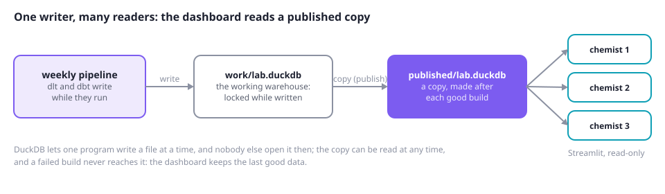
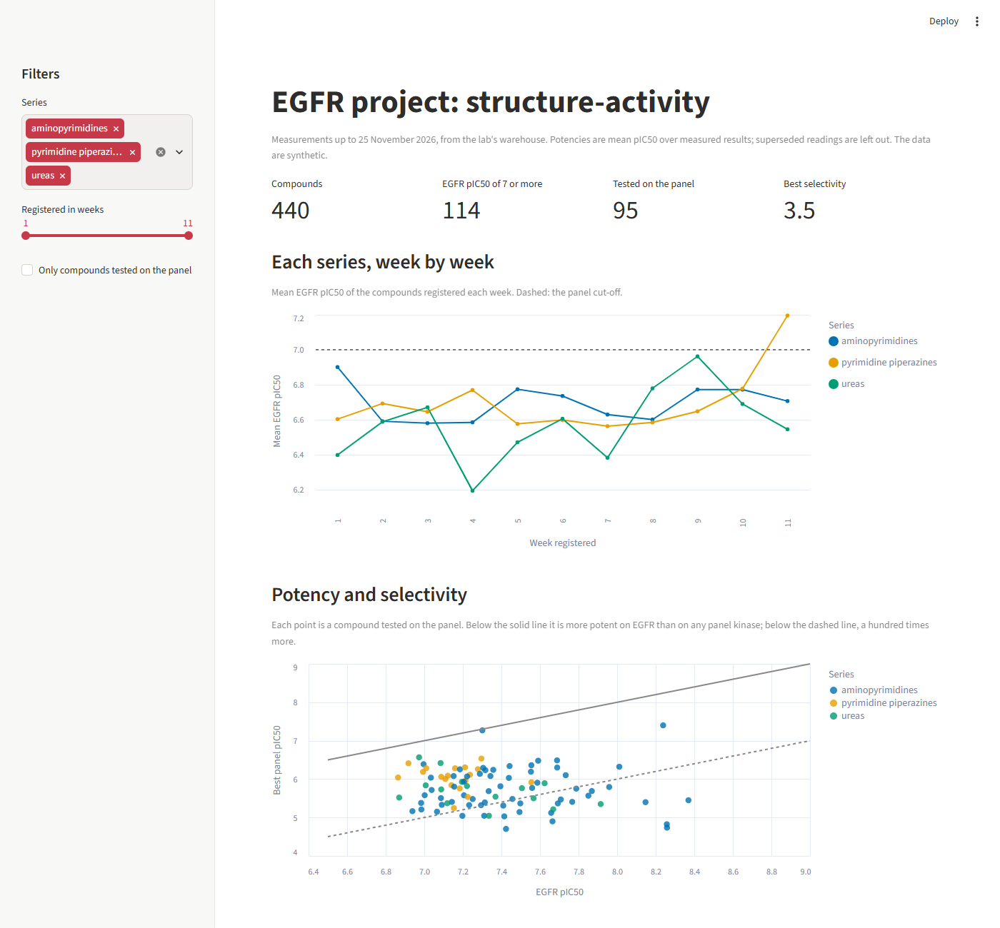

Everything so far has been for the people who run the data: layers, tests, history, flows,
checks. This module is for the people who use it. A medicinal chemist on the EGFR project asks the
same few questions every week: is each series getting better, which compounds are potent *and*
selective, is potency coming from real improvements or only from greasier molecules, and what
exactly was measured for this compound? [Module 3](../03-modelling-the-warehouse/) shaped the marts
to answer those questions with a query. A **dashboard** answers them without one: a page the
chemists open, with filters they can change and the structures in front of them.

**Streamlit** is an open-source Python library for such pages. A Streamlit **app** is a Python
script: each `st.` call puts something on the page (a title, a table, a chart, a filter), and
whenever someone changes a filter, Streamlit runs the script again from the top with the new value.
There is no web programming: the page is the script, read top to bottom.

By the end of this module you will be able to:

- write a Streamlit app that reads the warehouse's marts, read-only, with caching;
- add filters, headline numbers, charts (with Altair) and a table that shows chemical structures;
- give each compound a page with its measurements and its registration history;
- choose colours that everyone can tell apart, and say what the numbers are;
- test the app with Streamlit's **AppTest**, which runs it without a browser and checks what it
  shows, and run it for real on your own computer.

## Setup

The warehouse is the lab's at the end of the project, week 12, built as in Module 6
(`labstack.warehouse_at`). Then the build is **published**: copied, whole, to
`work/published/lab.duckdb`, the file the dashboard reads. DuckDB lets one program write to a file
at a time, and while it writes, no other program can open the file, so a dashboard reading the
working warehouse would be locked out every time the pipeline builds. A copy made after each good
build (the job of the `publish` task of [Module 7](../07-orchestration/)) can be read at any time.
`COPY FROM DATABASE` copies every schema and table of one database into another, which `ATTACH`
has opened alongside it.



The app is written to `work/dashboard.py`, part by part: `add` appends a part to the file. `AppTest` comes from Streamlit's testing tools. The logging filter hides one
warning Streamlit prints, with the time, whenever an app runs outside a browser session, which is
exactly what a test does.

```python
import json
import logging
import shutil
from pathlib import Path

import duckdb
from streamlit.testing.v1 import AppTest

import labdata
import labstack

logging.basicConfig(level=logging.INFO, format="%(levelname)s %(message)s", force=True)
log = logging.getLogger(__name__)
logging.getLogger("streamlit.runtime.scriptrunner_utils.script_run_context").addFilter(
    lambda record: "missing ScriptRunContext" not in record.getMessage())  # expected in a test

# where the lesson writes its files (git-ignored); change it to write somewhere else
WORK = Path("work")
WAREHOUSE = WORK / "lab.duckdb"
PUBLISHED = WORK / "published" / "lab.duckdb"  # the copy the dashboard reads
APP = WORK / "dashboard.py"

shutil.rmtree(WORK, ignore_errors=True)  # start clean
lab = labdata.Lab()
labstack.warehouse_at(lab, labdata.WEEKS, WORK)
PUBLISHED.parent.mkdir(parents=True)
with duckdb.connect(str(WAREHOUSE)) as db:
    db.execute(f"ATTACH '{PUBLISHED.as_posix()}' AS published")
    db.execute("COPY FROM DATABASE lab TO published")
    db.execute("DETACH published")  # let go of the copy, so readers can open it


def add(code: str) -> None:
    """Append one part to the app's file."""
    with APP.open("a", encoding="utf-8", newline="\n") as app:
        app.write(code.lstrip("\n") + "\n\n")


def run_app() -> AppTest:
    """Run the app as it is so far, without a browser, and return what it shows."""
    app = AppTest.from_file(str(APP.resolve()), default_timeout=120).run()
    assert not app.exception, app.exception[0].message  # the app must run without an error
    return app
```

`run_app` is the test: it runs the whole app once, as a browser visit would, and gives back every
element on the page, so the lesson can print what a chemist would see. If the app raised an error,
the `assert` stops the lesson with Streamlit's message.

## 1. The data, read once

The app's first part sets up the page and reads the data. Three decisions matter more than the code:

- **Read-only, from the published copy.** The app opens `work/published/lab.duckdb` with
  `read_only=True`. A dashboard should never be able to change what it shows, and DuckDB lets any
  number of readers share a file that nobody is writing. The environment variable `LAB_PUBLISHED`
  can point it at another copy.
- **Cached.** Streamlit runs the script again on every click, and reading the warehouse every time
  would make every click slow. `@st.cache_data` keeps a function's result for the same arguments,
  and `ttl=600` (time to live) throws it away after ten minutes, so new data appears within ten
  minutes of a build.
- **From the marts, not the raw layer.** The app reads `marts.measurements_wide` (Module 3, built by
  dbt and tested every week) and the compound dimension, and leaves out superseded readings, as the
  wide view already does. One mean pIC50 per compound and target, from measured values only (Module
  3, section 6), and a count of the results that were only bounds.

```python
add('''
"""The EGFR project's structure-activity dashboard (Series 2, Module 10).

Run it with: streamlit run work/dashboard.py   (from the module's folder)
"""

import base64
import os

import altair as alt
import duckdb
import pandas as pd
import streamlit as st
from rdkit import Chem, RDLogger
from rdkit.Chem import Draw

RDLogger.DisableLog("rdApp.*")
WAREHOUSE = os.environ.get("LAB_PUBLISHED", "work/published/lab.duckdb")  # published, read-only
PANEL_CUTOFF = 7.0  # EGFR pIC50 at which a compound goes on to the selectivity panel
# one colour per series, from Okabe and Ito's palette: distinct with colour-vision deficiency
SERIES_COLOURS = {"aminopyrimidines": "#0072B2", "pyrimidine piperazines": "#E69F00",
                  "ureas": "#009E73"}

st.set_page_config(page_title="EGFR project: structure-activity", layout="wide")


@st.cache_data(ttl=600)
def load(sql: str) -> pd.DataFrame:
    """Run one query on the warehouse, read-only; the answer is kept for ten minutes."""
    with duckdb.connect(WAREHOUSE, read_only=True) as db:
        return db.sql(sql).df()


potency = load("""
    SELECT w.compound_id, w.parent_smiles, w.series, w.chemist, w.mw, w.clogp, w.target,
           c.registered_on,
           avg(w.pic50) FILTER (WHERE w.relation = '=')   AS pic50,
           count(*) FILTER (WHERE w.relation = '>')       AS bounds
    FROM marts.measurements_wide AS w
    JOIN marts.dim_compound AS c USING (compound_id)
    GROUP BY ALL
""")
start = load("SELECT min(date_key) AS d FROM marts.dim_date")["d"][0]
potency["week"] = (potency["registered_on"] - start).dt.days // 7 + 1
newest = load("SELECT max(run_date) AS d FROM marts.fact_measurement")["d"][0]

st.title("EGFR project: structure-activity")
st.caption(f"Measurements up to {newest:%d %B %Y}, from the lab's warehouse. Potencies are mean "
           "pIC50 over measured results; superseded readings are left out. The data are synthetic.")
''')
app = run_app()
print(app.title[0].value)
print(app.caption[0].value)
```
```output
EGFR project: structure-activity
Measurements up to 25 November 2026, from the lab's warehouse. Potencies are mean pIC50 over measured results; superseded readings are left out. The data are synthetic.
```

The page has its title and says where its numbers come from and what they are. That caption is part
of the dashboard, not decoration: a number a chemist cannot trace is a number they should not use.

## 2. Filters and headline numbers

The second part turns the long table of potencies into one row per compound (EGFR in one column,
the best panel kinase in another), works out each compound's selectivity and **lipophilic
efficiency** (LipE, Module 3, section 7), and adds filters in the **sidebar**, the panel at the left
of the page: which series, which weeks of registration, and whether to show only compounds that
have been through the panel. Every later part uses the filtered table, `shown`.

Then four **metrics**, the large numbers a page opens with: how many compounds are shown, how many
reached the panel cut-off, how many went through the panel, and the best selectivity among them.
`st.columns(4)` lays them side by side.

```python
add('''
wide = potency.pivot_table(index=["compound_id", "parent_smiles", "series", "chemist", "week",
                                  "mw", "clogp"], columns="target", values="pic50").reset_index()
panel = [t for t in ["ABL1", "BRAF", "CDK2", "JAK2"] if t in wide]
wide["best_panel"] = wide[panel].max(axis=1)  # the panel kinase it hits hardest
wide["selectivity"] = wide["EGFR"] - wide["best_panel"]  # 2 = a hundred times more potent on EGFR
wide["lipe"] = wide["EGFR"] - wide["clogp"]

with st.sidebar:
    st.header("Filters")
    series = st.multiselect("Series", list(SERIES_COLOURS), default=list(SERIES_COLOURS))
    weeks = st.slider("Registered in weeks", 1, int(wide["week"].max()), (1, int(wide["week"].max())))
    panel_only = st.checkbox("Only compounds tested on the panel")

shown = wide[wide["series"].isin(series) & wide["week"].between(*weeks)]
if panel_only:
    shown = shown[shown["best_panel"].notna()]

tested = shown[shown["best_panel"].notna()]
columns = st.columns(4)
columns[0].metric("Compounds", len(shown))
columns[1].metric(f"EGFR pIC50 of {PANEL_CUTOFF:g} or more", int((shown["EGFR"] >= PANEL_CUTOFF).sum()))
columns[2].metric("Tested on the panel", len(tested))
columns[3].metric("Best selectivity", f"{tested['selectivity'].max():.1f}" if len(tested) else "-")
''')
app = run_app()
print({metric.label: metric.value for metric in app.metric})
app.sidebar.multiselect[0].set_value(["ureas"])
app.sidebar.slider[0].set_value((1, 6))
app.run()
print({metric.label: metric.value for metric in app.metric})
```
```output
{'Compounds': '440', 'EGFR pIC50 of 7 or more': '114', 'Tested on the panel': '95', 'Best selectivity': '3.5'}
{'Compounds': '53', 'EGFR pIC50 of 7 or more': '8', 'Tested on the panel': '6', 'Best selectivity': '2.6'}
```

The test did what a chemist would: it chose only the ureas registered in the first six weeks, and the
app ran again with those filters. `set_value` changes a widget and `run` reruns the script, so every
filter can be tested without a browser.

## 3. Each series' progress

The project's first question: is each series improving? The chart shows the mean EGFR pIC50 of the
compounds registered each week, one line per series. It is drawn with **Altair**, which Streamlit
uses for charts: a chart is the data, a **mark** (lines, points) and an **encoding** (which column
goes on which axis, and which decides the colour). Three choices make it honest and readable:

- the colours are fixed per series (`scale=alt.Scale(domain=..., range=...)`), so a series keeps its
  colour whatever the filters, and they are colours that people with colour-vision deficiency can
  tell apart;
- the y axis starts where the data are, not at zero (a pIC50 of zero means nothing), and is
  labelled with its unit;
- a dashed line marks the panel cut-off, so "good enough to go on" is on the chart.

```python
add('''
st.subheader("Each series, week by week")
st.caption("Mean EGFR pIC50 of the compounds registered each week. Dashed: the panel cut-off.")
by_week = (shown.dropna(subset=["EGFR"])
           .groupby(["week", "series"], as_index=False)["EGFR"].mean())
colour = alt.Color("series:N", title="Series",
                   scale=alt.Scale(domain=list(SERIES_COLOURS), range=list(SERIES_COLOURS.values())))
lines = alt.Chart(by_week).mark_line(point=True).encode(
    x=alt.X("week:O", title="Week registered"),
    y=alt.Y("EGFR:Q", title="Mean EGFR pIC50", scale=alt.Scale(zero=False)),
    color=colour,
    tooltip=["series", "week", alt.Tooltip("EGFR:Q", format=".2f")],
)
cutoff = alt.Chart(pd.DataFrame({"y": [PANEL_CUTOFF]})).mark_rule(strokeDash=[4, 4]).encode(y="y")
st.altair_chart(lines + cutoff, width="stretch")
''')
app = run_app()
charts = app.get("vega_lite_chart")
print(len(charts), "chart; its marks:",
      [layer["mark"]["type"] for layer in json.loads(charts[0].proto.spec)["layer"]])
```
```output
1 chart; its marks: ['line', 'rule']
```

The test cannot see the picture, but it can check that the chart is there and what it is made of: a
line layer and a rule layer. (`json.loads` reads the chart's specification, which Altair writes
as JSON.)

## 4. Potency against selectivity

The project's second question: which compounds are potent *and* selective? A scatter plot answers it
at a glance: EGFR pIC50 across, best panel pIC50 up, one point per compound tested on the panel. The
diagonal is "as potent on the panel as on EGFR"; points far below it are the selective ones, and the
second line marks a hundredfold selectivity (2 log units). Hovering over a point shows the compound.

```python
add('''
st.subheader("Potency and selectivity")
st.caption("Each point is a compound tested on the panel. Below the solid line it is more potent on "
           "EGFR than on any panel kinase; below the dashed line, a hundred times more.")
low, high = 6.5, 9.0  # only compounds at the panel cut-off (7) or near it reach the panel
guides = pd.DataFrame({"x": [low, high], "same": [low, high], "fold100": [low - 2, high - 2]})
points = alt.Chart(tested).mark_circle(size=70, opacity=0.8).encode(
    x=alt.X("EGFR:Q", title="EGFR pIC50", scale=alt.Scale(domain=[low, high])),
    y=alt.Y("best_panel:Q", title="Best panel pIC50", scale=alt.Scale(domain=[4.0, high])),
    color=colour,
    tooltip=["compound_id", "series", alt.Tooltip("EGFR:Q", format=".2f"),
             alt.Tooltip("best_panel:Q", format=".2f"), alt.Tooltip("selectivity:Q", format=".2f")],
)
same = alt.Chart(guides).mark_line(color="#888888").encode(x="x", y="same")
fold100 = alt.Chart(guides).mark_line(color="#888888", strokeDash=[4, 4]).encode(x="x", y="fold100")
st.altair_chart(points + same + fold100, width="stretch")
''')
app = run_app()
print(len(app.get("vega_lite_chart")), "charts")
```
```output
2 charts
```

## 5. A table of structures

Chemists think in structures, so the table shows them. RDKit draws each parent as an SVG picture
(Series 1, Module 5, "Seeing the molecules"); `base64` turns the picture into text that can sit
inside the table as a **data URL** (an image carried in its own address); and Streamlit's
`ImageColumn` shows it. `column_config` also names each column and gives its numbers a format, so
the table reads like a report, not like a database.

```python
add('''
@st.cache_data
def picture(smiles: str) -> str:
    """The molecule drawn as an SVG picture, as a data URL a table can show."""
    svg = Draw.MolsToGridImage([Chem.MolFromSmiles(smiles)], subImgSize=(220, 160), useSVG=True)
    return "data:image/svg+xml;base64," + base64.b64encode(svg.encode()).decode()


st.subheader("The most potent compounds")
best = shown.dropna(subset=["EGFR"]).sort_values("EGFR", ascending=False).head(25).copy()
best["structure"] = best["parent_smiles"].map(picture)
st.dataframe(
    best[["structure", "compound_id", "series", "chemist", "EGFR", "selectivity", "clogp", "lipe"]],
    column_config={
        "structure": st.column_config.ImageColumn("Structure", width="medium"),
        "compound_id": "Compound",
        "EGFR": st.column_config.NumberColumn("EGFR pIC50", format="%.2f"),
        "selectivity": st.column_config.NumberColumn("Selectivity", format="%.2f",
                                                     help="EGFR pIC50 minus best panel pIC50"),
        "clogp": st.column_config.NumberColumn("cLogP", format="%.2f"),
        "lipe": st.column_config.NumberColumn("LipE", format="%.2f", help="pIC50 minus cLogP"),
    },
    hide_index=True, row_height=110,
)
''')
app = run_app()
table = app.dataframe[0].value
print(table.drop(columns="structure").head(5).round(2).to_string(index=False))
print("every row has a picture:", table["structure"].str.startswith("data:image/svg+xml").all())
```
```output
compound_id           series chemist  EGFR  selectivity  clogp  lipe
   LAB-0023 aminopyrimidines      CN  8.37         2.92   4.82  3.55
   LAB-0340 aminopyrimidines      BK  8.26         3.52   3.93  4.33
   LAB-0246 aminopyrimidines      AO  8.26         3.43   4.17  4.09
   LAB-0269 aminopyrimidines      BK  8.24         0.84   3.98  4.26
   LAB-0267 aminopyrimidines      DS  8.15         2.75   3.19  4.96
every row has a picture: True
```

The first rows are the compounds the project would discuss on Monday, with what makes them
interesting next to their potency: their selectivity and LipE. `picture` is cached too, so each
structure is drawn once, not on every click.

## 6. A page for each compound

The last question is about one compound: what exactly was measured, and is this the structure that
was measured? A select box chooses the compound; the app shows its structure, every measurement
(superseded readings included, marked as such, because this is the record), and its registration
history from `dim_compound_history` (Module 6). `st.columns` puts the picture beside the tables.

```python
add('''
st.subheader("One compound")
choice = st.selectbox("Compound", sorted(wide["compound_id"]), index=None,
                      placeholder="Choose a compound")
if choice:
    measurements = load(f"""
        SELECT t.target, f.run_date, f.plate, f.replicate, f.relation, f.ic50_nm,
               round(f.pic50, 2) AS pic50, f.status
        FROM marts.fact_measurement AS f
        JOIN marts.dim_compound AS c USING (compound_key)
        JOIN marts.dim_target AS t USING (target_key)
        WHERE c.compound_id = '{choice}'
        ORDER BY f.run_date, t.target, f.replicate, f.status DESC
    """)
    history = load(f"""
        SELECT version, valid_from, valid_to, parent_smiles
        FROM marts.dim_compound_history WHERE compound_id = '{choice}' ORDER BY version
    """)
    left, right = st.columns([1, 2])
    left.image(picture(history["parent_smiles"].iloc[-1]), caption=f"{choice}, as registered now")
    right.dataframe(measurements, hide_index=True)
    if len(history) > 1:
        right.warning(f"{choice}'s registration changed {len(history) - 1} time(s): "
                      "measurements before the change were made under an earlier structure.")
    right.dataframe(history, hide_index=True)
''')
app = run_app()
app.selectbox[0].set_value("LAB-0042").run()
print([warning.value for warning in app.warning])
print(app.dataframe[1].value.to_string(index=False))
print(app.dataframe[2].value.drop(columns="parent_smiles").to_string(index=False))
```
```output
["LAB-0042's registration changed 1 time(s): measurements before the change were made under an earlier structure."]
target   run_date  plate  replicate relation  ic50_nm  pic50 status
  EGFR 2026-09-23 P03-03          1        =    22.20   7.65  final
  EGFR 2026-09-23 P03-03          2        =     6.67   8.18  final
  ABL1 2026-09-30 P04-01          1        = 25500.00   4.59  final
  ABL1 2026-09-30 P04-01          2        = 16300.00   4.79  final
  BRAF 2026-09-30 P04-01          1        =  9180.00   5.04  final
  BRAF 2026-09-30 P04-01          2        = 19800.00   4.70  final
  CDK2 2026-09-30 P04-01          1        > 30000.00   4.52  final
  CDK2 2026-09-30 P04-01          2        > 30000.00   4.52  final
  JAK2 2026-09-30 P04-01          1        =  3660.00   5.44  final
  JAK2 2026-09-30 P04-01          2        =  5460.00   5.26  final
 version valid_from   valid_to
       1 2026-09-14 2026-10-19
       2 2026-10-19        NaT
```

LAB-0042 shows what a dashboard built on the warehouse of Modules 2 to 9 can say that a spreadsheet
could not: its current structure, every result with its status, and a warning that the measurements
were made while the registry held a different structure, with the history to prove it. (`choice`
comes from the select box, which only offers IDs from the warehouse, so putting it in the SQL is
safe here; with free text from a user it would not be: [Series 1, Module
4](../../series-1/04-databases-and-schemas/), section 8, shows the attack and the cure.)

## 7. Running it

The app is a file, and Streamlit serves it as a web page. On your own computer, in a terminal in
the module's folder (after running the lesson, so the warehouse exists):

```bash
uv run streamlit run work/dashboard.py
```

Streamlit prints a local address, usually <http://localhost:8501>, and opens it in your browser.
Change a filter and watch the page run again. This is what it looks like:



In Colab there is no browser on the machine that runs the code, so the lesson's tests are the way
to check the app there; Colab can forward the app's port to your browser, but the steps change from
time to time, so the course does not rely on them. For the lab, the app runs on a server next to
the warehouse, started like the flow of [Module 7](../07-orchestration/) and refreshed by its
weekly build; [Streamlit's documentation](https://docs.streamlit.io/deploy) lists the ways to
deploy it, from a single server to managed hosting.

The whole app is about 150 lines, and every part was tested before anyone opened it. In
[Module 11](../11-capstone/) you build the whole stack for a lab of your own, from the files to a
dashboard like this one.

## Try it yourself

The homework is a few questions, answered by running code like the code above: in a new cell at
the end of the notebook, or in a script. It is at the end of the lesson's page, and in
`homework.md` in the module's folder. The answers are published after the cohort's deadline.

## Further reading

- The Streamlit documentation. *Main concepts*: the script that reruns, widgets, caching and the
  testing framework. <https://docs.streamlit.io/develop/concepts>
- The Streamlit documentation. *App testing*: `AppTest`, its elements and widgets.
  <https://docs.streamlit.io/develop/concepts/app-testing>
- Satyanarayan, A., Moritz, D., Wongsuphasawat, K. & Heer, J. (2017). Vega-Lite: A Grammar of
  Interactive Graphics. *IEEE Transactions on Visualization and Computer Graphics*, 23(1),
  341–350. <https://doi.org/10.1109/TVCG.2016.2599030>
- Okabe, M. & Ito, K. (2008). *Color Universal Design (CUD): How to make figures and presentations
  that are friendly to colorblind people*. <https://jfly.uni-koeln.de/color/>
- Leeson, P. D. & Springthorpe, B. (2007). The influence of drug-like concepts on decision-making
  in medicinal chemistry. *Nature Reviews Drug Discovery*, 6(11), 881–890.
  <https://doi.org/10.1038/nrd2445>
